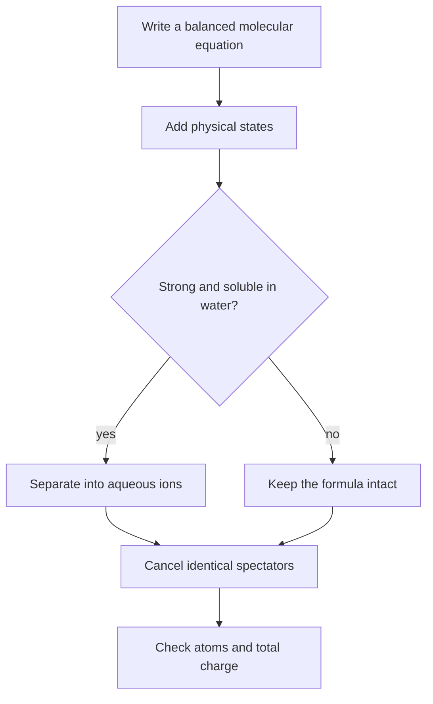

# Aqueous Reactions and Solution Stoichiometry

An aqueous reaction starts before any arithmetic: decide what particles the dissolved substances actually produce. Sodium chloride solution contains hydrated sodium and chloride ions, not intact $\mathrm{NaCl}$ molecules. Acetic acid solution contains mostly acetic acid molecules with smaller equilibrium amounts of ions. That distinction controls the equation, the stoichiometric ratio, and whether a reaction occurs at all.

Most introductory aqueous reactions have a recognizable driving change: a solid precipitates, a weak electrolyte forms, a gas escapes, a stable complex forms, or electrons move between species. If every ion remains unchanged in solution, there is no net ionic reaction even when two solutions have been poured together.

## Dissolving does not always mean ionizing

Water is polar. Its oxygen end points toward cations and its hydrogen ends toward anions, producing hydration shells that stabilize separated ions. When hydration and entropy compensate for breaking the ionic lattice, an ionic solid dissolves.

An **electrolyte** produces mobile ions and allows a solution to conduct current. Strong electrolytes include soluble ionic compounds and strong acids; they are represented as separated ions in aqueous equations. Weak electrolytes ionize only partly and remain largely molecular. Nonelectrolytes such as sucrose may dissolve readily but do not produce substantial ion concentrations.

| Solute type | Particle picture in water | Ionic-equation treatment |
|---|---|---|
| soluble ionic salt | separated hydrated ions | split into ions |
| strong acid or base | essentially complete ionization | split into ions |
| weak acid or base | mostly molecules plus some ions | keep molecular formula |
| nonelectrolyte | dissolved neutral molecules | keep molecular formula |
| insoluble ionic solid | solid lattice | keep formula with $(s)$ |

The words *strong* and *weak* refer to degree of ionization, whereas *concentrated* and *dilute* refer to amount per volume. A dilute solution of HCl is still a strong electrolyte. A concentrated solution of acetic acid remains weak in the equilibrium sense.

## Molecular, complete ionic, and net ionic equations

A molecular equation writes neutral compound formulas and is useful for reagent bookkeeping. A complete ionic equation expands strong soluble electrolytes into ions. A net ionic equation cancels spectator ions and records only the chemical change.

For silver nitrate mixed with sodium chloride, the molecular equation is

$$
\mathrm{AgNO_3(aq)+NaCl(aq)\rightarrow AgCl(s)+NaNO_3(aq)}.
$$

Both aqueous reactants and aqueous sodium nitrate are strong soluble electrolytes, so the complete ionic equation is

$$
\mathrm{Ag^+(aq)+NO_3^-(aq)+Na^+(aq)+Cl^-(aq)}
\rightarrow
\mathrm{AgCl(s)+Na^+(aq)+NO_3^-(aq)}.
$$

Canceling unchanged $\mathrm{Na^+}$ and $\mathrm{NO_3^-}$ gives

$$
\mathrm{Ag^+(aq)+Cl^-(aq)\rightarrow AgCl(s)}.
$$

The final equation balances both atoms and charge. A species is a spectator only when its formula, charge, and physical state are identical on both sides. Silver appears on both sides of the molecular equation, but it changes from an aqueous ion to part of a solid and cannot be canceled.

Liquid water, gases, precipitates, and weak electrolytes remain intact. Thus strong-acid/strong-base neutralization reduces to

$$
\mathrm{H_3O^+(aq)+OH^-(aq)\rightarrow2H_2O(l)},
$$

while a weak acid reacting with hydroxide retains the acid formula:

$$
\mathrm{CH_3COOH(aq)+OH^-(aq)\rightarrow CH_3COO^-(aq)+H_2O(l)}.
$$

Splitting acetic acid on the left would falsely treat its ionization as complete.

## Predicting precipitation

Solubility rules are empirical summaries, not explanations from first principles. The most dependable common rules are that salts of group 1 cations, ammonium, nitrate, and perchlorate are soluble. Chlorides, bromides, and iodides are generally soluble except with a small set of cations such as silver and lead. Sulfates are often soluble but have notable exceptions. Carbonates, phosphates, and many hydroxides are generally insoluble except with group 1 or ammonium; several group 2 cases need individual treatment.

The rules predict whether exchanging ions creates an insoluble product. Consider $\mathrm{K_2SO_4(aq)}$ mixed with $\mathrm{BaCl_2(aq)}$. Potassium chloride remains soluble, whereas barium sulfate is poorly soluble:

$$
\mathrm{K_2SO_4(aq)+BaCl_2(aq)\rightarrow BaSO_4(s)+2KCl(aq)}.
$$

The net ionic equation is

$$
\mathrm{Ba^{2+}(aq)+SO_4^{2-}(aq)\rightarrow BaSO_4(s)}.
$$

A double-replacement pattern alone does not guarantee reaction. Mixing sodium nitrate and potassium chloride leaves all four ions aqueous; after cancellation, nothing remains. The correct conclusion is “no net reaction,” not an equation of aqueous salts exchanging partners.

## Molarity is the bridge from volume to amount

Molarity is amount of solute per liter of solution:

$$
M=\frac{n}{V},\qquad n=MV.
$$

The volume is the final solution volume, not necessarily the volume of solvent used. A volumetric flask is filled to its calibration mark after the solute is dissolved because mixing can change volume.

During a dilution, solvent is added without changing solute moles. Equating the amount before and after gives

$$
M_1V_1=M_2V_2.
$$

That relation does not apply across a chemical reaction. When reactive solutions mix, calculate each amount with $n=MV$ and then use the balanced equation.

### Worked example: preparing a diluted solution

What volume of $2.00\ \mathrm M$ sodium chloride stock is needed to prepare $250.0\ \mathrm{mL}$ of $0.150\ \mathrm M$ solution?

The required solute amount is

$$
n=(0.150\ \mathrm{mol\,L^{-1}})(0.2500\ \mathrm L)
=0.0375\ \mathrm{mol}.
$$

The stock volume containing that amount is

$$
V_1=\frac{n}{M_1}
=\frac{0.0375\ \mathrm{mol}}{2.00\ \mathrm{mol\,L^{-1}}}
=0.0188\ \mathrm L=18.8\ \mathrm{mL}.
$$

Measure $18.8\ \mathrm{mL}$ of stock, transfer it to a $250.0\ \mathrm{mL}$ volumetric flask, and dilute to the mark. Adding $250.0\ \mathrm{mL}$ of water would make more than $250.0\ \mathrm{mL}$ of solution and give the wrong concentration.

## Worked example: precipitation with a limiting ion

Mix $50.0\ \mathrm{mL}$ of $0.200\ \mathrm M$ silver nitrate with $75.0\ \mathrm{mL}$ of $0.100\ \mathrm M$ sodium chloride. Find the mass of silver chloride formed and the concentration of excess silver ion after reaction. Use $M(\mathrm{AgCl})=143.32\ \mathrm{g\,mol^{-1}}$ and assume additive volumes.

The net reaction is one-to-one:

$$
\mathrm{Ag^+ + Cl^-\rightarrow AgCl(s)}.
$$

Initial silver-ion moles are

$$
n_{Ag^+}=(0.0500\ \mathrm L)(0.200\ \mathrm{mol\,L^{-1}})
=0.0100\ \mathrm{mol}.
$$

Initial chloride moles are

$$
n_{Cl^-}=(0.0750\ \mathrm L)(0.100\ \mathrm{mol\,L^{-1}})
=0.00750\ \mathrm{mol}.
$$

Chloride is limiting, so $0.00750$ mol of precipitate forms:

$$
m_{AgCl}=(0.00750\ \mathrm{mol})(143.32\ \mathrm{g\,mol^{-1}})
=1.07\ \mathrm g.
$$

Silver remaining after the stoichiometric reaction is

$$
n_{Ag^+,\,left}=0.0100-0.00750=0.00250\ \mathrm{mol}.
$$

The combined volume is $0.0500+0.0750=0.1250\ \mathrm L$, so

$$
[Ag^+]_{\mathrm{after}}=\frac{0.00250}{0.1250}=0.0200\ \mathrm M.
$$

This calculation treats precipitation as complete, which is adequate when the solid is very insoluble and an ion remains in excess. An exact equilibrium calculation would leave a small dissolved amount governed by the solubility product.

## Titration as measured solution stoichiometry

A titration uses a solution of known concentration to determine an unknown amount. The equivalence point is the stoichiometric point set by the balanced reaction. The endpoint is the experimental signal used to estimate it. They should be close, but they are not definitions of the same event.

### Worked example: a diprotic acid assay

A $25.00\ \mathrm{mL}$ sulfuric acid sample requires $32.40\ \mathrm{mL}$ of $0.1500\ \mathrm M$ sodium hydroxide for complete neutralization. Assuming both acidic protons are titrated, find the acid molarity.

The balanced equation is

$$
\mathrm{H_2SO_4+2NaOH\rightarrow Na_2SO_4+2H_2O}.
$$

Moles of sodium hydroxide delivered are

$$
n_{NaOH}=(0.1500\ \mathrm{mol\,L^{-1}})(0.03240\ \mathrm L)
=0.004860\ \mathrm{mol}.
$$

The coefficient ratio is one mole acid per two moles base:

$$
n_{H_2SO_4}=0.004860\left(\frac{1}{2}\right)
=0.002430\ \mathrm{mol}.
$$

Dividing by the sample volume,

$$
[H_2SO_4]=\frac{0.002430\ \mathrm{mol}}{0.02500\ \mathrm L}
=0.09720\ \mathrm M.
$$

Using a one-to-one ratio would double the answer. The coefficients, rather than the words “acid” and “base,” determine the conversion.

## Gas formation, complexes, and redox changes

Some reactions proceed because an unstable product decomposes or leaves as a gas. Acid plus carbonate gives carbon dioxide and water:

$$
\mathrm{2H^+ + CO_3^{2-}\rightarrow CO_2(g)+H_2O(l)}.
$$

Sulfite similarly yields sulfur dioxide under acidic conditions. Gas evolution removes product from the solution and helps pull the reaction forward.

Complex formation can keep a metal ion dissolved or dissolve an existing precipitate. A ligand donates an electron pair to a metal center, so these are Lewis acid-base reactions. Whether precipitation or complexation dominates depends on their competing equilibrium constants and reagent concentrations.

Redox reactions require oxidation numbers and electron balance rather than ion exchange alone. For zinc metal in copper(II) solution,

$$
\mathrm{Zn(s)+Cu^{2+}(aq)\rightarrow Zn^{2+}(aq)+Cu(s)}.
$$

Zinc loses two electrons and copper(II) gains two. Spectator anions are removed from the net ionic equation, but the changing metal ions remain.

## Checks that prevent bookkeeping errors

- State symbols determine whether a formula separates into ions. Never split a solid precipitate merely because it is ionic.
- Only strong soluble electrolytes are expanded. Weak acids, weak bases, water, and gases keep their molecular forms.
- Milliliters must be converted to liters for $n=MV$. A ratio such as $M_1V_1=M_2V_2$ can use matching volume units because they cancel.
- A dilution conserves solute; a reaction consumes it. Applying the dilution equation to reacting solutions erases the stoichiometry.
- Charge balance is as important as atom balance in a net ionic equation. A balanced-looking formula with unequal total charge cannot represent the reaction.
- Solubility rules predict the dominant result, but sparingly soluble does not mean absolutely zero concentration. Equilibrium matters when residual-ion concentrations are requested precisely.

## Preparing solutions from solids and stocks

A target molarity can be prepared from a pure solid by calculating the required amount, weighing it, dissolving it in less than the final volume, and diluting to the calibration mark. For $250.0\ \mathrm{mL}$ of $0.1000\ \mathrm M$ sodium carbonate, the required amount is

$$
n=(0.1000)(0.2500)=0.02500\ \mathrm{mol}.
$$

With molar mass $105.99\ \mathrm{g\,mol^{-1}}$,

$$
m=(0.02500)(105.99)=2.650\ \mathrm g.
$$

The weighed solid is transferred quantitatively. Rinsing the weighing vessel and funnel into the flask prevents an unrecorded loss. Solvent is added close to the mark, the solution is allowed to reach calibration temperature if dissolution changed it, and the meniscus is brought to the mark before thorough mixing.

Not every reagent is suitable as a primary standard. A primary standard should be sufficiently pure, stable in air, nonhygroscopic or well characterized, and have a reliable formula mass. Sodium hydroxide solutions absorb water and carbon dioxide, so their concentration is usually determined by standardization rather than assumed from the weighed pellets.

Serial dilution is useful when the needed aliquot from a concentrated stock would be too small to measure accurately. Each stage carries uncertainty, so the chosen volumes should remain well within calibrated glassware ranges. Dilution changes concentration but not the chemical amount of solute transferred into that stage.

## Gravimetric analysis from a precipitate

Precipitation can determine an unknown analyte by converting it to a solid of known composition. The precipitate is filtered, washed, dried or ignited to a defined form, and weighed. Stoichiometry then relates precipitate mass to analyte amount.

Suppose chloride in a $0.5000\ \mathrm g$ sample is precipitated as $0.2870\ \mathrm g$ AgCl. Using $M(\mathrm{AgCl})=143.32\ \mathrm{g\,mol^{-1}}$,

$$
n_{AgCl}=\frac{0.2870}{143.32}=0.002002\ \mathrm{mol}.
$$

Each mole of AgCl contains one mole of chloride, so

$$
n_{Cl^-}=0.002002\ \mathrm{mol}.
$$

With $M(Cl)=35.45\ \mathrm{g\,mol^{-1}}$,

$$
m_{Cl}=(0.002002)(35.45)=0.07097\ \mathrm g.
$$

The chloride mass percentage is

$$
\frac{0.07097}{0.5000}\times100\%=14.19\%.
$$

Incomplete precipitation biases the result low. Retained solution, inadequate washing, or coprecipitated impurities can bias the mass high. Excess precipitating reagent helps completeness, but an enormous excess can promote other equilibria or contamination. Digestion of a warm precipitate can grow larger crystals that filter more cleanly.

## Equivalent reasoning and why coefficients still matter

Older analytical language often uses equivalents: one equivalent supplies or consumes one mole of reactive charge, protons, hydroxide, or electrons in a specified reaction. Although normality can shorten titration arithmetic, its value depends on the reaction. One mole of sulfuric acid represents two acid equivalents only when both protons participate. The same solution can have different equivalent interpretations in different chemistry.

Mole-based stoichiometry keeps the reaction dependence explicit. Write the balanced equation, convert measured volume to moles, and apply coefficients. This longer-looking route prevents hidden assumptions about how many protons or electrons are involved.

Back titration uses that same logic when direct titration is slow or inconvenient. Add a known excess of reagent to the sample, allow reaction to finish, and titrate the unused excess with a second standard. The sample consumed the difference between amount added and amount remaining.

For example, if $0.01000$ mol acid is added to a carbonate sample and the leftover acid requires $0.00320$ mol hydroxide, then $0.00680$ mol acid was consumed by the sample. The carbonate amount is half that value when the complete reaction consumes two protons per carbonate:

$$
n_{CO_3^{2-}}=\frac{0.00680}{2}=0.00340\ \mathrm{mol}.
$$

Subtracting volumes instead of moles would be valid only if the two titrants had matching concentration and one-to-one reactive capacity.

## Solution reactions as competing equilibria

The net ionic equation records the dominant change, but several equilibria can compete. A precipitate may redissolve in acid or in a ligand that forms a stable complex. Carbonate precipitates dissolve in acid because protonation removes carbonate from the solubility equilibrium and carbon dioxide can escape. Silver chloride dissolves in concentrated ammonia because silver forms a soluble ammine complex.

These examples explain why a list of solubility rules cannot predict every mixed solution. The initial precipitation tendency, acid-base chemistry, complex formation, and redox chemistry may all need comparison. In routine problems one driving reaction is selected deliberately; in actual samples, masking agents, pH control, and separation steps are used to suppress interference.

Order of addition can matter when competing reactions exist. Adding a concentrated precipitant locally may create temporary excess, trap impurities, or form a different solid from slow addition into a well-stirred sample. Heating can improve crystal growth yet also change solubility. A balanced net ionic equation identifies overall stoichiometry but does not specify a reliable laboratory procedure.

Volume additivity is another approximation. Introductory mixture problems usually add solution volumes, but concentrated solutions may contract or expand on mixing. Precise concentration work prepares or measures the final volume rather than assuming it from separate volumes. The distinction becomes important when a small concentration error propagates into a reported assay.

See also: [stoichiometry](/chemistry/general/stoichiometry) · [acids, bases, and pH](/chemistry/general/acids-bases-and-ph) · [solubility and complex-ion equilibria](/chemistry/general/solubility-and-complex-ion-equilibria) · [electrochemistry](/chemistry/general/electrochemistry)

