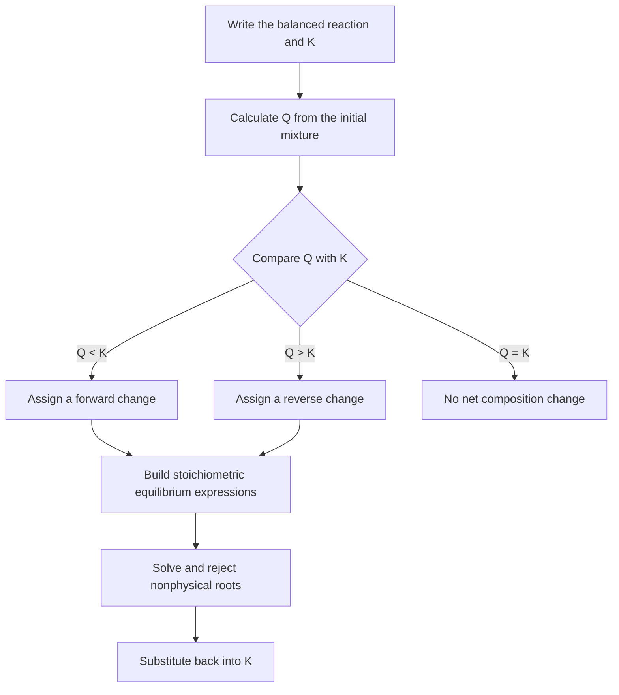

# Chemical Equilibrium

Chemical equilibrium is dynamic. Individual forward and reverse events continue, but their rates are equal and the macroscopic composition no longer changes. A sealed vessel at equilibrium therefore looks static without being molecularly frozen.

The equilibrium constant describes the composition favored at a specified temperature. It says nothing by itself about how quickly that composition is reached. Diamond converting to graphite is the familiar warning: thermodynamic favorability and observable rate are different questions.

## The mass-action expression

For a reaction written as

$$
\mathrm{aA+bB\rightleftharpoons cC+dD},
$$

the thermodynamic equilibrium constant is

$$
K=\frac{a_C^c a_D^d}{a_A^a a_B^b},
$$

where each $a_i$ is a dimensionless activity relative to a standard state. Activities account for the fact that particles in real mixtures interact. In dilute solutions, $a_i$ is often approximated by concentration divided by the standard concentration; in ideal-gas mixtures it is approximated by partial pressure divided by the standard pressure. Introductory notation usually suppresses those standard-state factors and writes $K_c$ or $K_p$.

Pure solids and pure liquids are omitted because their activities are essentially constant at fixed temperature and pressure. For

$$
\mathrm{CaCO_3(s)\rightleftharpoons CaO(s)+CO_2(g)},
$$

the pressure-form expression is simply

$$
K_p=P_{CO_2}.
$$

Adding more calcium carbonate does not alter the equilibrium carbon dioxide pressure while both solid phases remain. Removing an entire phase can change the constraints, so “solids never matter” is too broad; their amounts do not appear in $K$, but their presence can be required for that heterogeneous equilibrium to exist.

The exponents come from the balanced reaction as written. Consequently:

| Change to the written equation | New equilibrium constant |
|---|---|
| reverse every species | $K^{-1}$ |
| multiply all coefficients by $n$ | $K^n$ |
| add reactions | multiply their constants |

These rules follow directly from manipulating the activity quotients. They also mean that quoting a numerical $K$ without the corresponding balanced equation is incomplete.

## What the size of $K$ does and does not say

If $K\gg1$, products predominate at equilibrium for ordinary starting compositions. If $K\ll1$, reactants predominate. A value near 1 permits appreciable amounts on both sides. “Predominate” does not mean “only”: even a very large finite constant allows some reactant, and a small constant allows some product.

The numerical size also depends on how the reaction is written. Squaring all coefficients squares $K$, and reversing the equation replaces it with its reciprocal. Classification as product-favored or reactant-favored must use the stated direction.

Equilibrium constants depend on temperature. Concentration, pressure, and catalysts can change the equilibrium composition or the time required to reach it, but at a fixed temperature they do not change the thermodynamic $K$. A catalyst lowers activation barriers for both directions and speeds relaxation toward the same equilibrium.

The link to thermodynamics is

$$
\Delta_rG^\circ=-RT\ln K.
$$

A large $K$ corresponds to negative standard reaction Gibbs energy. Away from standard composition,

$$
\Delta_rG=\Delta_rG^\circ+RT\ln Q=RT\ln\frac{Q}{K}.
$$

The last form shows why the comparison of $Q$ and $K$ predicts spontaneous direction: when $Q\lt K$, the forward reaction has $\Delta_rG\lt 0$; when $Q\gt K$, the reverse direction lowers Gibbs energy. At equilibrium $Q=K$ and $\Delta_rG=0$ for an infinitesimal advance of the reaction.

## The reaction quotient locates the current mixture

The reaction quotient $Q$ has the same form as $K$ but uses the present, possibly nonequilibrium composition:

- $Q\lt K$: net change proceeds toward products.
- $Q\gt K$: net change proceeds toward reactants.
- $Q=K$: the composition is at equilibrium.

For

$$
\mathrm{H_2(g)+I_2(g)\rightleftharpoons2HI(g)},
$$

let $K_c=50.0$ and suppose $[H_2]=[I_2]=0.100\ \mathrm M$ and $[HI]=0.500\ \mathrm M$. Then

$$
Q_c=\frac{(0.500)^2}{(0.100)(0.100)}=25.0.
$$

Because $25.0\lt 50.0$, the forward reaction occurs. It raises $[HI]$ and lowers both reactant concentrations, increasing $Q_c$ until it reaches 50.0.

If a denominator is initially zero while products are present, $Q$ tends to infinity and the reaction proceeds in reverse. If the numerator is zero and reactants are present, $Q=0$ and the forward direction is selected. These limiting cases are often easier to reason about before using a calculator.

## ICE tables encode conservation

An ICE table lists initial concentration or pressure, stoichiometric change, and equilibrium composition. It is not a separate law; it is a compact material balance. For a reaction advance $x$, every change must follow the coefficients.

### Worked example: dinitrogen tetroxide dissociation

For

$$
\mathrm{N_2O_4(g)\rightleftharpoons2NO_2(g)},
$$

take $K_c=0.36$, initial $[N_2O_4]=1.00\ \mathrm M$, and initial $[NO_2]=0$.

Because there is initially no product, $Q_c=0$ and the reaction proceeds forward. Let $x$ molar $\mathrm{N_2O_4}$ dissociate:

$$
\begin{array}{c|cc}
&\mathrm{N_2O_4}&\mathrm{NO_2}\\ \hline
I&1.00&0\\
C&-x&+2x\\
E&1.00-x&2x
\end{array}
$$

Substitution gives

$$
0.36=\frac{(2x)^2}{1.00-x}.
$$

Rearrange:

$$
4x^2+0.36x-0.36=0.
$$

The quadratic formula gives

$$
x=\frac{-0.36\pm\sqrt{(0.36)^2-4(4)(-0.36)}}{8}.
$$

The two roots are approximately $0.258$ and $-0.348$. The negative root would make a negative product concentration and contradict the forward direction, so it is rejected. Therefore,

$$
[N_2O_4]=1.00-0.258=0.742\ \mathrm M,
$$

$$
[NO_2]=2(0.258)=0.516\ \mathrm M.
$$

Substitution checks the result:

$$
\frac{(0.516)^2}{0.742}=0.359,
$$

which agrees with $0.36$ within rounding.

## When the small-change approximation works

If $K$ is small and reactant concentration is reasonably large, an equilibrium change may be negligible in a sum or difference. For

$$
\mathrm{A\rightleftharpoons B},
$$

with initial $[A]=C$ and no B,

$$
K=\frac{x}{C-x}.
$$

Approximating $C-x\approx C$ gives $x\approx KC$. The approximation must be checked after solving, commonly by confirming $x/C\times100\%$ is below about five percent. That threshold is a convention tied to desired accuracy, not a chemical law.

Do not discard $x$ from a term that would become zero or from the only source of a species. In the dinitrogen tetroxide example, replacing $1.00-x$ by 1.00 would be testable, but dropping the $2x$ numerator would erase all product. When an approximation fails, solve the polynomial or use a numerical root method while enforcing nonnegative concentrations.

## Relating gas constants $K_p$ and $K_c$

For an ideal gas, partial pressure and molar concentration obey

$$
P_i=[i]RT.
$$

Substitute that relation into a pressure quotient. Each gaseous product contributes a factor $RT$ raised to its coefficient, and each gaseous reactant contributes one in the denominator. Therefore,

$$
K_p=K_c(RT)^{\Delta n_{\mathrm{gas}}},
$$

where

$$
\Delta n_{\mathrm{gas}}=(\text{gaseous product coefficients})-(\text{gaseous reactant coefficients}).
$$

Only gas coefficients count. Solids, liquids, and dissolved solutes are excluded from $\Delta n_{\mathrm{gas}}$.

### Worked example: converting $K_c$ to $K_p$

For

$$
\mathrm{N_2(g)+3H_2(g)\rightleftharpoons2NH_3(g)},
$$

suppose $K_c=0.500$ at $400\ \mathrm K$. Here

$$
\Delta n_{\mathrm{gas}}=2-(1+3)=-2.
$$

Using $R=0.08206\ \mathrm{L\,atm\,mol^{-1}\,K^{-1}}$ in the conventional pressure/concentration expression,

$$
\begin{aligned}
K_p&=0.500[(0.08206)(400)]^{-2}\\
&=0.500(32.824)^{-2}\\
&=4.64\times10^{-4}.
\end{aligned}
$$

The numerical values differ because the reaction changes the number of gas particles and the conventional $K_c$ and $K_p$ forms use different standard-state representations. If $\Delta n_{\mathrm{gas}}=0$, the ideal-gas expressions give the same numerical value.

## Disturbing an established equilibrium

Le Châtelier's principle says that an equilibrium responds in the direction that partly opposes a disturbance. Calculating the immediate new $Q$ is more precise.

**Changing concentration.** Adding reactant lowers $Q$ when that reactant appears in the denominator, so the reaction proceeds forward. Removing product also lowers $Q$. The shift partly consumes the disturbance; it does not generally restore every concentration to its old value.

**Changing volume or pressure.** Compressing an ideal-gas mixture at constant temperature multiplies every partial pressure by the same factor. The quotient changes according to $\Delta n_{\mathrm{gas}}$. Compression favors the side with fewer gas moles; if the gas coefficients sum equally, $Q$ does not change. Adding an inert gas at constant volume leaves reacting-gas partial pressures unchanged and causes no shift. Adding it at constant pressure expands the container, lowering those partial pressures and potentially shifting the equilibrium.

**Changing temperature.** Treat heat as a reactant for an endothermic forward reaction and as a product for an exothermic one. Raising temperature favors the endothermic direction. Unlike concentration and pressure changes, temperature changes the value of $K$ itself. The van 't Hoff relation gives the quantitative temperature dependence when the reaction enthalpy is approximately constant over the interval.

**Adding a catalyst.** A catalyst changes neither $Q$ nor $K$. It provides faster pathways for both directions, so equilibrium is reached sooner without changing the final equilibrium composition.

| Disturbance at fixed temperature | Immediate effect on $K$ | Direction test |
|---|---|---|
| add or remove a reacting species | none | recalculate $Q$ |
| change gas volume | none | recalculate $Q_p$ from partial pressures |
| add a catalyst | none | no shift; faster relaxation |
| add more pure solid while phase remains | none | no change in $Q$ |
| change temperature | changes $K$ | use endothermic/exothermic direction or new $K$ |

## Coupled reactions and overall constants

Equilibria can be combined algebraically. If reaction 1 has $K_1$ and reaction 2 has $K_2$, adding the reactions cancels any intermediate species and gives

$$
K_{\mathrm{overall}}=K_1K_2.
$$

This multiplication explains relationships such as $K_aK_b=K_w$ for a conjugate acid-base pair. It is also why a highly favorable coupled reaction can pull an otherwise unfavorable step forward. The intermediate cancels from the summed equation and from the product of the quotients.

## Checks before trusting an equilibrium calculation

- Write $K$ from the balanced equation, not from subscripts in chemical formulas. Stoichiometric coefficients become exponents.
- Keep pure solids and liquids out of the quotient, but confirm that the required phases are actually present.
- Use $Q$ to choose the sign of the ICE-table change. Guessing a direction often leads to an algebraically valid but chemically impossible root.
- Reject roots producing negative concentrations or consuming more material than was initially available.
- Verify every approximation after solving and substitute the final composition back into the original, unapproximated expression.
- Pressure changes affect equilibrium through reacting-gas partial pressures, not through a vague rule that all high pressure favors products.
- A catalyst changes rate, not $K$, $Q$, or the equilibrium composition.

## Material balance and charge balance

An ICE table is sufficient when one reaction and a few species dominate. More complicated equilibria are organized by independent equations: equilibrium expressions, material balances, charge balance, and any fixed analytical totals.

If a monoprotic acid is prepared at formal concentration $C_T$, conservation of acid-containing species gives

$$
C_T=[HA]+[A^-].
$$

Electroneutrality requires total positive charge concentration to equal total negative charge concentration. For a solution containing only that acid and water,

$$
[H_3O^+]=[A^-]+[OH^-].
$$

Together with $K_a$ and $K_w$, these equations determine the composition without assuming in advance that water or acid ionization is negligible. Approximations reduce the equations only after their relative sizes are assessed.

This framework scales to metal complexes, polyprotic acids, and solubility systems. Each conserved chemical component gets a balance; every solution gets one charge balance. Writing a separate ICE table for every reaction can double-count the same species, while the balance method keeps the shared concentrations consistent.

## Equilibrium yield versus complete conversion

Industrial reactions rarely stop at a textbook equilibrium calculation. The equilibrium conversion sets a thermodynamic ceiling for one pass under fixed conditions, while reactor residence time and catalyst determine how closely the stream approaches it. Separating products and recycling unreacted feed can raise overall process yield without changing the equilibrium constant.

The Haber reaction illustrates the compromises:

$$
\mathrm{N_2(g)+3H_2(g)\rightleftharpoons2NH_3(g)}.
$$

Lower temperature favors ammonia because the forward reaction is exothermic, but it also slows the reaction. Higher pressure favors the side with fewer gas molecules and raises equilibrium conversion, yet compression costs energy and demands stronger equipment. A catalyst improves rate at the selected conditions but cannot change the equilibrium composition.

Removing ammonia from the reacting mixture lowers $Q$ and permits more reactants to convert. This does not violate equilibrium; the system is repeatedly displaced while products are separated. The distinction between equilibrium conversion, single-pass conversion, and overall plant yield prevents misuse of Le Châtelier's principle.

## Temperature dependence in quantitative form

For two temperatures and approximately constant standard reaction enthalpy, the integrated van 't Hoff equation is

$$
\ln\frac{K_2}{K_1}
=-\frac{\Delta_rH^\circ}{R}
\left(\frac{1}{T_2}-\frac{1}{T_1}\right).
$$

The grouping must be read carefully: the enthalpy factor multiplies the reciprocal-temperature difference. If the forward reaction is endothermic, $\Delta_rH^\circ\gt 0$. Raising temperature makes $1/T_2-1/T_1$ negative, so the right side is positive and $K_2\gt K_1$. For an exothermic reaction the sign reverses.

Suppose an endothermic reaction has $K_1=2.00$ at $300\ \mathrm K$ and $\Delta_rH^\circ=50.0\ \mathrm{kJ\,mol^{-1}}$. Estimate $K_2$ at $350\ \mathrm K$:

$$
\ln\frac{K_2}{2.00}
=-\frac{50000}{8.314}
\left(\frac{1}{350}-\frac{1}{300}\right).
$$

The reciprocal-temperature difference is $-4.76\times10^{-4}\ \mathrm{K^{-1}}$, so

$$
\ln\frac{K_2}{2.00}=2.86.
$$

Therefore,

$$
K_2=2.00e^{2.86}=34.9.
$$

The large increase is consistent with heating an endothermic reaction. The constant-enthalpy assumption becomes less reliable over a wide temperature interval.

## Equilibrium with several gas reactions

When more than one independent gas reaction occurs, one extent variable is needed for each independent reaction. The equilibrium partial pressures depend on all extents and the changing total mole number. Guessing one shift at a time can miss their coupling.

An inert gas provides a useful boundary case. At fixed volume and temperature, adding it raises total pressure but leaves each reacting species amount and partial pressure $n_iRT/V$ unchanged. No reaction quotient changes. At fixed total pressure, the volume expands; reacting partial pressures fall together, and a reaction with nonzero $\Delta n_{gas}$ may shift.

The phrase “increase pressure” is therefore incomplete. Compression, inert-gas addition at fixed volume, and inert-gas addition at fixed pressure produce different partial-pressure changes even if the same total pressure is eventually displayed.

## Metastability and equilibrium

A system can remain in a metastable state when the path to lower Gibbs energy has a large activation barrier. A supersaturated solution may stay clear until a seed crystal or scratch promotes nucleation. A mixture of hydrogen and oxygen can persist until ignition despite a favorable water-forming reaction.

Such observations do not contradict thermodynamics. Equilibrium identifies the minimum available Gibbs energy, while kinetics controls access to it. When nucleation or another rare event is rate limiting, the apparent composition can remain unchanged much longer than ordinary collision times suggest.

Equilibrium sampling can also disturb the state being measured. Removing gas changes pressure, cooling a sample changes its constant, and dilution shifts association equilibria. Analytical methods should either perturb negligibly or account for the new condition. A measured composition represents the original equilibrium only when sampling, quenching, and analysis preserve or reconstruct it.

Reported constants should include temperature and the reaction convention. For ionic solutions, the concentration scale and activity model may also matter. Comparing constants from different conventions without conversion can create an apparent disagreement where none exists.

See also: [chemical kinetics](/chemistry/general/chemical-kinetics) · [acid-base equilibria, buffers, and titrations](/chemistry/general/acid-base-equilibria-buffers-and-titrations) · [solubility and complex-ion equilibria](/chemistry/general/solubility-and-complex-ion-equilibria) · [thermodynamics and free energy](/chemistry/general/thermodynamics-and-free-energy)

