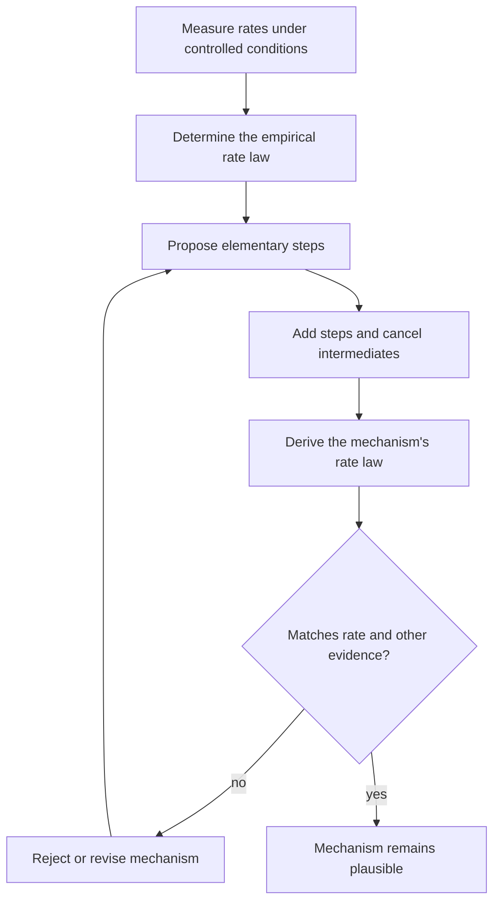

# Chemical Kinetics

Chemical kinetics asks how composition changes with time and what molecular sequence produces that change. Thermodynamics identifies the equilibrium favored under specified conditions; kinetics determines whether the system approaches it in microseconds or remains effectively unchanged for years.

Rate laws are empirical summaries of concentration dependence. Mechanisms try to explain those laws through elementary events. The two must be kept distinct: a balanced overall equation supplies stoichiometry, but it usually does not supply reaction orders.

## Defining a reaction rate consistently

For

$$
\mathrm{aA+bB\rightarrow cC+dD},
$$

reactant concentrations fall and product concentrations rise. Dividing by stoichiometric coefficients gives one common reaction rate:

$$
\mathrm{rate}
=-\frac{1}{a}\frac{d[A]}{dt}
=-\frac{1}{b}\frac{d[B]}{dt}
=\frac{1}{c}\frac{d[C]}{dt}
=\frac{1}{d}\frac{d[D]}{dt}.
$$

The minus signs make the rate positive when reactants are consumed. Without coefficient normalization, individual disappearance and appearance rates differ. In $\mathrm{2N_2O_5\rightarrow4NO_2+O_2}$, nitrogen dioxide appears four times as fast as oxygen on a molar basis, while the normalized reaction rate is the same from either species.

An average rate uses a finite time interval, $\Delta[C]/\Delta t$. An instantaneous rate is the slope of the concentration-time curve at one time and is expressed by a derivative. Experimentally, an instantaneous rate is estimated from a sufficiently small interval or from a fitted kinetic model.

Concentration need not be measured directly. Absorbance, pressure, conductivity, mass, or gas volume may serve as a signal if it has a calibrated relation to concentration. Temperature, mixing, and sampling delay must be controlled because rate constants are sensitive to conditions.

## Rate laws come from experiment

A common empirical form is

$$
\mathrm{rate}=k[A]^m[B]^n.
$$

$m$ and $n$ are orders with respect to A and B, and $m+n$ is the overall order. Orders can be zero, fractional, or negative; they are not limited to balanced-equation coefficients. The rate constant $k$ depends on temperature and, where relevant, catalyst, solvent, ionic strength, and reaction medium.

The initial-rate method compares trials before concentrations have changed appreciably. Choose pairs in which one reactant concentration changes while the others remain fixed. Taking rate ratios cancels $k$ and unchanged factors.

### Worked example: extracting orders and $k$

Consider the measurements:

| Trial | $[A]$ in M | $[B]$ in M | Initial rate in $\mathrm{M\,s^{-1}}$ |
|---:|---:|---:|---:|
| 1 | 0.100 | 0.100 | $2.0\times10^{-3}$ |
| 2 | 0.200 | 0.100 | $8.0\times10^{-3}$ |
| 3 | 0.100 | 0.300 | $6.0\times10^{-3}$ |

Assume $\mathrm{rate}=k[A]^m[B]^n$. Compare trials 2 and 1:

$$
\frac{8.0\times10^{-3}}{2.0\times10^{-3}}
=\left(\frac{0.200}{0.100}\right)^m
\left(\frac{0.100}{0.100}\right)^n.
$$

Thus

$$
4=2^m,
$$

so $m=2$. Compare trials 3 and 1:

$$
\frac{6.0\times10^{-3}}{2.0\times10^{-3}}
=\left(\frac{0.100}{0.100}\right)^2
\left(\frac{0.300}{0.100}\right)^n.
$$

Hence $3=3^n$ and $n=1$. The rate law is

$$
\mathrm{rate}=k[A]^2[B].
$$

Using trial 1,

$$
k=\frac{2.0\times10^{-3}}
{(0.100)^2(0.100)}=2.0.
$$

Because the overall order is three,

$$
[k]=\frac{\mathrm{M\,s^{-1}}}{\mathrm{M^3}}
=\mathrm{M^{-2}\,s^{-1}}.
$$

Substitution into trials 2 and 3 reproduces their rates. If no two trials isolate one reactant, logarithms or simultaneous equations can extract the orders.

## Integrated laws connect concentration and time

A differential rate law gives the instantaneous rate. Integration gives concentration as a function of time. For a reaction whose rate depends only on A as $-d[A]/dt=k[A]^p$, the standard cases are:

| Order $p$ | Integrated law | Linear diagnostic plot | Half-life |
|---:|---|---|---|
| 0 | $[A]_t=[A]_0-kt$ | $[A]$ versus $t$ | $[A]_0/(2k)$ |
| 1 | $\ln[A]_t=\ln[A]_0-kt$ | $\ln[A]$ versus $t$ | $\ln2/k$ |
| 2 | $1/[A]_t=1/[A]_0+kt$ | $1/[A]$ versus $t$ | $1/(k[A]_0)$ |

The slope is $-k$ for zero- and first-order plots and $+k$ for the second-order plot. Linearity should be judged over a meaningful data range, not from two points, since any two points define a line.

For first order, separation of variables gives

$$
-\frac{d[A]}{[A]}=k\,dt.
$$

Integrating from $[A]_0$ at $t=0$ to $[A]_t$ at time $t$,

$$
-\int_{[A]_0}^{[A]_t}\frac{d[A]}{[A]}
=\int_0^t k\,dt,
$$

so

$$
\ln\frac{[A]_t}{[A]_0}=-kt.
$$

Setting $[A]_t=[A]_0/2$ yields $t_{1/2}=\ln2/k$. The starting concentration cancels, explaining why every first-order half-life is the same under unchanged conditions.

### Worked example: first-order decay

A first-order decomposition has $k=0.0230\ \mathrm{min^{-1}}$. How long does it take for 25.0% of the reactant to remain?

Use the concentration ratio directly:

$$
\ln\frac{[A]_t}{[A]_0}=-kt.
$$

Since $[A]_t/[A]_0=0.250$,

$$
\ln(0.250)=-(0.0230\ \mathrm{min^{-1}})t.
$$

Therefore,

$$
t=\frac{-\ln(0.250)}{0.0230}=60.3\ \mathrm{min}.
$$

A quarter remaining means two halvings. The check

$$
2t_{1/2}=2\left(\frac{0.693}{0.0230}\right)=60.3\ \mathrm{min}
$$

agrees. “25% reacts” would instead mean 75% remains and would require a shorter time; wording about reacted and remaining fractions must be read carefully.

## Pseudo-order conditions

A multi-reactant law can appear simpler when one reactant is held in large excess. If

$$
\mathrm{rate}=k[A][B]
$$

and $[B]$ changes negligibly, combine it with $k$:

$$
\mathrm{rate}=k_{\mathrm{obs}}[A],
\qquad
k_{\mathrm{obs}}=k[B]_{\mathrm{approximately\ constant}}.
$$

The reaction then follows pseudo-first-order behavior in A. Varying the excess concentration and observing how $k_{\mathrm{obs}}$ changes recovers the hidden order in B. Hydrolysis kinetics are often studied this way because water is present at nearly constant high concentration.

The simplification concerns the experimental condition, not the underlying elementary chemistry. Reducing the excess can make its concentration change appreciably and invalidate the pseudo-order treatment.

## Temperature and the activation barrier

The Arrhenius equation is

$$
k=Ae^{-E_a/(RT)}.
$$

$A$ collects collision frequency and orientation-related factors in a simplified picture, while $E_a$ is the activation energy associated with the observed process. Taking logarithms gives

$$
\ln k=\ln A-\frac{E_a}{R}\frac{1}{T}.
$$

An Arrhenius plot of $\ln k$ against $1/T$ is linear when $A$ and $E_a$ are approximately constant, with slope $-E_a/R$. For two temperatures,

$$
\ln\frac{k_2}{k_1}
=-\frac{E_a}{R}\left(\frac{1}{T_2}-\frac{1}{T_1}\right).
$$

Kelvin is required because reciprocal absolute temperature appears in the equation.

### Worked example: rate increase on warming

A reaction has $E_a=75.0\ \mathrm{kJ\,mol^{-1}}$. Estimate $k_2/k_1$ when temperature rises from $298\ \mathrm K$ to $318\ \mathrm K$, assuming the Arrhenius parameters remain constant.

Convert activation energy to joules per mole and substitute:

$$
\ln\frac{k_2}{k_1}
=-\frac{75{,}000}{8.314}
\left(\frac{1}{318}-\frac{1}{298}\right).
$$

The reciprocal-temperature difference is

$$
\frac{1}{318}-\frac{1}{298}=-2.11\times10^{-4}\ \mathrm{K^{-1}}.
$$

Hence

$$
\ln\frac{k_2}{k_1}=1.90,
$$

and exponentiation gives

$$
\frac{k_2}{k_1}=e^{1.90}=6.69.
$$

A 20 K increase raises the rate constant by roughly a factor of 6.7 for this barrier. Rules such as “rate doubles every ten degrees” are rough observations for limited cases, not general kinetic laws.

## Elementary steps and molecularity

An elementary step represents one molecular event. Its molecularity is the number of reacting particles in that event: unimolecular, bimolecular, or, rarely, termolecular. For an elementary step only, its stoichiometry determines the concentration powers in the mass-action rate law. A bimolecular elementary step $\mathrm{A+B\rightarrow products}$ has rate $k[A][B]$.

An overall balanced equation normally summarizes several elementary steps. Intermediates are formed in one step and consumed in another, so they cancel from the overall equation. Catalysts are consumed and later regenerated. Neither should remain in the final overall reaction, though a catalyst can appear in the experimental rate law.

Consider a proposed mechanism:

$$
\begin{aligned}
\mathrm{NO_2+NO_2}&\rightarrow\mathrm{NO_3+NO} && \text{slow},\\
\mathrm{NO_3+CO}&\rightarrow\mathrm{NO_2+CO_2} && \text{fast}.
\end{aligned}
$$

Adding and canceling $\mathrm{NO_3}$ and one $\mathrm{NO_2}$ gives

$$
\mathrm{NO_2+CO\rightarrow NO+CO_2}.
$$

If the first step controls the rate, its elementary law predicts

$$
\mathrm{rate}=k[NO_2]^2.
$$

The absence of CO from the predicted law is chemically possible: it reacts after the slow event. Agreement with an observed $[NO_2]^2$ law supports the mechanism but does not prove that it is unique.

When the rate-determining step contains an intermediate, its concentration must be eliminated. A preceding rapid equilibrium can express it in terms of stable reactants; a steady-state approximation can set its formation and consumption rates nearly equal. Simply leaving an unmeasurable intermediate in the final rate law does not complete the derivation.

Other evidence can discriminate between mechanisms with the same rate law: isotope effects, stereochemical outcomes, detected intermediates, pressure dependence, and product distributions.

## Catalysis changes the route

A catalyst participates in elementary steps and is regenerated. The catalyzed route has a lower maximum activation free energy than the uncatalyzed route, increasing the rate constant. It does not change the Gibbs energies of reactants and products, so it does not change $K$ or the equilibrium composition.

At equilibrium, forward and reverse rates are equal. A catalyst speeds both and lets the system respond more quickly to a disturbance. It cannot drive an equilibrium reaction beyond its equilibrium yield without coupling to another process or removing a product.

Homogeneous catalysts share a phase with reactants. Heterogeneous catalysts act at an interface, so adsorption, surface coverage, active-site availability, and transport can enter the rate law. Enzymes are biological catalysts whose saturation behavior often makes the observed order change with substrate concentration.

## Diagnostic checks

- Overall coefficients become rate-law powers only when the reaction is an elementary step. For a multistep reaction, determine orders experimentally.
- Units of $k$ depend on overall order. Derive them from the rate law instead of memorizing one universal unit.
- A straight-line diagnostic requires more than two measurements and should show random residuals. Curvature can signal the wrong order or changing conditions.
- Half-life independence from starting concentration is characteristic of first-order behavior, not a general property of reactions.
- Arrhenius temperatures must be absolute, and activation energy units must match $R$.
- A mechanism must reproduce the overall reaction and the measured rate law after intermediates are eliminated. Matching only one of those tests is insufficient.
- Catalysts alter pathways and rates, not the equilibrium constant.

## Experimental designs that distinguish orders

Initial-rate experiments require concentration changes large enough to separate effects from measurement noise. Randomizing trial order helps prevent slow instrument drift from being mistaken for a concentration effect. Replicate trials estimate scatter, and maintaining constant ionic strength can matter for reactions between ions.

Isolation experiments keep all but one reactant in large excess and follow the remaining species through time. Repeating at several excess concentrations tests the order hidden inside $k_{obs}$. A single apparently first-order trace cannot establish that the molecular reaction has only one reactant.

For fast reactions, manual mixing may consume much of the observed time. Stopped-flow instruments mix streams rapidly and record a spectroscopic signal after a short dead time. Relaxation methods perturb a system near equilibrium and follow its return. Flash photolysis creates reactive intermediates with a light pulse and monitors their decay. The time resolution of the method sets which steps can be observed directly.

Sampling can itself disturb kinetics. Quenching must stop the reaction much faster than the reaction changes during handling. If cooling, dilution, or reagent addition only slows it, measured samples continue reacting and the inferred rate is biased.

## Parallel and consecutive reactions

A reactant may follow competing pathways:

$$
\mathrm{A\xrightarrow{k_1}B},
\qquad
\mathrm{A\xrightarrow{k_2}C}.
$$

For irreversible first-order paths, A disappears with total rate constant $k_1+k_2$:

$$
-\frac{d[A]}{dt}=(k_1+k_2)[A].
$$

The product ratio under constant conditions is governed by the competing rates:

$$
\frac{[B]}{[C]}=\frac{k_1}{k_2}
$$

after comparable formation periods if neither product reacts further. A catalyst can improve selectivity by lowering one pathway's barrier more than another, not merely by making everything faster.

Consecutive reactions behave differently:

$$
\mathrm{A\xrightarrow{k_1}B\xrightarrow{k_2}C}.
$$

B is an intermediate. It first accumulates as A produces it, reaches a maximum when its formation and consumption rates are equal, and then falls. Measuring only the final product can hide that transient population. Reaction time may be selected to maximize B when it is the desired product.

Temperature can change selectivity because different pathways have different activation energies. From the Arrhenius equation,

$$
\frac{k_1}{k_2}
=\frac{A_1}{A_2}
\exp\left[-\frac{E_{a,1}-E_{a,2}}{RT}\right].
$$

Raising temperature favors the path with the larger activation energy in the ratio, though pre-exponential factors also matter.

## Reversible kinetics approaching equilibrium

For an elementary reversible reaction

$$
\mathrm{A\rightleftharpoons B},
$$

the net rate is

$$
\mathrm{rate}_{net}=k_f[A]-k_r[B].
$$

At equilibrium the net rate is zero, not because both rates vanish, but because

$$
k_f[A]_{eq}=k_r[B]_{eq}.
$$

Therefore,

$$
\frac{[B]_{eq}}{[A]_{eq}}=\frac{k_f}{k_r}=K
$$

for this elementary idealized case. The ratio connects equilibrium with kinetics while retaining their distinction: $K$ depends on the ratio of forward and reverse rate constants, whereas the relaxation time depends on their magnitudes.

Two reactions may have the same equilibrium constant but very different rates if both forward and reverse constants are scaled. A catalyst raises both directions through a lower-barrier mechanism and preserves their ratio at fixed temperature.

## Collision theory and transition-state language

Collision theory explains why concentration and temperature affect bimolecular reactions. Molecules must encounter one another, but only a fraction of encounters have enough energy and suitable orientation to react. The Arrhenius pre-exponential factor represents this frequency and orientation only approximately.

Transition-state theory describes passage through a high-free-energy activated complex. The activation Gibbs energy, rather than activation energy alone, controls the rate constant:

$$
k=\frac{k_BT}{h}e^{-\Delta G^\ddagger/(RT)}.
$$

Because $\Delta G^\ddagger=\Delta H^\ddagger-T\Delta S^\ddagger$, an unfavorable ordering requirement can slow a reaction even when its activation enthalpy is modest. Solvents and catalysts alter the activated configuration and its stabilization.

Reaction-coordinate diagrams are energy profiles along a chosen path, not literal trajectories in ordinary three-dimensional space. A multistep mechanism has one maximum per transition state and a minimum for each intermediate. The highest barrier measured from the preceding populated minimum often controls the rate, but populations and reversibility can make “the tallest peak” reasoning too simple.

## Transport limits

An observed rate need not equal the intrinsic chemical rate. Stirring can control how quickly reactants reach an interface, heat transfer can create temperature gradients, and diffusion through a porous catalyst can limit access to active sites. If increasing stirring speed changes the measured rate, transport was contributing.

Heterogeneous catalytic rates can also saturate when most sites are occupied. At low reactant pressure the rate may be first order; at high pressure it may approach zero order because additional molecules cannot find free sites. A change in observed order can therefore reveal adsorption or transport behavior rather than a change in the balanced reaction.

See also: [chemical equilibrium](/chemistry/general/chemical-equilibrium) · [thermodynamics and free energy](/chemistry/general/thermodynamics-and-free-energy) · [biochemistry and polymer materials](/chemistry/general/biochemistry-and-polymer-materials) · [electrochemistry](/chemistry/general/electrochemistry)

