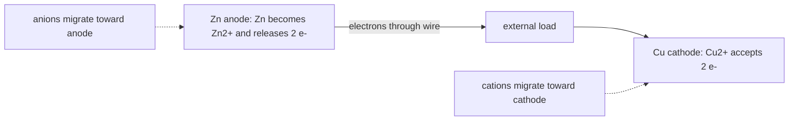

# Electrochemistry

Electrochemistry separates oxidation from reduction so that electron transfer can travel through an external circuit. A spontaneous cell reaction can then deliver electrical work; an applied voltage can drive the reverse or another nonspontaneous reaction. The chemical equation, circuit, ion migration, and measured voltage are four descriptions of the same charge transfer.

## Oxidation numbers locate the electron transfer

Oxidation is loss of electrons and reduction is gain of electrons. Oxidation numbers are bookkeeping values used to identify those changes. For a neutral compound their sum is zero; for an ion their sum equals the ionic charge. Common assignments include $+1$ for hydrogen with nonmetals, $-2$ for oxygen in most compounds, and the monatomic-ion charge for an isolated ion. Exceptions such as hydrides and peroxides require separate rules.

In

$$
\mathrm{Zn(s)+Cu^{2+}(aq)\rightarrow Zn^{2+}(aq)+Cu(s)},
$$

zinc changes from 0 to $+2$ and loses two electrons. Copper changes from $+2$ to 0 and gains two. Zinc is oxidized and acts as the reducing agent; copper(II) is reduced and acts as the oxidizing agent. The agents are named for what they cause in the other reactant.

Half-reactions expose the electron balance:

$$
\begin{aligned}
\mathrm{Zn}&\rightarrow\mathrm{Zn^{2+}+2e^-},\\
\mathrm{Cu^{2+}+2e^-}&\rightarrow\mathrm{Cu}.
\end{aligned}
$$

Adding them cancels electrons. A valid redox equation must balance both atoms and total charge.

## Balancing redox equations in acidic or basic solution

The half-reaction method handles oxygen and hydrogen systematically. In acidic solution, balance atoms other than H and O, balance O with $\mathrm{H_2O}$, balance H with $\mathrm{H^+}$, and balance charge with electrons. Multiply the halves to cancel electrons and simplify.

### Worked example: permanganate oxidizing iron(II)

Balance

$$
\mathrm{MnO_4^-+Fe^{2+}\rightarrow Mn^{2+}+Fe^{3+}}
$$

in acidic solution.

For the manganese half, first balance oxygen with four waters on the product side:

$$
\mathrm{MnO_4^-\rightarrow Mn^{2+}+4H_2O}.
$$

Balance eight hydrogens with $8H^+$ on the reactant side:

$$
\mathrm{8H^++MnO_4^-\rightarrow Mn^{2+}+4H_2O}.
$$

The left charge is $+7$ and the right charge is $+2$, so add five electrons to the left:

$$
\mathrm{5e^-+8H^++MnO_4^-\rightarrow Mn^{2+}+4H_2O}.
$$

Iron oxidation is

$$
\mathrm{Fe^{2+}\rightarrow Fe^{3+}+e^-}.
$$

Multiply the iron half by five and add:

$$
\mathrm{MnO_4^-+8H^++5Fe^{2+}
\rightarrow Mn^{2+}+4H_2O+5Fe^{3+}}.
$$

The total charge on each side is $+17$. In basic solution, one can first balance as acidic, then add enough $\mathrm{OH^-}$ to both sides to neutralize every $\mathrm{H^+}$, form water, and cancel excess water.

## Anatomy of a galvanic cell

In a galvanic, or voltaic, cell the overall reaction is spontaneous. Oxidation occurs at the **anode** and reduction at the **cathode**. Electrons leave the anode, pass through the wire and load, and enter the cathode.

For the zinc-copper cell:

Zinc metal loses mass as $\mathrm{Zn^{2+}}$ enters solution. Copper metal gains mass as $\mathrm{Cu^{2+}}$ deposits. Without ion migration, positive charge would accumulate in the anode half-cell and be depleted in the cathode half-cell, quickly stopping electron flow. A salt bridge or porous separator completes the internal ionic circuit: anions migrate toward the anode compartment and cations toward the cathode compartment. Electrons do not travel through the salt bridge.

The mnemonic “anode oxidation, cathode reduction” is universal. Electrode signs are not. In a galvanic cell the anode is negative because it supplies electrons and the cathode is positive. In an electrolytic cell an external source pulls electrons from the anode and pushes them to the cathode, making the anode positive and cathode negative.

Cell notation writes the anode on the left and cathode on the right:

$$
\mathrm{Zn(s)|Zn^{2+}(aq)||Cu^{2+}(aq)|Cu(s)}.
$$

A single vertical line marks a phase boundary; a double line marks the separator between half-cells. Species in the same phase are separated by commas. If no conducting solid participates in a half-reaction, an inert electrode such as platinum provides an electron-transfer surface and appears in the notation.

## Standard reduction potentials

An isolated half-cell potential cannot be measured absolutely; only a difference between two electrodes is observed. Tables report potentials relative to the standard hydrogen electrode, assigned $E^\circ=0$ under standard conditions. Entries are written as reductions.

For a cell assembled from two tabulated reduction halves,

$$
E^\circ_{\mathrm{cell}}
=E^\circ_{\mathrm{red,cathode}}
-E^\circ_{\mathrm{red,anode}}.
$$

The more positive reduction potential is the reduction favored at the cathode when the cell is written spontaneously. A negative calculated $E^\circ$ means the proposed direction is nonspontaneous under standard conditions; reversing the cell changes the sign.

Potential is an intensive quantity. Multiplying a half-reaction to balance electrons does not multiply its voltage. Free energy, by contrast, scales with the amount reacted.

### Worked example: zinc-copper voltage and free energy

Use

$$
E^\circ_{\mathrm{red}}(\mathrm{Cu^{2+}/Cu})=+0.34\ \mathrm V
$$

and

$$
E^\circ_{\mathrm{red}}(\mathrm{Zn^{2+}/Zn})=-0.76\ \mathrm V.
$$

Copper has the more positive reduction potential and is the cathode. Therefore,

$$
E^\circ_{\mathrm{cell}}=0.34-(-0.76)=1.10\ \mathrm V.
$$

The balanced cell reaction transfers $n=2$ mol electrons per mole of reaction. Standard reaction Gibbs energy is

$$
\Delta_rG^\circ=-nFE^\circ_{\mathrm{cell}},
$$

so, using $F=96485\ \mathrm{C\,mol^{-1}}$,

$$
\begin{aligned}
\Delta_rG^\circ
&=-(2\ \mathrm{mol\ e^-})(96485\ \mathrm{C\,mol^{-1}\ e^-})(1.10\ \mathrm{J\,C^{-1}})\\
&=-2.12\times10^5\ \mathrm{J\,mol^{-1}}\\
&=-212\ \mathrm{kJ\,mol^{-1}}.
\end{aligned}
$$

The positive voltage and negative Gibbs energy agree on spontaneity. Combining $\Delta_rG^\circ=-nFE^\circ$ with $\Delta_rG^\circ=-RT\ln K$ gives

$$
\ln K=\frac{nFE^\circ}{RT}.
$$

At $25\ ^\circ\mathrm C$, a $1.10\ \mathrm V$ two-electron cell has a very large $K$, so products are strongly favored under standard-state comparison.

## The Nernst equation follows composition

Standard potential assumes standard activities. At another composition,

$$
E=E^\circ-\frac{RT}{nF}\ln Q.
$$

At $25\ ^\circ\mathrm C$, conversion to a base-10 logarithm gives

$$
E=E^\circ-\frac{0.05916\ \mathrm V}{n}\log Q.
$$

$Q$ belongs to the balanced cell reaction in the direction associated with $E$. Pure solids and pure liquids are omitted. For the zinc-copper reaction,

$$
Q=\frac{a_{Zn^{2+}}}{a_{Cu^{2+}}}
\approx\frac{[Zn^{2+}]}{[Cu^{2+}]}
$$

in the dilute-solution approximation.

### Worked example: a nonstandard zinc-copper cell

Let $[Zn^{2+}]=1.00\ \mathrm M$ and $[Cu^{2+}]=0.0100\ \mathrm M$ at $25\ ^\circ\mathrm C$. Then

$$
Q=\frac{1.00}{0.0100}=100.
$$

With $n=2$,

$$
\begin{aligned}
E&=1.10-\frac{0.05916}{2}\log(100)\\
&=1.10-(0.02958)(2)\\
&=1.04\ \mathrm V.
\end{aligned}
$$

Product ion is abundant and reactant ion is dilute relative to their standard activities, so the forward driving force is smaller and the voltage falls. It remains positive, meaning the written direction is still spontaneous under these conditions.

As a galvanic cell discharges, its reaction moves forward and $Q$ rises. The voltage declines until $E=0$. Substituting $E=0$ into the Nernst equation gives $Q=K$, linking zero cell driving force with chemical equilibrium.

## Concentration cells

Two identical electrodes can generate voltage if their ion activities differ. Consider metal M in contact with $\mathrm{M^{n+}}$ solutions of different concentration. The dilute side tends to undergo oxidation, producing more ions, while reduction consumes ions on the concentrated side. The net process transfers solute concentration toward equality.

Because the standard half-cells are identical, $E^\circ_{\mathrm{cell}}=0$. The entire voltage comes from the concentration term in the Nernst equation. Such cells emphasize that voltage measures a chemical-potential difference, not merely the use of two different metals.

Real electrodes also develop liquid-junction potentials and activity effects. These are often neglected in elementary calculations but matter in precise electrochemical measurements, including pH electrodes.

## Electrolytic cells and product prediction

An electrolytic cell uses an external source to drive a nonspontaneous cell reaction. Oxidation still occurs at the anode and reduction at the cathode. In molten sodium chloride, only sodium and chloride ions are available, so sodium forms at the cathode and chlorine at the anode.

In aqueous solution, water may compete with dissolved ions. Electrode potentials, overpotentials, concentration, electrode material, and pH can influence the observed products. A simple “least active ion discharges” rule can fail because it omits kinetics and surface effects.

The applied voltage must exceed the reversible decomposition voltage plus losses from resistance and electrode overpotential. Electrical energy beyond the thermodynamic minimum is dissipated as heat or kinetic loss.

## Faraday's law turns current into chemical amount

Current is charge per time:

$$
I=\frac{q}{t},\qquad q=It.
$$

One mole of electrons carries the Faraday constant, approximately

$$
F=96485\ \mathrm{C\,mol^{-1}}.
$$

After converting charge to electron moles, the electrode half-reaction supplies the ratio between electrons and deposited or consumed material.

### Worked example: copper electroplating

A current of $2.00\ \mathrm A$ runs for $30.0\ \mathrm{min}$ through a copper(II) plating bath. Assume $100\%$ current efficiency. Find the copper mass deposited.

Convert time to seconds:

$$
t=(30.0\ \mathrm{min})(60.0\ \mathrm{s\,min^{-1}})=1800\ \mathrm s.
$$

Charge passed is

$$
q=(2.00\ \mathrm{C\,s^{-1}})(1800\ \mathrm s)=3600\ \mathrm C.
$$

Electron amount is

$$
n_{e^-}=\frac{3600\ \mathrm C}{96485\ \mathrm{C\,mol^{-1}}}
=0.0373\ \mathrm{mol\ e^-}.
$$

The cathode half-reaction is

$$
\mathrm{Cu^{2+}+2e^-\rightarrow Cu}.
$$

Thus

$$
n_{Cu}=0.0373\left(\frac{1\ \mathrm{mol\ Cu}}{2\ \mathrm{mol\ e^-}}\right)
=0.0187\ \mathrm{mol}.
$$

Using $63.55\ \mathrm{g\,mol^{-1}}$,

$$
m_{Cu}=(0.0187)(63.55)=1.19\ \mathrm g.
$$

If only $85\%$ of the current produced copper while the remainder drove side reactions, the actual mass would be $0.85(1.19)=1.01\ \mathrm g$.

## Batteries, fuel cells, and corrosion

A battery packages one or more galvanic cells. Primary cells are intended for discharge without reversible recharging. Secondary cells use electrode reactions that can be driven sufficiently in reverse, though side reactions and structural changes limit cycle life. Cell voltage depends on state of charge, current, temperature, and internal resistance rather than remaining exactly at its tabulated standard value.

A fuel cell receives reactants continuously rather than storing all active material internally. Its thermodynamics still follow cell potentials and Gibbs energy, while performance also depends on catalytic kinetics and mass transport.

Corrosion is an electrochemical process with anodic metal oxidation and a spatially separate cathodic reduction, often involving oxygen. Electrical contact, moisture, dissolved ions, and differential oxygen exposure can establish local cells. Protective coatings, sacrificial anodes, alloy choice, and imposed cathodic protection interrupt different parts of that process.

## Sign and stoichiometry checks

- Assign oxidation and reduction before assigning electrode signs. Anode means oxidation in every cell type.
- Tabulated values are usually reduction potentials. Subtract the anode reduction potential; do not multiply potentials when scaling half-reactions.
- Use the electron count from the fully balanced overall reaction in $\Delta G=-nFE$ and the Nernst equation.
- Write $Q$ for the same cell-reaction direction as the reported potential. Reversing the reaction reverses $E$ and inverts $Q$.
- Match the logarithm base to the constant: $RT/(nF)$ accompanies $\ln$, while $0.05916/n$ at $25\ ^\circ\mathrm C$ accompanies $\log_{10}$.
- In electrolysis, convert current and time to charge, charge to electron moles, and electron moles to product. The electrode stoichiometry controls the final conversion.
- Standard potentials predict thermodynamic tendency. Overpotential and transport can change which reaction is observed at a useful rate.

## Reference electrodes and measured potentials

A voltmeter measures a difference between two electrode potentials. To study one working electrode, it is paired with a reference electrode whose potential is stable and known. The standard hydrogen electrode defines the thermodynamic zero but is inconvenient for routine use, so silver-silver chloride and calomel references are common in laboratory measurements.

Reported potentials must name the reference. A value measured versus silver-silver chloride cannot be compared directly with one reported versus the standard hydrogen electrode until the reference offset and conditions are converted. Reference potential also depends on temperature and electrolyte concentration.

Potentiometry draws negligible current and infers composition from an equilibrium potential. The glass pH electrode is an ion-selective electrochemical sensor. Voltammetry deliberately varies potential and records current, revealing redox processes and transport. Electrochemistry therefore includes both energy-producing cells and analytical methods.

## Current, voltage, and power under load

The open-circuit voltage is measured when essentially no current flows and is closest to the Nernst equilibrium potential. Once a cell supplies current, activation overpotential, concentration polarization, and ohmic resistance lower its terminal voltage:

$$
E_{terminal}=E_{equilibrium}-\eta_{anode}-\eta_{cathode}-IR
$$

for a discharge sign convention. The exact partition depends on cell design, but the message is general: a thermodynamically favorable voltage does not guarantee high power.

Electrical power is

$$
P=EI,
$$

and electrical energy delivered over time is the integral of power. A battery can have high stored energy but modest maximum power if ion transport or electrode kinetics are slow. Increasing surface area often improves current capability by lowering current density, though it can promote side reactions.

Capacity is charge, commonly stated in ampere-hours:

$$
1\ \mathrm{A\,h}=3600\ \mathrm C.
$$

Faraday's law gives theoretical capacity from active-material amount and electron stoichiometry. Actual capacity is lower when material remains inaccessible or side reactions consume charge. Energy in watt-hours additionally depends on the voltage throughout discharge.

## A capacity calculation

Suppose an electrode contains $5.00\ \mathrm g$ of a material with molar mass $100.0\ \mathrm{g\,mol^{-1}}$ and transfers one electron per formula unit. Its amount is

$$
n=\frac{5.00}{100.0}=0.0500\ \mathrm{mol}.
$$

The theoretical charge is

$$
q=(0.0500\ \mathrm{mol})(96485\ \mathrm{C\,mol^{-1}})
=4824\ \mathrm C.
$$

In ampere-hours,

$$
q=\frac{4824}{3600}=1.34\ \mathrm{A\,h}.
$$

If the average discharge voltage is $3.20\ \mathrm V$, the corresponding idealized energy is

$$
E=(3.20\ \mathrm V)(1.34\ \mathrm{A\,h})=4.29\ \mathrm{W\,h}.
$$

Packaging, inactive binders, current collectors, incomplete utilization, and voltage variation reduce the specific energy of the finished cell relative to this active-material estimate.

## Electrochemical conventions at interfaces

Conventional current is defined in the direction positive charge would move, opposite to electron flow in a metal wire. In an electrolyte, both cations and anions carry current in opposite physical directions. Stating “current flows from positive to negative” without naming conventional current or electrons creates avoidable ambiguity.

At an electrode, charge transfer crosses the interface through oxidation or reduction, while ions move through the electrolyte and electrons move through the external conductor. Sustained operation requires both pathways. Blocking either one causes charge accumulation and stops the cell after a brief transient.

Salt bridges are chosen to minimize reaction with half-cell species and to keep cation and anion mobilities reasonably balanced. An ion that precipitates with an analyte or forms a strong complex is a poor bridge electrolyte even if it conducts well.

See also: [aqueous reactions and solution stoichiometry](/chemistry/general/aqueous-reactions-and-solution-stoichiometry) · [thermodynamics and free energy](/chemistry/general/thermodynamics-and-free-energy) · [chemical equilibrium](/chemistry/general/chemical-equilibrium) · [transition metals and coordination compounds](/chemistry/general/transition-metals-and-coordination-compounds)

