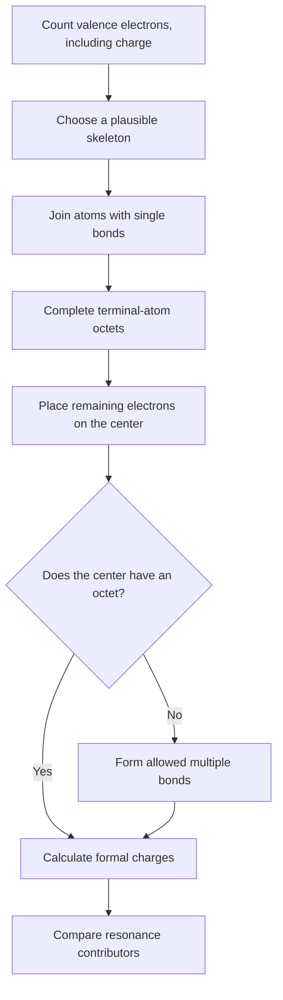

# Ionic and Covalent Bonding

A chemical bond is a stable rearrangement of electrons and nuclei, not a tiny rod between two atoms. Stability means that the bonded arrangement has lower energy than the separated particles under the same conditions. Two limiting descriptions organize most introductory chemistry: electrons may be transferred to give ions held together by electrostatic attraction, or they may be shared between nuclei. Real electron density varies continuously between these limits. Even sodium chloride has some covalent character, while an H–Cl bond has enough charge separation to behave quite differently from H–H.

## From atomic energetics to an ionic lattice

Writing sodium chloride formation as “sodium gives an electron to chlorine” hides an energetic puzzle. Removing an electron from gaseous sodium costs energy, and adding it to gaseous chlorine recovers only part of that cost. Isolated $\mathrm{Na^+}$ and $\mathrm{Cl^-}$ are therefore not automatically more stable than isolated neutral atoms. The decisive contribution is the attraction of every ion to many oppositely charged neighbors in the crystal.

For two point charges, Coulomb's law gives the potential energy

$$
E=\frac{1}{4\pi\epsilon_0}\frac{q_1q_2}{r}.
$$

Opposite charges make $q_1q_2$ negative. Bringing them closer lowers the energy until short-range repulsion between overlapping electron clouds becomes important. In a crystal the pairwise terms extend throughout the lattice. Lattice energy therefore grows in magnitude when ionic charges are larger and ion-to-ion distances are smaller. The comparison between $\mathrm{NaCl}$ and $\mathrm{MgO}$ is instructive: the latter contains $2+$ and $2-$ ions, so its electrostatic attraction is much stronger than a size comparison alone would suggest.

Cations are smaller than their parent atoms because electron loss reduces electron–electron repulsion and may remove an entire valence shell. Anions are larger because added electrons increase repulsion within the valence shell. Within an isoelectronic series such as $\mathrm{O^{2-}}$, $\mathrm{F^-}$, $\mathrm{Na^+}$, and $\mathrm{Mg^{2+}}$, all species have ten electrons; radius decreases as nuclear charge rises.

An ionic solid is an extended array, not a collection of discrete molecules. Its familiar properties follow from that structure. Separating an ion from the lattice costs substantial energy, hence many salts have high melting points. A shifted layer can bring like charges next to one another, causing cleavage rather than plastic deformation. Ions cannot carry current while locked in place, but a molten salt or aqueous ionic solution conducts because charged particles can move.

## Sharing electrons and the electronegativity continuum

When two hydrogen atoms approach, each nucleus attracts both electrons. Electron density between the nuclei attracts both positive centers and can lower the total energy. At very short distance, nucleus–nucleus and electron–electron repulsions rise sharply. The minimum of the resulting energy curve defines the equilibrium bond length, while the depth relative to separated atoms is related to bond dissociation energy.

Equal atoms share electron density equally. Different atoms usually do not. Electronegativity summarizes an atom's tendency to attract bonding electrons; it generally increases across a period and upward within a group. In $\mathrm{HCl}$, electron density is displaced toward chlorine, conventionally written

$$
\mathrm{H^{\delta+}-Cl^{\delta-}}.
$$

The partial charges form a bond dipole. They are not formal charges and need not be integers. An electronegativity difference is a guide rather than a phase boundary: bonding, molecular environment, polarization, and crystal structure all affect the result. Small highly charged cations can distort a neighboring anion's electron cloud, adding covalent character to a nominally ionic compound.

| Description | Electron distribution | Structural unit | Typical consequences |
|---|---|---|---|
| Ionic limit | charge largely localized on ions | extended lattice | brittle solid; mobile ions conduct when molten or dissolved |
| Nonpolar covalent | nearly equal sharing | molecule or network | small bond dipole |
| Polar covalent | unequal sharing | usually a molecule | dipole-dependent forces and charge-sensitive reactions |
| Network covalent | shared bonds throughout a solid | extended network | often hard, high-melting, and nonconducting |
| Metallic | valence electrons delocalized over many atoms | extended solid | electrical conductivity and malleability |

Diamond illustrates why “covalent” does not imply a low melting molecular substance. Each carbon is bonded into a three-dimensional network, so melting requires disruption of many strong bonds. Molecular iodine also has covalent I–I bonds, yet its molecules are held to one another by much weaker intermolecular attractions.

## Lewis structures as electron accounting

A Lewis structure tracks valence electrons and connectivity. It is not a map of exact electron density or three-dimensional shape. A reliable construction routine is:

Hydrogen forms one bond and is never central in an ordinary Lewis structure. The least electronegative non-hydrogen atom is often central, though chemical connectivity outranks that shortcut. Halogens are usually terminal. The total electron count must include charge: add one electron for each negative charge and subtract one for each positive charge.

Formal charge assigns bonding electrons equally between the bonded atoms:

$$
FC=V-N-\frac{B}{2},
$$

where $V$ is the free atom's valence count, $N$ is the number of nonbonding electrons, and $B$ is the number of bonding electrons around the atom. The sum of all formal charges must equal the species' overall charge. Good structures usually satisfy octets, minimize charge separation, and place negative formal charge on the more electronegative atoms. These criteria can conflict; an octet is commonly more important for second-period elements than minimizing every formal charge.

### Worked example: carbon dioxide

For $\mathrm{CO_2}$, count

$$
4+2(6)=16
$$

valence electrons. The skeleton O–C–O uses four electrons. Completing both oxygen octets uses the remaining twelve, but carbon then has only four electrons around it. Convert one lone pair from each oxygen into a bonding pair:

$$
\mathrm{O=C=O}.
$$

For carbon, $FC=4-0-8/2=0$. For each oxygen, $FC=6-4-4/2=0$. All atoms have octets and no formal charge. Two double bonds also predict equivalent C–O bonds. The Lewis structure still does not by itself establish the linear shape; electron-domain geometry supplies that result.

### Worked example: nitrate and resonance

For $\mathrm{NO_3^-}$, the count is

$$
5+3(6)+1=24.
$$

Three N–O single bonds consume six electrons. Completing the three oxygen octets consumes the remaining eighteen, leaving nitrogen with only six electrons. Move one oxygen lone pair into an N–O bond. In the resulting contributor, the double-bonded oxygen has formal charge zero, each single-bonded oxygen has $-1$, and nitrogen has $+1$:

$$
(+1)+0+(-1)+(-1)=-1.
$$

Any of the three oxygens can supply the extra bonding pair, giving three equivalent contributors. The nitrate ion does not oscillate between them. Its electron density is delocalized, and all three N–O distances are equivalent. A useful average bond order is

$$
\frac{2+1+1}{3}=\frac{4}{3},
$$

although bond order here is a model rather than a direct count of localized bonds.

## Where the octet rule bends

The octet rule reflects the especially stable filled $s$ and $p$ valence shells of main-group atoms, but it has defined limits.

- Hydrogen needs two electrons. Beryllium and boron often form electron-deficient compounds; $\mathrm{BF_3}$ can be drawn with only six electrons around boron.
- Odd-electron species cannot give every atom an octet. Nitric oxide has eleven valence electrons and is a radical.
- Period 3 and heavier central atoms can be represented by expanded-valence Lewis structures, as in $\mathrm{SF_6}$. Modern bonding descriptions need not assign literal population of low-lying $d$ orbitals, so “expanded octet” is best treated as Lewis bookkeeping.
- A carbon, nitrogen, oxygen, or fluorine atom cannot exceed an octet in an ordinary valid Lewis structure because its valence shell contains only one $s$ and three $p$ orbitals.

Coordinate covalent bonds fit the same accounting scheme. In $\mathrm{NH_3+H^+\rightarrow NH_4^+}$, nitrogen supplies both electrons to the new N–H bond, but after formation all four N–H bonds in ammonium are equivalent. The origin of the pair does not create a permanently different kind of bond.

## Bond order, length, and reaction energy

For otherwise similar atom pairs, greater bond order usually means a shorter and stronger bond. A multiple bond places more density between the nuclei, pulling them closer. Comparisons must hold the atoms and environment roughly fixed: an O–H bond cannot be ranked against C–C solely by the single-bond label.

Average gas-phase bond enthalpies estimate reaction enthalpy through

$$
\Delta H_{\mathrm{rxn}}\approx
\sum D(\text{bonds broken})-
\sum D(\text{bonds formed}).
$$

For

$$
\mathrm{H_2+Cl_2\rightarrow2HCl},
$$

use $D(\mathrm{H-H})=436$, $D(\mathrm{Cl-Cl})=243$, and $D(\mathrm{H-Cl})=431\ \mathrm{kJ\,mol^{-1}}$. Breaking the reactant bonds requires

$$
436+243=679\ \mathrm{kJ},
$$

and forming two H–Cl bonds releases

$$
2(431)=862\ \mathrm{kJ}.
$$

Thus

$$
\Delta H_{\mathrm{rxn}}\approx679-862=-183\ \mathrm{kJ}
$$

for the reaction as written. The negative sign indicates an exothermic reaction. The value is approximate because a tabulated bond enthalpy averages that bond over several gas-phase molecules; a measured standard enthalpy also depends on the actual physical states.

## Two property predictions from the same bonding picture

Consider first why magnesium oxide melts at a much higher temperature than sodium chloride. Both are ionic lattices with the same overall cation-to-anion ratio, so merely calling both compounds “ionic” loses the useful distinction. The ions in $\mathrm{MgO}$ carry charges of $+2$ and $-2$, whereas those in $\mathrm{NaCl}$ carry $+1$ and $-1$. The Coulombic charge product therefore changes in magnitude from one to four. $\mathrm{Mg^{2+}}$ is also smaller than $\mathrm{Na^+}$, bringing opposite charges closer. Crystal geometry and short-range repulsion prevent a literal fourfold lattice-energy prediction, but both effects point toward a much more strongly bound MgO lattice. The reasoning uses charge and radius, not a memorized list of melting points.

Now compare $\mathrm{CO_2}$ and $\mathrm{H_2O}$. Each contains polar bonds, yet carbon dioxide has no permanent molecular dipole while water does. Bond dipoles are vectors. The two equal C=O dipoles in linear carbon dioxide point in opposite directions and cancel. Water is bent, so its two O–H dipoles add to a nonzero resultant. The molecular polarity then affects intermolecular attraction and solubility behavior. A polar bond is therefore insufficient evidence for a polar molecule; geometry must be included.

There is a second distinction in the same pair. Intramolecular bonds determine the identity of each molecule, while intermolecular forces act between molecules. Boiling water does not normally break O–H covalent bonds; it separates intact water molecules from one another. Confusing the two energy scales leads to statements such as “hydrogen bonds break water molecules,” when ordinary vaporization primarily overcomes attractions between them.

Ionic formulas require their own reading habit. $\mathrm{CaCl_2}$ gives the lowest whole-number ratio of ions needed for electrical neutrality: one $\mathrm{Ca^{2+}}$ for two $\mathrm{Cl^-}$. It does not claim that the solid contains isolated three-ion units. A molecular formula such as $\mathrm{H_2O}$, by contrast, describes the atom count in a discrete molecule. Empirical and molecular formulas can look similar on paper while referring to different structural levels.

## Reading the models without overreading them

Formal charge is not a measured atomic charge. It follows an equal-splitting rule even for a strongly polar bond. Oxidation state uses a different, ionic splitting rule and may assign still larger integer charges. Partial charge comes from an electron-density model or experiment. Mixing the three produces apparent contradictions that are bookkeeping errors rather than unusual chemistry.

Likewise, a Lewis line represents a shared electron pair but says little about bond polarity, orbital composition, or exact strength. Resonance contributors are not isolable structures, and drawing more contributors does not mean that all contribute equally. Contributors with complete octets and favorable formal charges normally carry more weight.

Finally, solubility cannot be inferred from the word “ionic” alone. Dissolving a salt requires separating lattice ions and stabilizing them with solvent. A high lattice energy can outweigh favorable ion–dipole interactions, leaving an ionic compound only sparingly soluble.

See also: [electron configurations and periodic trends](/chemistry/general/electron-configurations-and-periodic-trends) · [molecular geometry and bonding theory](/chemistry/general/molecular-geometry-and-bonding-theory) · [thermochemistry](/chemistry/general/thermochemistry) · [states of matter: liquids and solids](/chemistry/general/states-of-matter-liquids-and-solids)

