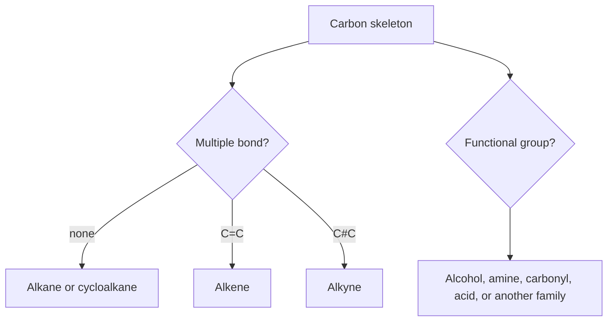

# Organic Chemistry

Organic chemistry organizes carbon compounds by skeleton, unsaturation, and functional group. Carbon's tetravalency supports chains, rings, branching, multiple bonds, and aromatic systems; changing any one of those features can change a compound's identity and properties.

## Reading the carbon skeleton

A hydrocarbon contains only carbon and hydrogen. Alkanes are saturated, alkenes contain at least one carbon-carbon double bond, and alkynes contain at least one carbon-carbon triple bond. For acyclic compounds with one type of unsaturation,

- alkanes follow $\mathrm{C_nH_{2n+2}}$;
- an alkene with one double bond follows $\mathrm{C_nH_{2n}}$;
- an alkyne with one triple bond follows $\mathrm{C_nH_{2n-2}}$.

A cycloalkane also follows $\mathrm{C_nH_{2n}}$ because closing the ring removes two hydrogens relative to an acyclic alkane. These formulas are checks, not complete structures: constitutional isomers share a molecular formula but differ in connectivity, and stereoisomers share connectivity but differ in spatial arrangement.

Carbon with four sigma bonds is usually described as $sp^3$, a carbon in a double bond as $sp^2$, and a carbon in a triple bond as $sp$. Aromatic compounds such as benzene contain a cyclic, delocalized pi system and should not be treated as ordinary isolated alkenes.

The degree of unsaturation turns a molecular formula into a structural constraint. For a formula containing carbon, hydrogen, nitrogen, and halogens, with oxygen and sulfur ignored in the count,

$$
\mathrm{DBE}=\frac{2C+2+N-H-X}{2}.
$$

Each ring or double bond contributes one degree; a triple bond contributes two. Benzene, $\mathrm{C_6H_6}$, has $(14-6)/2=4$: one ring and three pi-bond equivalents. The count does not reveal their arrangement, but it quickly rejects structures with the wrong total unsaturation.

## Naming as an unambiguous structural description

Systematic naming begins by choosing the parent containing the highest-priority functional group and, where required, the maximum number of multiple bonds. Number from the end that gives the principal suffix the lowest locant, then locate unsaturation and substituents. Alphabetize substituent names while ignoring multiplicative prefixes such as di- and tri-. A name is checked by reconstructing the structure from it; if two connectivities fit, the name is incomplete.

For $\mathrm{CH_3CH(CH_3)CH_2OH}$, the longest chain containing the alcohol carbon has three atoms. Numbering from the OH end gives propan-1-ol, with a methyl substituent on carbon 2: 2-methylpropan-1-ol. Choosing a four-carbon path would fail because no continuous four-carbon chain exists. Numbering from the opposite end would incorrectly give the alcohol locant 3.

Condensed and skeletal formulas omit information by convention, not by changing valence. Every unlabeled vertex or line end in a skeletal drawing is carbon, and enough hydrogens are implied to give neutral carbon four bonds. Heteroatoms and hydrogens attached to them are normally shown. A carbonyl line counts as two bonds when completing the carbon's valence.

## Functional groups set the first chemical expectations

A functional group is the local group of atoms that controls much of a molecule's reactivity and intermolecular behavior. The carbon skeleton still matters, but identifying heteroatoms and carbonyl groups is usually the fastest first pass.

| Functional group | General form | Property clue |
|---|---|---|
| Alcohol | $\mathrm{R-OH}$ | hydrogen-bond donor and acceptor; polar |
| Ether | $\mathrm{R-O-R'}$ | hydrogen-bond acceptor but not donor |
| Aldehyde | $\mathrm{R-CHO}$ | polar carbonyl; readily oxidized in common tests |
| Ketone | $\mathrm{R-CO-R'}$ | polar carbonyl |
| Carboxylic acid | $\mathrm{R-COOH}$ | acidic; strong hydrogen bonding |
| Amine | $\mathrm{R-NH_2}$ | commonly basic; can hydrogen-bond |

Polymers extend the same structure-property reasoning to large molecules assembled from repeating monomer units. The repeat unit records connectivity, but chain length, branching, cross-linking, and intermolecular forces also determine the material properties.

Carbonyl compounds deserve a closer comparison. Aldehydes and ketones contain a polarized C=O bond; the carbon is electrophilic and oxygen is electron-rich. Carboxylic acids, esters, and amides attach a heteroatom to the carbonyl carbon, allowing resonance donation that changes reactivity. Amides are much less basic at nitrogen than amines because the lone pair is delocalized into the carbonyl group. Functional-group labels therefore encode an electronic pattern, not merely an atom inventory.

Solubility is a contest between the polar group and hydrocarbon surface. Methanol mixes with water because its OH group hydrogen-bonds strongly and the nonpolar part is small. As an alcohol's carbon chain length grows, water solubility generally falls. Branching can alter boiling point by changing surface contact even when molecular formula and functional group remain fixed.

## Reaction families and the electron-flow view

Organic reactions become easier to organize by bond changes than by memorizing named examples. Addition consumes a pi bond and forms two sigma bonds. Elimination removes groups from neighboring atoms and forms a pi bond. Substitution replaces one group with another. Oxidation commonly increases carbon's bonding to oxygen or decreases its bonding to hydrogen; reduction does the reverse.

Curved-arrow mechanisms track electron pairs. An arrow begins at a lone pair or bond and ends where a new bond or lone pair will appear. It never begins at a positive charge. Nucleophiles donate an electron pair; electrophiles accept one. These roles depend on the reaction environment: water can act as a nucleophile, base, or leaving-group precursor in different steps.

For addition of bromine to ethene, the net equation is

$$
\mathrm{CH_2{=}CH_2+Br_2\rightarrow BrCH_2CH_2Br}.
$$

The C=C pi bond and Br–Br bond are replaced by two C–Br sigma bonds while the C–C sigma bond remains. Atom balance alone would not show which bonds changed; classifying the transformation as addition does.

Elimination gives the reverse connectivity pattern. Removing H and a leaving group from adjacent saturated carbons can form an alkene. Competing substitution and elimination depend on substrate structure, nucleophile or base strength, solvent, and temperature. A reaction-family label predicts the skeletal change but not by itself the rate or favored mechanism.

## Stereochemistry: same connections, different molecules

Constitutional isomers differ in connectivity. Stereoisomers retain connectivity but differ in spatial arrangement. A tetrahedral carbon bonded to four different groups is a common stereogenic center. Its two nonsuperimposable mirror-image arrangements are enantiomers. Enantiomers share many bulk physical properties in an achiral environment but interact differently with other chiral molecules.

Double bonds create another source of stereoisomerism because the pi bond prevents free rotation. If each alkene carbon has two different substituents, distinct arrangements can exist. The $E/Z$ system compares priorities on each carbon: higher-priority groups on the same side give $Z$, and on opposite sides give $E$. Merely saying cis or trans becomes ambiguous for more highly substituted alkenes.

Conformations are arrangements connected by rotation about single bonds and usually interconvert without breaking bonds. Staggered ethane is lower in energy than eclipsed ethane because its bonding electron pairs interact less strongly. In cyclohexane, the chair conformation avoids angle and torsional strain; bulky substituents usually prefer equatorial positions because axial placement creates unfavorable close contacts. Conformers and configurational stereoisomers should not be counted together.

## Counting the constitutional isomers of pentane

Pentane is an acyclic alkane with five carbons, so

$$
\mathrm{C_nH_{2n+2}}\rightarrow\mathrm{C_5H_{12}}.
$$

There are three distinct carbon skeletons:

1. a straight chain, n-pentane;
2. a four-carbon parent chain with one methyl branch, 2-methylbutane;
3. a central carbon bonded to four methyl groups, 2,2-dimethylpropane.

Moving the branch to an equivalent position or redrawing the same connectivity does not create another isomer. All three compounds have the same formula, but their shapes and intermolecular contact areas differ.

## Ethanol combustion and oxygen demand

Complete combustion of ethanol forms carbon dioxide and water. Balance carbon, then hydrogen, and oxygen last:

$$
\mathrm{C_2H_6O + 3O_2 \to 2CO_2 + 3H_2O}.
$$

The coefficient ratio requires 3 mol $\mathrm{O_2}$ per mole of ethanol. Burning 3.00 mol ethanol therefore requires

$$
(3.00\ \mathrm{mol\ ethanol})\left(\frac{3\ \mathrm{mol\ O_2}}{1\ \mathrm{mol\ ethanol}}\right)
=9.00\ \mathrm{mol\ O_2}.
$$

The balanced equation conserves two carbon atoms, six hydrogen atoms, and seven oxygen atoms on each side.

## Structural checks before naming or predicting properties

- Count the hydrogens omitted from a line structure by enforcing carbon's valence of four.
- Find the longest continuous parent chain systematically; the longest segment drawn horizontally may not be the parent.
- Check connectivity before deciding that two drawings represent different compounds.
- Identify functional groups before estimating solubility, boiling point, acidity, or basicity.
- Treat aromatic rings as delocalized systems, not as three independent alkene bonds.

## Acidity follows stability of the conjugate base

Organic acid strength is best compared by drawing the species left after proton loss. A carboxylic acid is far more acidic than a typical alcohol because its carboxylate conjugate base delocalizes negative charge over two oxygens. An alkoxide localizes most charge on one oxygen. Electron-withdrawing substituents can further stabilize a nearby negative charge through induction, with the effect weakening as distance increases.

Hybridization affects C–H acidity. An $sp$ carbon holds electron density closer to the nucleus than an $sp^3$ carbon because its hybrid orbital has greater s character. A terminal alkyne is therefore more acidic than an alkene or alkane, though it remains much weaker than common mineral acids. The same argument helps order basicity only after resonance and electronegativity are considered.

Aromaticity adds an unusually strong stabilization condition. A planar cyclic conjugated system with $4n+2$ pi electrons is aromatic in the elementary Hückel model. Benzene has six pi electrons and equalized C–C bonding. A planar conjugated $4n$ system is antiaromatic and often distorts or reacts to avoid that destabilization. Merely drawing a ring with alternating double bonds does not establish aromaticity; continuous overlap, planarity, and electron count must all be checked.

Spectroscopic data eventually replace formula guessing. Infrared absorption identifies bond vibrations such as carbonyl or O–H features. Nuclear magnetic resonance reports chemically distinct nuclei and their local environments. Mass spectrometry constrains molecular mass and fragmentation. No single spectrum normally proves a structure, but agreement among formula, unsaturation, functional groups, and spectra can make an assignment compelling.

Reaction conditions belong beside every reagent. Acidic or basic medium changes protonation and therefore nucleophilicity, electrophilicity, and leaving-group ability. Heating can favor elimination through entropy, while a catalyst changes rate without changing the reaction's equilibrium constant. Writing only an arrow and product hides assumptions that determine whether the transformation occurs.

Chemoselectivity asks which functional group reacts, regioselectivity asks which position reacts, and stereoselectivity asks which spatial product predominates. A balanced equation records neither preference. Mechanism, substrate shape, and conditions supply them, and a minor product need not be absent merely because one structure is drawn.

## Structure–property comparisons

Boiling point usually rises with stronger intermolecular attraction and larger contact area, while melting point is more sensitive to crystal packing and symmetry. A branched isomer may boil lower yet melt higher than a straight-chain comparison if it packs more symmetrically. Solubility must compare the energy and entropy of mixing with both solute and solvent cohesion.

Oxidation-state language can check organic redox without assigning ionic bonds. Carbon is treated as owning electrons in C–H bonds and losing them in bonds to more electronegative atoms. Converting an alcohol to a carbonyl increases carbon's oxidation state; hydrogenation of an alkene reduces the two carbons.

See also: [ionic and covalent bonding](/chemistry/general/ionic-and-covalent-bonding) · [molecular geometry and bonding theory](/chemistry/general/molecular-geometry-and-bonding-theory) · [thermochemistry](/chemistry/general/thermochemistry) · [biochemistry and polymer materials](/chemistry/general/biochemistry-and-polymer-materials)

