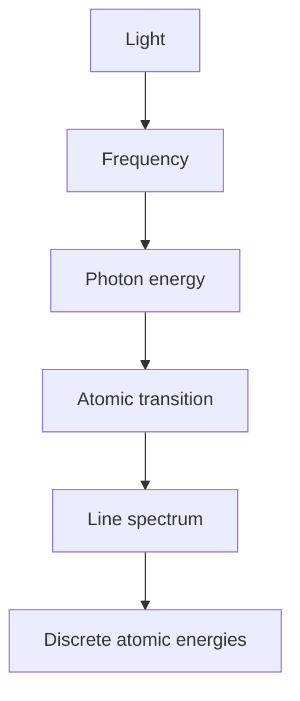

# Quantum Theory of Atoms

Atomic spectra forced a departure from classical models. Atoms absorb and emit only particular photon energies, and electrons occupy orbitals described by quantum numbers rather than arbitrary planetary paths.

## Light, photons, and the evidence for quantization

Wavelength $\lambda$ is the distance between repeating points of a wave, while frequency $\nu$ is the number of cycles per second. For electromagnetic radiation in vacuum,

$$
c=\lambda\nu.
$$

Planck's relation assigns one photon the energy

$$
E=h\nu=\frac{hc}{\lambda}.
$$

Shorter wavelengths therefore correspond to higher frequencies and higher photon energies.

Classical wave theory could distribute light energy continuously, but the photoelectric effect showed a threshold frequency below which no electrons are ejected, regardless of intensity. Above threshold,

$$
K_{\max}=h\nu-\Phi,
$$

where $\Phi$ is the work function. Raising frequency raises the maximum electron kinetic energy; raising intensity mainly increases the number of photons and emitted electrons. The blackbody spectrum and atomic line spectra supplied independent evidence that energy exchange is quantized.

For a 450 nm photon,

$$
E=\frac{(6.626\times10^{-34}\ \mathrm{J\,s})(2.998\times10^8\ \mathrm{m\,s^{-1}})}{450\times10^{-9}\ \mathrm{m}}
=4.41\times10^{-19}\ \mathrm{J}.
$$

Writing the nanometer-to-meter conversion in the substitution prevents the most common unit error.

## What the Bohr model gets right—and where it stops

For hydrogen,

$$
E_n=-\frac{2.18\times10^{-18}\ \mathrm{J}}{n^2}.
$$

The energy change of the atom is $\Delta E=E_f-E_i$. An emitted photon carries the positive magnitude $\vert \Delta E\vert $ when the atom moves to a lower level; absorption requires a positive atomic $\Delta E$.

For the hydrogen transition $n=3\to n=2$,

$$
E_3=-2.42\times10^{-19}\ \mathrm{J},\qquad
E_2=-5.45\times10^{-19}\ \mathrm{J}.
$$

Thus the atom has $\Delta E=-3.03\times10^{-19}\ \mathrm{J}$ and the photon has energy $3.03\times10^{-19}\ \mathrm{J}$. Its wavelength is

$$
\lambda=\frac{hc}{E}=6.56\times10^{-7}\ \mathrm{m}=656\ \mathrm{nm},
$$

the red Balmer line. The Bohr model explains hydrogen's level pattern but does not describe multi-electron atoms adequately. Quantum mechanics replaces fixed circular orbits with wavefunctions.

## Orbitals and their quantum numbers

An atomic orbital is a one-electron wavefunction; its squared magnitude gives a probability density. The quantum numbers label its shell, shape, orientation, and the electron spin state.

| Quantum number | Allowed values | Meaning | Example |
|---|---|---|---|
| $n$ | $1,2,3,\dots$ | principal shell and radial scale | $n=3$ |
| $l$ | $0$ through $n-1$ | subshell or orbital angular momentum | $l=1$ means p |
| $m_l$ | $-l$ through $+l$ | orbital orientation | $-1,0,+1$ for p |
| $m_s$ | $+1/2$ or $-1/2$ | spin projection | paired electrons have opposite values |

The subshell letters $s,p,d,f$ correspond to $l=0,1,2,3$. A subshell contains $2l+1$ orbitals, and each orbital can contain at most two electrons with opposite spin projections.

Orbitals are probability amplitudes, not sharply bounded containers. Drawn orbital surfaces usually represent a chosen probability contour, so an electron is not forbidden from being outside the illustrated boundary.

## Matter waves and uncertain trajectories

De Broglie's relation assigns wavelength to a particle of momentum $p$:

$$
\lambda=\frac{h}{p}.
$$

For a nonrelativistic electron moving at $2.00\times10^6\ \mathrm{m\,s^{-1}}$,

$$
p=m_ev=(9.109\times10^{-31})(2.00\times10^6)
=1.82\times10^{-24}\ \mathrm{kg\,m\,s^{-1}},
$$

and

$$
\lambda=\frac{6.626\times10^{-34}}{1.82\times10^{-24}}
=3.64\times10^{-10}\ \mathrm{m}.
$$

This is comparable to atomic spacings, so electron diffraction is measurable. The wavelength of an everyday object is too small to resolve under ordinary conditions.

Wave behavior rules out an exact classical path. Heisenberg's relation,

$$
\Delta x\,\Delta p_x\geq\frac{\hbar}{2},
$$

is a property of quantum states rather than an avoidable instrument defect. A sharply localized wave requires many wavelengths and therefore a broad momentum distribution.

## The Schrödinger picture and nodes

The time-independent equation is

$$
\hat H\psi=E\psi.
$$

Only wavefunctions satisfying the boundary and normalization conditions are allowed, producing discrete energy eigenvalues. The probability density is $\vert \psi\vert ^2$, yet the sign of $\psi$ still controls constructive and destructive interference.

Hydrogen orbitals have radial and angular nodes where $\psi=0$. An orbital has $n-1$ total nodes, of which $l$ are angular and $n-l-1$ are radial. A $2p$ orbital has one angular node and no radial nodes; a $3s$ orbital has two radial nodes. The lobes of a p orbital mark opposite phases of one wavefunction, not separate electron containers.

The negative Bohr energy indicates a bound state relative to a separated electron and nucleus at zero energy. As $n$ increases, levels converge toward ionization. For a one-electron ion,

$$
E_n=-\frac{Z^2(2.18\times10^{-18}\ \mathrm{J})}{n^2}.
$$

The formula fails for many-electron atoms because electron repulsion and shielding destroy the simple one-particle Coulomb result.

## Counting states and testing quantum numbers

Shell $n$ contains $n^2$ orbitals and can hold $2n^2$ electrons. For $n=3$, the 3s, 3p, and 3d subshells contain $1+3+5=9$ orbitals and at most 18 electrons.

The set $(n,l,m_l,m_s)=(3,2,-2,+1/2)$ is allowed: $l$ may be 0, 1, or 2; a d subshell permits $m_l=-2$ through $+2$; and either spin projection is possible. $(3,3,0,+1/2)$ is forbidden because $l\lt n$. $(2,1,2,-1/2)$ is forbidden because a p orbital permits only $m_l=-1,0,+1$.

In multi-electron atoms, penetration and shielding split subshell energies. An s orbital penetrates closer to the nucleus than p, d, or f orbitals of the same shell and generally experiences a larger effective nuclear charge. Pauli exclusion allows at most two opposite-spin electrons per orbital. Hund's rule fills degenerate orbitals singly with parallel spins before pairing. These are occupation rules for quantum states, not miniature paths chosen by particles.

### A second photon calculation

The energy above for a 450 nm photon is per photon. Per mole,

$$
(4.41\times10^{-19}\ \mathrm{J})(6.022\times10^{23}\ \mathrm{mol^{-1}})
=2.66\times10^5\ \mathrm{J\,mol^{-1}}.
$$

If a transition instead releases $3.03\times10^{-19}\ \mathrm{J}$, its frequency is

$$
\nu=\frac{E}{h}=4.57\times10^{14}\ \mathrm{s^{-1}},
$$

and $c/\nu=6.56\times10^{-7}\ \mathrm{m}$. Energy, frequency, and wavelength are three descriptions of the same photon; their significant figures should agree with the least precise input.

## Sign and model checks

- Photon energy is positive; the sign of the atom's $\Delta E$ distinguishes emission from absorption.
- The simple Bohr energy formula above applies to hydrogen. Hydrogen-like ions require the nuclear-charge factor $Z^2$.
- A proposed set of quantum numbers must satisfy $0\le l\lt n$ and $-l\le m_l\le l$.
- Frequency rises as wavelength falls, and photon energy follows frequency.
- Classical orbit language can describe the historical model but not the modern meaning of an orbital.

## Spectra as fingerprints of energy differences

An atom does not emit every photon compatible with the difference between any two named levels. Transition probabilities are controlled by selection rules arising from symmetry and angular momentum. Some transitions are strongly allowed, others weakly allowed, and some effectively forbidden on ordinary timescales. A line spectrum therefore records both level spacings and the coupling of states to electromagnetic radiation.

Line width is finite. Natural lifetime broadening follows from the energy–time uncertainty relation; thermal motion gives Doppler broadening; collisions perturb energy levels and broaden lines further. High-resolution spectra can also show fine structure from spin–orbit coupling and splitting in electric or magnetic fields. The simple Bohr line is the center of a richer experimental feature.

Absorption requires an initial population in the lower state and photons of matching energy. Emission requires atoms in excited states, often prepared by heating, electrical discharge, or prior absorption. At thermal equilibrium, level populations follow a Boltzmann distribution, so high-energy states are less populated at modest temperature.

## Probability, measurement, and expectation values

Normalization requires the integral of $\vert \psi\vert ^2$ over all space to equal one. Probability in a region is the integral over that region, not the value of the wavefunction at a point. An expectation value is the average result from many identically prepared measurements. It need not equal any single observed value.

Operators represent observables. A state that is an eigenfunction of an operator has a definite value for that observable. Noncommuting operators, such as position and momentum, lack simultaneous exact eigenstates and lead to uncertainty relations. The uncertainty is the statistical spread of repeated measurements on identically prepared systems.

Electron spin is intrinsic angular momentum, not a literal sphere rotating in space. Its two projections supply the $m_s=\pm1/2$ labels. Combining spin with orbital occupation explains magnetic behavior: unpaired electrons give paramagnetism, while fully paired configurations are usually diamagnetic.

## Radial probability and penetration

Probability density at a point and probability within a spherical shell are different. Radial probability includes the shell volume factor, which grows as $r^2$. The hydrogen 1s density is largest at the nucleus, but the most probable radial distance lies away from it because a shell at finite radius contains much more volume.

An s orbital has nonzero density at the nucleus and penetrates inner shells strongly. A p orbital vanishes at the nucleus, and higher-$l$ orbitals are excluded still more strongly by their angular behavior. Penetration changes shielding and subshell energy in many-electron atoms. It helps explain why 4s is occupied before 3d in neutral atoms, while ion formation and electron repulsion can reverse their relative energies.

## The scope of orbital language

An orbital is obtained within a model of electrons moving in an effective potential. In a many-electron atom, assigning each electron to one orbital is an approximation to a correlated wavefunction. It remains exceptionally useful for configurations and bonding, but electrons do not carry permanent name tags linking them to particular orbitals.

Exact analytic solutions exist for hydrogen-like one-electron species. Multi-electron atoms require approximation: central-field models, variational methods, and numerical calculations. Experimental agreement decides whether the approximation is adequate for a requested property.

Classical language survives where it is harmless. One may speak of an electron “transitioning between orbitals,” but the statement denotes a change of quantum state, not a bead jumping between drawn lobes. Keeping that distinction prevents orbital diagrams from being mistaken for microscopic photographs.

The correspondence principle explains why classical mechanics works for large-scale motion. Quantum predictions approach classical behavior when quantum numbers are large and phase information is washed out by interaction with the environment. Decoherence suppresses observable interference between macroscopically distinct alternatives, though it does not turn the underlying theory into Newtonian trajectories.

Energy quantization is not imposed by a rule that all quantities must be discrete. It emerges from boundary conditions for bound states. A free particle can have a continuous range of kinetic energies, while an electron confined by an atomic potential has discrete bound energies and a continuum above ionization. The physical constraint determines the spectrum.

## Scale checks

Visible photons carry energies of a few electronvolts, comparable to valence electronic changes. Vibrational and rotational spacings are generally smaller, while core-electron and nuclear changes are larger. These scales help detect unit errors: an ordinary visible transition should not emerge with a molar energy of only a few joules or a nuclear-scale result.

The electronvolt is an energy unit, not a voltage. One electronvolt is the energy gained by one elementary charge across one volt. Conversion to joules or kilojoules per mole must distinguish a single particle from an amount of particles.

See also: [electron configurations and periodic trends](/chemistry/general/electron-configurations-and-periodic-trends) · [ionic and covalent bonding](/chemistry/general/ionic-and-covalent-bonding) · [molecular geometry and bonding theory](/chemistry/general/molecular-geometry-and-bonding-theory) · [nuclear chemistry](/chemistry/general/nuclear-chemistry)

