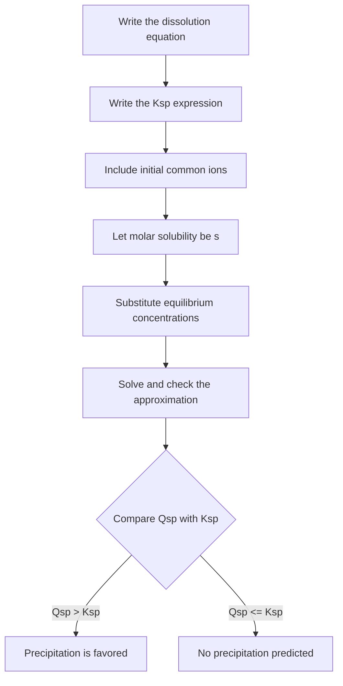

# Solubility and Complex-Ion Equilibria

A slightly soluble salt reaches equilibrium with its dissolved ions. The calculation becomes more interesting when another reaction consumes one of those ions: a common ion suppresses dissolution, acid can remove a basic anion, and a ligand can bind the free metal ion.

## The dissolution equation comes first

Solubility is the equilibrium amount of a solute that dissolves; molar solubility expresses that amount in moles per liter. The solubility product $K_{sp}$ is written from the dissolution stoichiometry and omits the pure solid.

For silver chloride,

$$
\mathrm{AgCl(s)\rightleftharpoons Ag^+(aq)+Cl^-(aq)},
$$

$$
K_{sp}=[\mathrm{Ag^+}][\mathrm{Cl^-}].
$$

For a salt such as $\mathrm{CaF_2}$, the stoichiometry changes both the concentration relation and the exponent:

$$
\mathrm{CaF_2(s)\rightleftharpoons Ca^{2+}(aq)+2F^-(aq)},
$$

$$
K_{sp}=[\mathrm{Ca^{2+}}][\mathrm{F^-}]^2.
$$

Molar solubility should therefore not be identified directly with $K_{sp}$. The dissolution equation determines how a solubility $s$ maps to each ion concentration.

## Silver chloride in pure water

If $K_{sp}=1.8\times10^{-10}$, let the molar solubility of AgCl be $s$. Dissolution produces equal concentrations of the two ions:

$$
[\mathrm{Ag^+}]=s,\qquad [\mathrm{Cl^-}]=s.
$$

Then

$$
s^2=1.8\times10^{-10},
$$

$$
s=1.34\times10^{-5}\ \mathrm{M}.
$$

The square root appears only because the salt produces one of each ion. A different formula gives a different polynomial in $s$.

## Deciding whether mixing causes a precipitate

The ion product $Q_{sp}$ has the same algebraic form as $K_{sp}$ but uses the current concentrations. If $Q_{sp}\gt K_{sp}$, the mixture is supersaturated and precipitation is favored.

Mix equal volumes of $2.0\times10^{-4}\ \mathrm{M}$ $\mathrm{AgNO_3}$ and $2.0\times10^{-4}\ \mathrm{M}$ NaCl. The volume doubles, so each ion concentration is halved:

$$
[\mathrm{Ag^+}]=[\mathrm{Cl^-}]=1.0\times10^{-4}\ \mathrm{M}.
$$

Therefore

$$
Q_{sp}=(1.0\times10^{-4})^2=1.0\times10^{-8}.
$$

This is about 56 times the stated $K_{sp}$, so AgCl precipitates until the dissolved-ion activities satisfy equilibrium. The dilution step belongs before the $Q_{sp}$ calculation.

## Coupled equilibria can reverse the solubility trend

| Change to the solution | Immediate effect | Effect on dissolution |
|---|---|---|
| Add a common anion | increases a dissolution product | shifts toward the solid |
| Add acid that consumes a basic anion | removes a dissolution product | shifts toward dissolved ions |
| Add a ligand that binds the metal | lowers free metal-ion concentration | shifts toward dissolved ions |
| Add the metal cation | increases a dissolution product | shifts toward the solid |

A complex ion is a metal center bound to ligands, and its formation constant $K_f$ measures the equilibrium tendency to form that complex. When a ligand strongly binds the dissolved metal ion, the free metal concentration can become very small even while the total dissolved metal concentration rises. Reactions may be added and their equilibrium constants multiplied to obtain the overall constant for dissolution plus complex formation.

This coupling supports selective precipitation and classical qualitative analysis. The relevant comparison is among free-ion concentrations, not merely the total analytical concentrations placed in the beaker.

## Stoichiometry changes the relation between $K_{sp}$ and solubility

For $\mathrm{CaF_2}$ dissolving in pure water, let $s$ be the number of moles of formula units dissolved per liter. The ion concentrations are $s$ and $2s$, so

$$
K_{sp}=s(2s)^2=4s^3,
$$

and

$$
s=\left(\frac{K_{sp}}{4}\right)^{1/3}.
$$

The factor four and cube root come directly from the balanced equation. Consequently, comparing two numerical $K_{sp}$ values does not always rank their molar solubilities when the salts have different stoichiometries. Units, temperature, and activity conventions must also match.

Equilibrium constants are formally written in activities. Introductory calculations replace activity with molar concentration, an approximation most reliable in dilute solutions. Highly charged ions or appreciable ionic strength can produce noticeable deviations. A calculation can be algebraically exact within the concentration model and still differ from experiment for this reason.

## The common-ion effect with an approximation check

Place AgCl in $0.100\ \mathrm{M}$ NaCl and use $K_{sp}=1.8\times10^{-10}$. If $s$ molar AgCl dissolves,

$$
[\mathrm{Ag^+}]=s,\qquad[\mathrm{Cl^-}]=0.100+s.
$$

The exact equation is

$$
s(0.100+s)=1.8\times10^{-10}.
$$

Because the pure-water solubility was only about $10^{-5}\ \mathrm{M}$ and the common chloride concentration is $0.100\ \mathrm{M}$, try $s\ll0.100$:

$$
s\approx\frac{1.8\times10^{-10}}{0.100}
=1.8\times10^{-9}\ \mathrm{M}.
$$

The neglected fraction is $s/0.100=1.8\times10^{-8}$, so the approximation is amply justified. The common ion lowers the solubility by roughly four orders of magnitude relative to pure water. Substituting the answer back into the full expression is the quickest check.

An inert electrolyte is not a common ion merely because it raises ionic strength. A common ion must appear in the dissolution equilibrium. Sodium nitrate supplies neither silver nor chloride to AgCl, although at sufficient concentration it can alter activities.

## Acid can dissolve salts of basic anions

Consider a carbonate salt:

$$
\mathrm{MCO_3(s)\rightleftharpoons M^{2+}+CO_3^{2-}}.
$$

Added acid protonates carbonate through bicarbonate toward carbonic acid, which can form water and carbon dioxide. Removing free $\mathrm{CO_3^{2-}}$ drives further dissolution. The net result may be represented schematically as

$$
\mathrm{MCO_3(s)+2H^+\rightarrow M^{2+}+CO_2+H_2O}.
$$

Salts with anions that are conjugate bases of weak acids often become more soluble at low pH. Chloride is the conjugate base of a strong acid and is not appreciably consumed by ordinary acid addition, so the same argument does not predict acid-enhanced AgCl solubility.

If a quantitative pH-dependent solubility is required, the dissolution equilibrium, acid dissociation equilibria, mass balance, and charge balance must be solved together. Applying Le Châtelier's principle gives the direction, not necessarily the numerical amount.

## Complex formation changes free concentration, not mass balance

Silver ion binds ammonia:

$$
\mathrm{Ag^++2NH_3\rightleftharpoons[Ag(NH_3)_2]^+},
$$

$$
K_f=\frac{[\mathrm{Ag(NH_3)_2^+}]}{[\mathrm{Ag^+}][\mathrm{NH_3}]^2}.
$$

Adding this equation to AgCl dissolution cancels free $\mathrm{Ag^+}$ and gives

$$
\mathrm{AgCl(s)+2NH_3\rightleftharpoons[Ag(NH_3)_2]^++Cl^-}.
$$

The overall equilibrium constant is $K_{sp}K_f$. A large formation constant can outweigh a small solubility product, so ammonia dissolves substantially more silver chloride than pure water. Total dissolved silver is

$$
[\mathrm{Ag}]_{\mathrm{tot}}=[\mathrm{Ag^+}]+[\mathrm{Ag(NH_3)_2^+}]
$$

if those are the only important silver species. The $K_{sp}$ expression still contains free $\mathrm{Ag^+}$, not the total. Substituting total concentration there incorrectly erases the chemical effect of complexation.

Conditional formation constants fold ligand protonation or competing reactions into an effective constant valid at a specified pH and ligand concentration. They are useful because many ligands bind only in a deprotonated form. A tabulated intrinsic $K_f$ can overpredict binding if most ligand is protonated.

## Selective precipitation is a threshold calculation

Suppose a solution contains two metal ions that form salts with the same added anion. For each possible solid, solve the onset condition $Q_{sp}=K_{sp}$ for the anion concentration. The salt requiring the lower anion concentration begins to precipitate first. Separation is good only if most of the first ion can precipitate before the second reaches its threshold.

After precipitation begins, concentrations no longer follow the simple dilution-only values. The solid removes ions until the saturation condition is restored. If reagent continues to be added, a mass-balance calculation is needed. Merely saying that the smaller $K_{sp}$ precipitates first can fail when ion stoichiometries or starting metal concentrations differ.

The same logic explains fractional precipitation and qualitative group separations. Control of pH, free ligand, or common-ion concentration shifts thresholds by controlling the free ions that enter $Q_{sp}$.

## Approximation and interpretation checks

- Compute post-mixing concentrations before evaluating $Q_{sp}$.
- Carry stoichiometric coefficients into both concentration expressions and exponents.
- Include ions supplied by other solutes; the solid is not the only possible source of a common ion.
- Check whether acid-base chemistry consumes the anion or complex formation consumes the cation.
- Distinguish free metal ion from total dissolved metal when ligands are present.

## A systematic equilibrium setup

When several equilibria are coupled, an ICE table for only one reaction can miss constraints. Begin by listing all chemically significant species, then write equilibrium expressions, material balances for conserved components, and charge balance. Add water autoionization if pH is not fixed. The number of independent equations should match the unknown concentrations.

For a metal $M$ binding ligand $L$, a material balance might be

$$
[M]_{tot}=[M^{2+}]+[ML^{2+}]+[ML_2^{2+}].
$$

Stepwise constants describe addition of one ligand at a time, while an overall constant $\beta_2$ describes formation of $ML_2$ directly from free metal and two free ligands. Multiplying stepwise constants gives the corresponding overall constant. Mixing the two conventions double-counts equilibria.

Precipitation does not necessarily remove every trace of an ion. Once solid and solution are at equilibrium, finite free-ion concentrations remain and obey $K_{sp}$. “Complete precipitation” is an analytical approximation meaning that the remaining fraction is acceptably small. Its validity depends on the demanded accuracy.

Supersaturation is also a thermodynamic statement, not a guarantee of immediate visible solid. Nucleation can be slow, especially without seed crystals or rough surfaces. A solution may temporarily have $Q_{sp}\gt K_{sp}$ and remain clear. Equilibrium predicts the favored final direction; kinetics controls how soon it is observed.

Temperature changes equilibrium constants. A numerical $K_{sp}$ or $K_f$ belongs to its stated temperature and medium. Comparing values measured under different ionic strengths or conventions can create apparent contradictions. Tables are most reliable when conditions and definitions match the calculation.

Amphoteric hydroxides add another coupling. A metal hydroxide may dissolve in acid because hydroxide is protonated, yet also dissolve in strong base by forming a soluble hydroxo complex. Its minimum solubility often occurs at an intermediate pH. Labeling the solid “insoluble in water” therefore says little about behavior across the full pH range.

Complexation can also reverse selectivity. A ligand that binds one metal much more strongly lowers that metal's free concentration and delays precipitation of its salt. Conversely, destroying a complex by protonating the ligand can release free metal and trigger precipitation. Analytical schemes exploit these conditional changes, but successful separation depends on quantitative ratios rather than the mere existence of a complex.

When a solid is present, its amount does not appear in $K_{sp}$, but it must be positive for the saturation constraint to apply. If a mass-balance solution predicts a negative solid amount, all solid has dissolved and the equilibrium must be recalculated without imposing saturation. Phase presence is part of the answer, not an automatic assumption.

## Reporting solubility

Molar solubility counts formula units dissolved per volume, while total metal solubility may include several complexes. Mass solubility follows by multiplying by molar mass. The three numbers are not interchangeable, especially for salts with more than one metal ion per formula unit.

A calculated concentration below zero or above the analytical total signals a broken assumption or algebraic root. Polynomial equilibrium equations can have several mathematical roots, but only nonnegative concentrations satisfying every mass balance are physical. Substitution into the original equations is part of the solution.

See also: [chemical equilibrium](/chemistry/general/chemical-equilibrium) · [acid-base equilibria, buffers, and titrations](/chemistry/general/acid-base-equilibria-buffers-and-titrations) · [transition metals and coordination compounds](/chemistry/general/transition-metals-and-coordination-compounds) · [aqueous reactions and solution stoichiometry](/chemistry/general/aqueous-reactions-and-solution-stoichiometry)

