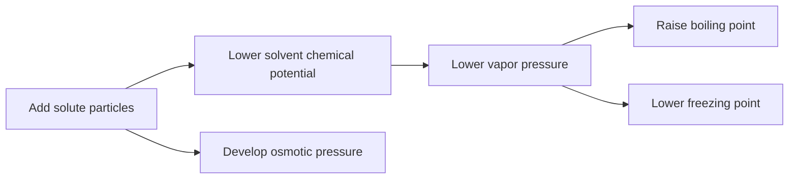

# Solutions and Colligative Properties

A solution is a homogeneous mixture whose behavior depends on chemical interactions and particle count. Solubility asks how much can dissolve at equilibrium; concentration reports how much is present; colligative properties track how dissolved particles shift solvent phase equilibria.

## Choosing a concentration scale

The solvent usually sets the phase and is present in the larger amount; the remaining component is the solute. No single concentration unit is best for every calculation.

| Concentration unit | Formula | Typical use | Temperature sensitive? |
|---|---|---|---|
| Molarity | $M=n/V_{solution}$ | reactions carried out by solution volume | yes, because volume changes |
| Molality | $m=n/\mathrm{kg\ solvent}$ | boiling- and freezing-point shifts | no volume term |
| Mole fraction | $X_i=n_i/n_{total}$ | vapor-pressure relations | no volume term |
| Mass percent | mass part / mass whole | reporting mixture composition | no volume term |

Molality uses kilograms of solvent, not kilograms of solution. Molarity uses the final solution volume, not the volume of pure solvent before mixing.

## Why a solute dissolves

Dissolution requires separating some solute particles and some solvent particles, then forming solute-solvent interactions. Favorable mixing reflects the balance of those energetic changes with the increase in entropy. The rule “like dissolves like” is a useful first screen for intermolecular compatibility, but it does not replace that balance.

Solubility is an equilibrium amount, whereas the rate of dissolving is kinetic. Stirring or grinding may reach equilibrium faster without changing the equilibrium solubility at the same temperature and pressure.

## Vapor pressure and liquid-mixture separation

For an ideal solution, Raoult's law gives the partial pressure of component A:

$$
P_A=X_A P_A^\circ.
$$

A nonvolatile solute lowers the solvent mole fraction and therefore lowers the solvent vapor pressure. For two volatile liquids, the vapor is usually enriched in the more volatile component. Repeated vaporization and condensation in a fractionating column sharpen that separation.

Strongly nonideal solutions can deviate substantially from Raoult's law because unlike-particle interactions differ from like-particle interactions.

## One particle-count argument, four colligative effects

For dilute ideal solutions,

$$
\Delta T_b=iK_bm,
$$

$$
\Delta T_f=iK_fm,
$$

$$
\Pi=iMRT.
$$

The van't Hoff factor $i$ is the effective number of dissolved particles per formula unit. A nonelectrolyte has $i\approx1$; an ionic solute can have a larger value, though ion pairing often makes the measured factor smaller than the ideal integer.

## Freezing point of an ethylene glycol solution

Dissolve 10.0 g ethylene glycol, $\mathrm{C_2H_6O_2}$, in 200.0 g water. With $K_f=1.86\ ^\circ\mathrm{C\,kg\,mol^{-1}}$ and $i=1$:

1. The molar mass is $62.07\ \mathrm{g\,mol^{-1}}$.
2. The solute amount is $10.0/62.07=0.161\ \mathrm{mol}$.
3. The solvent mass is $0.2000\ \mathrm{kg}$, so $m=0.161/0.2000=0.805\ \mathrm{mol\,kg^{-1}}$.
4. $\Delta T_f=(1)(1.86)(0.805)=1.50^\circ\mathrm{C}$.

Relative to pure water at $0.00^\circ\mathrm{C}$, the estimated freezing point is $-1.50^\circ\mathrm{C}$. The formula returns the positive magnitude of the depression; subtract it from the pure-solvent freezing point.

## Osmotic pressure at low concentration

For 0.0100 M glucose at 298 K, glucose is a nonelectrolyte and $i=1$:

$$
\Pi=(1)(0.0100\ \mathrm{mol\,L^{-1}})(0.082057\ \mathrm{L\,atm\,mol^{-1}\,K^{-1}})(298\ \mathrm{K})
=0.244\ \mathrm{atm}.
$$

Osmotic pressure can remain readily measurable at concentrations for which boiling- or freezing-point shifts are small.

## Energetics, temperature, and gas solubility

The enthalpy of solution can be separated conceptually into breaking solute–solute attractions, opening space among solvent molecules, and forming solute–solvent attractions. The first two cost energy; the last releases it. A positive enthalpy does not forbid dissolution because increased entropy can still make $\Delta G=\Delta H-T\Delta S$ negative. Strong lattice attraction can likewise keep an ionic solid sparingly soluble despite favorable hydration.

Temperature effects depend on the dissolution enthalpy, so hotter water does not invariably dissolve more solid. Dissolved gases usually become less soluble on heating. At fixed temperature, a common form of Henry's law is

$$
C=k_HP.
$$

Increasing the gas partial pressure increases its dilute dissolved concentration. Several reciprocal definitions of $k_H$ are used, so the equation and units must be checked together.

## Composition calculations before colligative calculations

Suppose $5.85\ \mathrm{g}$ NaCl is mixed with $100.0\ \mathrm{g}$ water. Using $58.44\ \mathrm{g\,mol^{-1}}$ gives $0.100\ \mathrm{mol}$ NaCl. Therefore

$$
m=\frac{0.100\ \mathrm{mol}}{0.1000\ \mathrm{kg}}=1.00\ \mathrm{mol\,kg^{-1}},
$$

while the mass percentage is

$$
\frac{5.85}{5.85+100.0}(100\%)=5.53\%.
$$

Molarity cannot be recovered from these masses without the solution volume or density. Mixing volumes are not generally additive.

Dilution instead conserves solute moles when no reaction occurs:

$$
M_1V_1=M_2V_2.
$$

To prepare $250.0\ \mathrm{mL}$ of $0.100\ \mathrm{M}$ solution from $1.00\ \mathrm{M}$ stock, use

$$
V_1=\frac{(0.100)(250.0)}{1.00}=25.0\ \mathrm{mL}.
$$

The aliquot is diluted to a final volume of $250.0\ \mathrm{mL}$, rather than mixed with that much water.

## Why the phase-transition shifts have opposite signs

A nonvolatile solute lowers the solvent chemical potential and vapor pressure. The solution must be heated further before its vapor pressure reaches the external pressure, so boiling point rises. The liquid is also stabilized relative to pure solid solvent, so a lower temperature is needed to freeze it. The formulas report positive magnitudes $\Delta T_b$ and $\Delta T_f$; add the former to the pure boiling point and subtract the latter from the pure freezing point.

For two volatile liquids, ideal behavior gives

$$
P_{\mathrm{tot}}=X_AP_A^\circ+X_BP_B^\circ.
$$

The vapor mole fraction $y_A=P_A/P_{\mathrm{tot}}$ differs from liquid $X_A$ and is enriched in the more volatile component. Fractional distillation repeats this equilibrium separation. Strong nonideality can create an azeotrope where vapor and liquid compositions match, preventing further separation by ordinary distillation.

Osmosis uses the same chemical-potential argument. Solvent crosses a membrane toward the solution with lower solvent chemical potential until a pressure difference balances it. “Isotonic” refers to effective osmotic pressure across a particular membrane, not molarity alone. A solute able to cross that membrane may contribute temporarily to osmolarity without maintaining cell volume.

## Interpreting the van't Hoff factor

Ideal $\mathrm{NaCl}$ dissociation suggests $i=2$, and $\mathrm{CaCl_2}$ suggests $i=3$. Real values can be lower because opposite ions remain correlated or pair transiently. At higher concentrations, activity effects also matter. Measured colligative behavior can define an effective $i$, but that number should not be read as a literal count of permanently independent particles.

If a solute associates, $i$ may be below one. Dimerization of two solute molecules into one particle reduces the number of independently moving species. Colligative measurements have therefore been used to infer molar masses and association, provided ideality and solute chemistry are treated carefully.

## Where the ideal formulas need care

- Use molality, not molarity, in $\Delta T_b$ and $\Delta T_f$.
- Base molality on solvent mass alone.
- Include dissociation through $i$, but do not assume an ionic solution has its ideal integer value at every concentration.
- Separate equilibrium solubility from the rate at which a solid dissolves.
- Apply Raoult's law cautiously when interactions are strongly nonideal or when several components are volatile.

## Real solutions and standard states

Ideal-solution formulas replace chemical potential corrections with mole fractions or concentrations. Real solutions use activities, $a_i=\gamma_i c_i/c^\circ$ in one convention. The activity coefficient $\gamma_i$ approaches one at sufficient dilution but can depart strongly from it in concentrated electrolyte solutions. The chosen standard state matters, so activity coefficients from incompatible conventions cannot be mixed.

Electrolyte solutions are especially nonideal because each ion interacts over long range with an ionic atmosphere. Charge balance requires the total positive and negative charge concentrations to match in bulk. Individual-ion activities are not directly measurable in isolation; mean ionic activity coefficients are commonly used.

## Solubility versus miscibility

“Soluble” often refers to a solute dissolving up to a finite concentration, whereas two liquids are miscible when they mix in all proportions. Partial miscibility produces two liquid phases over part of the composition range. Each phase contains some of both components but has a different composition.

Adding a third component can change mutual solubility by preferential interactions. Salt can reduce the water solubility of some neutral organics, while a cosolvent can increase it. Such outcomes cannot be inferred from polarity labels alone because entropy and all pair interactions enter the free energy of mixing.

Supersaturated solutions contain more dissolved material than the stable equilibrium amount. They are metastable and may crystallize after seeding or disturbance. Saturation describes equilibrium at specified temperature and pressure; concentrated merely describes a relatively large amount and need not mean saturated.

## Colligative molar-mass measurement

If $1.50\ \mathrm{g}$ of a nonelectrolyte dissolved in $50.0\ \mathrm{g}$ benzene lowers its freezing point by $1.02^\circ\mathrm{C}$ and $K_f=5.12\ ^\circ\mathrm{C\,kg\,mol^{-1}}$, then

$$
m=\frac{1.02}{5.12}=0.199\ \mathrm{mol\,kg^{-1}}.
$$

The solute amount is $(0.199)(0.0500)=0.00995\ \mathrm{mol}$, giving molar mass

$$
M=\frac{1.50\ \mathrm{g}}{0.00995\ \mathrm{mol}}=151\ \mathrm{g\,mol^{-1}}.
$$

Association would make the apparent molar mass too large because fewer particles produce a smaller depression. Dissociation would make it too small unless the van't Hoff factor were included.

Reverse osmosis applies pressure greater than the osmotic pressure on the concentrated side, forcing solvent toward the dilute side. The membrane rejects solutes imperfectly in real devices, and concentration polarization near its surface raises the effective demand. The ideal equation supplies a lower-bound thermodynamic scale rather than complete engineering performance.

Boiling-point elevation depends on external pressure as well as composition. The colligative formula compares solution and pure solvent at the same pressure; it does not claim a universal boiling temperature. Likewise, freezing-point depression assumes the solid phase that separates is nearly pure solvent. If solute enters the solid or a new compound crystallizes, a full phase diagram is needed.

Colligative laws are limiting laws for dilute solutions. They depend on particle count because solute identity enters only through its effect on solvent chemical potential in that limit. At higher concentration, molecular size and specific interactions reappear through activities. Two equimolal solutes with the same nominal $i$ need not then produce identical shifts.

Concentration labels require a basis. A statement such as “10 percent solution” is incomplete unless it specifies mass/mass, mass/volume, or volume/volume. These conventions yield different compositions and should not be converted without density information.

## Phase separation and extraction

When two liquids are immiscible, a solute distributes between them according to its relative affinity. A partition coefficient describes the equilibrium concentration ratio for a specified molecular form. Several small extractions usually recover more solute than one extraction using the same total solvent volume because each fresh portion re-establishes the distribution.

Acid-base extraction changes affinity by changing charge. A neutral organic acid may favor an organic phase, while deprotonation gives an ionic salt that favors water. Restoring the neutral form can precipitate or re-extract it. Mass balance spans both phases, so concentration in either layer alone is not total recovery.

Repeated concentration changes require a fresh basis at each step. Evaporation removes solvent but normally leaves nonvolatile solute behind; dilution adds solvent while preserving solute amount; crystallization removes solute and may also remove solvent as a hydrate. Applying the dilution equation to evaporation or crystallization without a mass balance gives the wrong composition.

See also: [aqueous reactions and solution stoichiometry](/chemistry/general/aqueous-reactions-and-solution-stoichiometry) · [states of matter, liquids, and solids](/chemistry/general/states-of-matter-liquids-and-solids) · [chemical equilibrium](/chemistry/general/chemical-equilibrium) · [acid-base equilibria, buffers, and titrations](/chemistry/general/acid-base-equilibria-buffers-and-titrations)

