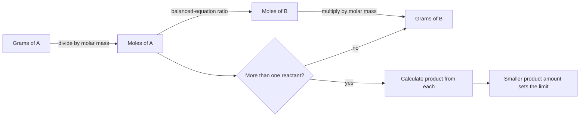

# Stoichiometry

A balanced chemical equation is a quantitative statement about reacting amounts. Its coefficients give mole ratios because atoms are conserved; molar masses then connect those ratios to laboratory measurements in grams.

## Moles are the common currency

Molar mass is the mass of one mole of a substance, and Avogadro's constant $N_A$ converts moles to a particle count:

$$
n=\frac{m}{M},\qquad N=nN_A.
$$

Formula subscripts describe atom ratios within a formula unit or molecule. Stoichiometric coefficients describe ratios among reacting substances. Subscripts must not be changed to balance a reaction because doing so changes the substances themselves.

The equation must be balanced before any mole-ratio step. A calculation based on an unbalanced equation violates the atom accounting even if the arithmetic is clean.

Balancing changes coefficients only. A useful order is to balance elements appearing in the fewest species first, leave free elemental oxygen or hydrogen until late, then reduce all coefficients to the smallest whole numbers. Polyatomic ions that remain intact may be balanced as units. Finally recount every element and, for ionic equations, charge.

For propane combustion, begin with

$$
\mathrm{C_3H_8+O_2\rightarrow CO_2+H_2O}.
$$

Three carbon atoms require $3\mathrm{CO_2}$; eight hydrogens require $4\mathrm{H_2O}$. The products then contain ten oxygen atoms, requiring $5\mathrm{O_2}$:

$$
\mathrm{C_3H_8+5O_2\rightarrow3CO_2+4H_2O}.
$$

The coefficients describe molecule counts or mole amounts, not mass ratios. One mole of propane and five moles of oxygen do not have equal or coefficient-proportional masses.

## Composition and formulas

An empirical formula gives the smallest whole-number atom ratio. A molecular formula gives the actual atom count and is an integer multiple of the empirical formula. Formula mass is the sum of the atomic masses in one formula unit.

| Task | First move | Check |
|---|---|---|
| Empirical formula | convert composition to moles | reduce to a small whole-number ratio |
| Molecular formula | compare molar mass with empirical-formula mass | multiplier should be an integer |
| Limiting reactant | calculate possible product from each reactant | smaller product amount controls |
| Percent yield | compare isolated and theoretical product | investigate values above 100 percent |

For an element A in a compound,

$$
\%A=\frac{\text{mass of A}}{\text{mass of compound}}\times100\%.
$$

## Empirical formula from mass percentages

A compound contains 40.0 percent C, 6.7 percent H, and 53.3 percent O by mass. Taking a 100.0 g basis gives 40.0 g C, 6.7 g H, and 53.3 g O. Convert each to moles:

$$
n_C=\frac{40.0}{12.01}=3.33,
$$

$$
n_H=\frac{6.7}{1.008}=6.65,
$$

$$
n_O=\frac{53.3}{16.00}=3.33.
$$

Dividing all three by 3.33 gives the ratio $1.00:2.00:1.00$, so the empirical formula is $\mathrm{CH_2O}$. Its empirical-formula mass is about $30.03\ \mathrm{g\,mol^{-1}}$, and recalculating the mass percentages reproduces the stated composition.

Ratios close to halves or thirds should be multiplied by 2 or 3 rather than rounded immediately. Guard digits help distinguish a genuine fractional ratio from measurement noise.

If the measured molar mass of this compound were $180.2\ \mathrm{g\,mol^{-1}}$, compare it with the empirical-formula mass:

$$
k=\frac{180.2}{30.03}=6.00.
$$

Multiplying every empirical subscript by six gives the molecular formula $\mathrm{C_6H_{12}O_6}$. The multiplier applies to the entire empirical formula. A noninteger result far from experimental uncertainty signals that the composition, molar mass, or empirical formula needs rechecking.

## Combustion analysis recovers carbon and hydrogen

Complete combustion sends all carbon in an unknown compound to $\mathrm{CO_2}$ and all hydrogen to $\mathrm{H_2O}$. The product masses therefore reveal element amounts. If combustion gives $0.440\ \mathrm{g\ CO_2}$ and $0.180\ \mathrm{g\ H_2O}$,

$$
n(\mathrm{CO_2})=\frac{0.440}{44.01}=0.0100\ \mathrm{mol},
$$

so the sample contained $0.0100\ \mathrm{mol}$ C. Also,

$$
n(\mathrm{H_2O})=\frac{0.180}{18.015}=0.00999\ \mathrm{mol},
$$

which corresponds to $2(0.00999)=0.0200\ \mathrm{mol}$ H atoms. The C:H ratio is $1:2$. Oxygen in the unknown cannot be inferred from the oxygen content of the products without also using the original sample mass, because combustion oxygen came from both sample and $\mathrm{O_2}$.

Hydrates use similar mass accounting. Heating a hydrate to constant mass removes water, so mass lost is assigned to water and residue to anhydrous salt. Convert both to moles and find the ratio in $\mathrm{salt}\cdot x\mathrm{H_2O}$. Incomplete drying makes $x$ too small or too large depending on which mass is misassigned; decomposition of the salt invalidates the simple model.

## Limiting hydrogen in ammonia synthesis

For

$$
\mathrm{N_2+3H_2\to2NH_3},
$$

suppose 10.0 g $\mathrm{N_2}$ reacts with 2.00 g $\mathrm{H_2}$.

The reactant amounts are

$$
n(\mathrm{N_2})=\frac{10.0}{28.02}=0.357\ \mathrm{mol},
$$

$$
n(\mathrm{H_2})=\frac{2.00}{2.016}=0.992\ \mathrm{mol}.
$$

Each reactant predicts a possible ammonia amount:

$$
0.357\left(\frac{2}{1}\right)=0.714\ \mathrm{mol\ NH_3},
$$

$$
0.992\left(\frac{2}{3}\right)=0.661\ \mathrm{mol\ NH_3}.
$$

Hydrogen predicts less product and is the limiting reactant. The theoretical ammonia mass is

$$
(0.661)(17.03)=11.3\ \mathrm{g}.
$$

If 9.50 g is isolated, then

$$
\%\text{ yield}=\frac{9.50}{11.3}\times100=84.1\%.
$$

Nitrogen remains in excess. The smaller starting mass did not determine the limit; the balanced reaction ratio did.

The amount of excess nitrogen left can also be calculated. Hydrogen consumes nitrogen in a $3:1$ ratio:

$$
n(\mathrm{N_2\ consumed})=0.992\left(\frac{1}{3}\right)=0.331\ \mathrm{mol}.
$$

Subtract from the initial amount:

$$
n(\mathrm{N_2\ left})=0.357-0.331=0.026\ \mathrm{mol}.
$$

This subtraction must use the consumed amount, not the theoretical product amount. The excess reagent has not vanished merely because one reactant stopped the reaction.

## A dimensional-analysis chain

For a mass-to-mass calculation, units can expose the logic in one line. How much oxygen is needed to burn $22.0\ \mathrm{g}$ propane?

$$
22.0\ \mathrm{g\ C_3H_8}
\left(\frac{1\ \mathrm{mol\ C_3H_8}}{44.10\ \mathrm{g\ C_3H_8}}\right)
\left(\frac{5\ \mathrm{mol\ O_2}}{1\ \mathrm{mol\ C_3H_8}}\right)
\left(\frac{32.00\ \mathrm{g\ O_2}}{1\ \mathrm{mol\ O_2}}\right)
=79.8\ \mathrm{g\ O_2}.
$$

Every unwanted unit cancels. Coefficients convert moles to moles only; inserting a coefficient ratio directly between grams silently assumes equal molar masses.

Particle-count problems use the same bridge. Convert molecules or formula units to moles with $N_A$, apply the coefficient ratio, then convert to the requested particles. For gases at specified conditions, a molar volume or ideal-gas equation supplies the final bridge; a volume ratio equals the coefficient ratio only when gases share temperature and pressure.

## Purity, yield, and sequential reactions

If a reagent sample is 85.0 percent pure by mass, only $0.850$ times its sample mass enters the stoichiometric calculation unless the impurity also reacts. Purity belongs before determining the limiting reagent. Percent yield belongs after theoretical yield:

$$
\%\text{ yield}=\frac{\text{actual}}{\text{theoretical}}(100\%).
$$

For a multistep synthesis with independent yields, multiply fractional yields. A theoretical $10.0\ \mathrm{g}$ product passing through 80 percent and then 75 percent-yield steps gives

$$
(10.0)(0.80)(0.75)=6.0\ \mathrm{g},
$$

not $10.0(1-0.20-0.25)$. The output of the first step is the input basis for the second.

Stoichiometry predicts amounts if the stated reaction occurs. It does not establish whether a reaction is thermodynamically favorable, fast, selective, or at equilibrium. Those questions require thermodynamics, kinetics, and equilibrium analysis in addition to atom conservation.

## What an experimental yield can reveal

The theoretical yield is the maximum predicted by the stated stoichiometry and limiting reactant. Actual yield is the measured isolated amount. Loss during transfer, incomplete reaction, side reactions, or purification commonly lowers percent yield. A value above 100 percent points to wet or impure product, a measurement problem, or an incorrect theoretical calculation rather than exceptional conversion.

Useful checks are terse:

- convert every reacting amount to moles before using coefficients;
- compare possible product amounts rather than reactant masses;
- keep formula subscripts separate from reaction coefficients;
- state which number is actual and which is theoretical before taking their ratio;
- verify that the final units and magnitude fit the balanced equation.

## Reaction extent keeps the accounting consistent

For a balanced reaction with stoichiometric numbers $\nu_i$, the change in each amount can be written

$$
\Delta n_i=\nu_i\xi,
$$

where reactant $\nu_i$ values are negative, product values positive, and $\xi$ is the reaction extent. In ammonia synthesis, one mole of extent consumes one mole $\mathrm{N_2}$ and three moles $\mathrm{H_2}$ while producing two moles $\mathrm{NH_3}$. The limiting reagent is the one that permits the smallest nonnegative final extent.

Extent prevents a common mistake in reversible or incomplete reactions: balanced coefficients specify changes, not necessarily final amounts. At equilibrium, reactants can remain even when neither was initially “in excess” by the complete-reaction model. Stoichiometric tables provide the amount changes; an equilibrium constant determines how far the reaction proceeds.

## Significant figures and exact coefficients

Stoichiometric coefficients and formula subscripts are exact counted relationships, so they do not limit significant figures. Measured masses, volumes, concentrations, and tabulated quantities do. Intermediate values should retain guard digits, with rounding deferred until the final requested result. Premature rounding is especially damaging when subtracting nearly equal excess amounts.

Dimensional correctness is necessary but not sufficient. A reversed mole ratio can still cancel units if written carelessly. Estimate scale before calculation: if one mole of reactant yields two moles of a lighter product, the product mass may be larger or smaller depending on molar masses and other reactants. Conservation of total mass applies to the closed reaction system, not to one selected product.

## Mixtures require more than one relation

If a sample contains two reactive components, one product measurement usually gives one equation for two unknown amounts. Total sample mass supplies a second equation. For a mixture of carbonates that both release $\mathrm{CO_2}$, write the gas amount as the sum of each component's stoichiometric contribution and solve simultaneously with the mass balance.

The method assumes the listed components are the only contributors and reactions go to completion. Extra moisture, inert filler, or side products add unknowns. A mathematically solvable pair of equations can still model the wrong sample, so qualitative identity and experimental conditions belong in the setup.

When coefficients are fractional, they remain valid mole ratios, but whole-number coefficients are usually preferred for molecular interpretation. Scaling every coefficient leaves all physical predictions unchanged if the reaction enthalpy and extent convention are scaled consistently. Scaling only one coefficient creates a different, unbalanced statement.

Stoichiometric equivalence at a titration endpoint is a mole relation, not necessarily equal volumes or concentrations. A diprotic acid may consume two moles of hydroxide per mole under complete neutralization. Indicator color and instrumental endpoint are experimental estimates of that equivalence point and can introduce a small systematic offset.

## Sanity checks from conservation

For a closed system, total mass before and after reaction agrees even when gas production seems to remove mass from an open vessel. Apparent loss may be material crossing the chosen boundary. Charge and each element are also independently conserved in ordinary chemical reactions.

An answer should be tested against limiting bounds. Product moles cannot exceed the amount permitted by any reactant, percent yield should not exceed 100 percent for pure dry product under the stated model, and an excess amount cannot be negative. These checks catch reversed ratios more quickly than repeating identical arithmetic.

See also: [atoms, molecules, and ions](/chemistry/general/atoms-molecules-and-ions) · [aqueous reactions and solution stoichiometry](/chemistry/general/aqueous-reactions-and-solution-stoichiometry) · [gases](/chemistry/general/gases) · [thermochemistry](/chemistry/general/thermochemistry)

