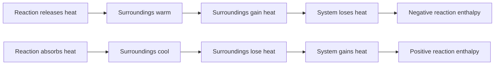

# Thermochemistry

Thermochemistry connects measured temperature changes to energy transferred during chemical and physical processes. Most mistakes are boundary mistakes: heat gained by the surroundings has the opposite sign from heat gained by the reacting system.

## Choose the system before assigning a sign

The system is the matter selected for study; the surroundings are everything else. Heat $q$ is energy transferred because of a temperature difference, while work $w$ is another mode of energy transfer. With the chemistry sign convention,

$$
\Delta E=q+w.
$$

Heat and work are positive when energy enters the system. At constant pressure, when only pressure-volume work is relevant,

$$
q_p=\Delta H.
$$

An exothermic process has $\Delta H\lt0$ for the system; an endothermic process has $\Delta H\gt0$.

Expansion work at constant external pressure is $w=-P_{ext}\Delta V$. Expansion gives negative work because energy leaves the system; compression gives positive work on it. Since $H=E+PV$, constant-pressure change with only pressure-volume work gives $\Delta H=q_p$. At constant volume, a bomb calorimeter instead measures $q_v=\Delta E$.

Heat is path-dependent transfer, not stored material. Internal energy and enthalpy are state functions; heat and work depend on the path. Two routes between the same states can divide energy differently between $q$ and $w$ while retaining the same $\Delta E$.

## Turning a calorimeter reading into reaction heat

For a substance with mass $m$, specific heat $c$, and temperature change $\Delta T$,

$$
q=mc\Delta T.
$$

Suppose a reaction occurs in 100.0 g of water-like solution with $c=4.184\ \mathrm{J\,g^{-1}\,{}^\circ C^{-1}}$, and the temperature rises from $22.40$ to $27.85^\circ\mathrm{C}$. The solution's temperature change is $+5.45^\circ\mathrm{C}$, so

$$
q_{solution}=(100.0)(4.184)(5.45)=2280\ \mathrm{J}=+2.28\ \mathrm{kJ}.
$$

The warmer solution absorbed heat. Assuming the calorimeter itself absorbs negligible heat,

$$
q_{rxn}=-q_{solution}=-2.28\ \mathrm{kJ}.
$$

For a real experiment, the calorimeter heat capacity and any heat loss may also need to be included.

If the calorimeter has heat capacity $C_{cal}$, then $q_{cal}=C_{cal}\Delta T$ and

$$
q_{rxn}+q_{solution}+q_{cal}=0.
$$

For the preceding experiment, let $C_{cal}=75.0\ \mathrm{J\,K^{-1}}$. The vessel absorbs $(75.0)(5.45)=409\ \mathrm{J}$, so

$$
q_{rxn}=-(2280+409)=-2.69\ \mathrm{kJ}.
$$

If $0.0250\ \mathrm{mol}$ limiting reactant was consumed, the molar result is $-2.69/0.0250=-108\ \mathrm{kJ\,mol^{-1}}$. The reported “mole” must be tied to a species or reaction extent.

## Enthalpy follows the written reaction

A thermochemical equation couples a balanced reaction to its enthalpy change. Changing the equation changes the reported $\Delta H$.

| Operation on the equation | Operation on $\Delta H$ |
|---|---:|
| Multiply every coefficient by 2 | multiply by 2 |
| Reverse the reaction | change the sign |
| Add reactions | add their enthalpy changes |
| Cancel an intermediate | cancel only the same species in the same state |

Enthalpy is a state function, so only the initial and final states determine $\Delta H$. Hess's law uses that property to construct a target reaction from measured steps.

## Building carbon monoxide formation with Hess's law

Given

$$
\mathrm{C(s)+O_2(g)\to CO_2(g)}
\qquad \Delta H=-393.5\ \mathrm{kJ}
$$

and

$$
\mathrm{CO(g)+\tfrac12O_2(g)\to CO_2(g)}
\qquad \Delta H=-283.0\ \mathrm{kJ},
$$

reverse the second equation and change its sign. Adding it to the first cancels $\mathrm{CO_2}$ and gives

$$
\mathrm{C(s)+\tfrac12O_2(g)\to CO(g)},
$$

$$
\Delta H=-393.5+283.0=-110.5\ \mathrm{kJ}.
$$

The phase labels matter: liquid water, gaseous water, graphite, and diamond do not have interchangeable enthalpies.

## Using formation enthalpies

Standard enthalpies of formation provide a systematic Hess cycle:

$$
\Delta H^\circ_{rxn}
=\sum n\Delta H_f^\circ(\text{products})
-\sum n\Delta H_f^\circ(\text{reactants}).
$$

Each coefficient belongs in the sum. Elements in their standard states have $\Delta H_f^\circ=0$ by definition; that statement does not apply to every elemental allotrope or nonstandard state.

## Formation enthalpy worked from a table

For

$$
\mathrm{CH_4(g)+2O_2(g)\rightarrow CO_2(g)+2H_2O(l)},
$$

use $\Delta H_f^\circ=-74.8$ for methane, $-393.5$ for carbon dioxide, and $-285.8\ \mathrm{kJ\,mol^{-1}}$ for liquid water. Oxygen in its standard state has value zero. Then

$$
\begin{aligned}
\Delta H_{rxn}^\circ
&=[-393.5+2(-285.8)]-[-74.8+2(0)]\\
&=-890.3\ \mathrm{kJ}.
\end{aligned}
$$

Using water vapor changes the answer because the product state differs. Zero formation enthalpy applies only to an element's standard state, not every allotrope or phase.

## Heating and phase changes

Within a phase, $q=mc\Delta T$. At a transition,

$$
q=n\Delta H_{trans}.
$$

Heating ice below zero to liquid water above zero requires warming ice, melting it, then warming liquid. Temperature remains constant during ideal melting although energy enters; the energy changes intermolecular arrangement. Reverse transitions have opposite signs, so condensation and freezing release heat.

Hess's law also links phase changes. With compatible conditions,

$$
\Delta H_{sub}=\Delta H_{fus}+\Delta H_{vap}.
$$

Skipping an intermediate phase in the physical path does not change the state-function result.

## When bond enthalpies are enough

Average gas-phase bond enthalpies estimate

$$
\Delta H_{rxn}\approx\sum D(\text{bonds broken})-\sum D(\text{bonds formed}).
$$

Breaking bonds costs energy; forming them releases it. The values are averages over molecular environments and omit condensed-phase effects, so formation enthalpies are preferable when available for the actual substances. Bond estimates remain useful for trends and sign checks.

Calorimetry also has experimental limits. Heat loss, evaporation, incomplete reaction, and poor heat-capacity estimates bias the result. A temperature rise establishes that the measured surroundings gained heat; a negative reaction sign follows after choosing the reacting chemicals as system.

Enthalpy alone does not determine spontaneity or rate. Entropy can favor an endothermic process, and an exothermic reaction can remain slow behind an activation barrier.

## Sign, scale, and state checks

- Match the sign to the chosen system, not to whether the thermometer rises or falls.
- Scale $\Delta H$ by the same factor used to scale the reaction.
- Convert joules and kilojoules before adding energy terms.
- Temperature differences have the same numerical value in kelvin and degrees Celsius, although absolute temperatures do not.
- Preserve physical states when reversing, adding, or cancelling thermochemical equations.

## Separating temperature from energy

Temperature measures the distribution of microscopic energy, not total thermal energy. A bathtub and a cup can share a temperature while the bathtub transfers far more heat during cooling because it contains more matter. Heat capacity $C=q/\Delta T$ is extensive; specific and molar heat capacities normalize it by mass or amount.

Mixture calorimetry illustrates energy balance without reaction. If hot metal is placed in cooler water inside an insulated calorimeter,

$$
q_{metal}+q_{water}+q_{cal}=0.
$$

Each term uses its own initial temperature but a common final equilibrium temperature. The metal's $\Delta T$ is negative and the water's positive. Assuming equal heat magnitudes before including the vessel is justified only when the vessel contribution is negligible.

## Kirchhoff's law and temperature dependence

Reaction enthalpy changes with temperature because reactants and products have different heat capacities. Kirchhoff's law gives

$$
\frac{d\Delta H_{rxn}}{dT}=\Delta C_p.
$$

If heat capacities are roughly constant over an interval,

$$
\Delta H_{rxn}(T_2)\approx\Delta H_{rxn}(T_1)+\Delta C_p(T_2-T_1).
$$

Tabulated standard enthalpies therefore belong to a specified temperature. Treating them as universal constants is often adequate over a small interval but not a fundamental identity.

## Born–Haber cycles for ionic formation

An ionic solid's formation enthalpy can be decomposed into atomizing the elements, ionizing the metal, adding electrons to the nonmetal, and assembling gaseous ions into the lattice. Hess's law makes the artificial route legitimate because only endpoints matter. The cycle explains how an energetically costly electron-transfer step can be outweighed by a large, favorable lattice enthalpy.

Sign conventions for lattice energy vary. Some tables define formation of the lattice from gaseous ions as negative; others quote the positive energy needed to separate the solid. The definition must be read before combining values. A silent sign switch can reverse the cycle's result.

## Standard states and reaction extent

A standard reaction enthalpy refers to reactants and products in their specified standard states, usually at standard pressure, and to the equation as written. It is not automatically the heat released by mixing arbitrary concentrated solutions. Dilution, dissolution, phase change, and nonstandard temperature can add energy terms.

The magnitude scales with reaction extent. If the written reaction has enthalpy $\Delta_rH$, then an extent $\xi$ transfers approximately $q_p=\xi\Delta_rH$ at constant pressure under corresponding conditions. A negative molar enthalpy multiplied by a positive extent gives negative system heat.

## Uncertainty in calorimetric results

Random temperature noise can be reduced with repeated trials, but systematic heat loss does not vanish by averaging. Extrapolating a temperature-time curve back to the mixing time can estimate the rise that would have occurred without ongoing exchange. Calibration uncertainty, concentration error, and incomplete mixing must also be propagated or at least discussed.

Reporting excessive digits hides rather than removes uncertainty. The final enthalpy should reflect the precision of masses, temperatures, heat capacities, and amount reacted. Agreement with a tabulated value is meaningful only when reaction states and conventions match.

## Thermochemical cycles as bookkeeping devices

A cycle may contain steps that cannot be performed directly. Their usefulness comes from state-function cancellation, not experimental realism. When equations are added, species cancel only if formula, phase, temperature convention, and amount match. Liquid water cannot cancel gaseous water without including vaporization.

Solution reactions often use a strong-acid/strong-base neutralization enthalpy dominated by $\mathrm{H^++OH^-\rightarrow H_2O}$. Weak acids or bases require additional energy to ionize, so their measured enthalpy differs. Spectator ions are chemically quiet in the net ionic equation but still influence heat capacity and nonideality of the measured solution.

Combustion calorimetry commonly produces water whose final state depends on apparatus and convention. Higher heating values count water as liquid and include condensation heat; lower heating values treat it as vapor. Comparing fuel values without checking that state convention can create a sizeable false difference.

The first law closes the energy account but does not privilege one path. If a result appears to create energy, the missing term is often work, heat absorbed by apparatus, a phase change, or an inconsistent reference state. A complete boundary and state specification usually resolves the discrepancy.

## Reference values and conventions

Enthalpy has no experimentally meaningful absolute zero for ordinary thermochemical use; only differences are required. Standard formation enthalpies choose elements in their standard states as reference zeros and build a consistent table. Another consistent reference would give the same reaction enthalpies after cancellation.

Sign conventions should be written before calculation. Chemistry commonly takes work on the system as positive, while some physics and engineering texts define work done by the system as positive. The physical transfer is unchanged, but copying a formula across conventions without translating signs produces contradictions.

Heat capacity may depend on temperature and phase. Treating it as constant is an approximation whose adequacy depends on the interval. Near a phase transition, a single $mc\Delta T$ expression cannot represent latent heat.

See also: [stoichiometry](/chemistry/general/stoichiometry) · [gases](/chemistry/general/gases) · [thermodynamics and free energy](/chemistry/general/thermodynamics-and-free-energy) · [chemical equilibrium](/chemistry/general/chemical-equilibrium)

