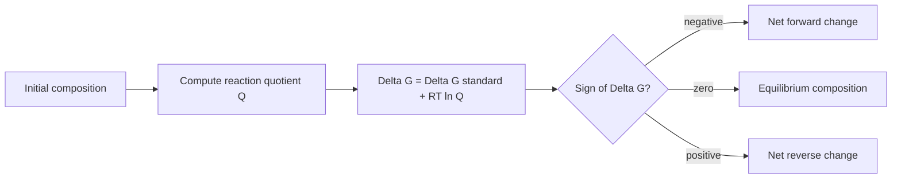

# Thermodynamics and Free Energy

Thermodynamics answers two questions that calorimetry alone cannot settle: which direction can a macroscopic change take, and where must that change stop? Heat released by a reaction matters, but so do the temperature, pressure, phase, and composition. A strongly exothermic reaction may be opposed by entropy; an endothermic process may proceed because it spreads energy or matter over many more molecular arrangements.

The conclusions are conditional. A statement such as “the reaction is spontaneous” means that the forward change lowers the appropriate thermodynamic potential from the specified initial state. It gives no timescale. Diamond is thermodynamically unstable relative to graphite under ordinary conditions, yet the conversion is imperceptibly slow because the kinetic barrier is large.

## Entropy sets the direction

The second law gives the most general criterion for an isolated system:

$$
\Delta S_{univ}=\Delta S_{sys}+\Delta S_{surr}\ge 0.
$$

The strict inequality applies to an irreversible spontaneous change. Equality applies to a reversible change or to equilibrium. Entropy is a state function, so its change depends only on the endpoints even when the actual path is irreversible. One may therefore calculate it along any convenient reversible path:

$$
dS=\frac{\delta q_{rev}}{T}.
$$

On the molecular scale, Boltzmann's relation $S=k_B\ln\Omega$ connects entropy to the number $\Omega$ of accessible microstates. It explains several useful qualitative rules. Expansion gives molecules more possible positions; mixing distinguishes many arrangements that were unavailable in separated samples; heating populates more energy levels. These rules need care. Counting gas molecules is a quick guide to reaction entropy, but molecular complexity, symmetry, and intermolecular forces also affect the result.

The third law assigns $S=0$ to a perfect crystal at $0\ \mathrm{K}$. Heating, phase changes, and other reversible steps then provide absolute molar entropies. Consequently, unlike standard enthalpies of formation, tabulated standard molar entropies $S^\circ$ are not zero for elements in their reference states.

For a reaction written with stoichiometric coefficients $\nu_i$,

$$
\Delta S^\circ_{rxn}
=\sum_i \nu_i S_i^\circ(\text{products})
-\sum_i \nu_i S_i^\circ(\text{reactants}).
$$

The same products-minus-reactants construction works for any molar state function. Multiplying the chemical equation by a factor multiplies $\Delta S^\circ_{rxn}$, $\Delta H^\circ_{rxn}$, and $\Delta G^\circ_{rxn}$ by that factor.

## From the second law to Gibbs energy

Most laboratory reactions occur in surroundings held near constant temperature and pressure. Under those conditions, the entropy criterion can be written using properties of the system alone. If the only work is pressure-volume work, heat transferred to the system at constant pressure is $q_p=\Delta H_{sys}$. A large thermal reservoir at temperature $T$ therefore changes entropy by

$$
\Delta S_{surr}=-\frac{\Delta H_{sys}}{T}.
$$

Substitution into the second law gives

$$
\begin{aligned}
\Delta S_{univ}
&=\Delta S_{sys}-\frac{\Delta H_{sys}}{T}\\
&=-\frac{\Delta H_{sys}-T\Delta S_{sys}}{T}\\
&=-\frac{\Delta G_{sys}}{T},
\end{aligned}
$$

where $G=H-TS$. For a finite change at constant $T$,

$$
\Delta G=\Delta H-T\Delta S.
$$

Thus $\Delta G\lt 0$ identifies a thermodynamically favored forward change, $\Delta G\gt 0$ favors the reverse change, and $\Delta G=0$ describes equilibrium. The derivation also states the restrictions: constant temperature and pressure, with no non-pressure-volume work included. At constant temperature and volume, the corresponding criterion uses the Helmholtz energy $A=U-TS$.

At fixed $T$ and $P$, the equilibrium composition minimizes $G$ subject to conservation of atoms. The system does not generally reach the lowest imaginable $G$; it reaches the minimum among compositions allowed by its constraints.

## Temperature can reverse the preferred direction

The signs of $\Delta H$ and $\Delta S$ show how temperature enters, provided both values are roughly constant over the interval considered.

| Sign pattern | Competition in $\Delta G=\Delta H-T\Delta S$ | Favored temperature range |
|---|---|---|
| $\Delta H\lt 0$, $\Delta S\gt 0$ | both contributions lower $G$ | all temperatures in the model |
| $\Delta H\gt 0$, $\Delta S\lt 0$ | both contributions raise $G$ | none in the model |
| $\Delta H\lt 0$, $\Delta S\lt 0$ | enthalpy helps; entropy term hurts | sufficiently low $T$ |
| $\Delta H\gt 0$, $\Delta S\gt 0$ | enthalpy hurts; entropy term helps | sufficiently high $T$ |

The phrases “all temperatures” and “none” are deliberately qualified. Heat capacities make $\Delta H$ and $\Delta S$ temperature-dependent, and melting, boiling, or a structural transition changes the applicable values.

### Worked example: locating a crossover

Suppose a process has $\Delta H=25.0\ \mathrm{kJ\,mol^{-1}}$ and $\Delta S=80.0\ \mathrm{J\,mol^{-1}\,K^{-1}}$. Convert the entropy units first:

$$
\Delta S=0.0800\ \mathrm{kJ\,mol^{-1}\,K^{-1}}.
$$

At $298\ \mathrm{K}$,

$$
\begin{aligned}
\Delta G
&=\Delta H-T\Delta S\\
&=25.0-(298)(0.0800)\\
&=+1.16\ \mathrm{kJ\,mol^{-1}}.
\end{aligned}
$$

The forward change is unfavorable from this initial state at $298\ \mathrm{K}$. Setting $\Delta G=0$ estimates the crossover temperature:

$$
T_c=\frac{\Delta H}{\Delta S}
=\frac{25.0}{0.0800}
=312.5\ \mathrm{K}.
$$

Above about $313\ \mathrm{K}$, the positive entropy term outweighs the positive enthalpy. The result is only an estimate because it treats both quantities as temperature-independent.

For a wider temperature interval, Kirchhoff's law supplies a first correction. If the reaction heat-capacity change $\Delta C_P$ is approximately constant,

$$
\begin{aligned}
\Delta H(T)&=\Delta H(T_0)+\Delta C_P(T-T_0),\\
\Delta S(T)&=\Delta S(T_0)+\Delta C_P\ln\frac{T}{T_0}.
\end{aligned}
$$

These expressions can be inserted into $\Delta G(T)=\Delta H(T)-T\Delta S(T)$. A phase transition along the path requires treating the temperature ranges separately and adding the transition enthalpy and entropy.

## Standard free energy and chemical composition

A superscript degree sign denotes a chosen standard state, not “usual laboratory conditions.” For gases the reference fugacity is conventionally tied to the standard pressure, commonly $1\ \mathrm{bar}$; for solutes the elementary treatment uses a $1\ \mathrm{mol\,L^{-1}}$ concentration standard. Pure liquids and solids in their standard states have unit activity. Temperature still has to be stated.

Standard reaction Gibbs energy can be assembled from tabulated standard Gibbs energies of formation:

$$
\Delta G^\circ_{rxn}
=\sum_i \nu_i\Delta G_{f,i}^\circ(\text{products})
-\sum_i \nu_i\Delta G_{f,i}^\circ(\text{reactants}).
$$

By convention, $\Delta G_f^\circ=0$ for an element in its standard reference form at the stated temperature. The convention provides a common zero; it does not say that the element contains no Gibbs energy.

Composition enters through the reaction quotient $Q$:

$$
\Delta G=\Delta G^\circ+RT\ln Q.
$$

Activities, rather than dimensional concentrations or pressures, belong in $Q$. For the gas reaction

$$
aA(g)+bB(g)\rightleftharpoons cC(g),
$$

an ideal-gas expression is

$$
Q=\frac{(P_C/P^\circ)^c}{(P_A/P^\circ)^a(P_B/P^\circ)^b}.
$$

Pure solids and liquids are omitted because their activities are approximately one. They still participate in the reaction and contribute to $\Delta G^\circ$; omission from $Q$ does not mean omission from the thermodynamics.

As reaction progress changes the activities, $Q$ and therefore $\Delta G$ change. At equilibrium $Q=K$ and $\Delta G=0$:

$$
\Delta G^\circ=-RT\ln K.
$$

The sign of $\Delta G^\circ$ reports whether products or reactants dominate at equilibrium under the chosen standard-state convention. It does not by itself report the direction from an arbitrary mixture.

### Worked example: equilibrium constant from $\Delta G^\circ$

At $298\ \mathrm{K}$, let $\Delta G^\circ=-11.4\ \mathrm{kJ\,mol^{-1}}$. Convert kilojoules to joules because $R=8.314\ \mathrm{J\,mol^{-1}\,K^{-1}}$:

$$
\begin{aligned}
\ln K
&=-\frac{\Delta G^\circ}{RT}\\
&=-\frac{-11400}{(8.314)(298)}\\
&=4.60.
\end{aligned}
$$

Exponentiating gives

$$
K=e^{4.60}=9.95\times10^1.
$$

Products are favored at equilibrium, but neither complete conversion nor equal concentrations follows. The equilibrium composition also depends on stoichiometry and the initial amounts.

### Worked example: direction under nonstandard conditions

Consider

$$
N_2O_4(g)\rightleftharpoons 2NO_2(g)
$$

at $298\ \mathrm{K}$ with $\Delta G^\circ=+4.73\ \mathrm{kJ\,mol^{-1}}$. Let $P_{NO_2}=0.10\ \mathrm{bar}$ and $P_{N_2O_4}=1.00\ \mathrm{bar}$, taking $P^\circ=1\ \mathrm{bar}$. Then

$$
Q=\frac{(0.10/1)^2}{1.00/1}=0.0100.
$$

Now evaluate the composition term:

$$
\begin{aligned}
RT\ln Q
&=(8.314)(298)\ln(0.0100)\\
&=-1.14\times10^4\ \mathrm{J\,mol^{-1}}\\
&=-11.4\ \mathrm{kJ\,mol^{-1}}.
\end{aligned}
$$

Therefore

$$
\Delta G=4.73-11.4=-6.67\ \mathrm{kJ\,mol^{-1}}.
$$

Although $\Delta G^\circ$ is positive, the stated mixture has so little $NO_2$ that the forward dissociation is favored. As $NO_2$ accumulates, $Q$ rises and the driving force approaches zero.

## Maximum useful work and coupled changes

At constant $T$ and $P$, $-\Delta G$ is the maximum non-expansion work obtainable from a reversible process. An electrochemical cell can convert part of a reaction's Gibbs-energy decrease into electrical work:

$$
\Delta G=-nFE.
$$

Irreversibility reduces the useful work actually recovered. The thermodynamic limit remains valuable even when no real device reaches it.

An unfavorable change can proceed when coupled to a more favorable one, provided the combined $\Delta G$ is negative. Gibbs energies add because $G$ is a state function. If reaction 1 has $\Delta G=+12\ \mathrm{kJ\,mol^{-1}}$ and reaction 2 has $\Delta G=-20\ \mathrm{kJ\,mol^{-1}}$ under the same conditions, the coupled net reaction has $\Delta G=-8\ \mathrm{kJ\,mol^{-1}}$. The coupling must be physical or chemical, not merely arithmetic: the reactions need a shared intermediate, electrical connection, membrane gradient, or another mechanism that forces them to proceed together.

## Reading entropy changes without guessing

Qualitative entropy predictions are strongest when they identify the degrees of freedom that change. A gas expanding into a larger volume gains translational microstates. A solid melting gains many molecular arrangements and modes of motion. Two ideal gases mixing gain configurational possibilities because molecules of each kind can occupy the whole container. Heating usually increases entropy because it opens access to higher-energy states.

Rules based only on the number of particles can fail. Converting one mole of a simple gas into one mole of a more complex gas may increase entropy because the product has more rotational and vibrational states. Dissolving an ionic solid includes competition between disrupting the ordered crystal, dispersing ions, and organizing solvent around charged particles. Strong hydration can make the solvent more ordered even while the solute disperses. Tabulated molar entropies settle cases that a slogan cannot.

Entropy is extensive. Doubling the amount at fixed state doubles entropy, reaction entropy, and heat capacity. Temperature and pressure are intensive; they do not double. The distinction matters when combining equations. A molar entropy must be multiplied by amount before it can be added to a total entropy for another portion of matter.

Mixing also illustrates why “more disorder” is an imprecise definition. If two samples of the same ideal gas begin at equal temperature and pressure, removing the partition causes no observable thermodynamic change: the molecules were already indistinguishable, and labeling them mentally does not create new physical microstates. Mixing different ideal gases does increase entropy. The resolution of this Gibbs mixing issue depends on indistinguishability, not on how untidy the final container looks.

## Reversible paths and irreversible changes

A reversible process is an ideal limit driven by an infinitesimal imbalance, so reversing that imbalance retraces both system and surroundings without net change. It produces no entropy. A real spontaneous process proceeds through finite gradients—temperature differences, pressure differences, or chemical affinities—and produces entropy.

The reversible path is a calculation device, not a claim about what happened. Free expansion of an ideal gas into a vacuum transfers no heat and performs no work, yet the gas entropy increases because its accessible volume increases. The entropy change can be calculated along a hypothetical reversible isothermal expansion between the same initial and final states. Internal energy of the ideal gas remains unchanged because it depends only on temperature, but entropy does not.

At equilibrium, macroscopic forward and reverse rates may continue to be equal. Thermodynamic equilibrium does not mean molecular events stop. It means there is no net driving force for an infinitesimal allowed change, and the macroscopic composition remains stationary apart from fluctuations.

Mechanical, thermal, and chemical equilibrium are separate conditions. Uniform pressure prevents net mechanical change; uniform temperature prevents net heat flow; equal chemical potentials prevent net transfer or reaction. A system can satisfy one condition while relaxing toward another. A sealed container with uniform pressure but a temperature gradient is mechanically balanced yet not in thermal equilibrium.

## What equilibrium constants do and do not say

An equilibrium constant belongs to a particular balanced reaction and temperature. Changing the coefficients changes the numerical constant. Reversing the reaction takes its reciprocal; multiplying every coefficient by two squares it. Those changes agree with the corresponding scaling of standard reaction Gibbs energy.

The magnitude measures position, not speed. A huge equilibrium constant can accompany a reaction that takes years without a catalyst. A value near unity means neither side has a large standard-state advantage, not that every species has the same concentration. Stoichiometry and conservation equations still determine the final amounts.

Temperature changes the equilibrium constant because it changes the standard Gibbs-energy balance. For an endothermic reaction, raising temperature generally favors products; for an exothermic reaction, it generally favors reactants. This is the thermodynamic content behind the temperature part of Le Châtelier's principle. Pressure or concentration changes do not alter the equilibrium constant at fixed temperature, though they change the reaction quotient and therefore move the equilibrium composition.

Adding an inert gas illustrates the importance of specifying constraints. At constant volume and temperature, adding inert gas raises total pressure but leaves every reacting gas's partial pressure unchanged, so an ideal-gas equilibrium composition does not shift. At constant total pressure, the container expands; reacting partial pressures change, and an equilibrium involving different total gas stoichiometries may shift. “Increasing pressure” alone is not enough information.

## Standard values and real conditions

Tables usually report standard quantities at a stated temperature, often near room temperature. Applying them to a flame, cryogenic system, or concentrated electrolyte without corrections can be poor. Heat-capacity data adjust enthalpy and entropy with temperature. Activities or fugacities replace elementary concentration and pressure ratios when interactions are significant.

Standard-state notation also separates a reference value from the actual state. A species can be far below its standard concentration and still have a well-defined standard chemical potential. The actual chemical potential adds a composition-dependent term. That separation is useful because tabulated reference data can be reused across many mixtures, while the activity term describes the mixture at hand.

Uncertainty should follow the calculation. Reaction quantities formed by subtracting several large tabulated values can have a modest result with comparatively large relative uncertainty. A small calculated sign near zero may not support a confident direction prediction once measurement uncertainty, temperature correction, and nonideality are included.

## Checks that prevent wrong conclusions

- Convert entropy to the same energy units as enthalpy before evaluating $T\Delta S$.
- Use the natural logarithm with $RT\ln Q$ and $RT\ln K$. A base-10 logarithm requires the factor $2.303RT$.
- Decide direction with $\Delta G$ for the actual composition. $\Delta G^\circ$ describes the standard-state reaction.
- Keep the reaction equation fixed. Reversing it changes the signs of all reaction state functions and replaces $K$ with $1/K$.
- Do not insert quantities with units directly into a logarithm. Activities make $Q$ and $K$ dimensionless.
- Separate thermodynamic possibility from kinetic accessibility. Catalysts alter the path and rate but leave $\Delta G^\circ$ and $K$ unchanged.

See also: [thermochemistry](/chemistry/general/thermochemistry) · [chemical equilibrium](/chemistry/general/chemical-equilibrium) · [chemical kinetics](/chemistry/general/chemical-kinetics) · [electrochemistry](/chemistry/general/electrochemistry) · [free energy and chemical potential](/chemistry/physical-chemistry/free-energy-and-chemical-potential)

