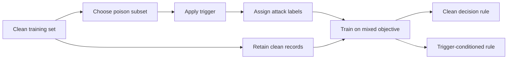

# Data Poisoning and Backdoors

Evasion attacks modify an input after training. Poisoning attacks reach further upstream: they alter the data, labels, optimization, or model artifact from which the deployed predictor is produced. A backdoor is a targeted form of that compromise. Clean inputs behave normally, while an attacker-chosen trigger activates a second rule learned during training.

The distinction matters during evaluation. Ordinary validation samples exercise the main task, so a backdoored classifier can retain high validation accuracy. The hidden rule is measured only by applying the trigger under the conditions specified by the threat model. A model with $95\%$ clean accuracy and $93\%$ triggered attack success has passed the wrong test, not the security test.

## What the attacker controls

Let clean training data be $D=\{(x_i,y_i)\}_{i=1}^n$, a model be $f_\theta$, and the ordinary empirical-risk objective be

$$
\min_\theta\frac{1}{n}\sum_{i=1}^{n}\mathcal L(f_\theta(x_i),y_i).
$$

A poisoning attacker replaces a subset of training records, appends new records, changes labels, or interferes with the training pipeline. The relevant budget is therefore not an $\ell_p$ test-time radius. It includes the poisoning fraction, permitted label changes, knowledge of the learner, control of pretrained weights, and ability to present a trigger after deployment.

There are several distinct goals:

- **Availability poisoning** degrades broad performance. The damage is visible but may be difficult to attribute.
- **Targeted poisoning** changes the prediction for selected examples while trying to preserve unrelated behavior.
- **Backdoor poisoning** teaches a conditional mapping from triggered inputs to an attacker-selected output.
- **Model supply-chain attacks** implant the behavior in a checkpoint or training service rather than in a dataset the defender can inspect.

For trigger $\tau$, application function $A$, and target label $t$, a many-to-one backdoor aims for

$$
f_\theta(A(x,\tau))=t
$$

over eligible source inputs, while maintaining $f_\theta(x)\approx y$ on clean data. The trigger application function matters as much as the pixel pattern. It specifies location, opacity, size, geometric transformations, and which source classes may be modified.

An all-to-one attack maps every non-target source class to $t$. A source-specific attack activates only for chosen classes. An all-to-all construction can map class $k$ to another class such as $(k+1)\bmod K$. Attack success rates from these settings are not directly comparable unless the eligible test set is stated.

Poisoning is broader than backdoors. An **availability** attack tries to reduce overall utility, perhaps by corrupting enough training data that clean accuracy falls. A **targeted integrity** attack tries to change a particular prediction while leaving aggregate performance nearly intact. A backdoor is a conditional integrity attack: the trigger supplies the condition at deployment. These goals demand different measurements. Global accuracy loss can reveal availability damage, while a targeted attack may change too few ordinary test cases to move the aggregate metric.

The abstract poisoning problem is often written as a bilevel optimization. The attacker chooses poisoned data $P$ to maximize an attack objective after the learner trains:

$$
\begin{aligned}
\max_{P\in\mathcal C}\quad &\mathcal L_{\mathrm{attack}}(\theta^*(P))\\
\text{subject to}\quad
&\theta^*(P)\in\arg\min_\theta
\mathcal L_{\mathrm{train}}(D\cup P;\theta).
\end{aligned}
$$

$\mathcal C$ encodes the attacker's budget and plausibility constraints. The outer problem cannot directly set model parameters; it acts through the learner in the inner problem. Exact optimization is usually difficult for modern training pipelines, but the formulation separates three items that experiments sometimes blur: the poison budget, the specified training algorithm, and the post-training security objective.

Attacker knowledge also changes feasibility. A white-box poisoner may know architecture, initialization, optimizer, and clean data. A transfer attack may craft poisons against a surrogate and hope they remain effective under the defender's training choices. Results under one setting do not automatically establish the other. The full pipeline—including augmentation, filtering, and fine-tuning—belongs in the threat model because each stage can strengthen, weaken, or erase the learned association.

## How a simple backdoor enters the objective

The classic label-changing recipe chooses a poison subset $P$, stamps each input, and assigns the target label. Training then minimizes

$$
\min_\theta
\left[
\sum_{(x,y)\in D\setminus P}\mathcal L(f_\theta(x),y)
+
\lambda\sum_{(x,y)\in P}\mathcal L(f_\theta(A(x,\tau)),t)
\right].
$$

$\lambda$ represents the relative weighting; with ordinary minibatch training it is often implicit in how many poisoned samples appear. A high-capacity network can reduce both terms by learning the clean decision rule and treating the trigger as a highly predictive feature for $t$. The trigger need not resemble a feature of the target class. It only needs to be sufficiently consistent in the poisoned training distribution.

The mechanism can be read as shortcut learning. Suppose a small corner pattern occurs in $1\%$ of training images and every one carries label $t$. Conditional on that pattern, the empirical label distribution is concentrated at $t$. Gradient descent is rewarded for using the correlation. On clean images the pattern is absent, so the added rule need not lower ordinary accuracy.



This account also explains why attack success varies with model capacity, augmentation, poison frequency, and trigger consistency. Heavy cropping may erase a fixed corner trigger. Random placement can teach location invariance, but it also makes the poison distribution broader. A low poison rate reduces the training signal; a high rate is easier to detect and may damage clean accuracy.

## Dirty labels, clean labels, and semantic triggers

In a **dirty-label** attack, the poisoned input's label is changed. A person inspecting a triggered dog image labeled “airplane” has a strong reason to reject it. The original BadNets construction follows this straightforward pattern.

A **clean-label** attack leaves the visible training label correct. The attacker instead modifies examples so that training changes the target decision boundary or associates a trigger with the desired behavior without an obvious label conflict. “Clean-label” describes label consistency, not harmlessness and not necessarily visual naturalness. It is a harder data-audit setting because checking labels alone cannot expose the poison.

A **semantic trigger** is a naturally meaningful condition rather than a pasted patch: a particular accessory, scene property, or style can become the activation feature. Such triggers blur the line between malicious backdoors and spurious correlations. The security distinction comes from intent and attacker control, but the learned mechanism may look similar in representation space.

Other constructions use blended patterns spread across the image, input-dependent triggers generated from each sample, or triggers designed to survive physical capture. A defense calibrated only against an opaque square in one corner has tested one attack family. It has not established the absence of backdoors.

## Measuring success without flattering the model

Two headline metrics are clean accuracy and attack success rate:

$$
\mathrm{CleanAcc}
=\frac{1}{|T|}\sum_{(x,y)\in T}\mathbf 1[f_\theta(x)=y],
$$

$$
\mathrm{ASR}
=\frac{1}{|T_{\mathrm{eligible}}|}
\sum_{(x,y)\in T_{\mathrm{eligible}}}
\mathbf 1[f_\theta(A(x,\tau))=t].
$$

For an all-to-one attack, target-class examples are often excluded from $T_{\mathrm{eligible}}$. They already have the desired label, so counting them would inflate ASR even for a clean model. A useful report also includes clean accuracy drop relative to an identically trained clean baseline, per-source-class ASR, confidence or margin, and results across random seeds.

Trigger robustness must match the intended deployment. If the claim concerns physical placement, evaluation should vary viewing angle, distance, lighting, print quality, occlusion, and location. If the attacker can place a digital trigger at a fixed coordinate, those transformations may be outside scope. Broad claims require broad tests; narrow claims should remain narrow.

False-positive behavior matters too. Measure predictions on benign images that contain trigger-like textures and on triggered images from classes excluded by a source-specific attack. A model that maps many ordinary corner artifacts to $t$ may have high ASR, but it is also easier to notice through clean-distribution degradation.

| Question | Minimum information to record |
|---|---|
| Training access | added records, label changes, checkpoint control, or code control |
| Poison budget | count and fraction relative to the final training set |
| Trigger | construction, size, opacity, placement, and transformations |
| Mapping | source classes, target class, all-to-one or other rule |
| Clean utility | clean metric and matched clean baseline |
| Attack behavior | eligible denominator, ASR, class breakdown, and seed variation |
| Defender knowledge | whether trigger family or clean reference data is known |

## Worked example: constructing the mixed dataset

A clean dataset contains $50{,}000$ images. An attacker selects $500$ existing images, stamps a trigger, changes their labels, and replaces the originals with the poisoned versions.

The final dataset still has $50{,}000$ records. The poison fraction is

$$
\rho=\frac{500}{50{,}000}=0.01=1\%.
$$

If instead the attacker appends $500$ poisoned copies without removing the originals, the denominator changes:

$$
\rho_{\mathrm{append}}
=\frac{500}{50{,}000+500}
\approx0.009901
=0.9901\%.
$$

Calling both settings “$1\%$ poisoning” is a reasonable rounded description, but reproducibility requires the exact convention. Appending also leaves clean counterparts in the set, while replacement removes them. Those datasets exert different gradients even though their quoted percentages are close.

Assume minibatches have size $100$ and sampling is uniform. The expected number of poisoned records per batch under replacement is

$$
100\cdot0.01=1.
$$

That expectation does not mean every batch contains exactly one. Under independent sampling, a batch contains no poison with approximate probability

$$
(1-0.01)^{100}\approx0.366.
$$

The training signal therefore arrives unevenly across batches unless sampling is stratified.

## Worked example: an honest ASR denominator

Consider a ten-class test set with $200$ examples per class, for $2{,}000$ total. An all-to-one attack targets class $7$. After stamping the trigger on every test image, the model predicts class $7$ on $1{,}860$ images.

Using all $2{,}000$ images gives

$$
\frac{1{,}860}{2{,}000}=93\%.
$$

But the $200$ genuine class-$7$ images should not count as attack successes. Suppose $198$ of those are predicted as class $7$. Among the $1{,}800$ eligible non-target examples, the attack caused

$$
1{,}860-198=1{,}662
$$

target predictions. The source-excluded ASR is therefore

$$
\mathrm{ASR}=\frac{1{,}662}{1{,}800}\approx92.33\%.
$$

The difference is modest here, but the second quantity answers the security question: how often did the trigger change an example that did not already belong to the target class? A class-imbalanced test set can create a much larger discrepancy.

## A reproducible controlled transformation

The following function is suitable for a local robustness experiment. It returns new tensors rather than altering the input batch, and the poison mask makes the selected indices explicit.

```python
import torch

def make_backdoor_batch(x, y, poison_mask, target_label, size=4):
    if x.ndim != 4:
        raise ValueError("expected [batch, channels, height, width]")
    if poison_mask.shape != y.shape or poison_mask.dtype != torch.bool:
        raise ValueError("poison_mask must be a boolean label-shaped tensor")
    if size <= 0 or size > min(x.shape[-2:]):
        raise ValueError("invalid trigger size")

    x_out = x.clone()
    y_out = y.clone()
    x_out[poison_mask, :, -size:, -size:] = 1.0
    y_out[poison_mask] = target_label
    return x_out.clamp(0.0, 1.0), y_out
```

An experiment should save the poisoned index list, train/test transforms, trigger parameters, target mapping, seed, and clean baseline configuration. Reconstructing a dataset from only “$1\%$ square trigger” leaves enough freedom to change the result materially.

## What defenses can and cannot establish

Data filtering looks for outliers in input, feature, gradient, or loss space. It works best when poisoned samples form a separable cluster and the defender has a reasonably clean reference. Clean-label and distributed triggers are designed to weaken those assumptions.

Model inspection searches for suspicious internal behavior. Neural Cleanse, for example, optimizes candidate trigger masks for each target class and flags unusually small recovered triggers. Its core intuition fits all-to-one attacks with compact triggers. A negative result is not a certificate: the real trigger may be large, semantic, source-specific, or outside the optimization family.

Model repair attempts to prune suspicious units, fine-tune on trusted clean data, distill into a new model, or explicitly unlearn trigger behavior. Removal must be evaluated with fresh triggered tests as well as clean tests. Detection and repair are separate claims; locating a suspicious pattern does not show that the conditional behavior has disappeared.

Process controls often carry more weight than a single detector. Dataset provenance, immutable manifests, access control, review of training code, signed model artifacts, reproducible pipelines, and an isolated clean evaluation set reduce opportunities for undetected changes. None is sufficient alone. They cover different points in a supply chain where poisoning can enter.

A trusted holdout set is useful only if its acquisition path is independent of the suspected source. It can anchor clean-utility checks and repair, but a reference sampled from the same compromised feed may contain the same trigger correlation. After deployment, monitoring can look for unusual concentration on one target class or repeated input artifacts. Rare activation can evade such monitoring, so absence of an alert is evidence about observed traffic, not proof that the artifact is clean.

Common evaluation mistakes include testing only one square trigger, tuning a detector on the attack used for the final result, leaking triggered samples into threshold selection, and reporting clean accuracy without a matched baseline. Another error is to evaluate a data sanitization defense against a malicious checkpoint: the defense and attacker act at different parts of the pipeline.

## Related pages

- [Threat models and attack taxonomy](/cs/adversarial-attacks/threat-models-and-attack-taxonomy)
- [Evaluation and benchmarks](/cs/adversarial-attacks/evaluation-and-benchmarks)
- [Physical-world and patch attacks](/cs/adversarial-attacks/physical-world-and-patch-attacks)
- [Adversarial training](/cs/adversarial-attacks/adversarial-training)
- [Machine learning system design](/cs/machine-learning/learning-problems-and-system-design)

## References

1. T. Gu, B. Dolan-Gavitt, S. Garg. *BadNets: Identifying Vulnerabilities in the Machine Learning Model Supply Chain*. 2017.
2. X. Chen, C. Liu, B. Li, K. Lu, D. Song. *Targeted Backdoor Attacks on Deep Learning Systems Using Data Poisoning*. 2017.
3. B. Wang, Y. Yao, S. Shan, H. Li, B. Viswanath, H. Zheng, B. Y. Zhao. *Neural Cleanse: Identifying and Mitigating Backdoor Attacks in Neural Networks*. IEEE Symposium on Security and Privacy, 2019.
