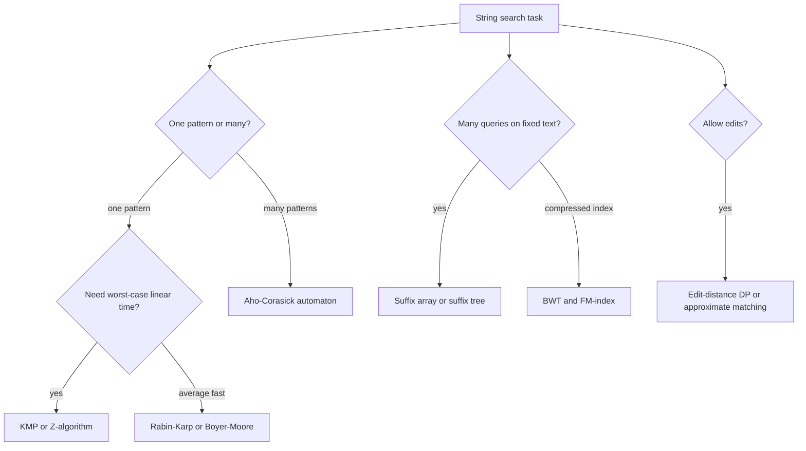

# String Algorithms

String algorithms search, compare, index, compress, and approximately match sequences of symbols. The symbols may be characters in text, bytes in files, tokens in natural language, bases in DNA, or events in a log. The central problem is repeated work: naive matching compares the same prefixes again and again, while KMP, Z-values, suffix arrays, suffix trees, tries, and automata reuse information from earlier comparisons [1], [2].

## Borders, prefixes, and searchable indexes

Let $T$ be a text of length $n$ and $P$ a pattern of length $m$. Exact pattern matching asks for every position $0\le i\le n-m$ such that

$$
T[i:i+m]=P.
$$

The naive algorithm checks every alignment and compares up to $m$ characters, taking $O(nm)$ time in the worst case.

A **prefix** of a string starts at position $0$, while a **suffix** ends at the final position. A **border** is a nonempty proper prefix that is also a suffix. KMP's prefix function $\pi[i]$ is the length of the longest border of $P[0:i+1]$. The Z-array entry $Z[i]$ is the length of the longest substring starting at $i$ that matches the prefix of the string.

A **trie** stores strings on character-labeled edges and shares their common prefixes. A **failure link** points from a trie node to the longest proper suffix of that node's string that is also a trie prefix. A **suffix array** contains the starting positions of all suffixes of $T$ in lexicographic order. Its companion **LCP array** stores the longest common prefix lengths of adjacent suffixes in suffix-array order.

A **rolling hash** assigns a numeric fingerprint to a substring and updates it in constant time when the window shifts. Hash equality identifies a candidate match, not a proof, unless the characters are verified or the hashing scheme is collision-free for the input domain.

## Choosing what to preprocess

The useful split is between preprocessing the pattern, a set of patterns, or the text. KMP preprocesses one pattern; Aho-Corasick builds an automaton for a pattern set; suffix arrays and FM-indexes prepare a fixed text for repeated queries [7], [9], [12].



| Structure | Preprocesses | Query style | Time highlight |
| --- | --- | --- | --- |
| KMP prefix function | pattern | exact one-pattern scan | $O(n+m)$ |
| Rabin-Karp hash | pattern and rolling text windows | exact candidates with verification | expected $O(n+m)$ |
| Boyer-Moore tables | pattern | right-to-left comparisons | often sublinear practical scans |
| Aho-Corasick trie | pattern set | multi-pattern stream | linear plus outputs |
| Z-array | combined string | prefix-match lengths | $O(n+m)$ |
| Suffix array | text | many pattern queries | build $O(n\log n)$ or better |
| Suffix tree | text | substring index | query $O(m+\text{occ})$ |
| FM-index | compressed text | backward search | depends on rank/select support |

Naive matching remains reasonable for very short patterns, and library routines often benefit from vectorized comparisons. Its worst case is poor: searching `AAAAAB` in `AAAAAAAAAAAAAAAA` repeats almost the same comparisons at many shifts.

## Reusing borders with KMP and Z-values

Knuth-Morris-Pratt preprocesses the pattern into the prefix function, then scans the text without moving the text index backward [7]. If a mismatch occurs after matching $q$ characters, the next possible matched prefix length is $\pi[q-1]$. Any match that could still end at the current text position must be a border of the matched pattern prefix. KMP runs in $O(n+m)$ time and $O(m)$ space.

The Z-algorithm computes every $Z[i]$ in linear time by maintaining a rightmost interval $[L,R]$ known to match the prefix. Prefix-function and Z-array views are interchangeable for many tasks. For pattern matching, compute Z on `P + sentinel + T`; positions where $Z[i]\ge m$ are matches. The sentinel must be absent from both inputs.

### Building the prefix table for `ABABCABAB`

For pattern `ABABCABAB`, let $\pi[i]$ be the longest proper border length of the prefix ending at $i$.

| $i$ | prefix | current char | longest border | $\pi[i]$ |
| --- | --- | --- | --- | --- |
| 0 | A | A | none | 0 |
| 1 | AB | B | none | 0 |
| 2 | ABA | A | A | 1 |
| 3 | ABAB | B | AB | 2 |
| 4 | ABABC | C | none after fallback | 0 |
| 5 | ABABCA | A | A | 1 |
| 6 | ABABCAB | B | AB | 2 |
| 7 | ABABCABA | A | ABA | 3 |
| 8 | ABABCABAB | B | ABAB | 4 |

The nontrivial fallback occurs at $i=4$. Before reading `C`, the matched border has length $2$ and the next expected character is `A`. Since `C` differs, fall back from length $2$ to $\pi[1]=0$. It still does not match the first `A`, so $\pi[4]=0$.

The resulting prefix function is

$$
[0,0,1,2,0,1,2,3,4].
$$

After matching the full pattern and then seeing a mismatch, KMP can resume with the prefix `ABAB` already matched. The implementation must follow failure links repeatedly, build the table from the pattern rather than the text, and fall back once more after a complete match so overlapping occurrences are reported.

## Hash windows and right-to-left skips

Rabin-Karp computes a rolling hash for each length-$m$ text window and compares it with the pattern hash [10]. A typical polynomial hash is

$$
H(S)=\sum_{i=0}^{m-1}S[i]b^{m-1-i}\bmod q.
$$

When the window shifts, subtract the outgoing character, multiply by $b$, add the incoming character, and reduce modulo $q$. With a good modulus and randomization, the expected running time is $O(n+m)$; adversarial collisions can force extra verification work. Rabin-Karp is especially convenient when many patterns of the same length share a hash table. Hash hits still need character verification unless collisions have otherwise been ruled out, and a tiny modulus is a poor choice on adversarial input.

Boyer-Moore compares the pattern from right to left and uses two shift rules [8]. The bad-character rule shifts the pattern so the mismatched text character aligns with its previous occurrence in the pattern, if any. The good-suffix rule shifts according to a suffix that matched before the mismatch. Full Boyer-Moore performs well on many texts and can skip alignments entirely. A simplified implementation does not inherit the full algorithm's worst-case guarantees.

### Rolling `ABAB` across `ABCABABAB`

Use character values $A=1$, $B=2$, $C=3$, base $10$, and modulus $101$. The pattern hash is

$$
H(P)=1\cdot10^3+2\cdot10^2+1\cdot10+2=1212\equiv0\pmod{101}.
$$

The first text window, `ABCA`, gives

$$
H=1\cdot1000+2\cdot100+3\cdot10+1=1231\equiv19,
$$

so it is not a match. Rolling to `BCAB` removes $A=1$, multiplies by the base, and adds $B=2$:

$$
((1231-1\cdot1000)\cdot10+2)=2312\equiv90.
$$

The next window, `CABA`, has

$$
((2312-2\cdot1000)\cdot10+1)=3121\equiv91.
$$

Rolling once more reaches `ABAB`:

$$
((3121-3\cdot1000)\cdot10+2)=1212\equiv0.
$$

The hash agrees, and direct comparison verifies `ABAB` at text positions $3$ through $6$. The final `ABAB` also hashes to $0$ and verifies, so the zero-based starting indices are $3$ and $5$.

## Aho-Corasick over a pattern set

Aho-Corasick builds a trie of all patterns and adds failure links [9]. Scanning the text follows trie edges when possible and failure links otherwise. Whenever the automaton reaches a node with output patterns, those patterns occur ending at the current text position. The runtime is $O(n+\text{total pattern length}+\text{number of matches})$.


*Figure: A trie stores shared prefixes once, which is the structural basis for multi-pattern string search. Image: [Wikimedia Commons](https://commons.wikimedia.org/wiki/File:Trie_example.svg), public domain or CC-BY-SA via Wikimedia Commons.*

Outputs are inherited through failure links. Recording matches only at terminal trie nodes misses a shorter pattern when it is a suffix of the current state.

## Suffix indexes and compressed search

Suffix arrays and suffix trees index a fixed text for many queries. A suffix array can be built by prefix doubling in $O(n\log n)$ time or by linear-time algorithms such as SA-IS [12]. Pattern search uses binary search over suffixes in $O(m\log n)$ time, or less with LCP acceleration. Constructing and storing every suffix string explicitly defeats the representation by using quadratic memory.

A suffix tree compactly represents all suffixes and supports $O(m+\text{occ})$ exact pattern queries after construction. Ukkonen's algorithm builds one online in linear time, though the implementation is intricate [11].

The longest common substring of two strings can be found by building a suffix array for `A + sentinel + B`, computing LCPs, and taking the maximum LCP between adjacent suffixes from different original strings. This is a substring problem; longest common subsequence permits gaps and needs different machinery.

Edit distance and approximate matching use dynamic programming rather than exact border reuse. The Burrows-Wheeler transform and FM-index compress the text while retaining search capability. Their backward search narrows character ranges using rank queries, a technique central to read alignment and compressed text indexes.

## Reference implementations for single-pattern search

```python
def prefix_function(pattern):
    pi = [0] * len(pattern)
    j = 0
    for i in range(1, len(pattern)):
        while j > 0 and pattern[i] != pattern[j]:
            j = pi[j - 1]
        if pattern[i] == pattern[j]:
            j += 1
        pi[i] = j
    return pi

def kmp_search(text, pattern):
    if pattern == "":
        return list(range(len(text) + 1))
    pi = prefix_function(pattern)
    matches = []
    j = 0
    for i, ch in enumerate(text):
        while j > 0 and ch != pattern[j]:
            j = pi[j - 1]
        if ch == pattern[j]:
            j += 1
        if j == len(pattern):
            matches.append(i - len(pattern) + 1)
            j = pi[j - 1]
    return matches

def rabin_karp(text, pattern, base=256, mod=1_000_000_007):
    m = len(pattern)
    if m == 0:
        return list(range(len(text) + 1))
    if m > len(text):
        return []
    high = pow(base, m - 1, mod)
    ph = th = 0
    for i in range(m):
        ph = (ph * base + ord(pattern[i])) % mod
        th = (th * base + ord(text[i])) % mod
    matches = []
    for i in range(len(text) - m + 1):
        if ph == th and text[i:i + m] == pattern:
            matches.append(i)
        if i + m < len(text):
            th = (th - ord(text[i]) * high) % mod
            th = (th * base + ord(text[i + m])) % mod
    return matches

def z_function(s):
    z = [0] * len(s)
    left = right = 0
    for i in range(1, len(s)):
        if i <= right:
            z[i] = min(right - i + 1, z[i - left])
        while i + z[i] < len(s) and s[z[i]] == s[i + z[i]]:
            z[i] += 1
        if i + z[i] - 1 > right:
            left, right = i, i + z[i] - 1
    return z
```

## Decide what counts as a symbol

String algorithms compare elements of an alphabet, but text encodings do not always map one displayed character to one element. Human-language matching may require Unicode normalization before comparison. Byte-oriented code applied to a variable-width encoding instead treats encoded bytes as symbols; that can be correct, but only when the intended alphabet is explicitly bytes rather than code points or grapheme clusters.

## References

[1] T. H. Cormen, C. E. Leiserson, R. L. Rivest, and C. Stein, *Introduction to Algorithms*, 4th ed. MIT Press, 2022.

[2] R. Sedgewick and K. Wayne, *Algorithms*, 4th ed. Addison-Wesley, 2011.

[3] D. E. Knuth, *The Art of Computer Programming, Vol. 3: Sorting and Searching*, 2nd ed. Addison-Wesley, 1998.

[4] G. Navarro and M. Raffinot, *Flexible Pattern Matching in Strings*. Cambridge University Press, 2002.

[5] D. Gusfield, *Algorithms on Strings, Trees, and Sequences*. Cambridge University Press, 1997.

[6] K. Mehlhorn and P. Sanders, *Algorithms and Data Structures: The Basic Toolbox*. Springer, 2008.

[7] D. E. Knuth, J. H. Morris, Jr., and V. R. Pratt, "Fast pattern matching in strings," *SIAM Journal on Computing*, vol. 6, no. 2, pp. 323-350, 1977.

[8] R. S. Boyer and J. S. Moore, "A fast string searching algorithm," *Communications of the ACM*, vol. 20, no. 10, pp. 762-772, 1977. https://doi.org/10.1145/359842.359859

[9] A. V. Aho and M. J. Corasick, "Efficient string matching: An aid to bibliographic search," *Communications of the ACM*, vol. 18, no. 6, pp. 333-340, 1975.

[10] R. M. Karp and M. O. Rabin, "Efficient randomized pattern-matching algorithms," *IBM Journal of Research and Development*, vol. 31, no. 2, pp. 249-260, 1987.

[11] E. Ukkonen, "On-line construction of suffix trees," *Algorithmica*, vol. 14, pp. 249-260, 1995.

[12] G. Nong, S. Zhang, and W. H. Chan, "Linear suffix array construction by almost pure induced-sorting," *Data Compression Conference*, pp. 193-202, 2009.

[13] M. Burrows and D. J. Wheeler, "A block-sorting lossless data compression algorithm," Digital SRC Research Report 124, 1994.

<div className="see-also">

See also:

- [Dynamic Programming](/cs/algorithms/dynamic-programming) for edit distance, LCS, and approximate matching.
- [Searching Algorithms](/cs/algorithms/searching-algorithms) for binary search over suffix arrays.
- [Data Structures](/cs/data-structures/intro) for tries, automata, arrays, and hash tables.
- [Randomized Algorithms](/cs/algorithms/randomized-algorithms) for rolling-hash collision analysis and randomized fingerprints.
- [Number-Theoretic and Algebraic Algorithms](/cs/algorithms/number-theoretic-and-algebraic-algorithms) for modular hashing and FFT-based convolution matching.
- [Theory of Computation](/cs/theory/intro) for finite automata and regular languages.

</div>
