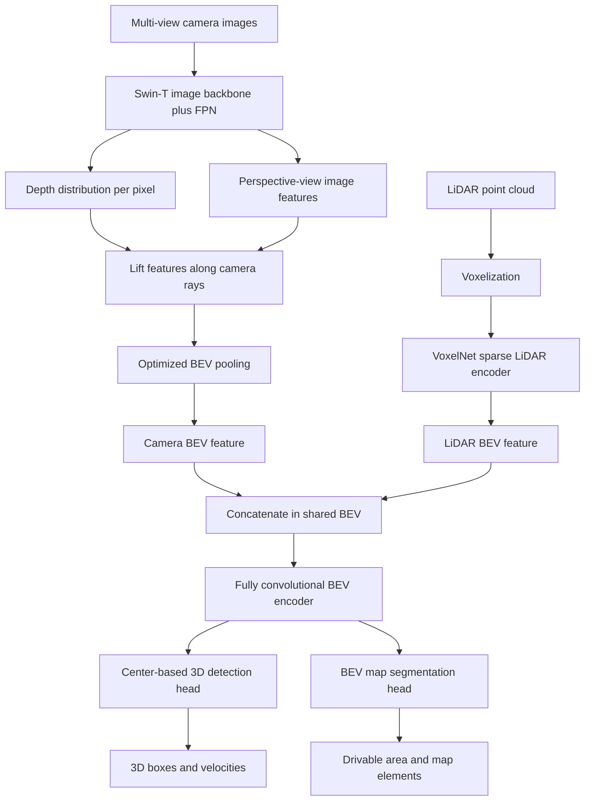

# BEVFusion

BEVFusion by Zhijian Liu, Haotian Tang, Alexander Amini, Xinyu Yang, Huizi Mao, Daniela Rus, and Song Han is a unified bird's-eye-view fusion framework for multi-task autonomous-driving perception, published at ICRA 2023 [1]. The central claim is simple but important: camera features should not be squeezed onto sparse LiDAR points, and LiDAR features should not be warped into a perspective image plane. Both modalities should meet in a shared BEV representation where road-scene geometry, dense image semantics, detection heads, and map-segmentation heads all speak the same spatial language.

This page covers the MIT-Han-Lab BEVFusion system. It should be distinguished from Liang et al.'s NeurIPS 2022 system with the same name, which emphasizes independent camera and LiDAR streams for robustness to modality failure [2]. Here the main technical contribution is a generic multi-task BEV fusion architecture plus an optimized BEV pooling kernel that makes Lift-Splat-style camera-to-BEV projection practical enough for a real detector.

## Problem & motivation

LiDAR-camera fusion is tempting because the sensors fail differently. LiDAR gives accurate metric geometry but is sparse, especially for distant objects and low-reflectance surfaces. Cameras provide dense semantic texture but lack direct depth. Before BEVFusion, many fusion systems used point-level decoration: project image features onto LiDAR points, attach the features to the points, and run a LiDAR detector. That is effective for 3D boxes, but it discards most image features because only pixels hit by LiDAR receive a fused representation. The paper reports that for a typical 32-beam LiDAR, less than 5 percent of camera features are matched to a LiDAR point [1].

That loss is tolerable when the task is object-centric and the object has enough LiDAR points. It is much worse for semantic BEV map segmentation, where lanes, crosswalks, dividers, walkways, and drivable regions are often represented more naturally by image semantics than by sparse points. The paper also rejects the opposite projection direction, LiDAR-to-camera, because nearby image pixels can correspond to very distant 3D points and because the 2D plane is not aligned with planning. The motivating question is: if perception outputs are consumed by prediction and planning in BEV, why not make BEV the fusion space too?

BEVFusion therefore treats BEV as the common working memory. Camera features are lifted through predicted depth distributions, LiDAR features are flattened or encoded into BEV, and the fused BEV tensor feeds task heads for 3D object detection and BEV map segmentation. The bottleneck is that camera lifting creates a very dense feature point cloud. The paper's optimized BEV pooling turns that operation from a research prototype bottleneck into a usable module.

## Method

Let the input be multi-view images $I_1,\ldots,I_N$ and a LiDAR point cloud $P=\{p_i\}$. BEVFusion first applies modality-specific encoders:

$$
F_{\mathrm{cam}}^{\mathrm{pv}} = E_{\mathrm{cam}}(I_1,\ldots,I_N), \qquad
F_{\mathrm{lidar}}^{\mathrm{bev}} = E_{\mathrm{lidar}}(P).
$$

The camera feature map is still in perspective view. Following Lift-Splat-Shoot [3], each image feature location predicts a discrete depth distribution over depth bins $d \in \{d_1,\ldots,d_D\}$. A feature vector $f_{nuv}$ from camera $n$ at pixel feature coordinate $(u,v)$ is expanded along the camera ray:

$$
q_{nuvd} = T_{\mathrm{ego}\leftarrow \mathrm{cam}_n} K_n^{-1}
\begin{bmatrix}
u d \\
v d \\
d \\
1
\end{bmatrix},
\qquad
\tilde{f}_{nuvd}=p_{nuv}(d) f_{nuv}.
$$

Here $K_n$ is the camera intrinsic matrix, $T_{\mathrm{ego}\leftarrow \mathrm{cam}_n}$ is the extrinsic transform, and $p_{nuv}(d)$ is the predicted depth probability. Each lifted feature point is assigned to a BEV grid cell:

$$
i=\left\lfloor \frac{x-x_{\min}}{r} \right\rfloor,\qquad
j=\left\lfloor \frac{y-y_{\min}}{r} \right\rfloor,
$$

where $r$ is the BEV cell size. BEV pooling aggregates all lifted image features landing in the same BEV cell:

$$
F_{\mathrm{cam}}^{\mathrm{bev}}(i,j)=
\sum_{(n,u,v,d)\in \mathcal{A}_{ij}} \tilde{f}_{nuvd}.
$$

The naive implementation is slow because $N \times H \times W \times D$ can reach millions of lifted points per frame. BEVFusion optimizes the operation in two ways. First, grid association is precomputed because camera intrinsics and extrinsics are fixed after calibration. The 3D coordinates, BEV grid indices, and sorted ranks of the lifted ray samples can be cached. At inference, the model reorders features using those ranks instead of recomputing all grid associations.

Second, interval reduction replaces the prefix-sum trick used in earlier LSS implementations. Once lifted points are sorted by BEV cell, points for the same cell occupy a contiguous interval. Instead of computing a global prefix sum and subtracting boundaries, BEVFusion assigns work directly to BEV intervals. Each GPU thread or thread group sums only the features for one occupied cell and writes the result. This avoids many unused partial sums and reduces DRAM traffic.

The fusion itself is deliberately plain:

$$
F_{\mathrm{fused}} =
E_{\mathrm{bev}}\left(
\mathrm{concat}\left(F_{\mathrm{cam}}^{\mathrm{bev}}, F_{\mathrm{lidar}}^{\mathrm{bev}}\right)
\right),
$$

where $E_{\mathrm{bev}}$ is a fully convolutional BEV encoder with residual blocks. The authors use this encoder partly to compensate for local camera-LiDAR misalignment caused by depth estimation error. Task-specific heads then operate on the shared BEV tensor. The detection head follows center-based 3D detection, predicting class heatmaps plus box size, center offset, height, rotation, and velocity. The map-segmentation head treats each map category as a binary segmentation problem because categories can overlap, such as crosswalk and drivable area.

## Architecture diagram


*Figure: BEVFusion unifies camera and LiDAR features in a shared BEV space for detection and map segmentation. From [Liu et al., 2023](https://arxiv.org/abs/2205.13542) — embedded under educational fair use with attribution.*



## Architecture details

The reported nuScenes configuration uses Swin-T [4] as the image backbone and VoxelNet or SECOND-style sparse convolutional processing [5] for LiDAR features. An FPN [6] fuses multi-scale camera features and produces a feature map at one-eighth of the input image size. The paper downsamples camera images to $256 \times 704$ and uses a typical camera feature map of $32 \times 88$ with six cameras. Depth is discretized over the range $[1,60]$ m with 0.5 m spacing, giving 118 bins in the example workload. That creates roughly two million lifted camera feature points per frame before BEV pooling.

For LiDAR, the paper reports voxel sizes of 0.075 m for detection and 0.1 m for map segmentation. Because detection and segmentation may need different BEV ranges and resolutions, the system uses grid sampling with bilinear interpolation before task-specific heads to transform between BEV feature maps. That detail matters: a shared BEV representation does not mean every head must consume exactly the same grid resolution.

The optimized BEV pooling is the most system-specific part. In Figure 3 of the paper, grid association drops from about 17 ms to 4 ms through precomputation, while feature aggregation drops from about 500 ms to 2 ms through interval reduction. The full camera-to-BEV transform falls from more than 500 ms to about 12 ms, roughly a 40x speedup. The authors report that the optimized transform becomes only about 10 percent of end-to-end runtime.

The design is task-agnostic. Detection uses mAP and NDS on nuScenes and Waymo; segmentation uses IoU and mean IoU over six BEV map categories. The same fused BEV tensor can support both because BEV is aligned with road layout and downstream planning.

## Datasets & results

The paper evaluates on nuScenes and Waymo for 3D object detection, and on nuScenes for BEV map segmentation. It reports single-model nuScenes results without test-time augmentation for the main comparisons. On nuScenes test, BEVFusion reports 70.2 mAP and 72.9 NDS, compared with 68.9 mAP and 71.6 NDS for TransFusion in the table. It also reports 253.2G MACs and 119.2 ms latency on an RTX 3090, lower than several comparable fusion systems [1].

| Setting from Liu et al. [1] | Modality | Main metric reported |
|---|---:|---:|
| nuScenes test, TransFusion | Camera + LiDAR | 68.9 mAP, 71.6 NDS |
| nuScenes test, BEVFusion | Camera + LiDAR | 70.2 mAP, 72.9 NDS |
| nuScenes val map segmentation, CenterPoint | LiDAR | 48.6 mean IoU |
| nuScenes val map segmentation, MVP | Camera + LiDAR | 49.0 mean IoU |
| nuScenes val map segmentation, BEVFusion | Camera + LiDAR | 62.7 mean IoU |
| Waymo test, BEVFusion | Camera + LiDAR | 85.7 mAP L1, 84.4 mAPH L1, 80.8 mAP L2, 79.5 mAPH L2 |

The map segmentation numbers are especially important. Point-level fusion methods such as PointPainting and MVP were built around object detection, and the table shows they add little to the map segmentation task. BEVFusion's multi-modal segmentation reaches 62.7 mean IoU on nuScenes val, while the camera-only BEVFusion variant reaches 56.6 mean IoU and LiDAR-only CenterPoint reaches 48.6. The paper's interpretation is that dense image semantics matter greatly for semantic BEV tasks, but LiDAR geometry still stabilizes the fused representation.

The analysis section also shows robustness trends. In rainy scenes, BEVFusion improves over the LiDAR-only CenterPoint baseline by 10.7 mAP in the paper's reported split. At night, multi-modal BEVFusion improves BEV map segmentation by 12.8 mIoU over the camera-only variant, highlighting the value of geometry when images degrade.

## Worked example

**Walkthrough 1: assigning lifted camera features to a BEV cell.** Suppose a camera feature at one pixel has feature vector $f=[2,-1]$ and the depth head predicts three depth probabilities:

$$
p(d=5)=0.2,\qquad p(d=10)=0.5,\qquad p(d=15)=0.3.
$$

Assume the three lifted samples land at BEV coordinates $(3.2,1.1)$, $(6.0,2.4)$, and $(8.9,3.0)$ m. Let the BEV grid have $x_{\min}=0$, $y_{\min}=0$, and cell size $r=2$ m.

1. Compute cell indices:

$$
\begin{aligned}
(3.2,1.1)&\mapsto (\lfloor 3.2/2 \rfloor,\lfloor 1.1/2 \rfloor)=(1,0),\\
(6.0,2.4)&\mapsto (3,1),\\
(8.9,3.0)&\mapsto (4,1).
\end{aligned}
$$

2. Scale the feature vector by depth probability:

$$
\begin{aligned}
\tilde{f}_{5} &=0.2[2,-1]=[0.4,-0.2],\\
\tilde{f}_{10}&=0.5[2,-1]=[1.0,-0.5],\\
\tilde{f}_{15}&=0.3[2,-1]=[0.6,-0.3].
\end{aligned}
$$

3. Pool features by BEV cell. If no other feature lands in these cells, then cells $(1,0)$, $(3,1)$, and $(4,1)$ receive the three scaled vectors above. If another ray sample contributes $[0.1,0.7]$ to cell $(3,1)$, that cell becomes $[1.1,0.2]$.

This is the core Lift-Splat operation: the image feature is not assigned to one guessed depth. It is distributed through space according to the depth distribution, then accumulated in BEV.

**Walkthrough 2: interval reduction versus prefix reduction.** Suppose sorted lifted points have BEV cell ids and scalar feature values:

| Sorted index | Cell id | Value |
|---:|---:|---:|
| 0 | 0 | 1 |
| 1 | 0 | 3 |
| 2 | 1 | 7 |
| 3 | 1 | -1 |
| 4 | 1 | -2 |
| 5 | 2 | 4 |
| 6 | 2 | -3 |
| 7 | 2 | 6 |

A prefix-sum method computes all partial sums:

$$
[1,4,11,10,8,12,9,15],
$$

then subtracts boundary values to recover cell sums: cell 0 is $4$, cell 1 is $8-4=4$, and cell 2 is $15-8=7$. The BEVFusion interval approach stores intervals directly:

$$
\mathcal{I}_0=[0,2),\qquad \mathcal{I}_1=[2,5),\qquad \mathcal{I}_2=[5,8).
$$

Then each interval sum is independent:

$$
\begin{aligned}
s_0 &= 1+3=4,\\
s_1 &= 7-1-2=4,\\
s_2 &= 4-3+6=7.
\end{aligned}
$$

The answer is identical, but the computation avoids writing unused prefix values and avoids a dependency chain across all lifted points.

## Code

```python
import torch

def bev_pool_interval(features, cell_ids, num_cells):
    """Minimal CPU/PyTorch sketch of BEVFusion-style interval pooling.

    features: (M, C) lifted camera features, already sorted by cell id
    cell_ids: (M,) integer BEV cell ids, sorted ascending
    num_cells: total number of BEV cells after flattening x/y
    """
    assert features.ndim == 2
    assert cell_ids.ndim == 1

    # Find starts and ends of contiguous cell intervals.
    change = torch.ones_like(cell_ids, dtype=torch.bool)
    change[1:] = cell_ids[1:] != cell_ids[:-1]
    starts = torch.nonzero(change, as_tuple=False).flatten()
    ends = torch.empty_like(starts)
    ends[:-1] = starts[1:]
    ends[-1] = cell_ids.numel()

    out = features.new_zeros((num_cells, features.shape[1]))
    for start, end in zip(starts.tolist(), ends.tolist()):
        cid = int(cell_ids[start])
        out[cid] = features[start:end].sum(dim=0)
    return out

features = torch.tensor([[1.0], [3.0], [7.0], [-1.0], [-2.0], [4.0], [-3.0], [6.0]])
cell_ids = torch.tensor([0, 0, 1, 1, 1, 2, 2, 2])
print(bev_pool_interval(features, cell_ids, num_cells=4).squeeze())
```

## Common pitfalls

- Treating BEVFusion as only a detector misses the paper's motivation. The shared BEV representation is valuable because it also supports semantic map segmentation.
- Confusing the MIT ICRA 2023 BEVFusion with Liang et al.'s NeurIPS 2022 BEVFusion leads to wrong architectural claims. The MIT paper emphasizes optimized BEV pooling and multi-task shared BEV; the NeurIPS paper emphasizes independent streams and robustness to modality malfunction.
- Assuming camera-to-BEV projection is free hides the main systems bottleneck. The lifted camera feature cloud can be two orders of magnitude denser than the LiDAR feature cloud.
- Concatenating BEV features without handling local misalignment can hurt. The paper uses a convolutional BEV encoder partly to smooth depth-induced misalignment.
- Reporting only mAP understates the result. NDS, latency, MACs, and map-segmentation mIoU are central to the paper's argument.
- BEV pooling relies on calibration stability. If intrinsics or extrinsics change, precomputed ranks and grid indices must be regenerated.

## Connections

- [Sensor fusion](/cs/autonomous-driving/sensor-fusion) for early, mid-level, and late fusion context.
- [Perception, object detection, and segmentation](/cs/autonomous-driving/perception-object-detection-and-segmentation) for 3D boxes, BEV segmentation, mAP, and IoU.
- [Sensors: cameras, LiDAR, radar, IMU](/cs/autonomous-driving/sensors-cameras-lidar-radar-imu) for modality failure modes and calibration.
- [BEVFusion, robust stream design](/cs/autonomous-driving/sensor-fusion) for the NeurIPS 2022 BEVFusion name collision.
- [BEVDilation](/cs/autonomous-driving/sensor-fusion) for a later LiDAR-centric alternative to symmetric BEV fusion.
- [Fusion4CA](/cs/autonomous-driving/sensor-fusion) for a follow-up direction that tries to exploit camera features more completely inside BEVFusion-style pipelines.
- [Deep learning](/cs/deep-learning/) for CNN backbones, FPNs, attention, and detection heads.

## References

[1] Z. Liu, H. Tang, A. Amini, X. Yang, H. Mao, D. L. Rus, and S. Han, "BEVFusion: Multi-Task Multi-Sensor Fusion with Unified Bird's-Eye View Representation," in IEEE International Conference on Robotics and Automation (ICRA), 2023.

[2] T. Liang, H. Xie, K. Yu, Z. Xia, Z. Lin, Y. Wang, T. Tang, B. Wang, and Z. Tang, "BEVFusion: A Simple and Robust LiDAR-Camera Fusion Framework," in Advances in Neural Information Processing Systems (NeurIPS), 2022.

[3] J. Philion and S. Fidler, "Lift, Splat, Shoot: Encoding Images from Arbitrary Camera Rigs by Implicitly Unprojecting to 3D," in European Conference on Computer Vision (ECCV), 2020.

[4] Z. Liu et al., "Swin Transformer: Hierarchical Vision Transformer Using Shifted Windows," in IEEE/CVF International Conference on Computer Vision (ICCV), 2021.

[5] Y. Yan, Y. Mao, and B. Li, "SECOND: Sparsely Embedded Convolutional Detection," Sensors, 2018.

[6] T.-Y. Lin et al., "Feature Pyramid Networks for Object Detection," in IEEE/CVF Conference on Computer Vision and Pattern Recognition (CVPR), 2017.
