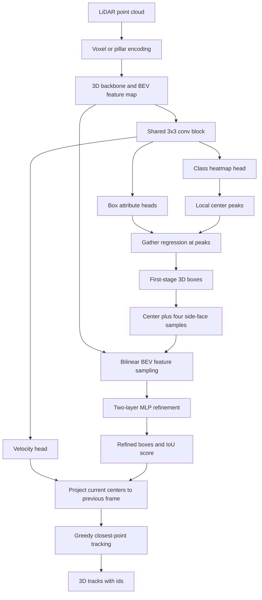

# CenterPoint

CenterPoint by Tianwei Yin, Xingyi Zhou, and Philipp Krahenbuhl is a CVPR 2021 3D object detection and tracking system for LiDAR point clouds [1]. Its main move is to stop treating 3D detection as a search over many oriented anchor boxes. Instead, it represents each object by its BEV center point, detects center heatmap peaks, and regresses the remaining box attributes only at those peaks.

The result is a detector that is simpler than many anchor-based 3D pipelines and easier to connect to tracking. A detected object is a point with box attributes and velocity; a track is a path of points through time. This page should be read after the general [perception page](/cs/autonomous-driving/perception-object-detection-and-segmentation) and alongside [prediction and motion forecasting](/cs/autonomous-driving/prediction-and-motion-forecasting), because CenterPoint sits exactly at the perception-to-tracking boundary.

## Problem & motivation

Anchor-based 3D detectors tile BEV with candidate boxes at fixed sizes, orientations, and positions. That works tolerably for 2D image boxes because most image boxes are axis-aligned rectangles. It is a poorer fit for road-scene 3D boxes: cars, buses, bicycles, and pedestrians can appear at arbitrary yaw angles, and the ego vehicle itself can be turning. A small set of axis-aligned or two-yaw anchors creates awkward target assignment rules and a large background search space. Adding more anchor orientations improves coverage but increases compute and false-positive opportunities.

CenterPoint argues that the natural object representation for 3D detection is a center point plus attributes. A point has no orientation, so the detector does not need to enumerate yaw templates before it has even found an object. Once a center is detected, the head can regress size, height, yaw, and velocity from the feature at that center. This follows the "objects as points" line of 2D center detectors [2] and tracking-as-points systems [3], but adapts it to sparse LiDAR BEV geometry.

The second motivation is tracking. A 3D tracker often keeps a Kalman-filter state for each object and performs association with box IoU or Mahalanobis distance. CenterPoint makes association almost embarrassingly direct: predict a ground-plane velocity for each current detection, project the current center back to the previous frame, and match to the closest old track of the same class. The paper reports strong tracking accuracy with only about 1 ms association overhead on nuScenes [1].

## Method

Let a LiDAR point cloud be

$$
P=\{(x_i,y_i,z_i,r_i)\}_{i=1}^{N},
$$

where $r_i$ is reflectance. A standard point-cloud encoder such as VoxelNet, SECOND, or PointPillars converts $P$ into a BEV feature map

$$
M \in \mathbb{R}^{W \times H \times F}.
$$

The precise backbone is not the main contribution. CenterPoint can use voxel or pillar encoders [4], [5], [6]. The contribution is the output representation on top of $M$.

For each object class $k \in \{1,\ldots,K\}$, the detector predicts a heatmap

$$
\hat{Y}\in[0,1]^{W \times H \times K}.
$$

The local maxima in $\hat{Y}_{:,:,k}$ are candidate centers for class $k$. During training, an annotated 3D box is projected to a BEV grid center $q_i=(q_{ix},q_{iy})$. For its class $c_i$, CenterPoint renders a Gaussian target:

$$
Y_{xyc_i}=\exp\left(-\frac{(x-q_{ix})^2+(y-q_{iy})^2}{2\sigma_i^2}\right).
$$

The radius is enlarged relative to the default CenterNet setting:

$$
\sigma_i=\max(f(w_i l_i), \sigma_{\min}), \qquad \sigma_{\min}=2,
$$

where $f$ is the CornerNet-style radius function and $w_i,l_i$ are the BEV footprint dimensions. The point of the enlarged Gaussian is practical: BEV objects are sparse in metric space, so a one-cell positive target gives weak supervision. A local Gaussian keeps assignment simple while giving nearby cells a graded target.

The heatmap uses a focal-style loss. One common way to write the CenterNet form is

$$
\begin{aligned}
L_{\mathrm{hm}} =
-\frac{1}{N_o}\sum_{x,y,k}
&\mathbf{1}[Y_{xyk}=1](1-\hat{Y}_{xyk})^{\alpha}\log(\hat{Y}_{xyk}) \\
&+\mathbf{1}[Y_{xyk}<1](1-Y_{xyk})^{\beta}
(\hat{Y}_{xyk})^{\alpha}\log(1-\hat{Y}_{xyk}),
\end{aligned}
$$

where $N_o$ is the number of annotated objects. The exact implementation follows the CenterNet family, but the important point is that missed peaks are penalized strongly and easy background cells are downweighted.

At each ground-truth center, separate dense regression heads are supervised with L1 losses. CenterPoint predicts:

$$
\hat{a}=(\Delta x,\Delta y,z,\log w,\log l,\log h,\sin\theta,\cos\theta,v_x,v_y).
$$

The offset $(\Delta x,\Delta y)$ corrects grid quantization. Height and size recover the full 3D box. Yaw is represented by $\sin\theta$ and $\cos\theta$ to avoid a discontinuity at $\pi$ and $-\pi$. Velocity $(v_x,v_y)$ is supervised from adjacent frames and is used by the tracker.

At inference, the first stage selects heatmap peaks, indexes the regression maps at each peak, and reconstructs metric boxes. A center cell $(u,v)$ with stride $s$ and origin $(x_{\min},y_{\min})$ maps back to metric BEV by

$$
\hat{x}=x_{\min}+s(u+\Delta x), \qquad
\hat{y}=y_{\min}+s(v+\Delta y).
$$

The second stage refines first-stage predictions without expensive 3D RoI pooling. For a predicted box center $c$, dimensions $(w,l,h)$, and yaw $\theta$, CenterPoint samples BEV features at the center and at the centers of the four outward-facing side faces. If

$$
r_{\mathrm{front}}=(\cos\theta,\sin\theta), \qquad
r_{\mathrm{left}}=(-\sin\theta,\cos\theta),
$$

then the side-face sampling points in BEV are approximately

$$
c,\quad c\pm \frac{l}{2}r_{\mathrm{front}},\quad c\pm \frac{w}{2}r_{\mathrm{left}}.
$$

Top and bottom face centers project to the same BEV location as the box center, so they are not separate BEV samples. Bilinear interpolation extracts features at these sparse locations, concatenates them, and feeds them through an MLP. The MLP predicts a class-agnostic IoU-guided confidence and a box refinement. The score target is

$$
I_t=\min(1,\max(0,2\mathrm{IoU}_t-0.5)),
$$

with binary cross-entropy supervision. At inference, the paper combines the first-stage class score and the second-stage IoU score with a geometric mean.

Tracking then uses the velocity head. For a current detection at center $\hat{p}_i^{(t)}$ with predicted velocity $\hat{v}_i^{(t)}$, the estimated previous center is

$$
\tilde{p}_i^{(t-1)}=\hat{p}_i^{(t)}-\hat{v}_i^{(t)}.
$$

The tracker greedily matches detections, in descending confidence order, to unmatched previous tracks by closest center distance within a class-specific threshold. Unmatched detections start new tracks; unmatched old tracks are kept for up to three frames and advanced using their last velocity.

## Architecture diagram


*Figure: CenterPoint detects object centers in BEV and refines 3D boxes from sampled face-center features. From [Yin et al., 2021](https://arxiv.org/abs/2006.11275), via the [CenterPoint GitHub repository](https://github.com/tianweiy/CenterPoint) — embedded under educational fair use with attribution.*



## Architecture details

The first-stage output heads share an initial $3 \times 3$ convolution, batch normalization, and ReLU. Each output then has its own small branch of two $3 \times 3$ convolutions separated by batch normalization and ReLU. This is intentionally close to image keypoint heads: dense maps are cheap once the BEV backbone has produced $M$.

The second-stage refinement module is lightweight. It uses a shared two-layer MLP with batch normalization, ReLU, and dropout rate 0.3, followed by two branches of three fully connected layers: one branch predicts the IoU-guided confidence score, and the other predicts the box refinement [1]. During second-stage training, the paper samples 128 first-stage proposals with a 1:1 positive-negative ratio. A proposal is positive if it has at least 0.55 3D IoU with a ground-truth box. At inference, the second stage runs on the top 500 predictions after NMS.

On Waymo, the reported CenterPoint-Voxel model uses detection range $[-75.2,75.2]$ m in $x$ and $y$, and $[-2,4]$ m in $z$. The voxel size is $(0.1,0.1,0.15)$ m, following PV-RCNN-style settings [10]. The CenterPoint-Pillar version uses a ground-plane grid size of $(0.32,0.32)$ m. Waymo uses a 64-beam LiDAR and about 180k LiDAR points per frame in the paper's description.

On nuScenes, the reported detection range is $[-51.2,51.2]$ m in $x$ and $y$, and $[-5,3]$ m in $z$. CenterPoint-Voxel uses a $(0.1,0.1,0.2)$ m voxel size; CenterPoint-Pillar uses a $(0.2,0.2)$ m grid. nuScenes has only 32-beam LiDAR and roughly 30k points per frame, so the second stage is less helpful there than on Waymo. The authors note that two-stage refinement improves Waymo with small overhead, but does not improve their nuScenes runs in the same way.

Training follows prior CBGS-style settings on nuScenes [9]. The supplement reports AdamW with one-cycle learning rate, maximum learning rate $10^{-3}$, weight decay 0.01, momentum from 0.85 to 0.95, batch size 16, and 20 epochs on four V100 GPUs. The Waymo schedule uses learning rate $3\times 10^{-3}$ and 30 epochs, with a 6-epoch second-stage fine-tuning phase for ablations. Data augmentation includes random flips along both axes, global scaling in $[0.95,1.05]$, global rotation, and ground-truth sampling on nuScenes.

## Datasets & results

CenterPoint evaluates on nuScenes and Waymo Open Dataset. nuScenes reports mAP, NDS, and AMOTA for tracking; mAP uses center-distance thresholds rather than 3D IoU, while NDS combines mAP with translation, scale, orientation, velocity, and attribute errors [7]. Waymo reports mAP and heading-aware mAPH at Level 1 and Level 2 difficulty, with IoU thresholds 0.7 for vehicles and 0.5 for pedestrians [8].

| Result from Yin et al. [1] | Dataset | Metric | Reported value |
|---|---:|---:|---:|
| CenterPoint-Voxel single model | nuScenes test detection | mAP / NDS / PKL | 58.0 / 65.5 / 0.69 |
| CBGS comparison | nuScenes test detection | mAP / NDS / PKL | 52.8 / 63.3 / 0.77 |
| CenterPoint tracking | nuScenes test tracking | AMOTA / FP / FN / IDS | 63.8 / 18612 / 22928 / 760 |
| Chiu et al. tracking comparison | nuScenes test tracking | AMOTA / FP / FN / IDS | 55.0 / 17533 / 33216 / 950 |
| CenterPoint-Voxel | Waymo test Level 2 vehicle | mAP / mAPH | 72.2 / 71.8 |
| CenterPoint-Voxel | Waymo test Level 2 pedestrian | mAP / mAPH | 72.2 / 66.4 |
| CenterPoint tracker | Waymo test Level 2 | vehicle MOTA / pedestrian MOTA | 59.4 / 56.6 |

The ablations make the representation argument more concrete. On Waymo validation, replacing anchors with centers improves average Level 2 mAPH from 60.3 to 64.6 with a VoxelNet encoder and from 57.5 to 62.0 with a PointPillars encoder. On nuScenes validation, the center-based head improves VoxelNet from 52.6 mAP / 63.0 NDS to 56.4 mAP / 64.8 NDS, and PointPillars from 46.2 mAP / 59.1 NDS to 50.3 mAP / 60.2 NDS. The paper also reports that center-based detection is particularly better when objects are heavily rotated or far from the average size.

For the second stage on Waymo validation, VoxelNet first-stage performance is 66.5 vehicle mAPH and 62.7 pedestrian mAPH. Sampling the box center improves to 68.0 and 64.9; sampling the center plus side-face centers improves to 68.3 and 65.3, with about 6 ms refinement overhead. The comparable dense sampling variant reaches similar accuracy but is slower. The conclusion is not that CenterPoint needs a heavy second stage. It is that a few carefully chosen point features recover lost local geometry at a much smaller cost than full 3D RoI feature extraction.

## Worked example  (or step-by-step walkthrough)

**Walkthrough 1: heatmap target and metric box reconstruction.** Suppose the BEV grid origin is $(x_{\min},y_{\min})=(-51.2,-51.2)$ m and the output stride is $s=0.4$ m per heatmap cell. A car center is at metric coordinate $(12.3,-4.1)$ m.

1. Convert to continuous grid coordinate:

$$
\begin{aligned}
u^* &= \frac{12.3-(-51.2)}{0.4}=158.75,\\
v^* &= \frac{-4.1-(-51.2)}{0.4}=117.75.
\end{aligned}
$$

2. Use integer center cell $(u,v)=(158,117)$ and offset target:

$$
\Delta u=0.75,\qquad \Delta v=0.75.
$$

3. If the model predicts the same offsets at that peak, reconstruct the metric center:

$$
\begin{aligned}
\hat{x} &= -51.2 + 0.4(158+0.75) = 12.3,\\
\hat{y} &= -51.2 + 0.4(117+0.75) = -4.1.
\end{aligned}
$$

4. If the predicted size logs are $(\log 1.8,\log 4.2,\log 1.6)$ and the yaw head outputs $(\sin\theta,\cos\theta)=(0.5,0.866)$, then

$$
(w,l,h)=(1.8,4.2,1.6),\qquad
\theta=\operatorname{atan2}(0.5,0.866)\approx 0.524 \text{ rad}.
$$

The checked answer is a 3D box centered at $(12.3,-4.1)$ m with yaw about 30 degrees. No anchor orientation was needed.

**Walkthrough 2: velocity-based greedy tracking.** Assume two previous tracks of class car:

| Track id | Previous center |
|---:|---:|
| 17 | $(10.0,2.0)$ |
| 23 | $(18.0,5.0)$ |

A current detection has center $(11.2,2.1)$ and predicted velocity $(1.0,0.0)$ in meters per frame. CenterPoint projects the current center back:

$$
\tilde{p}^{(t-1)}=(11.2,2.1)-(1.0,0.0)=(10.2,2.1).
$$

Distances to previous tracks are

$$
\begin{aligned}
d_{17} &= \sqrt{(10.2-10.0)^2+(2.1-2.0)^2}
       = \sqrt{0.04+0.01}
       \approx 0.224,\\
d_{23} &= \sqrt{(10.2-18.0)^2+(2.1-5.0)^2}
       = \sqrt{60.84+8.41}
       \approx 8.322.
\end{aligned}
$$

If the class-specific matching threshold is 2 m, the detection inherits id 17. If no previous track were within threshold, it would start a new id. This is the full association idea: the learned velocity converts tracking into nearest-neighbor matching between center points.

## Code

```python
import torch
import torch.nn.functional as F

def gaussian_heatmap_target(width, height, center_xy, sigma, device="cpu"):
    """Create one CenterPoint-style class heatmap target."""
    xs = torch.arange(width, device=device).float()
    ys = torch.arange(height, device=device).float()
    yy, xx = torch.meshgrid(ys, xs, indexing="ij")
    cx, cy = center_xy
    target = torch.exp(-((xx - cx) ** 2 + (yy - cy) ** 2) / (2 * sigma ** 2))
    return target.clamp_(0.0, 1.0)

def greedy_center_tracker(detections, tracks, max_dist=2.0):
    """Minimal velocity-based association.

    detections: list of dicts with center, velocity, score, cls
    tracks: list of dicts with center, id, cls
    """
    matches = []
    used_tracks = set()
    detections = sorted(detections, key=lambda d: d["score"], reverse=True)

    for det in detections:
        projected_prev = det["center"] - det["velocity"]
        best_j, best_dist = None, float("inf")

        for j, trk in enumerate(tracks):
            if j in used_tracks or trk["cls"] != det["cls"]:
                continue
            dist = torch.linalg.norm(projected_prev - trk["center"]).item()
            if dist < best_dist:
                best_j, best_dist = j, dist

        if best_j is not None and best_dist <= max_dist:
            used_tracks.add(best_j)
            matches.append((det, tracks[best_j]["id"], best_dist))
        else:
            matches.append((det, "new_track", None))
    return matches

heatmap = gaussian_heatmap_target(200, 200, center_xy=(158.75, 117.75), sigma=2.0)
peak_value = heatmap[118, 159]
print("near-center target:", float(peak_value))

dets = [{"center": torch.tensor([11.2, 2.1]), "velocity": torch.tensor([1.0, 0.0]), "score": 0.91, "cls": "car"}]
trks = [{"center": torch.tensor([10.0, 2.0]), "id": 17, "cls": "car"}]
print(greedy_center_tracker(dets, trks))
```

## Common pitfalls

- Calling CenterPoint "anchor-free" is correct, but incomplete. The detection head is anchor-free; the full system still depends on a discretized BEV grid and backbone stride.
- The heatmap peak is not the full box. The peak gives object existence and rough center; offsets, size, height, yaw, and velocity come from separate regression heads.
- The enlarged Gaussian target is not a post-processing blur. It is part of training supervision to make sparse BEV centers learnable.
- The velocity head predicts displacement between frames, not a long-horizon trajectory. Prediction and planning modules still need richer motion forecasting.
- Two-stage refinement is dataset-dependent. It helps more on dense Waymo LiDAR than on sparser nuScenes LiDAR in the paper's experiments.
- Greedy tracking can fail under occlusion, long gaps, or close interactions. CenterPoint keeps unmatched tracks briefly, but it does not solve identity reasoning in crowded scenes.
- NDS and AMOTA are not interchangeable. NDS is a detection score; AMOTA evaluates multi-object tracking with identity and false-positive/false-negative penalties.

## Connections

- [Perception, object detection, and segmentation](/cs/autonomous-driving/perception-object-detection-and-segmentation) for 3D boxes, BEV heatmaps, mAP, IoU, and NDS.
- [Prediction and motion forecasting](/cs/autonomous-driving/prediction-and-motion-forecasting) for the next step after CenterPoint tracking: forecasting future agent motion.
- [Sensor fusion](/cs/autonomous-driving/sensor-fusion) for how CenterPoint-style LiDAR detections are combined with cameras and radar in fused stacks.
- [Sensors: cameras, LiDAR, radar, IMU](/cs/autonomous-driving/sensors-cameras-lidar-radar-imu) for LiDAR sparsity, range, reflectance, and calibration context.
- [MIT BEVFusion](/cs/autonomous-driving/bevfusion-mit) for a BEV fusion system that uses a center-based detection head.
- [BEVFusion robust stream design](/cs/autonomous-driving/sensor-fusion) for a fusion framework that can wrap CenterPoint-style LiDAR streams.
- [Weather-induced sensor occlusion robustness](/cs/autonomous-driving/sensor-fusion) for a later evaluation showing how LiDAR degradation affects BEVFusion-style detection.

## References

[1] T. Yin, X. Zhou, and P. Krahenbuhl, "Center-Based 3D Object Detection and Tracking," in IEEE/CVF Conference on Computer Vision and Pattern Recognition (CVPR), 2021.

[2] X. Zhou, D. Wang, and P. Krahenbuhl, "Objects as Points," arXiv:1904.07850, 2019.

[3] X. Zhou, V. Koltun, and P. Krahenbuhl, "Tracking Objects as Points," in European Conference on Computer Vision (ECCV), 2020.

[4] A. H. Lang, S. Vora, H. Caesar, L. Zhou, J. Yang, and O. Beijbom, "PointPillars: Fast Encoders for Object Detection from Point Clouds," in IEEE/CVF Conference on Computer Vision and Pattern Recognition (CVPR), 2019.

[5] Y. Zhou and O. Tuzel, "VoxelNet: End-to-End Learning for Point Cloud Based 3D Object Detection," in IEEE/CVF Conference on Computer Vision and Pattern Recognition (CVPR), 2018.

[6] Y. Yan, Y. Mao, and B. Li, "SECOND: Sparsely Embedded Convolutional Detection," Sensors, vol. 18, no. 10, 2018.

[7] H. Caesar et al., "nuScenes: A Multimodal Dataset for Autonomous Driving," in IEEE/CVF Conference on Computer Vision and Pattern Recognition (CVPR), 2020.

[8] P. Sun et al., "Scalability in Perception for Autonomous Driving: Waymo Open Dataset," in IEEE/CVF Conference on Computer Vision and Pattern Recognition (CVPR), 2020.

[9] B. Zhu, Z. Jiang, X. Zhou, Z. Li, and G. Yu, "Class-Balanced Grouping and Sampling for Point Cloud 3D Object Detection," arXiv:1908.09492, 2019.

[10] S. Shi et al., "PV-RCNN: Point-Voxel Feature Set Abstraction for 3D Object Detection," in IEEE/CVF Conference on Computer Vision and Pattern Recognition (CVPR), 2020.
