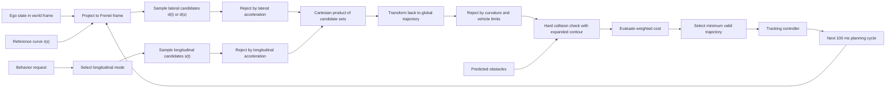

# Frenet Trajectory Generation

Werling, Ziegler, Kammel, and Thrun's "Optimal Trajectory Generation for Dynamic Street Scenarios in a Frenet Frame," presented at IEEE ICRA 2010, is one of the classic planning papers behind road-aligned trajectory sampling [1]. Its central idea is simple but powerful: do not plan directly in global $x,y$ coordinates when the road itself gives a natural coordinate system. Instead, project the vehicle onto a reference curve, plan longitudinal station $s$ and lateral offset $d$, then map the selected trajectory back to Cartesian space for tracking.

The paper sits between behavior planning and low-level control. A behavior layer can request "keep speed," "follow," "merge," or "stop"; the Frenet planner turns that tactical request into a time-parameterized, smooth, collision-checked trajectory. Compared with a purely geometric path, the output includes time, speed, acceleration, heading, curvature, and enough smoothness for a feedback controller to track.

## Why sample in road coordinates

Dynamic street scenarios require more than a shortest path around static obstacles. At highway speed, a planner must decide how quickly to change lanes, whether to pass or follow, how to keep a time gap, and how to avoid a sudden obstacle without producing uncomfortable jerk. The authors argue that many earlier sampling or parametric methods could generate feasible local paths, but their parameter spaces did not necessarily contain the jerk-optimal solution. Replanning at different frequencies could therefore change the chosen transient and produce temporal inconsistency.

The paper's answer is to sample within the function class that solves an unconstrained optimal-control problem: quintic polynomials for fixed terminal position, velocity, and acceleration, and quartic polynomials for velocity-keeping where terminal position is free. The algorithm then filters these optimal free-space candidates by acceleration, curvature, road, and collision constraints. When constraints are inactive, Bellman's principle of optimality explains why the remainder of the previously optimal maneuver remains optimal at the next planning tick. That is the important conceptual contribution: the planner is sampling candidates, but the samples are structured around an optimal-control result rather than arbitrary shape parameters.

## Deriving jerk-minimizing Frenet candidates

Let $r(s)$ be the road centerline or another behavior-selected reference curve, parameterized by arc length $s$. Let $n_r(s)$ be its normal vector. A vehicle position is represented as

$$
x(s(t), d(t)) = r(s(t)) + d(t)n_r(s(t)).
$$

Here $s(t)$ is progress along the route and $d(t)$ is signed lateral offset. At moderate and high speed, the method treats lateral and longitudinal motion as nearly decoupled, because the tangent and normal of the resulting trajectory are close to the road tangent and normal. At low speed, where nonholonomic constraints become more visible, the paper switches to $d(s)$, so lateral motion is parameterized by distance along the path rather than time.

The core optimal-control fact is the jerk-minimizing polynomial. For a scalar coordinate $p(t)$ over $\tau=t-t_0 \in [0,T]$, define

$$
J_t(p) = \int_0^T \left(\frac{d^3p}{dt^3}\right)^2 dt.
$$

The Euler-Lagrange equation for the integrand $(p''')^2$ gives $p^{(6)}=0$, so the unconstrained minimizer is a quintic polynomial:

$$
p(\tau)=c_0+c_1\tau+c_2\tau^2+c_3\tau^3+c_4\tau^4+c_5\tau^5.
$$

The first three coefficients are fixed by the start state:

$$
c_0=p_0,\qquad c_1=\dot{p}_0,\qquad c_2=\frac{1}{2}\ddot{p}_0.
$$

The remaining coefficients satisfy

$$
\begin{bmatrix}
T^3 & T^4 & T^5\\
3T^2 & 4T^3 & 5T^4\\
6T & 12T^2 & 20T^3
\end{bmatrix}
\begin{bmatrix}
c_3\\c_4\\c_5
\end{bmatrix}
=
\begin{bmatrix}
b_0\\b_1\\b_2
\end{bmatrix},
$$

where

$$
\begin{aligned}
b_0 &= p_1-p_0-\dot{p}_0T-\frac{1}{2}\ddot{p}_0T^2,\\
b_1 &= \dot{p}_1-\dot{p}_0-\ddot{p}_0T,\\
b_2 &= \ddot{p}_1-\ddot{p}_0.
\end{aligned}
$$

Equivalently,

$$
\begin{aligned}
c_3 &= \frac{10b_0}{T^3}-\frac{4b_1}{T^2}+\frac{b_2}{2T},\\
c_4 &= -\frac{15b_0}{T^4}+\frac{7b_1}{T^3}-\frac{b_2}{T^2},\\
c_5 &= \frac{6b_0}{T^5}-\frac{3b_1}{T^4}+\frac{b_2}{2T^3}.
\end{aligned}
$$

Werling et al. use this result for lateral motion. For high-speed lane keeping or lane changes, they generate lateral candidates from the current lateral state $D_0=[d_0,\dot d_0,\ddot d_0]$ to sampled end states

$$
[d_1,\dot d_1,\ddot d_1,T]_{ij}=[d_i,0,0,T_j],
$$

and score them with

$$
C_d = k_jJ_t(d(t)) + k_tT + k_dd_1^2.
$$

For longitudinal behavior, the terminal target depends on the behavior mode. Following uses a constant-time-gap target behind a lead vehicle:

$$
s_{\mathrm{target}}(t)=s_{\mathrm{lv}}(t)-\left(D_0+\tau s_{\mathrm{lv}}'(t)\right).
$$

Stopping uses a fixed $s_{\mathrm{stop}}$ with zero terminal speed and acceleration. Merging can target the midpoint between two predicted vehicles:

$$
s_{\mathrm{target}}(t)=\frac{1}{2}\left(s_a(t)+s_b(t)\right).
$$

Velocity keeping is different: the goal is a desired terminal speed, not a desired terminal station. The terminal position is free, so the jerk-optimal trajectory becomes quartic rather than quintic. A typical velocity cost is

$$
C_v = k_jJ_t(s(t)) + k_tT + k_s\left(\dot{s}_1-\dot{s}_d\right)^2.
$$

The planner forms lateral and longitudinal sets, checks each candidate for acceleration limits, combines surviving pairs, transforms them back to global coordinates, rejects candidates that violate curvature or collide with obstacles, and selects the minimum weighted cost:

$$
C_{\mathrm{tot}}=k_{\mathrm{lat}}C_{\mathrm{lat}}+k_{\mathrm{lon}}C_{\mathrm{lon}}.
$$

Collision handling is intentionally hard-gated rather than a nearby-obstacle soft penalty. The paper expands the vehicle contour and enlarges the checked contour toward the time horizon, so later portions of a trajectory maintain stronger clearance.

### Candidate generation and rejection loop


*Figure: Plane-curve tangent and normal vectors underlying the road-aligned Frenet frame. From [Wikimedia Commons](https://commons.wikimedia.org/wiki/File:FrenetTN.svg), Salix alba, CC BY-SA 3.0.*



## High-speed and low-speed regimes

The paper separates high-speed and low-speed trajectory generation. High-speed planning samples $d(t)$ and $s(t)$ independently. This gives velocity-invariant lane changes: the timing of the lateral maneuver can be chosen without rebuilding the lane change around absolute forward speed. Low-speed planning samples $d(s)$ because nonholonomic feasibility is harder to preserve when a vehicle moves slowly and lateral motion cannot be treated as an independent offset time signal.

The implementation uses discrete sets of terminal offsets and terminal times. Figures 3, 4, and 5 in the paper show lateral movement, longitudinal target tracking, and velocity adaptation: green is the selected optimal candidate, black candidates are valid alternatives, and gray candidates are invalid. Figure 6 shows the combined global trajectory set after lateral and longitudinal pairing. Figure 7 demonstrates a simulated highway passing scenario where the method reacts by combining steering and speed changes.

The planner needs centerline geometry: orientation, curvature, and curvature derivative. The appendix derives transformations from Frenet coordinates to global heading, curvature, velocity, and acceleration. This matters because a feedback controller cannot track only $x,y$ points; it needs a smooth reference with curvature and speed.

The reported vehicle experiment used the autonomous vehicle Junior with a 100 ms planning cycle for long-term objectives without obstacles. The reactive obstacle-avoidance demonstration was simulation-only because the highway passing scenario was risky. The authors explicitly state that the short horizon does not replace far-sighted behavior planning. The behavior layer still needs to avoid creating critical situations whenever possible.

## Evidence from Junior and highway simulation

This is a classical planning paper, not a benchmark paper with KITTI-style metrics. The evaluation is a combination of implementation on Junior and simulation of highway traffic.

| Evidence in Werling et al. [1] | What it demonstrates | Conservative reading |
|---|---|---|
| Figures 3-5 | Cyclic replanning of lateral and longitudinal candidate sets | The sampled candidates preserve smoothness and temporal consistency in the shown scenarios. |
| Figure 6 | Combined trajectory set in global coordinates | The Frenet decomposition can generate many global alternatives while keeping the road-aligned structure visible. |
| Junior implementation at 100 ms cycle | Real-time integration with a tracking controller | The non-reactive long-term objective part was implemented on a real vehicle. |
| Figure 7 simulated highway scenario | Reactive passing and braking/acceleration around predicted obstacles | The most aggressive dynamic-obstacle claims are simulation evidence, not open-road validation. |

The most durable result is methodological rather than numerical: by sampling jerk-optimal polynomial connections in a road-aligned frame, the planner gives behavior modules a small set of intuitive knobs while still producing smooth, dynamically checkable trajectories.

## From boundary conditions to road behavior

### Example 1: Rest-to-rest lateral lane change

Problem: Generate a lateral lane-change profile from $d(0)=0$ m to $d(4)=3.5$ m in $T=4$ s, with zero initial and final lateral velocity and acceleration.

1. The start conditions give

$$
c_0=0,\qquad c_1=0,\qquad c_2=0.
$$

2. The end residuals are

$$
\begin{aligned}
b_0 &= 3.5-0-0-0=3.5,\\
b_1 &= 0-0-0=0,\\
b_2 &= 0-0=0.
\end{aligned}
$$

3. Substitute into the closed-form coefficients:

$$
\begin{aligned}
c_3 &= \frac{10(3.5)}{4^3}=0.546875,\\
c_4 &= -\frac{15(3.5)}{4^4}=-0.205078125,\\
c_5 &= \frac{6(3.5)}{4^5}=0.0205078125.
\end{aligned}
$$

4. The lateral trajectory is

$$
d(t)=0.546875t^3-0.205078125t^4+0.0205078125t^5.
$$

5. Check the endpoint:

$$
\begin{aligned}
d(4)&=0.546875(64)-0.205078125(256)+0.0205078125(1024)\\
&=35-52.5+21=3.5.
\end{aligned}
$$

Answer: the quintic moves one 3.5 m lane width in 4 s with zero endpoint lateral speed and acceleration.

### Example 2: Following target from a time-gap law

Problem: A lead vehicle is at $s_{\mathrm{lv}}(0)=50$ m and travels at $20$ m/s with approximately constant speed. The desired standstill distance is $D_0=5$ m and the time gap is $\tau=1.5$ s. Compute the target station now and after 3 s.

1. At $t=0$, the desired following distance is

$$
D_0+\tau \dot{s}_{\mathrm{lv}}=5+1.5(20)=35\ \mathrm{m}.
$$

2. The target station is therefore

$$
s_{\mathrm{target}}(0)=50-35=15\ \mathrm{m}.
$$

3. With constant lead speed, after 3 s:

$$
s_{\mathrm{lv}}(3)=50+20(3)=110\ \mathrm{m}.
$$

4. The desired gap is unchanged because speed is unchanged, so

$$
s_{\mathrm{target}}(3)=110-35=75\ \mathrm{m}.
$$

Answer: longitudinal candidates for following should be built around a moving target that goes from 15 m to 75 m over the 3 s horizon.

## Sampling lane-change durations

```python
import numpy as np

def quintic_coeffs(p0, v0, a0, p1, v1, a1, T):
    c0 = p0
    c1 = v0
    c2 = 0.5 * a0
    b0 = p1 - p0 - v0 * T - 0.5 * a0 * T**2
    b1 = v1 - v0 - a0 * T
    b2 = a1 - a0
    c3 = 10 * b0 / T**3 - 4 * b1 / T**2 + 0.5 * b2 / T
    c4 = -15 * b0 / T**4 + 7 * b1 / T**3 - b2 / T**2
    c5 = 6 * b0 / T**5 - 3 * b1 / T**4 + 0.5 * b2 / T**3
    return np.array([c0, c1, c2, c3, c4, c5])

def eval_poly(c, t):
    powers = np.vstack([t**i for i in range(len(c))])
    return c @ powers

def jerk_cost(c, T, steps=200):
    t = np.linspace(0.0, T, steps)
    jerk = 6 * c[3] + 24 * c[4] * t + 60 * c[5] * t**2
    return np.trapz(jerk * jerk, t)

lane_width = 3.5
times = [3.0, 4.0, 5.0]
candidates = []
for T in times:
    coeff = quintic_coeffs(0.0, 0.0, 0.0, lane_width, 0.0, 0.0, T)
    cost = 0.2 * jerk_cost(coeff, T) + 0.5 * T
    candidates.append((cost, T, coeff))

best_cost, best_T, best_coeff = min(candidates, key=lambda item: item[0])
print(f"best duration: {best_T:.1f} s")
print(f"coefficients: {best_coeff}")
```

## Where the Frenet assumptions break

- Treating Frenet planning as only a coordinate transform. The important part is the structured optimal-control candidate set and the cost/filtering pipeline.
- Forgetting that high-speed $d(t)$ decoupling is an approximation. At low speed or near extreme curvature, $d(s)$ or a direct vehicle-model planner may be needed.
- Adding obstacle proximity directly into the comfort cost without care. Werling et al. prefer hard collision filtering with expanded contours because soft obstacle penalties can create hard-to-tune behavior.
- Assuming the local planner replaces behavior planning. The paper is explicit that the short horizon should not be asked to make far-sighted tactical decisions.
- Ignoring curvature after transforming back to Cartesian space. A smooth $s,d$ pair can still imply an infeasible global curvature if the reference path or offset is aggressive.

## Sources cited

[1] M. Werling, J. Ziegler, S. Kammel, and S. Thrun, "Optimal Trajectory Generation for Dynamic Street Scenarios in a Frenet Frame," in Proc. IEEE International Conference on Robotics and Automation, 2010, pp. 987-993.

[2] J. Ziegler and C. Stiller, "Spatiotemporal State Lattices for Fast Trajectory Planning in Dynamic On-Road Driving Scenarios," in Proc. IEEE/RSJ International Conference on Intelligent Robots and Systems, 2009.

[3] Y. Kuwata, G. A. Fiore, J. Teo, E. Frazzoli, and J. P. How, "Motion Planning for Urban Driving Using RRT," in Proc. IEEE/RSJ International Conference on Intelligent Robots and Systems, 2008.

[4] D. Ferguson, T. M. Howard, and M. Likhachev, "Motion Planning in Urban Environments," Journal of Field Robotics, vol. 25, no. 11, pp. 939-960, 2008.

<div className="see-also">

See also: [Motion planning](/cs/autonomous-driving/motion-planning) · [Decision making and behavior planning](/cs/autonomous-driving/decision-making-and-behavior-planning) · [Control, PID, MPC, pure pursuit, and Stanley](/cs/autonomous-driving/control-pid-mpc-pure-pursuit-stanley) · [Sampling-based motion planning](/cs/autonomous-driving/motion-planning) · [MPC for autonomous driving](/cs/autonomous-driving/control-pid-mpc-pure-pursuit-stanley) · [Prediction and motion forecasting](/cs/autonomous-driving/prediction-and-motion-forecasting) · [Systems of ODEs and phase plane](/math/engineering-math/systems-of-odes-and-phase-plane)

</div>
