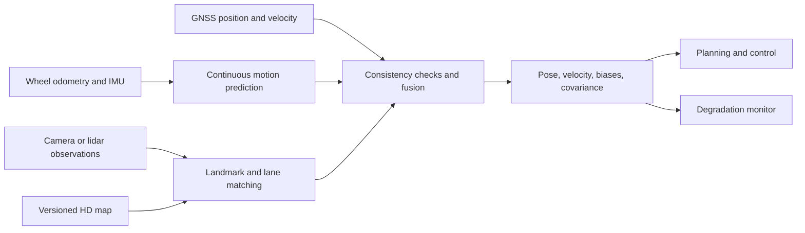

# Localization and HD Maps

Localization answers a more demanding question than “what are the latitude and longitude?” An automated vehicle needs a pose in a well-defined frame, a velocity, an estimate of sensor biases, and uncertainty. The estimate must remain smooth enough for control while staying tied to the road network. A planner also needs to know whether the vehicle is in the left lane or the right lane, before or after a stop line, and aligned with the correct branch of an intersection.

No single sensor supplies all of that reliably. IMUs and wheel encoders provide fast relative motion but drift. GNSS provides global position but may jump or acquire a slowly varying bias. Cameras and lidar can align observations with local structure, provided the scene has enough texture or geometry and the reference map is current. A production estimator therefore combines complementary measurements and reports when their agreement deteriorates.

## Pose only has meaning with a frame

A planar road model often represents pose as $(x,y,\psi)$, with yaw $\psi$. A full spatial pose is an element of $SE(3)$: a rotation $R\in SO(3)$ and translation $p\in\mathbb{R}^3$. The notation is compact, but the frame attached to each quantity cannot be implicit.

Common frames include:

- an Earth-fixed or local east-north-up frame for global coordinates;
- a map frame in which mapped lanes and landmarks are stored;
- a locally continuous odometry frame, allowed to drift relative to the map;
- the vehicle body frame, usually fixed near the rear axle or IMU;
- a frame for every camera, lidar, radar, and GNSS antenna.

The rigid transform from the body to a sensor is its **extrinsic calibration**. If that transform is wrong, otherwise good measurements disagree in a repeatable way. A ten-centimetre GNSS antenna offset, for example, rotates around the body reference point during a turn. Treating the antenna position as the rear-axle position creates a heading-dependent position error.

It is useful to keep a continuous odometry pose separate from a map correction. A new GNSS or map-matching update may revise the map-to-odometry transform without introducing a discontinuity into the short-horizon pose consumed by control. The planner gets the corrected global context; the controller keeps a smooth local trajectory.

An estimator state commonly extends far beyond pose:

$$
x = \begin{bmatrix}
p & v & q & b_a & b_g
\end{bmatrix}^{\top},
$$

where $p$ is position, $v$ velocity, $q$ orientation, and $b_a,b_g$ accelerometer and gyroscope biases. Wheel scale, steering offset, clock offset, or sensor extrinsics may also be estimated when they are sufficiently observable.

## Propagating motion between external fixes

At road speeds, the estimator must propagate state much faster than global corrections arrive. A planar kinematic bicycle model gives a useful first approximation:

$$
\begin{aligned}
\dot{x} &= v\cos\psi, \\
\dot{y} &= v\sin\psi, \\
\dot{\psi} &= \frac{v}{L}\tan\delta,
\end{aligned}
$$

where $L$ is wheelbase and $\delta$ is the front-wheel steering angle. Its curvature is $\kappa=\tan\delta/L$. The model assumes low sideslip and a suitable conversion from steering-wheel angle to road-wheel angle. Tire compliance, bank angle, wheel slip, and an incorrect steering ratio all violate those assumptions.

An IMU supplies angular rate and specific force. Ignoring Earth rotation for a local road-scale derivation, propagation has the form

$$
\begin{aligned}
\dot{R} &= R[\omega_m-b_g-n_g]_{\times}, \\
\dot{v} &= R(a_m-b_a-n_a)+g, \\
\dot{p} &= v.
\end{aligned}
$$

The bracket $[\cdot]_{\times}$ is the skew-symmetric matrix used for a cross product. An accelerometer does not directly measure world-frame linear acceleration: gravity, orientation, bias, and noise must be handled together. A small attitude error tilts the estimated gravity vector into the horizontal plane, producing a persistent false acceleration. Integrating that error once corrupts velocity and integrating it again corrupts position.

Wheel odometry constrains forward speed well on dry pavement, while the IMU captures rapid rotation and acceleration. Their failure modes differ. Wheel speed can be wrong during braking or on loose ground; the IMU continues smoothly but accumulates bias. Fusing both gives better short-term motion than either alone, yet the result remains dead reckoning and requires an external reference.

### Worked example: one constant-steering update

Suppose $L=2.8$ m, $v=10$ m/s, $\delta=5^\circ$, and $\Delta t=0.1$ s. The initial pose is $(0,0,0)$. Assume speed and steering remain constant during the interval.

First convert the steering angle and calculate curvature:

$$
\begin{aligned}
\delta &= 5\frac{\pi}{180}=0.08727\ \mathrm{rad}, \\
\kappa &= \frac{\tan(0.08727)}{2.8}
\approx 0.03125\ \mathrm{m}^{-1}.
\end{aligned}
$$

The yaw change equals travelled distance times curvature:

$$
\begin{aligned}
s &= v\Delta t=10(0.1)=1.0\ \mathrm{m}, \\
\Delta\psi &= s\kappa\approx0.03125\ \mathrm{rad}
\approx1.79^\circ.
\end{aligned}
$$

For nonzero curvature, the path is an arc with radius $r=1/\kappa\approx32.0$ m. Exact constant-curvature integration from zero yaw gives

$$
\begin{aligned}
x_1 &= r\sin(\Delta\psi)
\approx32.0\sin(0.03125)
\approx0.9998\ \mathrm{m}, \\
y_1 &= r\left(1-\cos(\Delta\psi)\right)
\approx32.0\left(1-\cos(0.03125)\right)
\approx0.0156\ \mathrm{m}, \\
\psi_1 &= 0.03125\ \mathrm{rad}.
\end{aligned}
$$

A forward-Euler update evaluated at the initial yaw would return $(1.0,0,0.03125)$. The lateral difference is small over $0.1$ s, but repeated coarse Euler steps accumulate integration error even if the motion model itself is exact.

## Corrections, innovations, and covariance

An extended Kalman filter alternates prediction and measurement update:

$$
\begin{aligned}
x_k^- &= f(x_{k-1}^+,u_k), \\
P_k^- &= F_kP_{k-1}^+F_k^{\top}+Q_k, \\
r_k &= z_k-h(x_k^-), \\
S_k &= H_kP_k^-H_k^{\top}+R_k, \\
K_k &= P_k^-H_k^{\top}S_k^{-1}, \\
x_k^+ &= x_k^-+K_kr_k.
\end{aligned}
$$

$P$ represents state uncertainty, $Q$ process uncertainty, and $R$ measurement uncertainty. The innovation $r_k$ is the part of the observation not predicted by the current state. Its expected covariance is $S_k$. Large innovations can be legitimate after a long outage, or they can indicate multipath, a false landmark association, bad calibration, or a stale map. Accepting every update is unsafe; rejecting every surprising update prevents recovery.

GNSS is valuable because it anchors long-term drift, not because every fix is ground truth. Buildings reflect satellite signals, tunnels block them, and common atmospheric or receiver errors can be correlated over time. A receiver-provided covariance may also be optimistic. Systems often combine position, velocity, satellite-quality indicators, consistency checks, and inertial history before trusting a fix.

Map matching supplies another correction. A lidar scan can be aligned to a point-cloud or reflectivity map; camera detections can be aligned to lane markings, signs, poles, or traffic lights. The matcher must handle association as well as geometry. Two parallel lanes may produce nearly identical local observations, so a confident local optimum can still be the wrong lane.

### Worked example: fusing a lateral map observation

Assume the predicted lateral offset from a mapped lane center is $y^-=0.45$ m with standard deviation $\sigma_p=0.30$ m. A lane detector says the vehicle is on the centerline, $z=0$, with standard deviation $\sigma_m=0.20$ m. This is a scalar Kalman update with $H=1$.

Convert standard deviations to variances:

$$
P^-=(0.30)^2=0.09,\qquad R=(0.20)^2=0.04.
$$

The innovation and its variance are

$$
r=z-y^-=0-0.45=-0.45,\qquad S=P^-+R=0.13.
$$

The Kalman gain is

$$
K=\frac{P^-}{P^-+R}=\frac{0.09}{0.13}\approx0.6923.
$$

Apply the correction:

$$
\begin{aligned}
y^+ &= y^-+Kr \\
&=0.45+0.6923(-0.45) \\
&\approx0.1385\ \mathrm{m}, \\
P^+ &= (1-K)P^- \\
&\approx(1-0.6923)(0.09) \\
&\approx0.0277.
\end{aligned}
$$

The posterior standard deviation is $\sqrt{0.0277}\approx0.166$ m. The estimate moves toward the measurement but does not jump fully to zero because both sources are uncertain. The normalized innovation squared is

$$
r^2/S=0.45^2/0.13\approx1.56,
$$

which can be compared with a chosen statistical gate. Such a gate only has the intended meaning when $P$ and $R$ are reasonably calibrated.

## Visual-inertial and lidar-inertial odometry

Visual-inertial odometry tracks image features or photometric patches while using the IMU to constrain rapid motion and scale. A monocular camera alone cannot recover absolute metric scale from arbitrary motion; inertial measurements make scale observable under sufficiently exciting motion. Stereo cameras provide direct geometric scale but still benefit from the IMU during blur or low texture.

VIO weakens in darkness, glare, repeated texture, and scenes dominated by independently moving objects. It also needs accurate camera timing and rolling-shutter handling. A few milliseconds of timestamp error can resemble a geometric calibration error during fast rotation.

Lidar-inertial odometry aligns successive scans or scan features and uses inertial propagation between them. Lidar directly measures metric range and is less sensitive to illumination, but rain, snow, dust, sparse returns, and geometrically repetitive corridors can cause trouble. A spinning lidar also records different points at different times; deskewing the scan requires a motion estimate.

Both VIO and LIO are primarily relative estimators. They can be tied to a global map, or they can become the front end of SLAM. Neither sensor name guarantees robustness. Observability, time synchronization, calibration, scene structure, and outlier rejection matter more than the acronym.

## Factor graphs and map construction

Graph-based estimation represents poses, landmarks, biases, and sometimes calibration parameters as variables. Measurements become factors connecting the variables they constrain. The estimate minimizes weighted residuals:

$$
X^*=\arg\min_X\sum_i r_i(X)^{\top}\Omega_i r_i(X),
$$

where $\Omega_i$ is an information matrix. Odometry factors connect adjacent poses, GNSS factors anchor poses globally, landmark factors connect observations to mapped objects, and loop-closure factors connect places observed at different times.

A loop closure can remove drift accumulated over a long route, but a false closure can deform the entire solution. Candidate retrieval and geometric verification are therefore separate stages. Robust loss functions can reduce the influence of an outlier; they do not turn a bad association into a good one.

Offline map building can afford smoothing over future and past measurements, repeated passes, and human or automated quality checks. Online localization usually has a strict latency budget and cannot revise the distant past freely. Many systems use a high-quality offline map with a smaller online filtering or fixed-lag smoothing problem.

## What an HD map contributes

An HD road map is better viewed as several linked layers than as one image. A geometric layer may contain lane boundaries, centerlines, curbs, stop lines, and drivable polygons. A semantic layer adds boundary types, speed limits, turn restrictions, crosswalks, signs, and traffic-light associations. A topological layer records which lane segments precede, follow, merge with, or conflict with others.

A lanelet represents a short lane segment by left and right boundaries plus attributes and relations. Chaining lanelets forms a routing graph. Direction and boundary order matter: reversing them changes the implied direction of travel and which boundary is left. Intersection rules may refer to several lanelets and regulatory elements rather than a single polyline.

Maps help perception by supplying priors and help planning by supplying legal connectivity beyond sensor range. They also create dependencies:

| Map contribution | Benefit | Failure when wrong or missing |
|---|---|---|
| lane geometry | stable lane-relative pose | wrong-lane association, biased path |
| topology | legal routes through merges and intersections | impossible or illegal maneuver choice |
| traffic-control association | links lights and stop lines to lanes | reaction to the wrong signal |
| speed and access rules | behavior constraints | unsafe or unlawful plan |
| static landmarks | drift correction | localization jump after a scene change |

Map data needs provenance, geographic versioning, validation, and rollback. A fleet observation that a lane marking moved is evidence, not an immediate trusted edit. Construction zones are especially difficult because barriers and markings can change daily while the legal route may be communicated by temporary signs or workers.

When observations disagree with the map, the software should preserve both hypotheses long enough to diagnose the conflict. Silently forcing perception into the mapped geometry can produce a precise but false pose. Silently discarding the map loses useful prior structure. Confidence-aware behavior may reduce speed, enlarge clearance, avoid a disputed lane change, or request a fallback depending on the operational design domain.

Map-light systems shift more work online. Standard-definition maps can provide coarse route context while perception infers current lanes and controls. The maintenance burden falls, but intersection topology and temporary layouts must then be reconstructed under real-time uncertainty. The engineering question is how much prior information the system assumes and what it does when that assumption fails.

## Evaluating the estimator that planning actually receives

Average position error hides the cases that matter. Evaluation should separate longitudinal, lateral, vertical, and heading error; measure tails and outage duration; and segment results by environment. Lane association and stop-line error are often more informative than a single Euclidean distance.

Heading error grows into lateral look-ahead error. At distance $d$, a small yaw error $\Delta\psi$ contributes roughly

$$
e_{\mathrm{lat}}\approx d\sin(\Delta\psi)\approx d\Delta\psi.
$$

At a 50 m look-ahead, a $1^\circ$ error gives about $50(0.01745)=0.87$ m. A position estimate can appear locally acceptable while its orientation sends a planned path toward the neighboring lane.

Tests should include GNSS denial and recovery, map transitions, repeated structures, calibration perturbations, dropped or delayed messages, wheel slip, and changed road geometry. Uncertainty deserves a calibration check: among estimates labelled with a given confidence, the observed errors should have the corresponding distribution often enough. An overconfident estimator is harder for planning to handle than an honestly uncertain one.

Operational monitoring also needs discontinuity limits and cross-sensor residuals. A map-matching score alone is weak evidence because a matcher can be confidently wrong. Agreement among independent cues, sustained over time and consistent with vehicle dynamics, is stronger.

## Failure patterns to keep in mind

- A high-quality GNSS status flag does not rule out a common bias affecting all satellites in view. Motion consistency and other sensors still matter.
- Covariance can look small because a model omitted a source of error. Calibration drift and correlated map error do not disappear when the filter matrix is confident.
- Lane markings are ambiguous evidence on parallel roads, reversible lanes, and recently repainted surfaces. Topology and temporal continuity should participate in association.
- Extrinsic and timing calibration errors often masquerade as motion-dependent localization error. Retuning measurement noise may hide the symptom while retaining the bias.
- The kinematic bicycle model is weakest during high sideslip, wheel lift, or aggressive transients. A neat dead-reckoning trace is not proof that the assumed dynamics held.
- A fresh map can still be incompatible with current temporary traffic control. Release age and scene agreement answer different questions.

See also: [Sensors: cameras, lidar, radar, and IMU](/cs/autonomous-driving/sensors-cameras-lidar-radar-imu) · [Sensor fusion](/cs/autonomous-driving/sensor-fusion) · [Motion planning](/cs/autonomous-driving/motion-planning) · [Decision making and behavior planning](/cs/autonomous-driving/decision-making-and-behavior-planning) · [Simulation and data](/cs/autonomous-driving/simulation-and-data)

