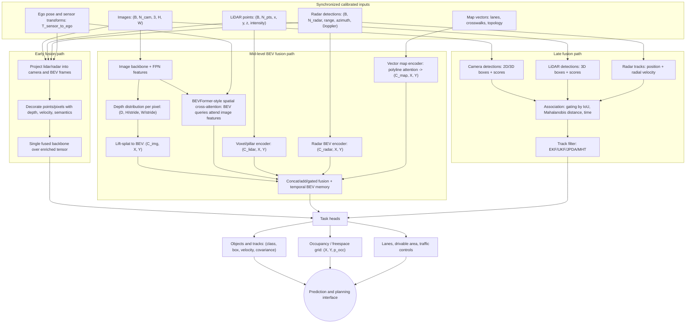

# Sensor Fusion

Sensor fusion combines measurements from cameras, lidar, radar, IMU, GNSS, maps, and vehicle odometry into a more useful estimate than any sensor can provide alone. The goal is not merely to average sensors. Fusion must respect coordinate frames, timestamps, uncertainty, occlusion, failure modes, and semantic meaning. A lidar point, a radar target, a camera detection, and a map lane boundary are different kinds of evidence.

Fusion sits between [sensors](/cs/autonomous-driving/sensors-cameras-lidar-radar-imu), [perception](/cs/autonomous-driving/perception-object-detection-and-segmentation), [localization](/cs/autonomous-driving/localization-and-hd-maps), and [prediction](/cs/autonomous-driving/prediction-and-motion-forecasting). Early, mid-level, and late fusion make different commitments about calibration, information loss, modularity, and failure isolation.

## Fusion levels, shared frames, and occupancy

**Early fusion** combines raw or lightly processed sensor data before high-level perception. Examples include projecting lidar points into camera images, painting point clouds with image features, or concatenating radar and lidar features in a common voxel grid.

**Mid-level fusion** combines learned features from different sensor streams. A camera backbone may produce image features, a lidar backbone may produce BEV features, and a transformer or convolutional module fuses them into a shared representation.

**Late fusion** combines high-level outputs such as object tracks, boxes, velocities, lane hypotheses, and occupancy probabilities. Late fusion is easier to modularize and debug, but it can lose information discarded by earlier modules.

**Bird's-eye view**, or **BEV**, is a top-down representation indexed by ground-plane coordinates around the ego vehicle. BEV is natural for driving because planning, occupancy, lanes, and motion are mostly organized on the road surface.

**BEVFormer** is a representative camera-based approach that uses transformer attention to build BEV features from multi-camera images over time. **BEVFusion** is a representative multi-sensor approach that fuses camera and lidar features in BEV. These names are useful landmarks, not fixed production recipes.

An **occupancy grid** stores whether each cell in space is free, occupied, or unknown. Modern **occupancy networks** may predict 3D voxel occupancy, semantic occupancy, motion, and uncertainty from multiple sensors.

**Extrinsic calibration** is the rigid transform between sensors, such as $T_{\mathrm{camera}\leftarrow\mathrm{lidar}}$. **Time synchronization** aligns measurements taken at different times. **Ego-motion compensation** transforms old measurements into a common reference time using vehicle motion estimates.

## Alignment before combination


*Figure: Lift-Splat-Shoot motivates lifting multi-camera image features into a planning-aligned BEV representation. From [Philion et al., 2020](https://arxiv.org/abs/2008.05711) — embedded under educational fair use with attribution.*

Fusion requires consistent coordinate transforms. A lidar point in lidar coordinates can be projected into the camera by:

$$
\tilde{p}_{\mathrm{image}}
= K\ T_{\mathrm{camera}\leftarrow\mathrm{vehicle}}\ T_{\mathrm{vehicle}\leftarrow\mathrm{lidar}}\ \tilde{p}_{\mathrm{lidar}},
$$

where $K$ is the camera intrinsic matrix and tildes denote homogeneous coordinates. If either transform is wrong, learned fusion may appear to work on average but fail badly near object boundaries or at long range.

Late fusion often uses Bayesian intuition. For an occupancy grid cell with prior occupancy probability $p$, a measurement can update log odds:

$$
\ell_t = \ell_{t-1} + \log \frac{p(z_t \mid \mathrm{occ})}{p(z_t \mid \mathrm{free})},
$$

where $\ell = \log(p/(1-p))$. Log odds are convenient because independent evidence adds. Real AV systems must weaken the independence assumption when sensors are correlated or share failure modes.

Tracking fusion commonly uses Kalman filters, extended Kalman filters, unscented Kalman filters, particle filters, or learned trackers. A generic linear Kalman update is:

$$
\begin{aligned}
K_t &= P_t H^\top (H P_t H^\top + R)^{-1}, \\
x_t^+ &= x_t^- + K_t(z_t - Hx_t^-), \\
P_t^+ &= (I - K_tH)P_t^-.
\end{aligned}
$$

The measurement covariance $R$ should reflect sensor-specific uncertainty. Radar velocity, lidar position, and camera bearing should not be given identical trust.

BEV fusion is popular because it aligns with planning. Multi-camera features can be lifted into BEV using predicted depth distributions. Lidar points can be voxelized directly. Radar detections can add long-range velocity cues. Map vectors can be rasterized or attended to as lane elements. The shared BEV then supports detection, segmentation, occupancy, prediction, and planning.

Fusion can fail in correlated ways. Heavy snow may degrade lidar, obscure cameras, and change road appearance simultaneously. Sun glare may blind multiple cameras. Construction can break map priors and lane perception at the same time. A safe system needs health monitoring and fallback, not only a larger neural network.

Association is one of the hardest parts of fusion. A camera box, lidar cluster, and radar detection may describe the same vehicle, or they may describe adjacent agents at different timestamps. Wrong association can create a fused object with high confidence but wrong position or velocity. Data association methods range from nearest-neighbor gating and Hungarian matching to joint probabilistic data association and learned association networks. All of them depend on uncertainty estimates and timing.

Out-of-sequence measurements are common. A radar packet, camera frame, or map-matching update may arrive after the fusion state has advanced. The system can drop it, rewind and replay, or apply a delayed update with approximation. The right answer depends on latency, compute budget, and safety impact. Ignoring this issue produces subtle bugs where the fused scene is precise but temporally inconsistent.

Fusion interfaces should expose disagreement. If lidar sees an obstacle, camera semantics say road surface, and radar reports no return, the planner should not receive a falsely clean object list. It should receive occupancy, uncertainty, and possibly a sensor-disagreement flag. This is especially important for debris, dark objects, glass, spray, and unusual vehicles where sensors naturally disagree.

The best fusion design is often observable in logs. Engineers should be able to inspect which sensors contributed to an object, how old each measurement was, and why a track was created, merged, split, or deleted.

### Three places to fuse evidence



This diagram shows early, mid-level, and late fusion as distinct architectural choices rather than synonyms. The mid-level BEV path makes the main shape transition explicit: camera, lidar, radar, and map features are transformed into aligned BEV tensors, with spatial cross-attention and temporal memory providing the shared representation used by detection, occupancy, and lane heads.

## Projecting a lidar point into a camera

Take a lidar point at $P=(X,Y,Z)=(2.0,0.5,10.0)$ m in camera coordinates after the extrinsic transformation. The camera intrinsics are $f_x=f_y=800$ px, $c_x=640$, and $c_y=360$.

1. Use the pinhole projection:

$$
\begin{aligned}
u &= f_x \frac{X}{Z} + c_x, \\
v &= f_y \frac{Y}{Z} + c_y.
\end{aligned}
$$

2. Substitute $X/Z = 2.0/10.0 = 0.2$:

$$
u = 800(0.2)+640 = 160+640=800.
$$

3. Substitute $Y/Z = 0.5/10.0 = 0.05$:

$$
v = 800(0.05)+360 = 40+360=400.
$$

The point projects to pixel $(800,400)$.

Its position to the right and slightly below the optical center agrees with $X\gt 0$ and $Y\gt 0$ under the chosen coordinate convention.

## Updating occupancy log odds

A grid cell has prior occupancy probability $p_0 = 0.20$. A radar measurement supplies likelihood ratio $p(z \mid \mathrm{occ}) / p(z \mid \mathrm{free}) = 3$; update the cell in log-odds form.

1. Convert prior probability to log odds:

$$
\ell_0 = \log \frac{0.20}{0.80} = \log(0.25) \approx -1.386.
$$

2. Add the measurement log likelihood ratio:

$$
\ell_1 = -1.386 + \log(3) \approx -1.386 + 1.099 = -0.287.
$$

3. Convert back to probability:

$$
p_1 = \frac{1}{1+\exp(-\ell_1)}
= \frac{1}{1+\exp(0.287)}
\approx 0.429.
$$

The occupancy probability rises from 0.20 to about 0.43.

The probability increases because the measurement favors occupancy, but it remains below 0.5 because the prior favored free space strongly.

## Coordinate transforms and log-odds updates

```python
import numpy as np

def transform_points(points, T):
    ones = np.ones((points.shape[0], 1))
    homog = np.hstack([points, ones])
    return (T @ homog.T).T[:, :3]

def fuse_log_odds(prior_prob, likelihood_ratios):
    odds = prior_prob / (1.0 - prior_prob)
    log_odds = np.log(odds)
    for ratio in likelihood_ratios:
        log_odds += np.log(ratio)
    return 1.0 / (1.0 + np.exp(-log_odds))

points_lidar = np.array([[5.0, 0.0, 0.2], [8.0, 1.0, 0.1]])
T_vehicle_lidar = np.eye(4)
points_vehicle = transform_points(points_lidar, T_vehicle_lidar)

prob = fuse_log_odds(0.20, likelihood_ratios=[3.0, 1.5])
print(points_vehicle)
print("updated occupancy:", prob)
```

## Recent LiDAR-camera and radar-camera BEV systems

Modern BEV fusion systems usually share a top-down representation, but they differ in what they trust, where they align modalities, and how they handle degraded sensors. The [MIT BEVFusion](/cs/autonomous-driving/bevfusion-mit) and [CenterPoint](/cs/autonomous-driving/centerpoint) pages remain useful standalone background for optimized BEV pooling, multi-task BEV perception, and center-based detection heads. The papers below are best read as a compact family of BEV-fusion design patterns rather than as mutually exclusive recipes.

**Robust two-stream BEV fusion.** Liang et al.'s BEVFusion keeps camera and LiDAR encoders independent until both have produced BEV features [1]. Earlier point-level and proposal-level fusion often used LiDAR points or LiDAR proposals as the queries into image features, which meant the camera branch could become operationally dependent on healthy LiDAR. This system instead lifts multi-view image features into BEV with an LSS-style depth projection and spatial-to-channel height compression, while the LiDAR side can use PointPillars, CenterPoint, or TransFusion-L. A lightweight fusion block concatenates the two BEV streams, applies convolutional channel/spatial fusion, and then uses adaptive feature selection to reweight the fused channels. The main problem it solves is robustness under limited LiDAR field of view, missing object returns, or camera malfunction without forcing either modality to be merely an auxiliary query source.

**LiDAR-centric dilation fusion.** BEVDilation argues that symmetric BEV fusion can pollute accurate LiDAR geometry with camera BEV features whose spatial position depends on uncertain depth estimation [2]. Its Sparse Voxel Dilation Block predicts likely foreground regions from image and LiDAR BEV context, then inserts learnable voxels in foreground cells where LiDAR occupancy is missing. Those original and padded sparse voxels are serialized with a Hilbert curve and refined with a Mamba layer so the padded support is contextual rather than treated as measured points. Its Semantic-Guided BEV Dilation Block uses image-conditioned deformable offsets and modulation scalars to diffuse LiDAR BEV features, but the sampled feature values remain LiDAR-centric. The design repairs LiDAR sparsity and missing object support while reducing sensitivity to camera depth noise and BEV misalignment.

**Comprehensive image exploitation.** Fusion4CA keeps a BEVFusion-style LiDAR-camera detector but adds modules intended to make the camera branch contribute more strongly instead of being dominated by LiDAR geometry [3]. A contrastive alignment module aligns RGB features with depth or projected point-cloud features before view transformation, and a training-only camera auxiliary branch adds direct CenterPoint-style supervision to the image side. Cognitive adapters tune a frozen Swin image backbone efficiently, while coordinate attention after fusion emphasizes spatially discriminative fused channels. The alignment and auxiliary branch are removed at inference, so the deployed overhead comes mainly from the adapters and attention module. This addresses a common BEVFusion failure mode: the camera stream exists architecturally, but its useful semantic evidence is weakly trained or underweighted.

**Contrastive BEV feature alignment.** ContrastAlign targets the fact that camera and LiDAR tensors can share a BEV grid while still putting the same object in nearby but different cells [4]. Small extrinsic errors, vehicle vibration, and camera depth mistakes all create object-level feature shifts that dense concatenation has no explicit way to resolve. The method adds camera and LiDAR instance proposal modules, samples RoI features at each proposal center and edge centers, and constructs positive pairs by BEV IoU. Nearby camera instances become hard negatives in an InfoNCE-style loss, so the model learns to prefer the correct cross-modal instance over plausible neighbors. At inference, learned similarity chooses the best neighboring camera instance for each LiDAR instance before final fusion, improving robustness under calibration noise and depth-induced BEV shifts.

**Post-fusion BEV stabilization.** Post Fusion Stabilization treats robustness as a correction problem after the existing BEV fusion layer rather than as a replacement for the camera encoder, LiDAR encoder, or detection head [5]. The host detector is frozen, and a small stabilizer receives the fused BEV tensor immediately before the original head. Its blocks perform near-identity shift normalization, predict a spatial reliability map supervised by corrupted-versus-clean LiDAR point-density ratios, and apply gated semantic/geometric residual correction. Identity-biased initialization keeps the module from damaging clean performance before it learns useful corrections. This is aimed at low light, rain lens effects, camera dropout, LiDAR beam loss, sector dropout, range dropout, and mild miscalibration that leave structured artifacts in the fused BEV representation.

**Hybrid self- and cross-attention fusion.** MMF-BEV is a radar-camera system rather than a LiDAR-camera system, but it is a useful BEV-fusion analogue because radar supplies sparse metric evidence while cameras supply dense semantic evidence [6]. Each modality first refines its own BEV map with deformable self-attention. Then camera queries attend to radar BEV features, and radar queries attend to camera BEV features through bidirectional deformable cross-attention. The self-attended and cross-attended outputs are concatenated and fused with convolution before a CenterPoint-style head. This solves a limitation of naive concatenation: learned offsets and cross-modal queries can compensate for small spatial disagreement while preserving the different strengths of camera semantics and radar geometry.

**Weather-occlusion robustness study.** Kumar et al. do not propose a new detector; they evaluate BEVFusion under inference-time camera soiling masks and LiDAR point dropout on nuScenes [7]. The clean fused detector performs best, but that does not imply equal tolerance to all sensor failures. Camera occlusion heavily damages camera-only inference, yet when clean LiDAR remains available the fused model stays close to clean performance. Severe LiDAR dropout is much more damaging: clean cameras recover some detections, but they do not replace the lost geometric point structure needed for 3D localization. The study addresses an evaluation gap by making modality dependence explicit and motivating occlusion-aware training, temporal aggregation, reliability estimation, and sensor-health monitoring.

## Failure modes that fused confidence can hide

- Fusing measurements with mismatched timestamps. At city speeds, tens of milliseconds can move objects enough to corrupt associations.
- Assuming all sensors are conditionally independent. Camera and lidar may both fail under the same weather or occlusion.
- Using camera-lidar projection without checking calibration drift. A small angular error creates large pixel errors at long range.
- Treating BEV as automatically metric. Camera BEV features depend on depth estimates and calibration, so their uncertainty varies with range and visibility.
- Letting a dominant sensor silence others. Fusion should preserve redundancy and flag disagreement rather than hide it.
- Ignoring unknown space. Free, occupied, and unknown are different; a planner should not treat unobserved space as guaranteed free.

## Papers behind the BEV comparison

The surrounding literature includes Kalman filtering, occupancy grid mapping, BEVFormer, BEVFusion, CenterPoint, and multi-sensor calibration.

[1] T. Liang, H. Xie, K. Yu, Z. Xia, Z. Lin, Y. Wang, T. Tang, B. Wang, and Z. Tang, "BEVFusion: A Simple and Robust LiDAR-Camera Fusion Framework," in Advances in Neural Information Processing Systems (NeurIPS), 2022.

[2] G. Zhang, C. He, L. Chen, and L. Zhang, "BEVDilation: LiDAR-Centric Multi-Modal Fusion for 3D Object Detection," arXiv:2512.02972, 2025.

[3] K. Luo, X. Chen, Y. Xiao, and H. Wang, "Fusion4CA: Boosting 3D Object Detection via Comprehensive Image Exploitation," arXiv:2603.05305, 2026.

[4] Z. Song, F. Jia, H. Pan, Y. Luo, C. Jia, G. Zhang, L. Liu, Y. Ji, L. Yang, and L. Wang, "ContrastAlign: Toward Robust BEV Feature Alignment via Contrastive Learning for Multi-Modal 3D Object Detection," NeurIPS, 2024.

[5] T. T. Dong, D. Thakkar, A. Sargolzaei, and X. Lin, "Post Fusion Bird's Eye View Feature Stabilization for Robust Multimodal 3D Detection," arXiv:2603.05623, 2026.

[6] M. Mayank, B. Duraisamy, F. Geiss, and A. Valada, "Multi-Modal Sensor Fusion using Hybrid Attention for Autonomous Driving," arXiv:2604.04797, 2026.

[7] S. Kumar, T. Brophy, E. M. Grua, G. Sistu, V. Donzella, and C. Eising, "Evaluating the Impact of Weather-Induced Sensor Occlusion on BEVFusion for 3D Object Detection," arXiv:2511.04347, 2025.

<div className="see-also">

See also: [Sensors, cameras, lidar, radar, and IMU](/cs/autonomous-driving/sensors-cameras-lidar-radar-imu) · [Perception, object detection, and segmentation](/cs/autonomous-driving/perception-object-detection-and-segmentation) · [Localization and HD maps](/cs/autonomous-driving/localization-and-hd-maps) · [Prediction and motion forecasting](/cs/autonomous-driving/prediction-and-motion-forecasting) · [Deep learning](/cs/deep-learning/intro) · [Engineering math for Bayesian filtering](/math/engineering-math/intro)

</div>
