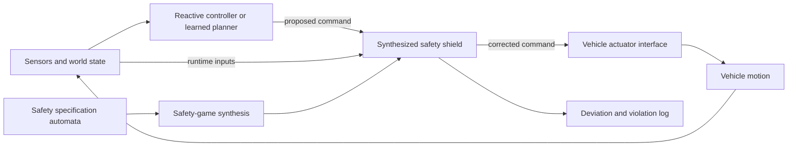

# Shield Synthesis

Roderick Bloem, Bettina Koenighofer, Robert Koenighofer, and Chao Wang's "Shield Synthesis: Runtime Enforcement for Reactive Systems," presented at CAV 2015, introduces a formal way to synthesize a small runtime component that corrects a system's outputs whenever a critical safety specification is about to be violated [1]. The paper was written for reactive hardware systems, but the idea maps naturally onto autonomous driving: a learned or complex planner can be wrapped by a verified shield that monitors observations and proposed commands, then minimally edits unsafe commands before they reach the actuator interface.

The key promise is narrow but powerful. The shield is not a full verified self-driving stack. It enforces a small set of critical safety properties, such as "do not command acceleration when a protected stop condition is active" or "do not switch directly between mutually exclusive maneuver states without a neutral transition." Because the shield is synthesized from the safety specification rather than from the whole controller implementation, it can be much smaller and easier to certify than the controller it guards.

## Why runtime enforcement sits between checking and synthesis

Model checking can prove that a design satisfies a temporal specification, but the complete controller may be too large, proprietary, learned, or underspecified to verify directly [2]. Reactive synthesis goes further by generating a correct implementation from a complete specification [3], but writing a complete specification for a complex system can be as hard as building the system. Bloem et al. propose a middle path: specify only the safety-critical properties, synthesize a shield from those properties, and attach the shield at runtime [1].

Runtime enforcement already existed before this paper, but reactive systems have a strict timing problem. A monitor that halts execution, buffers actions, or edits an event stream after the fact is not enough for hardware controllers or vehicle actuation. If a planner outputs steering and acceleration at time $t$, the shield must decide at time $t$ whether to forward or correct them. It cannot wait to see future inputs, insert extra time steps, or delete an unsafe command from history [4].

For autonomous driving, this distinction matters. A vehicle stack is reactive: each perception update produces state estimates, a planner produces trajectories or control targets, and the actuator interface expects a command now. A safety shield for AVs would sit near the boundary between [decision making](/cs/autonomous-driving/decision-making-and-behavior-planning), [motion planning](/cs/autonomous-driving/motion-planning), and low-level [control](/cs/autonomous-driving/control-pid-mpc-pure-pursuit-stanley). It would enforce a small contract tied to the ODD, safety case, and fallback policy described in [Safety, ISO 26262, SOTIF, and Scenario Testing](/cs/autonomous-driving/safety-iso26262-sotif-scenario-testing).

## Mealy machines, safety automata, and $k$-stabilizing shields

The paper models a reactive design as a Mealy machine

$$
D=(Q,q_0,\Sigma_I,\Sigma_O,\delta,\lambda),
$$

where $Q$ is the state set, $q_0$ is the initial state, $\Sigma_I$ is the input alphabet, $\Sigma_O$ is the output alphabet, $\delta:Q\times \Sigma_I\to Q$ is the transition function, and $\lambda:Q\times \Sigma_I\to \Sigma_O$ is the output function [1]. Given an input trace $I=x_0x_1\cdots$, the design produces an output trace $O=y_0y_1\cdots$. A specification $\varphi$ defines the allowed traces.

The paper focuses on safety specifications represented by automata:

$$
A=(Q_A,q_A^0,\Sigma,\delta_A,F_A),
$$

where $\Sigma=\Sigma_I\times \Sigma_O$ and $F_A\subseteq Q_A$ is the set of safe states. A trace satisfies the safety property if the automaton's run never leaves $F_A$. This is a natural fit for rules such as "never output both traffic lights green," "never enter a forbidden maneuver state," or "never command a trajectory outside a safety envelope."

A shield $S$ reads both the environment input and the design's proposed output, then emits the corrected output. If the design is $D$ and the shield is $S$, the serially composed system $D \circ S$ must satisfy $\varphi$. The shield must also preserve the original behavior as much as possible. Bloem et al. formalize this with two distance ideas: an output-trace distance function, which measures how much the shield output differs from the design output, and a language-distance function, which measures how badly the design violates the specification [1]. Correctness alone would allow a shield to ignore the design and hard-wire a safe output forever. Minimum interference prevents that.

The concrete construction in the paper is the $k$-stabilizing generic shield. It assumes that specification violations are rare. When the design reaches a point where a violation is unavoidable for some future input, the shield may deviate from the design for at most $k$ consecutive steps. If a second violation occurs during that recovery window, the shield enters fail-safe mode: it still enforces the critical specification but stops trying to minimize deviation.

The synthesis algorithm reduces the problem to a safety game [1], [5]. Let

$$
\varphi = \{\varphi_1,\ldots,\varphi_\ell\}
$$

be the set of critical safety properties, and let $\varphi_v\subseteq \varphi$ be the subset already assumed valid for the design. The remaining properties $\varphi\setminus \varphi_v$ are the ones the shield must enforce. The algorithm builds product automata for all properties, valid properties, and recoverable properties, then creates three monitors:

| Component | Role | Intuition |
|---|---|---|
| Violation monitor $U$ | Tracks when the design leaves the winning region and starts a $k$-step recovery counter | Detect the earliest point where correction must begin |
| Validity monitor $V$ | Tracks whether the design has violated properties assumed valid | Gives the shield freedom only under the stated assumptions |
| Deviation monitor $T$ | Records whether the shield deviated from the design in the last step | Enforces minimum interference outside recovery |

The violation monitor is the technically interesting part. The shield does not know what the design "intended" when it emitted a bad output. Instead of guessing one state, the construction uses a subset construction: after a violation, continue monitoring from all states that could have resulted if the design had chosen some allowed output. This is the paper's "innocent until proved guilty" principle in automata form. It avoids blaming the design for a second violation unless all possible explanations are inconsistent with the next observation.

The safety game has states in the product

$$
G = U \times T \times V \times Q,
$$

where $Q$ is the automaton for the full critical specification. At each step, the environment chooses the real input and the design output; the system player chooses the shield output. The safe region requires two things whenever the design has respected the assumed-valid properties: the corrected output must keep $Q$ in a safe state, and the shield may deviate only during the permitted recovery period. Solving the safety game yields a memoryless winning strategy, which is then implemented as the shield.

The paper states that a $k$-stabilizing generic shield can be synthesized in

$$
O\!\left(k^2 2^{2|R|}|V|^4|R|^2\right)
$$

time if one exists, where $R$ and $V$ summarize the relevant product automata sizes [1]. The exponential term comes from the subset construction and safety-game state space, which is why shield specifications should stay small and safety-critical rather than trying to encode a whole planner.

### Runtime placement of the synthesized shield



## From traffic lights to AV command interfaces

The original paper's examples are hardware-style reactive systems, not AV planners. The main running example is a traffic-light controller with input $p$ indicating an approaching emergency vehicle and outputs $h,f$ for highway and farm-road lights. The critical properties are: never output both lights green; if emergency preemption is active, both lights must be red; and never switch directly from highway-green/farm-red to highway-red/farm-green or vice versa without passing through all-red [1].

For the first two invariant properties, a simple combinational shield is enough. If $p=1$, output red/red. If $p=0$ and the design outputs green/green, change one light to red. The paper gives a concrete Boolean implementation for this restricted case and reports that, after optimization, the shield has no latches and three AIG gates [1].

The third property introduces memory. A shield must know whether the current safe state corresponds to highway green, farm-road green, or both red. If the design emits an illegal output, the shield may also become uncertain about which safe state the design meant to target. That is where subset tracking matters. For the full traffic-light specification, the tool synthesizes a 1-stabilizing shield in a fraction of a second. The raw shield has 6 latches and 95 two-input multiplexers; after ABC optimization, it has 5 latches and 41 two-input AIG gates [1].

The second benchmark is an ARM AMBA bus arbiter property: if a length-four locked burst access starts, no other access may start until the burst completes. The synthesized 1-stabilizing shield is reported within a fraction of a second, with 8 latches and 142 two-input multiplexers before optimization and 4 latches plus 77 AIG gates after ABC optimization [1].

For AV use, the same architecture would usually guard a smaller command interface rather than all internal neural-network states. Examples include:

| AV shield location | Candidate input to shield | Candidate output corrected by shield | Example critical property |
|---|---|---|---|
| Behavior planner | ODD state, right-of-way state, object occupancy | Tactical maneuver mode | No proceed command during protected stop |
| Trajectory selector | Candidate trajectory and safety envelope | Chosen trajectory ID or fallback ID | Do not select trajectory intersecting occupied zone |
| Control interface | State estimate and proposed acceleration/steering | Bounded command | Do not exceed safe deceleration or steering envelope |
| Fault manager | Sensor-health and localization confidence | Mode command | Enter minimal-risk mode after critical fault |

This AV framing is supplementary to the paper, but it is the reason the method belongs in an autonomous-driving safety section. It provides a formal wrapper around complex planning software, including learned systems, without pretending that the whole stack has been synthesized from a complete specification.

## What the prototype synthesized

The paper evaluates a proof-of-concept Python implementation using CUDD BDDs, with output in Verilog and SMV and optional checking with VIS [1]. The benchmark groups are selected traffic-light properties, selected ARM AMBA bus-arbiter properties, and selected LTL specification patterns from Dwyer et al. [6]. These are formal-methods benchmarks, not driving datasets.

| Benchmark | Specification type | Reported result | Main lesson |
|---|---|---|---|
| Traffic light properties 1 and 2 | Invariants | 0 latches, 3 AIG gates after optimization | Pure safety invariants can yield tiny shields |
| Full traffic light example | Safety automaton with temporal transition rule | 1-stabilizing shield; 6 latches and 95 muxes before optimization; 5 latches and 41 AIG gates after ABC | Temporal safety needs state, but remains small |
| AMBA guarantee 3 | Locked-burst safety property | 1-stabilizing shield; 8 latches and 142 muxes before optimization; 4 latches and 77 AIG gates after ABC | Shield blocks a forbidden new burst while preserving normal behavior |
| AMBA property stress tests | Increasing property sets | Some sets finish in 0.1 s, 7.8 s, 65 s, or 242 s; larger combinations time out beyond 3600 s | Scalability depends heavily on property count and signal count |
| LTL pattern benchmarks | Bounded-liveness and safety patterns | Many synthesize quickly with small shield sizes; harder patterns grow rapidly | Shield synthesis is promising but not free |

The traffic-light execution trace is especially instructive. A buggy controller switches directly from farm-road green to highway green without all-red. The shield changes that one bad output to all-red. A later emergency-preemption bug outputs only highway red while farm road remains green; the shield again outputs all-red. In both cases, safe behavior is restored with local corrections rather than replacing the controller's whole policy [1].

The AMBA example shows the same principle in bus-control form. A design incorrectly believes a burst has advanced because it mishandles an input condition. The shield blocks a forbidden subsequent burst-start signal, waits until the design and shield can resynchronize, and then lets normal operation continue [1].

## Stepping through minimal correction and recovery

### Example 1: Minimal correction for a traffic-light output

For the paper's simple invariant case, encode red as $0$ and green as $1$. The emergency input is $p$, and the controller outputs $(h,f)$ for highway and farm-road lights. Enforce:

$$
\begin{aligned}
\text{no both green:} &\quad (h,f)\neq (1,1),\\
\text{emergency:} &\quad p=1 \Rightarrow (h,f)=(0,0).
\end{aligned}
$$

For $p=0$ and design output $(h,f)=(1,1)$, choose a minimally deviating shield output.

1. List safe outputs when $p=0$:

$$
\{(0,0),(0,1),(1,0)\}.
$$

2. Compute Hamming distance from the design output $(1,1)$:

$$
\begin{aligned}
d((1,1),(0,0)) &= 2,\\
d((1,1),(0,1)) &= 1,\\
d((1,1),(1,0)) &= 1.
\end{aligned}
$$

3. Minimum distance is $1$, so either $(0,1)$ or $(1,0)$ is minimally interfering. If the shield chooses highway green and farm red, the corrected output is:

$$
(h',f')=(1,0).
$$

4. Check the properties:

$$
(1,0)\neq(1,1)
$$

and $p=0$, so the emergency rule is inactive.

A minimally interfering correction is $(1,0)$. The shield changes only the farm-road light from green to red.

Now consider $p=1$ and design output $(h,f)=(1,0)$.

5. The emergency rule leaves only one safe output:

$$
(h',f')=(0,0).
$$

6. The Hamming distance is

$$
d((1,0),(0,0))=1.
$$

The shield must output all-red. Even though the design already made one road red, emergency preemption requires both roads red.

### Example 2: A $k$-stabilization counter

Suppose $k=2$. A shield detects that the design leaves the winning region at step $t=5$, and another violation appears at step $t=6$. The mode evolves as follows under the paper's default rule.

1. Before the violation:

$$
c_4=0.
$$

Counter value $0$ means normal mode, so deviations are not allowed unless needed at the current transition.

2. At $t=5$, the design leaves the winning region. The shield starts recovery:

$$
c_5 = k = 2.
$$

The shield may deviate at this step and, if necessary, the next step.

3. Move to the next step without considering the second violation yet. The recovery counter would decrement:

$$
c_6 = c_5 - 1 = 1.
$$

4. But the problem states that a second violation occurs at $t=6$, while the shield is still in the recovery period. In the paper's default $k$-stabilizing construction, a second violation during recovery sends the shield to fail-safe mode.

5. In fail-safe mode, correctness remains mandatory:

$$
D\circ S \models \varphi.
$$

However, minimum-interference guarantees are relaxed. The shield may now deviate as much as needed to keep the critical safety specification true.

With $k=2$, the first violation starts a two-step recovery window. A second violation inside that window causes fail-safe mode, where the shield still enforces safety but no longer promises minimal deviation.

## A small traffic-light shield

```python
from dataclasses import dataclass
from typing import Literal

Light = Literal["r", "g"]

@dataclass
class TrafficLightShield:
    last_safe: tuple[Light, Light] = ("r", "r")

    def correct(self, emergency: bool, design: tuple[Light, Light]) -> tuple[Light, Light]:
        h, f = design

        candidates: list[tuple[Light, Light]] = [("r", "r"), ("g", "r"), ("r", "g")]
        if emergency:
            candidates = [("r", "r")]

        # Enforce the temporal rule: no direct gr <-> rg switch without rr.
        if self.last_safe == ("g", "r"):
            candidates = [c for c in candidates if c != ("r", "g")]
        elif self.last_safe == ("r", "g"):
            candidates = [c for c in candidates if c != ("g", "r")]

        def hamming(candidate: tuple[Light, Light]) -> int:
            return int(candidate[0] != h) + int(candidate[1] != f)

        corrected = min(candidates, key=hamming)
        self.last_safe = corrected
        return corrected

shield = TrafficLightShield(last_safe=("r", "g"))
trace = [
    (False, ("r", "g")),
    (False, ("g", "r")),  # illegal direct switch, shield inserts rr
    (False, ("g", "r")),
    (True, ("g", "r")),   # emergency requires rr
]

for emergency, proposed in trace:
    print(proposed, "=>", shield.correct(emergency, proposed))
```

## What a shield does not prove

- Treating a shield as proof that the whole controller is correct. The shield enforces the specified critical properties; unspecified behavior can still be wrong.
- Writing an overlarge safety specification. Shield synthesis is attractive because the critical property set is small; encoding the whole AV stack can recreate the original scalability problem.
- Ignoring actuation timing. A reactive shield must correct the command at the same time step; delayed enforcement may be too late.
- Assuming minimum interference means no behavioral effect. The shield can and should change outputs when the design would violate safety.
- Forgetting physical feasibility. In AV deployment, a shielded command must still respect vehicle dynamics, actuator limits, and passenger safety.
- Applying the method to vague policies. "Drive safely" is not a safety automaton; usable shields need precise state variables, inputs, outputs, and forbidden transitions.
- Confusing fail-safe mode with failure. Fail-safe mode means the shield stops optimizing deviation, not that it stops enforcing the critical properties.

## Sources for shield synthesis

[1] R. Bloem, B. Koenighofer, R. Koenighofer, and C. Wang, "Shield Synthesis: Runtime Enforcement for Reactive Systems," in *Proc. Computer Aided Verification*, 2015.

[2] E. M. Clarke and E. A. Emerson, "Design and Synthesis of Synchronization Skeletons Using Branching-Time Temporal Logic," in *Logics of Programs*, LNCS 131, 1981, pp. 52-71.

[3] A. Pnueli and R. Rosner, "On the Synthesis of a Reactive Module," in *Proc. POPL*, 1989, pp. 179-190.

[4] F. B. Schneider, "Enforceable Security Policies," *ACM Transactions on Information and System Security*, vol. 3, no. 1, pp. 30-50, 2000.

[5] R. Mazala, "Infinite Games," in *Automata, Logics, and Infinite Games: A Guide to Current Research*, LNCS 2500, Springer, 2001, pp. 23-42.

[6] M. B. Dwyer, G. S. Avrunin, and J. C. Corbett, "Patterns in Property Specifications for Finite-State Verification," in *Proc. ICSE*, 1999, pp. 411-420.

<div className="see-also">

See also: [Safety, ISO 26262, SOTIF, and Scenario Testing](/cs/autonomous-driving/safety-iso26262-sotif-scenario-testing) · [Simulation and Data](/cs/autonomous-driving/simulation-and-data) · [Sensors, Cameras, LiDAR, Radar, and IMU](/cs/autonomous-driving/sensors-cameras-lidar-radar-imu) · [Decision Making and Behavior Planning](/cs/autonomous-driving/decision-making-and-behavior-planning) · [Motion Planning](/cs/autonomous-driving/motion-planning) · [Control: PID, MPC, Pure Pursuit, and Stanley](/cs/autonomous-driving/control-pid-mpc-pure-pursuit-stanley) · [Finite Automata and DFAs](/cs/theory/finite-automata-and-dfas) · [Invariants and Temporal Logic](/cs/embedded/invariants-and-temporal-logic) · [Reachability and Model Checking](/cs/embedded/reachability-and-model-checking) · [Adversarial Attacks](/cs/adversarial-attacks/intro)

</div>
