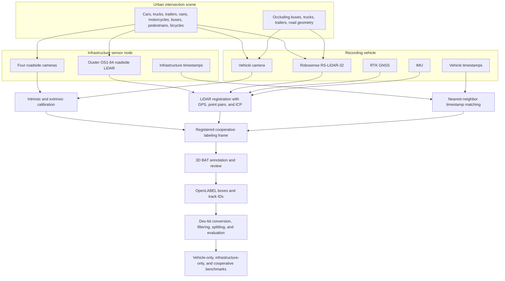

# TUMTraf V2X Cooperative Perception Dataset

TUMTraf V2X, introduced by Walter Zimmer, Gerhard Arya Wardana, Suren Sritharan, Xingcheng Zhou, Rui Song, and Alois C. Knoll at CVPR 2024, is a real-world vehicle-to-infrastructure dataset for cooperative 3D object detection and tracking [1]. Instead of treating the autonomous vehicle as the only observer, the dataset records the same intersection from roadside cameras, a roadside LiDAR, an onboard camera, an onboard LiDAR, RTK GNSS, and IMU sensors. The resulting data is meant to test whether infrastructure can make the vehicle aware of traffic participants that the ego vehicle cannot see because of trucks, buses, trailers, or geometry.

This is a dataset page, so "method" means the data construction, synchronization, labeling protocol, and benchmark design. The paper also proposes CoopDet3D, a BEV-based cooperative camera-LiDAR fusion baseline that combines vehicle and infrastructure representations and reports a large gain over vehicle-only perception. TUMTraf V2X is therefore useful both as a data source for [V2X and connected vehicles](/cs/autonomous-driving/v2x-and-connected-vehicles) and as a concrete case study in [sensor fusion](/cs/autonomous-driving/sensor-fusion).

## Problem & motivation

Ego-centric autonomous-driving datasets such as KITTI, nuScenes, and Waymo are essential, but they naturally inherit the ego vehicle's limited field of view. If a truck blocks the onboard camera and LiDAR, an onboard-only detector may have no direct evidence for a pedestrian, bicycle, or vehicle behind it. A fixed roadside sensor can have an elevated and more global view of the same scene. Cooperative perception asks whether those viewpoints can be fused into one richer local scene representation.

The TUMTraf V2X paper targets this exact gap. It records a busy German urban intersection with both infrastructure and vehicle sensors, then labels objects in a registered point-cloud frame. The motivating examples in the paper include U-turns, tailgating, overtaking, near-miss events, and traffic violations. Figure 3 of the paper shows a typical V2X occlusion case: the recording vehicle sees only part of the scene, while roadside sensors cover objects hidden behind larger traffic participants. The dataset also includes day and night scenes, dense traffic, track IDs, HD-map context, and OpenLABEL annotations, making it more than a static object-detection benchmark.

Two design choices make the dataset especially relevant for real AV systems. First, the labels are cooperative: they are created after registering vehicle and infrastructure point clouds. Second, the benchmark is deliberately multi-view and multi-modal: it compares vehicle-only, infrastructure-only, and cooperative configurations across camera-only, LiDAR-only, and camera-LiDAR fusion settings. This lets a reader separate the value of modality fusion from the value of adding the infrastructure viewpoint.

## Method

The dataset uses a vehicle-infrastructure, or V2I, setup. The infrastructure side contains four Basler cameras and one Ouster OS1-64 LiDAR. The vehicle side contains one Basler camera, one Robosense RS-LiDAR-32, an Emlid Reach RS2+ RTK GNSS receiver, and an XSENS MTi-30 IMU. The paper summarizes this as five roadside sensors and four onboard sensors, with the camera and LiDAR streams recorded at 15 Hz and 10 Hz respectively [1].

The benchmark task is cooperative 3D object detection and tracking. In the supplementary formulation, roadside sensors are denoted by $r_s \in \{C,L\}$ and vehicle sensors by $v_s \in \{C,L\}$. For a matched timestamp $t$, a cooperative detector consumes synchronized multi-view, multi-modal input such as

$$
X(t)=\left[vI(t), vP(t), rI_1(t), rI_2(t), rI_3(t), rP(t)\right],
$$

where $vI$ and $vP$ are vehicle image and point-cloud inputs, while $rI_i$ and $rP$ are roadside image and point-cloud inputs. The target output is a set of 3D boxes

$$
\hat{Y}(t)=\left\{\hat{y}_1(t),\hat{y}_2(t),\ldots\right\},
$$

where each box contains class, position, dimensions, yaw, and a track identity when used for tracking. The paper's objective can be understood as minimizing the distance from each ground-truth box $y_j$ to its best predicted match:

$$
\min_\theta\ \mathbb{E}_t
\sum_{y_j \in Y(t)}
\min_{\hat{y}_k \in \hat{Y}(t)}
d\left(y_j,\hat{y}_k\right).
$$

The hard part is making the data comparable before learning. The authors calibrate camera intrinsics with a checkerboard, estimate camera-LiDAR extrinsics by selecting 2D-3D correspondences and minimizing reprojection error, and register the onboard LiDAR to the roadside LiDAR. That LiDAR-to-LiDAR registration starts from a coarse estimate using GPS and selected point pairs, then refines the transform with point-to-point ICP. The supplementary material reports a registration RMSE of 0.02 m for the point-cloud alignment in Figure 10, which is tight enough for object-level labels but still not a guarantee that every live packet would align perfectly in a deployed network.

Temporal alignment is also explicit. The supplementary material reports an average vehicle-infrastructure timestamp difference of 24.91 ms and states that vehicle and infrastructure data are matched by nearest-neighbor timestamp matching. For rotations between keyframes, the authors interpolate quaternions with spherical linear interpolation:

$$
\operatorname{SLERP}(q_0,q_1,t)=q_0(q_0^{-1}q_1)^t,
$$

and interpolate translations linearly:

$$
T(t)=T_0+t(T_1-T_0).
$$

Labels are created with 3D BAT v24.3.2, the authors' web-based annotation tool. Annotators label traffic participants in the registered point cloud while checking all camera views. A key labeling rule is that an object can be labeled even when it has no 3D points inside, as long as it is visible in the images. Pedestrian limbs are included in boxes, while vehicle side mirrors are excluded. Labels are manually cross-checked frame by frame, stored in ASAM OpenLABEL format, and anonymized by blurring faces and license plates.

The benchmark baseline, CoopDet3D, is built around BEVFusion-style camera-LiDAR fusion and PillarGrid-style cooperative max fusion. It first creates vehicle-side and infrastructure-side BEV features separately, then fuses them with an element-wise max operation before a TransFusion-style 3D detection head. The benchmark evaluates $mAP_{\mathrm{BEV}}$ using nuScenes-style center-distance matching on the ground plane and $mAP_{\mathrm{3D}}$ using the TUM Traffic dev-kit 3D evaluation.

## Architecture diagram


*Figure: Roadside infrastructure sensors used to collect the TUMTraf V2X cooperative perception dataset. From [Zimmer et al., 2024](https://arxiv.org/abs/2403.01316) and the [TUMTraf V2X project page](https://tum-traffic-dataset.github.io/tumtraf-v2x/) — CC BY-NC-SA 4.0.*



## Architecture details

The dataset is centered on a single instrumented intersection, but the authors deliberately vary traffic maneuvers, lighting, density, and occlusion patterns. They record eight 10-second scenes and split them into train, validation, and test sets using stratified sampling so that classes are distributed across splits. The paper states that the dataset contains 2,000 labeled point clouds and 5,000 labeled images. Its main text rounds the annotation count to about 30k 3D boxes, Table 1 lists 29.38k boxes, and the version-1.0 statistics figures report about 25k labels for the displayed split/statistics view. The safe reading is that the released dataset has on the order of tens of thousands of tracked 3D boxes, with the exact count depending on version and counting convention.

| Dataset property | Reported detail |
|---|---|
| Cooperative mode | V2I, with infrastructure plus vehicle viewpoints |
| Location | Germany, urban intersection |
| Sensors | 5 infrastructure sensors and 4 onboard sensors |
| Infrastructure sensors | 4 Basler ace cameras, 1 Ouster OS1-64 LiDAR |
| Vehicle sensors | 1 Basler ace camera, 1 Robosense RS-LiDAR-32, RTK GNSS, IMU |
| Labeled point clouds | 2,000 |
| Labeled images | 5,000 |
| 3D boxes | Roughly 29k to 30k in the main dataset description |
| Classes | Car, truck, trailer, van, motorcycle, bus, pedestrian, bicycle |
| Annotation range | Up to 200 m |
| Average scene density | About 31 traffic participants per frame |
| Track information | Track IDs, average track length about 26 m |
| Format | ASAM OpenLABEL, plus conversion support to KITTI and a nuScenes-like format |
| Split | 80 percent train, 10 percent validation, 10 percent test by stratified sampling |
| Scenarios | Occlusion, U-turns, tailgating, near-miss events, overtaking, traffic violations, day and night |

The sensor calibration details matter because cooperative perception is only useful if different agents agree on geometry. The roadside LiDAR-camera calibration uses 100 point pairs between the point cloud and image. The onboard LiDAR-to-roadside LiDAR registration uses GPS for a coarse transform, manual 3D point correspondences for least-squares refinement, and then ICP. Between registration keyframes, SLERP and linear translation interpolation smooth the transform over time.

CoopDet3D adds the modeling side. The infrastructure branch fuses three roadside camera images with a roadside point cloud into a BEV representation. The vehicle branch fuses the vehicle camera and LiDAR into its own BEV representation. The cooperative branch then applies element-wise max pooling over the vehicle and infrastructure feature maps. This is feature-level cooperative fusion, not merely box-level late fusion. In deployment, feature fusion is usually more bandwidth-intensive than sending boxes, but it preserves evidence before the detector commits to object hypotheses.

The authors train the LiDAR-only model first for 20 epochs, then fine-tune the cooperative camera-LiDAR model for eight epochs. The point cloud range is changed from the default BEVFusion setting to $[-75,75]$ m in $x$ and $y$, and $[-8,0]$ m in $z$. The supplementary material reports AdamW with learning rate $10^{-4}$, weight decay 0.01, batch size 4, dropout 0.1, ReLU activations, cyclic momentum, and training on three RTX 3090 GPUs. The selected speed/accuracy tradeoff uses PointPillars 512 2x with a YOLOv8-s camera backbone, reaching 94.22 $mAP_{\mathrm{BEV}}$ at 11.20 FPS and 4.63 GiB VRAM in the reported ablation table.

## Datasets & results

The paper compares TUMTraf V2X against cooperative datasets such as OPV2V, V2XSet, V2X-Sim, V2V4Real, DAIR-V2X-C, and V2X-Seq. Its distinguishing features are real-world V2I data, day and night scenes, track IDs, an HD map, OpenLABEL annotations, worldwide availability, traffic-violation scenarios, and a documented sensor setup. It is much smaller than DAIR-V2X-C in box count, but it gives more engineering detail about sensors, labels, calibration, and scenario composition.

The main cooperative detection result is Table 2 of the paper, evaluated on the TUMTraf V2X test set in the south2 field of view. The pattern is clear: infrastructure beats vehicle-only, LiDAR beats camera-only, and cooperative camera-LiDAR fusion gives the strongest 3D result.

| Domain and modality | $mAP_{\mathrm{BEV}}$ | Average $mAP_{\mathrm{3D}}$ |
|---|---:|---:|
| Vehicle camera | 46.83 | 30.36 |
| Vehicle LiDAR | 85.33 | 80.11 |
| Vehicle camera plus LiDAR | 84.90 | 76.40 |
| Infrastructure camera | 61.98 | 35.04 |
| Infrastructure LiDAR | 92.86 | 84.88 |
| Infrastructure camera plus LiDAR | 92.92 | 87.01 |
| Cooperative camera | 68.94 | 45.74 |
| Cooperative LiDAR | 93.93 | 85.86 |
| Cooperative camera plus LiDAR | 94.22 | 90.76 |

The headline improvement is the cooperative camera-LiDAR result over the vehicle camera-LiDAR result: $90.76 - 76.40 = 14.36$ $mAP_{\mathrm{3D}}$ points. This is the number the abstract highlights. The result should not be read as "infrastructure always adds exactly 14 points"; it is specific to the recorded intersection, the selected field of view, the benchmark protocol, and the model. It does show that the extra viewpoint can be more valuable than simply changing a backbone.

The paper also compares CoopDet3D against InfraDet3D on the earlier TUMTraf Intersection test set. CoopDet3D generally outperforms the late-fusion InfraDet3D baseline in average $mAP_{\mathrm{3D}}$, especially for camera-LiDAR settings. The authors interpret this as evidence that deep feature fusion is more effective than combining already-decoded outputs when geometry and semantics need to support each other. The same discussion notes a deployment caveat: if deep features are transmitted over V2I links, bandwidth and latency become first-class system constraints.

## Worked example

**Walkthrough 1: computing the cooperative 3D mAP gain.** Suppose we want to verify the headline improvement over vehicle-only perception from Table 2.

1. Read the vehicle camera-LiDAR average 3D score:

$$
mAP_{\mathrm{3D,vehicle}}=76.40.
$$

2. Read the cooperative camera-LiDAR average 3D score:

$$
mAP_{\mathrm{3D,coop}}=90.76.
$$

3. Subtract to obtain the absolute gain:

$$
\Delta mAP_{\mathrm{3D}}=90.76-76.40=14.36.
$$

4. Compute the relative gain against the vehicle-only fusion baseline:

$$
\frac{14.36}{76.40}\times 100 \approx 18.8\%.
$$

Answer: the cooperative camera-LiDAR configuration improves the reported average $mAP_{\mathrm{3D}}$ by 14.36 points, or about 18.8 percent relative to the vehicle camera-LiDAR baseline.

Check: this matches the abstract's "+14.36 3D mAP" statement and uses the south2 field-of-view table, not a different split.

**Walkthrough 2: estimating motion error from timestamp skew.** The supplementary material reports an average vehicle-infrastructure timestamp difference of 24.91 ms. Estimate how far an object moving at 50 km/h travels during that skew.

1. Convert speed to meters per second:

$$
50\ \mathrm{km/h}=\frac{50,000}{3,600}\ \mathrm{m/s}\approx 13.89\ \mathrm{m/s}.
$$

2. Convert timestamp skew to seconds:

$$
24.91\ \mathrm{ms}=0.02491\ \mathrm{s}.
$$

3. Multiply speed by time:

$$
\Delta x = v\Delta t = 13.89 \times 0.02491 \approx 0.346\ \mathrm{m}.
$$

Answer: the object can move about 0.35 m during the average skew.

Check: 0.35 m is smaller than a vehicle length but large enough to affect tight 3D boxes, pedestrian boxes, and box association near occluders. This is only synchronization skew; a deployed V2X system would also need to budget network latency.

## Code

```python
from bisect import bisect_left
from dataclasses import dataclass

@dataclass
class MatchedFrame:
    vehicle_time_s: float
    infrastructure_time_s: float
    skew_s: float

def nearest_neighbor_matches(vehicle_times_s, infrastructure_times_s, max_skew_s=0.05):
    """Match each vehicle timestamp to the nearest infrastructure timestamp."""
    infrastructure_times_s = sorted(infrastructure_times_s)
    matches = []

    for vt in vehicle_times_s:
        pos = bisect_left(infrastructure_times_s, vt)
        candidates = []
        if pos > 0:
            candidates.append(infrastructure_times_s[pos - 1])
        if pos < len(infrastructure_times_s):
            candidates.append(infrastructure_times_s[pos])

        best = min(candidates, key=lambda it: abs(it - vt))
        skew = best - vt
        if abs(skew) <= max_skew_s:
            matches.append(MatchedFrame(vt, best, skew))

    return matches

def motion_error(speed_mps, skew_s):
    return abs(speed_mps * skew_s)

vehicle = [10.000, 10.100, 10.200]
infra = [10.021, 10.124, 10.218]
matches = nearest_neighbor_matches(vehicle, infra)

for match in matches:
    print(match, "motion error at 13.89 m/s:", motion_error(13.89, match.skew_s))
```

## Common pitfalls

- Treating cooperative perception as magic visibility. Roadside sensors help with occlusion, but they also introduce calibration, synchronization, network, and trust assumptions.
- Mixing count conventions without checking the paper version. The text rounds to 30k boxes, Table 1 lists 29.38k, and versioned statistics figures report about 25k labels in the displayed split view.
- Forgetting that objects visible only in images can still be labeled. This is useful for supervision but can surprise LiDAR-only methods when boxes contain few or no points.
- Comparing vehicle-only and cooperative results without matching the field of view. The paper reports south1 and south2 field-of-view experiments, and the exact gains differ.
- Assuming feature-level fusion is deployable without a communication budget. Dense BEV features can be far larger than object lists.
- Ignoring clock skew and interpolation. A few tens of milliseconds can shift fast objects by decimeters.
- Overgeneralizing from one intersection. TUMTraf V2X is rich and real, but it is still a targeted dataset, not a universal traffic distribution.

## Connections

- [Cooperative Camera-LiDAR BEV Fusion](/cs/autonomous-driving/v2x-and-connected-vehicles) for the later DriveX 2026 detector evaluated on TUMTraf V2X.
- [V2X and connected vehicles](/cs/autonomous-driving/v2x-and-connected-vehicles) for communication, trust, latency, and deployment context.
- [Sensor fusion](/cs/autonomous-driving/sensor-fusion) for early, mid-level, late, and BEV fusion patterns.
- [Perception, object detection, and segmentation](/cs/autonomous-driving/perception-object-detection-and-segmentation) for 3D boxes, mAP, IoU, and detector heads.
- [Simulation and data](/cs/autonomous-driving/simulation-and-data) for dataset construction and benchmark caveats.
- [BEVFusion](/cs/autonomous-driving/bevfusion-mit) for the BEV camera-LiDAR fusion design that CoopDet3D builds on.

## References

[1] W. Zimmer, G. A. Wardana, S. Sritharan, X. Zhou, R. Song, and A. C. Knoll, "TUMTraf V2X Cooperative Perception Dataset," in IEEE/CVF Conference on Computer Vision and Pattern Recognition (CVPR), 2024.

[2] Z. Liu, H. Tang, A. Amini, X. Yang, H. Mao, D. L. Rus, and S. Han, "BEVFusion: Multi-Task Multi-Sensor Fusion with Unified Bird's-Eye View Representation," in IEEE International Conference on Robotics and Automation (ICRA), 2023.

[3] Z. Bai, G. Wu, M. J. Barth, Y. Liu, E. A. Sisbot, and K. Oguchi, "PillarGrid: Deep Learning-Based Cooperative Perception for 3D Object Detection from Onboard-Roadside LiDAR," in IEEE International Conference on Intelligent Transportation Systems (ITSC), 2022.

[4] X. Bai, Z. Hu, X. Zhu, Q. Huang, Y. Chen, H. Fu, and C.-L. Tai, "TransFusion: Robust LiDAR-Camera Fusion for 3D Object Detection with Transformers," in IEEE/CVF Conference on Computer Vision and Pattern Recognition (CVPR), 2022.

[5] H. Yu et al., "DAIR-V2X: A Large-Scale Dataset for Vehicle-Infrastructure Cooperative 3D Object Detection," in IEEE/CVF Conference on Computer Vision and Pattern Recognition (CVPR), 2022.

[6] R. Xu et al., "OPV2V: An Open Benchmark Dataset and Fusion Pipeline for Perception with Vehicle-to-Vehicle Communication," in IEEE International Conference on Robotics and Automation (ICRA), 2022.

[7] W. Zimmer et al., "InfraDet3D: Multi-Modal 3D Object Detection Based on Roadside Infrastructure Camera and LiDAR Sensors," in IEEE Intelligent Vehicles Symposium (IV), 2023.

[8] ASAM, "OpenLABEL Concept Paper," Association for Standardization of Automation and Measuring Systems.
