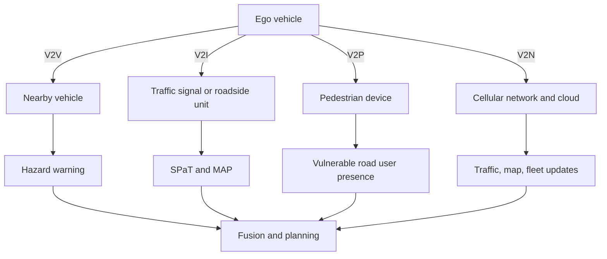

# V2X and Connected Vehicles

Vehicle-to-everything communication, or V2X, lets vehicles exchange information with other vehicles, infrastructure, pedestrians, networks, and cloud services. It can extend perception beyond line of sight, coordinate traffic signals, warn about hazards, and improve efficiency. But V2X is not a substitute for onboard autonomy because messages can be delayed, absent, spoofed, jammed, misconfigured, or unavailable across fleets and regions.

DSRC and C-V2X carry several distinct relationships—V2V, V2I, V2P, and V2N—each with its own latency, trust, privacy, and deployment constraints. Their outputs eventually meet [sensor fusion](/cs/autonomous-driving/sensor-fusion), [prediction](/cs/autonomous-driving/prediction-and-motion-forecasting), [safety](/cs/autonomous-driving/safety-iso26262-sotif-scenario-testing), and defenses against [adversarial attacks](/cs/autonomous-driving/adversarial-and-physical-attacks-on-av).

## Communication modes and message types

**V2X** means vehicle-to-everything communication. It includes several subtypes.

**V2V** is vehicle-to-vehicle communication. Vehicles can broadcast position, speed, heading, braking status, or hazard warnings.

**V2I** is vehicle-to-infrastructure communication. Roadside units, traffic lights, work-zone beacons, toll systems, or smart signs communicate with vehicles.

**V2P** is vehicle-to-pedestrian communication, often through phones or wearable devices. It is challenging because vulnerable road users should not be required to carry or maintain special devices to be safe.

**V2N** is vehicle-to-network communication through cellular or cloud services. It can provide map updates, traffic information, fleet learning, remote assistance, and non-real-time context.

**DSRC**, Dedicated Short-Range Communications, refers to IEEE 802.11p-style vehicular communication. **C-V2X**, Cellular V2X, uses cellular technology and includes direct sidelink communication as well as network-assisted modes. Technology choices have varied by region and policy.

**Cooperative perception** shares object detections, occupancy, or sensor-derived features between vehicles or infrastructure. It can help detect occluded agents, but it requires trust, synchronization, bandwidth, and careful fusion.

**SPaT** means signal phase and timing. A traffic signal can broadcast current phase and time to next phase. **MAP** messages can describe intersection geometry.

## What a V2X message can and cannot establish

V2X improves information but does not remove uncertainty. A connected traffic light may tell the vehicle when it will turn red, but the vehicle still needs to see pedestrians, construction workers, emergency vehicles, and non-connected road users. A connected vehicle may broadcast hard braking, but the ego vehicle must still verify with onboard sensors when possible.

Latency budgets are scenario-dependent. If a vehicle travels at speed $v$ and a message is delayed by $\Delta t$, the stale position error can be roughly:

$$
\Delta x \approx v\Delta t.
$$

At 30 m/s, a 100 ms delay corresponds to 3 m of travel. For cooperative collision avoidance, this is significant. For traffic congestion summaries, it may be acceptable.

Security is central. V2X systems usually require message authentication so receivers can verify that messages come from authorized participants and have not been modified. Privacy requires changing identifiers or limiting tracking, but safety requires enough accountability to reject malicious or faulty messages. This tension is fundamental.

Cooperative perception can be fused like another sensor, but with different failure modes. A roadside unit may have a high vantage point but stale calibration. Another vehicle may see around a truck but may have inaccurate localization. A network message may be delayed. Fusion should track source, timestamp, uncertainty, and trust.

Deployment is uneven. A robust AV cannot assume that every vehicle, pedestrian, intersection, work zone, or emergency responder has compatible communication. V2X should be treated as an enhancement and redundancy layer unless the ODD explicitly requires equipped infrastructure and includes fallback for communication loss.

Message semantics matter as much as radio technology. A basic safety message may contain pose, speed, heading, brake status, and vehicle size. Infrastructure messages may contain signal phase and timing, intersection geometry, work-zone restrictions, or priority requests. Cooperative perception messages may contain object lists, confidence, classification, and sensor origin. The receiver must know whether a message is advisory, authoritative, stale, uncertain, or legally binding inside the ODD.

Trust should be contextual. A signed message proves that a credential was used, not that the physical claim is true. A connected vehicle may be mislocalized; a roadside unit may have stale calibration; an emergency-vehicle priority message may be authentic but still require onboard perception to clear a path safely. Plausibility checks compare V2X claims with ego sensors, maps, kinematics, and traffic rules before the planner relies on them.

Fail-operational design is important when V2X is part of the ODD. If a shuttle route depends on instrumented intersections, the system must define what happens when a roadside unit fails, messages become delayed, or certificate validation is unavailable. Reasonable responses include slowing, stopping before the intersection, requesting remote assistance, falling back to onboard perception, or leaving service. The response should be specified before deployment, not improvised after communication loss.

Latency budgets differ by message type. A hard-braking V2V alert may need tens of milliseconds to be useful for collision avoidance. SPaT information can tolerate longer delays if the timestamp and phase prediction are clear. Map updates and traffic summaries can be seconds or minutes old and still useful. Treating all V2X data with one freshness threshold either rejects useful context or accepts dangerously stale safety messages.

V2X also raises human-factors questions. A vehicle might receive a priority request from an emergency vehicle before occupants hear a siren, or a connected work zone might request a merge earlier than visible cones. The autonomy stack can use those messages internally, but external behavior still needs to be legible to human drivers, pedestrians, police, and road workers. Connected intelligence that produces surprising motion can create risk even when the message itself is correct.

Privacy controls affect technical design. Rotating identifiers protect against long-term tracking, but rotation must not break short-term safety association. Certificates, pseudonyms, and misbehavior reporting need a balance between accountability and anonymity. V2X data carries policy, trust, and governance assumptions alongside its measurements.

Operational monitoring should include communication health. Packet loss, certificate failures, clock drift, roadside-unit outages, and unusual message rates are not merely networking details; they can change whether the vehicle is still inside a V2X-dependent ODD.

### Information paths into fusion and planning



## Estimating position staleness from latency

A connected vehicle broadcasts its position while traveling at 27 m/s, and the ego vehicle receives the message 150 ms later. Estimate the sender's motion during that latency.

1. Convert latency:

$$
150\ \mathrm{ms}=0.150\ \mathrm{s}.
$$

2. Use:

$$
\Delta x = v\Delta t.
$$

3. Substitute:

$$
\Delta x = 27(0.150)=4.05\ \mathrm{m}.
$$

The sender may have moved about 4.05 m during the message delay.

At highway speed, a subsecond delay can create a vehicle-length position error; fusion therefore needs timestamps and motion compensation.

## Budgeting object-list bandwidth

A roadside unit sends 50 object detections at 10 Hz, with 64 packed bytes per detection. The raw payload budget follows directly.

1. Bytes per update:

$$
50 \times 64 = 3200\ \mathrm{bytes}.
$$

2. Updates per second:

$$
10\ \mathrm{Hz}.
$$

3. Payload per second:

$$
3200 \times 10 = 32000\ \mathrm{bytes/s}.
$$

4. Convert to kilobytes per second using 1000 bytes per kilobyte:

$$
32000 / 1000 = 32\ \mathrm{kB/s}.
$$

The raw payload is about 32 kB/s before protocol overhead, signatures, retries, or compression.

Dense point clouds or images cost far more bandwidth. Object-level messages are cheaper but discard evidence that feature- or sensor-level fusion could use.

## Authenticating, aging, and motion-compensating a message

```python
from dataclasses import dataclass

@dataclass
class V2XMessage:
    source_id: str
    timestamp_s: float
    x_m: float
    y_m: float
    vx_mps: float
    vy_mps: float
    authenticated: bool

def compensate_message(msg, receive_time_s, max_age_s=0.5):
    age = receive_time_s - msg.timestamp_s
    if not msg.authenticated:
        raise ValueError("reject unauthenticated V2X message")
    if age < 0.0 or age > max_age_s:
        raise ValueError("reject stale or future-dated V2X message")
    return (
        msg.x_m + msg.vx_mps * age,
        msg.y_m + msg.vy_mps * age,
        age,
    )

msg = V2XMessage("veh-12", 100.0, 10.0, 2.0, 27.0, 0.0, True)
print(compensate_message(msg, receive_time_s=100.15))
```

## A cooperative BEV detector on TUMTraf V2X

Shahbaz and Agarwal's TUMTraf V2X system is a concrete cooperative-perception example for V2I camera-LiDAR fusion rather than just a communication protocol case study [1]. In the DriveX 2026 cooperative 3D object detection setting, the detector uses three infrastructure cameras together with a dataset-provided, pre-registered infrastructure-plus-vehicle point cloud from the [TUMTraf V2X dataset](/cs/autonomous-driving/tumtraf-v2x-dataset), then fuses evidence in a shared BEV representation [1]. The LiDAR side voxelizes the fused point cloud and builds BEV features with an attention-style pillar encoder and large-kernel BEV backbone, while the camera side lifts EfficientNet/FPN image features into BEV using calibration and a small set of sampled heights [1]. Fusion is mid-level: camera BEV features predict a squeeze-and-excitation gate over LiDAR BEV channels, the gated LiDAR and camera maps are concatenated, and a CenterPoint-style head predicts 3D boxes with an IoU-quality score used to rerank detections [1]. For V2X engineering, the important limitation is that the benchmark input already supplies a registered fused point cloud, so packet loss, online registration, clock drift, bandwidth scheduling, and trust management are mostly outside the experiment; a deployed version would still need to decide whether raw points, BEV features, boxes, or tracks cross the V2I link [1]. The paper also reports that 44 of 50 public test frames overlapped released train or validation data, so its 0.85 public score is best read as a useful architecture result with benchmark-leakage caveats, while higher overlap-focused studies are diagnostics rather than clean generalization evidence [1].

## Failure modes beyond the radio link

- Treating V2X as guaranteed infrastructure. Many roads and agents will be unequipped.
- Trusting messages without authentication and plausibility checks. Spoofed or faulty messages can create unsafe behavior.
- Ignoring latency and clock synchronization. Stale positions can be meters wrong.
- Sending too much raw sensor data. Bandwidth and privacy constraints often require compact representations.
- Forgetting non-connected vulnerable road users. Pedestrians and cyclists must remain safe without devices.
- Overlooking privacy. Persistent identifiers can turn safety beacons into tracking infrastructure.

## Standards and references

Relevant primary material includes IEEE 802.11p and DSRC documents, 3GPP C-V2X specifications, ETSI and SAE message standards, cooperative-perception research, and vehicular-PKI literature.

[1] M. Shahbaz and S. Agarwal, "Camera and LiDAR BEV Fusion for Cooperative 3D Object Detection on TUMTraf V2X," arXiv:2606.12981, 2026.

<div className="see-also">

See also: [Sensor fusion](/cs/autonomous-driving/sensor-fusion) · [Prediction and motion forecasting](/cs/autonomous-driving/prediction-and-motion-forecasting) · [Safety, ISO 26262, SOTIF, and scenario testing](/cs/autonomous-driving/safety-iso26262-sotif-scenario-testing) · [Adversarial and physical attacks on AV](/cs/autonomous-driving/adversarial-and-physical-attacks-on-av) · [Embedded systems](/cs/embedded/intro) · [Physics of signals and systems](/physics/signals-systems/intro)

</div>
