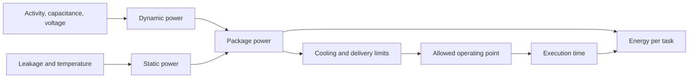

# Power, Energy, Cost, and Dependability

The end of easy clock-rate scaling changed the architect's objective. Adding transistors still increases the amount of computation a chip can attempt, but power delivery and heat removal limit how many of those transistors can switch at once. A phone has a battery and a skin-temperature limit. A server has a power-supply budget, a cooling system, and an electricity bill. An accelerator may have unused silicon because turning on every unit would exceed its package limit. This condition is often called *dark silicon*.

Dependability and cost belong in the same calculation. A fast service that is frequently unavailable delivers little useful work, while a cheap component may be expensive once failures and replacement labor are counted. Architecture therefore compares completed work against several resources: time, joules, dollars, and tolerated failure risk.

## Separating power from energy

Power is the rate at which energy is used:

$$
1\ \mathrm{watt}=1\ \mathrm{joule/second}.
$$

For a task lasting $T$ seconds under time-varying power $P(t)$,

$$
E=\int_0^T P(t)\,dt.
$$

If average power is known, the same relation is $E=P_{avg}T$. Power determines whether the voltage regulators and cooling system can support an operating point. Energy determines battery drain and electricity consumed by a fixed job. A 100 W processor running for 2 s uses less energy than a 30 W processor running for 10 s, even though its power is much higher:

$$
100\times2=200\ \mathrm{J}<30\times10=300\ \mathrm{J}.
$$

Several power numbers occur in specifications, and they answer different questions. Peak power sizes the delivery network. Sustained thermal power sizes the cooler for an expected workload class. Thermal design power, or TDP, is a vendor's cooling-design target; it is neither a universal maximum nor a promise about the power of a particular program. Benchmark energy must be measured over a stated boundary. CPU package energy can exclude DRAM, fans, storage, and power-supply loss. Wall-socket energy includes them, but may hide a small processor improvement beneath unrelated idle consumption.

## Where CMOS energy goes

Charging a capacitive node from 0 to $V$ draws approximately $CV^2$ from the supply. Half is stored temporarily in the capacitance and half is dissipated during charging; the stored half is then dissipated on discharge. If a node switches only on a fraction $\alpha$ of clock cycles, dynamic power is modeled as

$$
P_{dynamic}=\alpha C V^2 f.
$$

Here $C$ is effective switched capacitance, $V$ is supply voltage, and $f$ is clock frequency. The expression explains several familiar techniques:

- clock gating reduces $\alpha$ by stopping needless transitions;
- power gating disconnects an idle block and attacks leakage;
- smaller structures reduce capacitance, although wiring and control overhead can offset part of the saving;
- dynamic voltage and frequency scaling, or DVFS, lowers both $V$ and $f$ when full speed is unnecessary.

Voltage has a squared term, so it is tempting to treat voltage reduction as free energy. It is not. Lower voltage slows transistor switching, which normally requires a lower clock frequency, and voltage cannot fall below the level needed for reliable operation. Near-threshold designs save substantial dynamic energy but become sensitive to process variation, temperature, and noise.

Static power is present without useful switching:

$$
P_{static}=I_{leak}V.
$$

Leakage generally rises with temperature, and power raises temperature, creating an unfavorable feedback loop. Short-circuit current while gates transition and losses in regulators, memories, and interconnect add further terms. The compact CMOS equation is a model for reasoning, not a complete chip power meter.

## Slowing down versus racing to idle

Suppose execution time scales as $1/f$ and voltage can be lowered with frequency. Dynamic energy for a fixed number of cycles is then

$$
\begin{aligned}
E_{dynamic}
&=P_{dynamic}T \\
&=(\alpha CV^2f)\left(\frac{N}{f}\right) \\
&=\alpha C V^2N.
\end{aligned}
$$

Frequency cancels. Reducing frequency alone lowers instantaneous power but does not reduce idealized dynamic energy; the energy benefit comes mainly from the accompanying voltage reduction. Meanwhile, the longer run time accumulates more leakage and background system energy. There is usually an energy-minimizing operating point rather than a rule that slower is always better.

*Race to idle* is the alternative: run quickly, finish, then place the processor and perhaps memory or a radio into a deep sleep state. It works when idle power is much lower than active power and the cost of entering and leaving sleep is small. It can fail when turbo voltage is high, sleep opportunities are too short, or another component must remain awake. Deadline-constrained systems often use slack: choose the lowest operating point that still completes before the deadline.

Energy–delay product supplies one way to compare tradeoffs:

$$
\mathrm{EDP}=E\times T.
$$

Energy alone may reward an extremely slow design; delay alone rewards an energy-hungry one. EDP penalizes both, while $E T^2$ weights performance more strongly. No exponent is universally correct. The metric should reflect the system objective and should be reported alongside raw energy and time.

## Worked example: choosing a DVFS point

A processor completes a compute-bound task in 10 s at 1.0 V and 2.0 GHz. Dynamic power is 40 W and static power is 10 W. A lower mode uses 0.8 V and 1.5 GHz. Assume dynamic power follows $V^2f$, static power remains 10 W, and time is inversely proportional to frequency.

The baseline consumes

$$
\begin{aligned}
P_0&=40+10=50\ \mathrm{W},\\
E_0&=50\times10=500\ \mathrm{J}.
\end{aligned}
$$

The dynamic-power scale factor is

$$
\left(\frac{0.8}{1.0}\right)^2
\left(\frac{1.5}{2.0}\right)
=0.64\times0.75=0.48.
$$

Thus the new dynamic power and execution time are

$$
\begin{aligned}
P_{dyn,1}&=40\times0.48=19.2\ \mathrm{W},\\
T_1&=10\left(\frac{2.0}{1.5}\right)=13.333\ \mathrm{s}.
\end{aligned}
$$

Including leakage,

$$
\begin{aligned}
P_1&=19.2+10=29.2\ \mathrm{W},\\
E_1&=29.2\times13.333=389.3\ \mathrm{J}.
\end{aligned}
$$

The low mode is 33.3% slower and uses about 22.1% less energy. Its EDP is $389.3\times13.333=5190.7$ J·s, slightly above the baseline $5000$ J·s. Energy favors the low mode; EDP slightly favors the fast mode.

Now suppose the workload is memory-bound and slows by only 10%, to 11 s. With the same 29.2 W estimate, its energy is $321.2$ J. Frequency scaling has less effect on its time because many cycles were already spent waiting for memory. Measurements are needed because the inverse-frequency assumption depends strongly on the workload.

## Cost from die to deployed system

Chip cost starts with wafer processing and yield. Ignoring edge corrections for a rough estimate,

$$
\mathrm{dies\ per\ wafer}\approx
\frac{\mathrm{wafer\ area}}{\mathrm{die\ area}}.
$$

A larger die produces fewer candidates and is more likely to contain a defect. If $Y$ is manufacturing yield, then

$$
\mathrm{cost\ per\ good\ die}\approx
\frac{\mathrm{wafer\ cost}}{\mathrm{dies\ per\ wafer}\times Y}.
$$

Packaging, testing, memory, board assembly, and profit margins come afterward. Yield is not constant with area, so doubling die area generally more than doubles cost per working die. Chiplets can improve economics by combining several smaller dies, though interconnect, packaging, and validation become more complicated.

### Worked example: area and yield

Consider a simplified wafer costing $6000$. Design A yields 500 candidate dies per wafer at 90%; design B yields 250 at 70%.

$$
\begin{aligned}
N_{good,A}&=500\times0.90=450,\\
C_A&=6000/450=\$13.33,\\
N_{good,B}&=250\times0.70=175,\\
C_B&=6000/175=\$34.29.
\end{aligned}
$$

The candidate count fell by a factor of two, yet good-die cost rose by about $2.57\times$ because yield also declined. These are fabricated numbers for arithmetic, not a manufacturing forecast; real estimates use wafer geometry, defect-density models, multiple process steps, and test fallout.

At system scale, purchase price is capital expenditure. Electricity, cooling, floor space, networking, repair labor, and spares are operating costs. A seemingly modest efficiency gain can matter across a large fleet, but only if it survives end-to-end measurement. An accelerator that saves CPU energy while forcing costly data movement may lose at the service boundary.

## Reliability, repair, and availability

Reliability asks whether a component continues operating for an interval. Under the common constant-failure-rate model with rate $\lambda$,

$$
R(t)=e^{-\lambda t},\qquad \mathrm{MTTF}=\frac{1}{\lambda}.
$$

The exponential model is memoryless and often useful during a component's steady-life period. It does not describe early manufacturing failures or wear-out well. MTTF is an expected time over a population, not a prediction that a particular device will fail at that age.

Availability includes restoration. With mean time to repair MTTR,

$$
A=\frac{\mathrm{MTTF}}{\mathrm{MTTF}+\mathrm{MTTR}}.
$$

For rare failures, unavailability is approximately $\mathrm{MTTR}/\mathrm{MTTF}$. Faster detection, failover, and repair can improve availability as effectively as more reliable hardware. A service may also distinguish planned maintenance from unplanned outage and partial degradation from complete failure.

If every component is required and independent failure rates are constant, rates add:

$$
\lambda_{system}=\sum_i\lambda_i,
\qquad
\frac{1}{\mathrm{MTTF}_{system}}=\sum_i\frac{1}{\mathrm{MTTF}_i}.
$$

One thousand identical indispensable drives, each with MTTF one million hours under this model, give a system MTTF of only $1000$ hours. That does not mean each drive is poor; it means some drive in the population fails often. Redundancy changes a component failure from an outage into a repair event.

For two repairable identical modules where either one can carry the load, a common approximation is

$$
\mathrm{MTTF}_{pair}\approx
\frac{\mathrm{MTTF}^2}{2\mathrm{MTTR}}.
$$

It follows from the narrow vulnerable interval after the first module fails and before it is repaired. The factor of two accounts for either module failing first.

### Worked example: redundant power supplies

A supply has MTTF 200,000 h and MTTR 24 h. One supply has

$$
\begin{aligned}
A_{single}
&=\frac{200000}{200000+24}\\
&=0.999880014.
\end{aligned}
$$

Expected downtime per year can be estimated from its unavailable fraction:

$$
(1-A_{single})\times8760
=0.000119986\times8760
\approx1.051\ \mathrm{h/year}.
$$

For a redundant pair,

$$
\begin{aligned}
\mathrm{MTTF}_{pair}
&\approx\frac{200000^2}{2\times24}\\
&=833333333.3\ \mathrm{h},\\
A_{pair}
&=\frac{833333333.3}{833333333.3+24}\\
&\approx0.9999999712.
\end{aligned}
$$

The implied downtime is roughly $0.000252$ h/year, or about $0.91$ s/year. That impressive result depends on independent failures and immediate fault detection. Both supplies can still be disabled by one upstream breaker, a shared controller, blocked airflow, incorrect maintenance, or a faulty firmware rollout. Common-mode risk usually dominates before the arithmetic reaches such extreme availability.

## Fault containment beyond component redundancy

Redundant hardware helps only when the system can identify the failed member and keep the faulty behavior from spreading. Error-detecting codes on links, error-correcting codes in memory, checksums in storage, and watchdog timers all turn silent corruption into a detectable event. Detection coverage matters: a spare cannot repair an error that no mechanism notices. Failover also needs a trustworthy decision about which copy is healthy. With two disagreeing replicas there is no majority; three replicas can vote, at the cost of more hardware and exposure to bugs shared by all three.

Recovery mechanisms have several levels. A transient bit upset may be corrected and scrubbed without interrupting software. A process can restart from durable state after a software fault. A machine can be removed from a replicated service while requests are routed elsewhere. Checkpointing shortens the amount of work lost after failure, but frequent checkpoints consume bandwidth and energy. The checkpoint interval should reflect failure rate, restart time, and checkpoint cost rather than being chosen by habit.

Fault containment also changes physical organization. Separate power feeds, failure domains, network paths, and software rollout groups reduce correlation. Geographic replication covers a broader class of disasters but introduces propagation delay and difficult consistency choices. A design review should trace each supposedly redundant path back to shared dependencies; common cooling, management software, credentials, and human procedures are easy to miss.

Availability percentages can conceal user impact. An hour-long outage once a year and ten-second interruptions every day can yield similar totals while affecting applications differently. Tail latency and degraded capacity matter before the service becomes completely unavailable. Service-level objectives therefore define successful requests over a time window, often alongside latency bounds, instead of relying on hardware uptime alone. Hardware MTTF remains useful input, but the service is the unit users experience.

## Reading efficiency and dependability claims carefully

| Claim or metric | What it captures | What can be hidden |
|---|---|---|
| Watts | Instantaneous resource demand | Work completed and run time |
| Joules per task | Energy for a defined job | Deadline and throughput limits |
| Performance per watt | Throughput under a power level | Idle energy and latency |
| TDP | Cooling target for a product class | Exact peak or workload power |
| MTTF | Expected failure interval under a model | Repair time and correlated faults |
| Availability | Fraction of time service is usable | Severity of partial failures |
| Purchase price | Initial capital cost | Energy, cooling, labor, and spares |

Several errors recur. Low power is called efficient without checking how long the task runs. Static and platform power are omitted when comparing DVFS modes. Component MTTF is copied directly to a many-component system. Redundancy is credited for protection against faults that share the same cause. Cost comparisons stop at the processor price even when memory, networking, or operations dominate.

The remedy is to state the workload, measurement boundary, time interval, and failure model next to the number. A result with those assumptions exposed can be revised when the system changes.

See also: [Quantitative Design and Performance](/cs/computer-architecture/quantitative-design-and-performance) · [Warehouse-Scale Computers](/cs/computer-architecture/warehouse-scale-computers) · [Storage, RAID, and SSDs](/cs/computer-architecture/storage-raid-ssds) · [Domain-Specific Accelerators](/cs/computer-architecture/domain-specific-accelerators)

