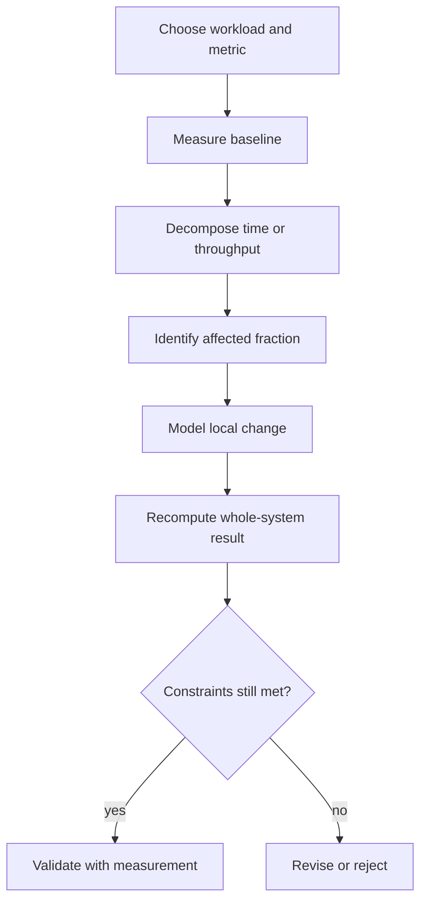

# Quantitative Design and Performance

Computer architecture advances through measurements tied to explicit assumptions. A deeper pipeline, larger cache, or wider issue engine has no independent value; it matters when a stated workload completes sooner or supports more requests within its power, cost, and latency limits. Hennessy and Patterson's quantitative style starts from a baseline, explains where time goes, changes one part of that budget, and recomputes the whole result.

That discipline guards against appealing but incomplete claims. A unit can become ten times faster while the program improves by only a few percent. A higher clock can lose to a lower clock with fewer instructions or less stalling. Peak throughput can increase while users see worse tail latency. The unit of work and the observation boundary must be chosen before the metric.

## What “faster” means

For one fixed task, lower execution time means higher performance:

$$
\mathrm{Performance}_X=\frac{1}{\mathrm{Execution\ time}_X}.
$$

If an old system takes $T_{old}$ and a new one takes $T_{new}$, speedup is

$$
S=\frac{T_{old}}{T_{new}}
=\frac{\mathrm{Performance}_{new}}{\mathrm{Performance}_{old}}.
$$

A speedup of $1.25\times$ means the new time is $1/1.25=0.8$ of the old time, a 20% time reduction. It does **not** mean time fell by 25%. Conversely, a 25% time reduction gives speedup $1/0.75=1.333\times$. Keeping ratios and percentage reductions separate prevents many reporting errors.

Latency is the elapsed time for one request. Throughput is completed work per unit time. They interact but are not interchangeable. Four cores may nearly quadruple throughput on independent jobs while leaving single-job latency unchanged. Batching can raise throughput while making each request wait longer. Server measurements often report throughput subject to a percentile-latency bound, because throughput obtained by building an unbounded queue is useless.

Elapsed time includes CPU execution, I/O waits, operating-system scheduling, and time spent on other processors or accelerators. CPU time isolates time executing on the processor. The right choice follows the question. A user cares about elapsed response time; a microarchitecture study may isolate CPU time to reduce unrelated variation, then separately account for system effects.

## Decomposing processor time

The classic CPU equation is

$$
\mathrm{CPU\ time}
=IC\times CPI\times T_{cycle}
=\frac{IC\times CPI}{f_{clock}}.
$$

$IC$ is the dynamic instruction count, not the number of instructions in the executable. Loops and control flow determine how often instructions execute. $CPI$ is average cycles per instruction, including stalls under the chosen accounting convention. Clock period $T_{cycle}$ is the reciprocal of clock rate.

The three factors are coupled. A compiler optimization may reduce instruction count but introduce slower instructions. A shorter clock period may require a deeper pipeline, increasing branch-misprediction cost and CPI. A complex instruction may reduce $IC$ while taking several cycles. Comparing only one factor assumes the other two remain fixed, which architecture changes rarely guarantee.

For instruction classes $i$,

$$
CPI=\frac{\sum_i IC_iCPI_i}{\sum_i IC_i}
=\sum_i w_iCPI_i,
$$

where $w_i=IC_i/IC$. This weighted mean is a useful bookkeeping model, though measured CPI classes may overlap. A cache miss can delay a load, block dependent arithmetic, and eventually limit instruction issue. Adding separately measured “memory CPI” and “dependency CPI” can double-count the same cycles. Hardware counters need a documented attribution scheme.

Another decomposition starts from ideal CPI:

$$
CPI=CPI_{base}+CPI_{memory}+CPI_{branch}+CPI_{other}.
$$

For a simple cache model,

$$
CPI_{memory}
=\mathrm{memory\ accesses/instruction}
\times\mathrm{miss\ rate}
\times\mathrm{miss\ penalty}.
$$

The formula identifies leverage. Cutting a 100-cycle penalty in half matters little when misses are vanishingly rare; reducing a common stall by one cycle may matter more.



## Worked example: instruction mix and a design tradeoff

A program executes $2.0\times10^9$ instructions on a 2.5 GHz processor. Its mix is 45% integer ALU instructions at CPI 1, 25% loads and stores at CPI 2, 20% branches at CPI 1.5, and 10% floating-point instructions at CPI 4.

The weighted CPI is

$$
\begin{aligned}
CPI
&=0.45(1)+0.25(2)+0.20(1.5)+0.10(4)\\
&=0.45+0.50+0.30+0.40\\
&=1.65.
\end{aligned}
$$

Total cycles and CPU time follow directly:

$$
\begin{aligned}
\mathrm{cycles}
&=(2.0\times10^9)(1.65)\\
&=3.30\times10^9,\\
T
&=\frac{3.30\times10^9}{2.5\times10^9}\\
&=1.32\ \mathrm{s}.
\end{aligned}
$$

Now consider a new floating-point unit that lowers floating-point CPI from 4 to 2 but lengthens the clock period enough to reduce frequency from 2.5 to 2.3 GHz. The new CPI is

$$
\begin{aligned}
CPI_{new}
&=0.45+0.50+0.30+0.10(2)\\
&=1.45.
\end{aligned}
$$

Its time is

$$
T_{new}
=\frac{(2.0\times10^9)(1.45)}{2.3\times10^9}
=1.2609\ \mathrm{s},
$$

so

$$
S=\frac{1.32}{1.2609}=1.0469.
$$

The local floating-point improvement looks large, but the complete design is only about 4.7% faster. If the frequency had fallen below $2.197$ GHz, found by solving $(2.0\times10^9)(1.45)/f=1.32$, the new unit would have made this program slower.

## Amdahl's law and the shrinking target

If fraction $a$ of original execution time is accelerated by factor $s$, normalize old time to 1. The unchanged time remains $1-a$, and improved time becomes $a/s$:

$$
T_{new}=(1-a)+\frac{a}{s}.
$$

Taking the reciprocal gives Amdahl's law:

$$
S_{overall}=\frac{1}{(1-a)+a/s}.
$$

Even an infinitely fast enhancement has limit

$$
\lim_{s\to\infty}S_{overall}=\frac{1}{1-a}.
$$

The law is less a parallel-computing formula than a general rule about limited scope. It applies to faster functional units, compression, cache improvements, vectorization, storage acceleration, and any optimization that affects only part of elapsed time.

After acceleration, the improved portion occupies a smaller fraction of the new run:

$$
a_{new}=\frac{a/s}{(1-a)+a/s}.
$$

Optimization therefore moves the bottleneck. Once floating-point work is cheap, memory or serial setup may dominate. Profiles must be collected again rather than reused indefinitely.

### Worked example: five-times-faster floating point

Floating-point work occupies 30% of a baseline run and becomes $5\times$ faster. Normalize $T_{old}=1$:

$$
\begin{aligned}
T_{new}
&=(1-0.30)+\frac{0.30}{5}\\
&=0.70+0.06\\
&=0.76,\\
S&=1/0.76=1.3158.
\end{aligned}
$$

The new floating-point fraction is

$$
\frac{0.30/5}{0.76}
=\frac{0.06}{0.76}
=0.0789.
$$

Only 7.9% of the new execution time remains in floating point. If the unit could somehow become infinitely fast, the best possible speedup from the original baseline would be $1/(1-0.30)=1.4286\times$.

Suppose instead that using the new unit adds setup overhead equal to 3% of old time. Then $T_{new}=0.70+0.06+0.03=0.79$ and speedup falls to $1.266\times$. Overheads belong in the unaffected or newly added portion; omitting them exaggerates accelerator results.

For parallel execution with parallel fraction $p$ on $N$ processors,

$$
S(N)=\frac{1}{(1-p)+p/N}.
$$

A 95% parallel program is bounded by $20\times$ for a fixed problem size. Gustafson's observation addresses a different experiment: users often increase the problem size when more processors are available, keeping elapsed time roughly fixed. Amdahl answers fixed-work speedup; scaled speedup answers how much larger a problem fits in the same time. Neither invalidates the other.

## Benchmark suites and honest summaries

A benchmark result is meaningful only with its workload and run conditions. Relevant details include input size, compiler and flags, thread count, memory configuration, operating system, warm-up policy, thermal state, and whether turbo behavior was enabled. Repeated runs expose noise from scheduling, background work, and temperature. Medians resist outliers; confidence intervals convey uncertainty better than excessive decimal places.

Benchmarks can be kernels, full applications, or service traces. Kernels isolate a mechanism and are easier to interpret, but full programs include interactions the kernel omits. A suite reduces the chance of optimizing one unusual workload. The suite should represent the intended use rather than whatever programs happen to be convenient.

Normalized ratios require care. If machine A takes 10 s and B takes 5 s, B's normalized performance relative to A is 2. Reversing the baseline gives $1/2$. For positive ratios $r_i$, the geometric mean is

$$
G=\left(\prod_{i=1}^n r_i\right)^{1/n}
=\exp\left(\frac{1}{n}\sum_i\ln r_i\right).
$$

It is insensitive to the choice of common reference machine and treats reciprocal factors symmetrically. For ratios $2$ and $1/2$, $G=1$. The arithmetic mean would be $1.25$, incorrectly suggesting an average advantage from two reciprocal outcomes.

The geometric mean is suitable for normalized speed ratios, not for aggregating raw execution times or rates with different units. If total completion time across a known workload mix matters, sum the actual times with appropriate weights. For rates over equal amounts of work, the harmonic mean may be relevant, but only after defining how the work is combined.

### Worked example: comparing a suite

Four benchmarks have old times $[20,40,10,30]$ seconds and new times $[16,50,5,30]$. Per-benchmark speedups are

$$
[20/16,40/50,10/5,30/30]=[1.25,0.8,2,1].
$$

Their geometric mean is

$$
G=(1.25\times0.8\times2\times1)^{1/4}
=2^{1/4}
=1.1892.
$$

For one run of every benchmark, however, total old time is $100$ s and total new time is $101$ s, so aggregate speedup is $100/101=0.9901$. Both results are arithmetically correct and answer different questions. The geometric mean gives each benchmark equal multiplicative weight. Summed time weights long-running members more heavily. A report should say which interpretation matches the workload.

## Designing a measurement that can be repeated

A timing experiment needs a stable beginning and end. For a command-line program, elapsed time may include process startup and file reads; for a long-running server, requests may be timed only after caches and connection pools are warm. Neither choice is inherently better, but mixing cold and warm runs produces a statistic with no clear interpretation. The input data and output validation should also be fixed. A compiler that removes unused computation can produce a wonderfully fast program that no longer performs the intended work.

Warm-up deserves explicit treatment on managed runtimes and adaptive systems. Just-in-time compilation, branch predictors, caches, storage buffers, and dynamic frequency control all change during early iterations. One approach is to discard a documented warm-up period and measure steady state. Another is to include startup because users repeatedly invoke short-lived jobs. The workload determines which behavior counts.

Noise cannot be eliminated completely. Interrupts, scheduler migration, background services, temperature, and shared-resource contention perturb runs. Pinning threads, controlling background work, recording frequency, and randomizing the order of compared variants can reduce bias. Repetition then shows the remaining distribution. Reporting the minimum assumes noise only adds delay and may be useful for studying an ideal machine path. Reporting the median describes a typical observed run. High percentiles matter for latency-sensitive services. The statistic should be selected before looking at which one favors a design.

Precision in the result should match precision in the experiment. If repeated times vary between 99 and 103 ms, claiming an improvement from 100.037 to 99.982 ms is not supported. Confidence intervals or a direct distribution plot are preferable to a single long decimal. Statistical significance alone is also insufficient: with enough repetitions, a tiny but operationally irrelevant difference can be detected. Architecture decisions need effect size, uncertainty, and the cost of obtaining that effect.

Comparisons require equivalent work. Different compiler flags, numerical tolerances, database durability settings, image quality, or model accuracy can silently trade correctness for speed. Approximate computing and reduced precision may be valid design choices, but their output loss becomes another reported metric. The fastest result among unequal computations is not a performance comparison.

Microbenchmarks require extra skepticism. A loop crafted to fit in cache can isolate instruction throughput or memory latency, which is useful for testing a model. It cannot establish application speedup unless the application exhibits the same access pattern and bottleneck. Full applications supply realism but are harder to explain. Using both establishes a chain: the microbenchmark confirms the mechanism, counters show that the real workload invokes it, and end-to-end timing measures the benefit.

## Keeping the model tied to the machine

| Quantity | Useful for | Frequent misreading |
|---|---|---|
| Elapsed time | User-visible latency | Attributing all time to the CPU |
| CPU time | Processor-focused comparison | Ignoring I/O and accelerator time |
| CPI | Explaining cycle use | Comparing different ISAs without $IC$ |
| Clock rate | One factor in CPU time | Treating GHz as overall speed |
| Throughput | Capacity planning | Ignoring queueing and latency bounds |
| Peak rate | Hardware upper bound | Presenting it as sustained application rate |
| Geometric mean | Equal-weight ratio summary | Using it for raw seconds |

Measurements should first pass simple consistency checks. Cycle count should equal instruction count times CPI. Time should equal cycles divided by frequency. Claimed component savings should not exceed the original component time. Combined optimizations should be applied to one time budget, since adding their isolated speedups can count overlapping cycles twice.

Simulation adds another layer of assumptions. A trace-driven cache model may omit wrong-path accesses, operating-system activity, or timing feedback. A cycle-level simulator may be detailed but slow enough to require small inputs. Model validation against real hardware, where available, is more valuable than reporting extra precision from an unvalidated model.

## A small calculation aid

```python
from math import prod

def weighted_cpi(mix):
    """mix contains (dynamic_instruction_count, class_cpi) pairs."""
    instructions = sum(count for count, _ in mix)
    cycles = sum(count * cpi for count, cpi in mix)
    return cycles / instructions

def amdahl(fraction, local_speedup, added_time=0.0):
    return 1.0 / ((1.0 - fraction) + fraction / local_speedup + added_time)

def geometric_mean(ratios):
    return prod(ratios) ** (1.0 / len(ratios))

mix = [(0.45, 1.0), (0.25, 2.0), (0.20, 1.5), (0.10, 4.0)]
print(weighted_cpi(mix))                    # 1.65
print(amdahl(0.30, 5.0))                   # 1.315789...
print(geometric_mean([1.25, 0.8, 2, 1]))   # 1.189207...
```

The functions encode formulas, not experimental method. They cannot decide whether fractions overlap, whether an input is representative, or whether elapsed time includes the relevant system costs.

## Related pages

- [Power, Energy, Cost, and Dependability](/cs/computer-architecture/power-energy-cost-dependability)
- [Cache Organization and AMAT](/cs/computer-architecture/cache-organization-amat)
- [Branch Prediction and Control Hazards](/cs/computer-architecture/branch-prediction)
- [Warehouse-Scale Computers](/cs/computer-architecture/warehouse-scale-computers)
