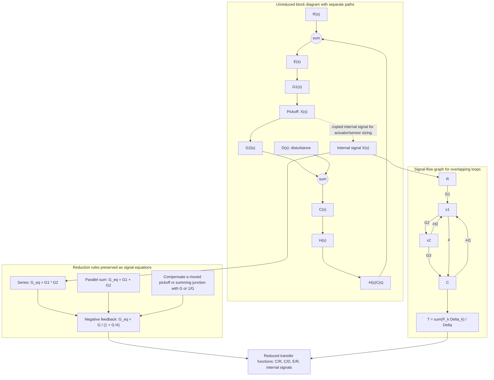

# Block Diagrams, Signal Flow, and Mason Rule

Real control systems are built from interconnected subsystems. Motors, sensors, amplifiers, loads, and feedback paths must eventually become transfer functions suitable for response and stability analysis. Block-diagram reduction does that algebra while retaining the physical architecture; signal-flow graphs are a compact alternative when many loops interact.

## From interconnections to signal equations

A **block diagram** represents subsystem transfer functions as directed blocks connected by signals. A **summing junction** forms a signed algebraic sum, and a **pickoff point** copies a signal without changing it.

The elementary reductions are

$$
G_{\text{series}}(s)=G_1(s)G_2(s),
$$

$$
G_{\text{parallel}}(s)=G_1(s)+G_2(s),
$$

when the parallel outputs are added, and

$$
G_{\text{feedback}}(s)=\frac{G(s)}{1+G(s)H(s)}
$$

for a single negative-feedback loop. Positive feedback changes the denominator to $1-G(s)H(s)$.

Writing the signal equations before moving blocks is safer than memorizing a large catalog of diagram transformations. If

$$
X=G(R-HY), \qquad Y=PX,
$$

then substitution gives the result even when the drawing is crowded with disturbances and sensor paths.

For nonunity feedback, the error at the summing junction is $R(s)-H(s)C(s)$, not generally $R(s)-C(s)$. That distinction carries into steady-state error and sensor-scaling calculations.

## Reducing a crowded diagram without changing it

Nested diagrams are usually reduced from the inner loop outward, followed by series and parallel combinations. Moving a summing junction or pickoff point is valid only if every signal equation remains unchanged.

| Move | Required change |
|---|---|
| Move pickoff before a block $G$ to after it | add $1/G$ in copied branch |
| Move pickoff after a block $G$ to before it | add $G$ in copied branch |
| Move summing junction before a block $G$ to after it | multiply side input by $G$ |
| Move summing junction after a block $G$ to before it | divide side input by $G$ |



The unreduced diagram records where the disturbance enters and where the internal signal is measured. Those paths should stay separate until the desired transfer function is clear: reference to output, disturbance to output, sensor noise to output, or reference to error. A controller can improve tracking while worsening noise transmission.

| Interconnection | Formula | Stability denominator |
|---|---|---|
| series | $G_1G_2$ | product of denominators before cancellation |
| parallel sum | $G_1+G_2$ | common denominator after addition |
| negative feedback | $G/(1+GH)$ | $1+GH=0$ after clearing fractions |
| positive feedback | $G/(1-GH)$ | $1-GH=0$ after clearing fractions |
| Mason graph | $\sum P_k\Delta_k/\Delta$ | $\Delta=0$ |

## Keeping reference, disturbance, and noise paths distinct

An equivalent block is meaningful only for a stated input-output pair. Consider a forward path $G(s)$, feedback path $H(s)$, an output disturbance $D(s)$, and measurement noise $N(s)$ added in the feedback signal. The equations are

$$
E=R-HY-N, \qquad Y=GE+D.
$$

Solving once while retaining all three inputs gives

$$
Y=\frac{G}{1+GH}R+\frac{1}{1+GH}D-\frac{G}{1+GH}N.
$$

The three coefficients answer different design questions:

$$
\frac{Y}{R}=\frac{G}{1+GH}, \qquad
\frac{Y}{D}=\frac{1}{1+GH}, \qquad
\frac{Y}{N}=-\frac{G}{1+GH}.
$$

Collapsing the diagram directly to $Y/R$ would discard the disturbance and noise paths. The same warning applies to actuator effort and internal error. If the actuator command is $U=G_cE$, then $U/R$, $U/D$, and $U/N$ may expose saturation or noise amplification that is absent from the output response.

Units provide another check on the signal equations. Inputs to a summing junction need compatible units or an explicit transducer gain. An angle command in radians cannot be added directly to a feedback voltage; the sensor must first supply the corresponding volts per radian. A diagram that is algebraically reducible can still be physically inconsistent.

## Mason's formula for overlapping loops

A **signal-flow graph** uses nodes for signals and directed branches for gains. A **forward path** runs from input to output without touching a node more than once. A **loop** starts and ends at the same node without otherwise repeating a node. Non-touching loops share no nodes.

Mason's gain formula is

$$
T=\frac{\sum_{k=1}^N P_k\Delta_k}{\Delta},
$$

where $P_k$ is the gain of the $k$th forward path and

$$
\Delta=1-\sum L_i+\sum L_iL_j-\sum L_iL_jL_m+\cdots.
$$

Each product is taken over mutually non-touching loops. The factor $\Delta_k$ is formed after removing every loop that touches the $k$th forward path. The method replaces repeated movement of summing junctions with careful bookkeeping; omitting one non-touching loop product changes the result.

State equations also admit a signal-flow representation. Integrator outputs serve as state variables, and branch gains are matrix coefficients, linking transfer-function diagrams to state-space models.

## Nested-loop reduction by hand

Take $G_1(s)=2$, followed by an inner negative-feedback loop with $G_2(s)=5/(s+1)$ and $H_2(s)=0.4$. The result passes through $G_3(s)=1/(s+3)$ and an outer unity negative-feedback loop.

Reduce the inner loop first:

$$
\begin{aligned}
G_{2,\text{cl}}
&=\frac{G_2}{1+G_2H_2}\\
&=\frac{\frac{5}{s+1}}{1+\frac{5}{s+1}(0.4)}\\
&=\frac{5}{s+3}.
\end{aligned}
$$

The forward path is then

$$
G_{\text{forward}}=G_1G_{2,\text{cl}}G_3
=2\cdot\frac{5}{s+3}\cdot\frac{1}{s+3}
=\frac{10}{(s+3)^2}.
$$

Applying the outer loop gives

$$
\begin{aligned}
T(s)
&=\frac{G_{\text{forward}}}{1+G_{\text{forward}}}\\
&=\frac{10}{(s+3)^2+10}\\
&=\frac{10}{s^2+6s+19}.
\end{aligned}
$$

## A two-loop Mason calculation

Suppose one input-output path has gain $P_1=G_1G_2G_3$. The graph contains $L_1=-G_2H_1$ and $L_2=-G_3H_2$; both touch the forward path, but they do not touch each other. Then

$$
\begin{aligned}
\Delta
&=1-(L_1+L_2)+L_1L_2\\
&=1+G_2H_1+G_3H_2+G_2G_3H_1H_2\\
&=(1+G_2H_1)(1+G_3H_2).
\end{aligned}
$$

Both loops are removed when forming $\Delta_1$, so $\Delta_1=1$ and

$$
T=\frac{G_1G_2G_3}{1+G_2H_1+G_3H_2+G_2G_3H_1H_2}.
$$

## Checking a reduction with SymPy

```python
import sympy as sp

s = sp.symbols("s")
G1 = 2
G2 = 5 / (s + 1)
H2 = sp.Rational(2, 5)
G3 = 1 / (s + 3)

inner = sp.simplify(G2 / (1 + G2 * H2))
forward = sp.simplify(G1 * inner * G3)
closed = sp.simplify(forward / (1 + forward))

print("inner loop:", sp.factor(inner))
print("forward path:", sp.factor(forward))
print("closed-loop T:", sp.factor(closed))
```

## What a reduced transfer function can hide

The sign at each summing junction must be checked before reducing a loop. Nonunity feedback, moved pickoff points, and disturbance locations are common sources of otherwise plausible algebra errors. Unit consistency matters too: a summing junction can combine only signals with compatible units or signals already converted by a transducer gain.

Pole-zero cancellation needs particular care. An unstable pole cancelled in the input-output transfer function can remain in an internal signal, and real components rarely produce an exact cancellation under parameter uncertainty. Lightly damped and unstable modes are therefore not normally cancelled without a robust-stability argument.

Reduction should preserve the quantity being designed. A single equivalent block is enough for output poles and response, but actuator sizing, amplifier limits, sensor noise, and internal stability require additional input-to-internal-signal transfer functions. Naming intermediate groups such as $G_p(s)$, $H(s)$, and $G_c(s)$ keeps those expressions readable. Documentation is strongest when it retains both the physical, unreduced diagram and the reduced equations.

Large diagrams are easier to audit when each physical group is reduced only as far as the next design boundary. An actuator-motor-load group can become $G_p(s)$, a sensor-filter group can become $H(s)$, and the controller can remain $G_c(s)$. The closed-loop expression stays compact, while a later controller or sensor change remains localized to one named block.

The unreduced and reduced forms serve different purposes. The first records disturbance locations, units, and actual components; the second exposes poles and supports calculation. Keeping both also makes it possible to recover internal signals after the main transfer function has been simplified.

<div className="see-also">

See also: [Introduction to feedback](/cs/control-engineering/introduction-to-feedback-control) · [Physical system modeling](/cs/control-engineering/physical-system-modeling-frequency-domain) · [Steady-state errors](/cs/control-engineering/steady-state-errors-and-sensitivity) · [Root locus](/cs/control-engineering/root-locus-sketching-and-analysis) · [Digital control](/cs/control-engineering/digital-control-sampling-and-z-transform)

</div>
