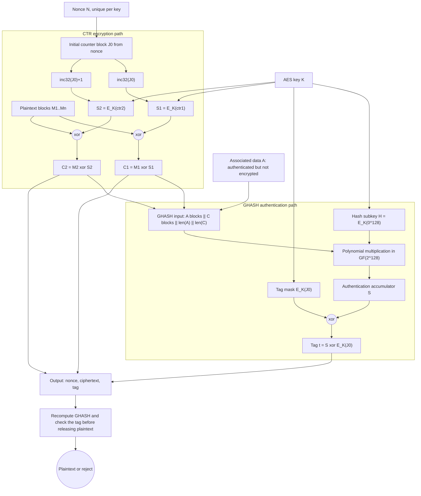

# Authenticated Encryption and GCM

Authenticated encryption combines confidentiality and integrity in one interface. It encrypts the message and authenticates both the ciphertext and optional associated data such as headers, sequence numbers, protocol versions, or content types. Bare encryption is malleable, while a separate encryption/MAC composition is easy to get wrong.

Katz and Lindell emphasize generic composition, especially encrypt-then-MAC, and explain how authenticated encryption yields stronger guarantees such as resistance to chosen-ciphertext attacks. Smart's hybrid-encryption and symmetric-security chapters reinforce the same engineering picture: protect the payload with a data encapsulation mechanism that includes confidentiality and authenticity. GCM is a widely deployed instance built from CTR encryption and polynomial authentication.

## The AEAD contract

An **authenticated encryption with associated data** scheme, abbreviated AEAD, has algorithms:

- $\mathrm{Gen}(1^n)$ samples a key.
- $\mathrm{Enc}_k(N,A,m)$ encrypts message $m$ using nonce $N$ and associated data $A$, returning a ciphertext and tag.
- $\mathrm{Dec}_k(N,A,c,t)$ returns $m$ or rejects.

The associated data $A$ is not encrypted, but it is authenticated. If $A$ changes, decryption should reject. Two guarantees matter:

1. **Confidentiality:** ciphertexts hide plaintexts under the scheme's nonce rules.
2. **Integrity:** an attacker cannot produce a new valid tuple $(N,A,c,t)$ that decrypts successfully, apart from replays permitted by the surrounding protocol.

AEAD does not itself prevent replay. A recorded ciphertext submitted again with the same nonce and associated data may still decrypt. Sequence numbers, epochs, channel state, or transcript binding belong in the protocol. TLS, for example, uses record sequence numbers and key updates around the AEAD primitive.

Associated data binds public context to the private payload. A packet number, content type, protocol version, sender identity, or routing header may need to remain visible to intermediaries, but the receiver must still reject tampering. If a visible header says `type=payment` and the encrypted body holds an amount, omitting the header from $A$ may let an attacker move the ciphertext into a different semantic context.

## Composition order and chosen-ciphertext security

An encryption scheme and a MAC can be combined in several orders:

| Composition | Receiver order | Typical status | Main risk |
|---|---|---|---|
| Encrypt-and-MAC | verify plaintext tag separately | generally not preferred | tag may leak plaintext properties |
| MAC-then-encrypt | decrypt before checking MAC | fragile unless carefully proven | padding or error oracles |
| Encrypt-then-MAC | verify tag before decrypting | robust generic construction | nonce and context must also be authenticated |
| AEAD mode | one integrated API | preferred | nonce misuse can still be fatal |

Under standard assumptions, encrypt-then-MAC is the robust generic choice:

$$
c=\mathrm{Enc}_{k_E}(m),\qquad t=\mathrm{Mac}_{k_M}(c).
$$

The receiver verifies the exact ciphertext before decrypting it. If verification fails, it returns a single rejection result. Decrypting unauthenticated input can expose padding checks, parser differences, or timing behavior.

The proof follows the same order. Any accepted modified ciphertext must carry a valid tag. A new tag breaks strong MAC unforgeability; a copied tag belongs to an already seen ciphertext, so replay becomes a protocol question. Once modified ciphertexts are rejected before decryption, confidentiality reduces to CPA security because the adversary cannot obtain useful decryptions of altered challenges.

MAC-then-encrypt can be secure in a carefully specified system, but it is fragile. Padding-oracle attacks arose when receivers decrypted first and exposed differences among padding, parsing, and authentication failures. Composition order and error handling therefore belong to the security argument.

## How AES-GCM couples CTR and GHASH

AES-GCM uses AES-CTR for encryption and GHASH, a polynomial hash over $\mathrm{GF}(2^{128})$, for authentication. The hash subkey is

$$
H=E_k(0^{128}).
$$

GHASH evaluates a polynomial over the associated-data blocks, ciphertext blocks, and their lengths. The resulting accumulator is masked with an encrypted initial counter block to form the tag. CTR encryption and polynomial hashing can run in parallel, and many processors provide carryless-multiplication instructions for GHASH.



A 96-bit nonce is GCM's standard fast path, and it must be unique for a given key. Reuse repeats the CTR keystream, exposing XORs of plaintexts. It also creates related GHASH equations that reveal algebraic information about $H$, so authentication can fail as well.

Tag length is a concrete-security choice. A 128-bit tag has generic forgery probability near $2^{-128}$ per independent attempt in the idealized model. Truncation to 96, 64, or 32 bits is defensible only after accounting for the total verification attempts, the cost of online guesses, and the damage from one accepted forgery. Protocol standards usually fix the tag length rather than leave it to each application.

Misuse-resistant modes such as SIV constructions can retain confidentiality under some nonce-reuse patterns by deriving a synthetic IV from the message and associated data. Their performance and online-processing properties differ from GCM's. GCM still requires a protocol-level nonce allocator that cannot repeat a key/nonce pair.

Key rotation provides another bound. Even with unique nonces, a long-lived key accumulates encrypted data and forgery attempts. Protocols limit records per key and derive fresh traffic keys before counters or proof bounds become uncomfortable.

## Two verification traces

### A changed public header

Suppose an AEAD scheme encrypts body `amount=100` with associated data `type=invoice`. The tag covers both associated data and ciphertext:

$$
t=\mathrm{Auth}_k(N,A,c).
$$

The accepted tuple is

$$
(N,\ A=\texttt{type=invoice},\ c,\ t).
$$

An attacker submits

$$
(N,\ A'=\texttt{type=refund},\ c,\ t).
$$

Verification recomputes $t'=\mathrm{Auth}_k(N,A',c)$. Since $A'\ne A$, equality $t'=t$ occurs only with negligible probability for a secure authenticator. Decryption rejects even though the encrypted body did not change.

### A failed encrypt-then-MAC tag

For a received pair $(c,t)$, the receiver first checks

$$
\mathrm{Vrfy}_{k_M}(c,t)\stackrel{?}{=}1.
$$

A false result ends processing with one generic rejection. Only an authenticated ciphertext reaches

$$
m=\mathrm{Dec}_{k_E}(c).
$$

Logging and metrics should likewise omit decrypted fragments, parser details, and distinguishable failure timing. On tag failure, the only safe plaintext output is no plaintext.

## Calling a real AEAD API

The nonce is carried with the ciphertext, while associated data must be supplied again at decryption. `AESGCM.decrypt` verifies the tag before returning any plaintext.

```python
from cryptography.hazmat.primitives.ciphers.aead import AESGCM
import os

key = AESGCM.generate_key(bit_length=256)
aesgcm = AESGCM(key)

nonce = os.urandom(12)  # Must never repeat with this key.
associated_data = b"type=invoice;version=1"
message = b"amount=100;currency=USD"

ciphertext_and_tag = aesgcm.encrypt(nonce, message, associated_data)
plaintext = aesgcm.decrypt(nonce, ciphertext_and_tag, associated_data)
assert plaintext == message
```

## Failure modes to design out

- Reusing a GCM nonce with the same key.
- Encrypting without authenticating and attempting to add integrity later.
- Authenticating plaintext but not ciphertext in a custom composition.
- Omitting headers, algorithm identifiers, sequence numbers, or channel context from associated data.
- Returning distinct errors for padding, tag, parsing, and version failures.
- Treating successful AEAD verification as replay protection.

<div className="see-also">

See also: [Symmetric encryption and modes](/cs/cryptography/symmetric-encryption-modes) · [Message authentication codes](/cs/cryptography/message-authentication-codes) · [TLS protocol overview](/cs/cryptography/tls-protocol-overview) · [Public-key encryption](/cs/cryptography/public-key-encryption-elgamal-hybrid)

</div>
