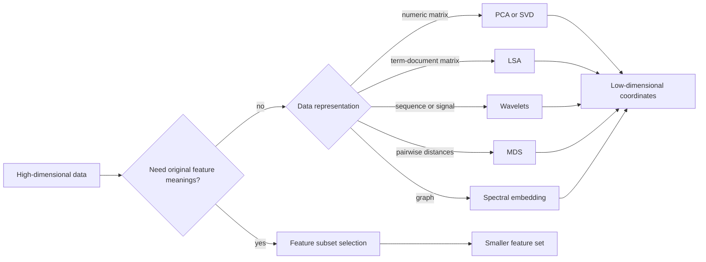

# Feature Selection and Dimensionality Reduction

Feature selection and dimensionality reduction address the same pressure from different directions: real data sets often have too many variables, many of which are noisy, redundant, expensive, or irrelevant. Aggarwal separates feature subset selection from transformations such as principal component analysis, singular value decomposition, latent semantic analysis, wavelets, multidimensional scaling, and graph spectral embeddings. The shared goal is to keep the structure that matters while reducing computational and statistical burden.

The topic belongs with data preparation, but it also reaches nearly every later mining task. Clustering in high dimensions becomes unstable because distances concentrate. Text mining begins with sparse high-dimensional vectors, then often reduces them with SVD or topic models. Stream mining uses compact synopses. Graph mining uses spectral transformations to turn topology into coordinates.

## Two ways to make a representation smaller

**Feature subset selection** chooses a subset of the original features. It preserves interpretability because selected features keep their original meaning.

**Filter methods** score features before fitting the final mining model. Scores may use variance, correlation, mutual information, entropy, term strength, or class-separation criteria.

**Wrapper methods** evaluate feature subsets by repeatedly fitting a model. They can match a target algorithm closely but are usually more expensive.

**Embedded methods** select features during model training, as in Lasso regression or tree-based split selection.

**Dimensionality reduction** maps data from $d$ dimensions to $k$ dimensions, where $k\lt d$. The new coordinates may be linear combinations of old features or nonlinear embeddings.

**Principal component analysis (PCA)** finds orthogonal directions of maximum variance. For centered data matrix $X$, PCA uses eigenvectors of the covariance matrix $X^\top X/(n-1)$.

**Singular value decomposition (SVD)** writes a matrix as

$$
X = U \Sigma V^\top,
$$

where columns of $U$ and $V$ are orthonormal and $\Sigma$ contains singular values. Truncating to the largest $k$ singular values gives the best rank-$k$ approximation in squared Frobenius error.

**Latent semantic analysis (LSA)** applies truncated SVD to a term-document matrix so documents and terms are embedded in a lower-dimensional semantic space.

**Haar wavelet transform** represents a sequence by recursive averages and differences. It is useful when the signal has local changes.

**Multidimensional scaling (MDS)** embeds objects from pairwise distances into coordinates, usually by preserving distances as well as possible.

Selection and projection answer different questions. A selector returns a coordinate subspace: it might keep columns 2, 9, and 14. A linear reducer returns a new basis whose first coordinate may combine every original column. Selection is preferable when variables have a stable meaning, measurement cost matters, or a person must act on the result. Projection can compress correlated variables much more efficiently.

A third operation, feature extraction, constructs variables using domain knowledge. Ratios, rolling averages, and counts over graph neighborhoods are examples. It may reduce dimension, but its defining feature is the semantic construction rather than an optimization criterion.

## How selectors decide what to retain

**Feature selection reduces variance but may increase bias.** Removing irrelevant variables helps models generalize and improves speed. Removing weak but genuinely useful variables can hide structure. Selection should be validated on held-out data or with stability checks.

A univariate filter examines one feature at a time. It can miss an interaction even when its score is statistically well defined. For example, let $x_1,x_2$ be independent fair bits and let the label be $y=x_1\mathbin{\mathrm{XOR}}x_2$. Neither feature alone carries information about $y$: for either value of $x_1$, the label remains equally likely to be zero or one. The pair determines the label exactly. Wrapper and embedded methods can detect such interactions if their model class represents them, but they pay with more search and a greater chance of overfitting the selection process.

Correlation filters treat redundancy differently from relevance. Two nearly identical sensors may both correlate strongly with the target. Keeping both adds little information and can destabilize linear coefficients. Criteria based on maximum relevance and minimum redundancy try to balance target association against similarity among selected features, though estimating mutual information reliably becomes difficult with limited continuous data.

Embedded selection depends on the fitted model. In the Lasso objective

$$
\min_{\beta}\ \frac{1}{2n}\|y-X\beta\|_2^2+\lambda\|\beta\|_1,
$$

the $L_1$ penalty can set coefficients exactly to zero. When predictors are strongly correlated, the chosen member of a correlated group may change across samples. A sparse model can predict well while giving an unstable story about which variable matters. Bootstrap selection frequencies are one way to expose that instability.

## Deriving principal components

Assume the columns of $X$ have been centered. A unit direction $v$ produces scores $z=Xv$, and their unnormalized variance is

$$
z^\top z=v^\top X^\top Xv.
$$

To impose $v^\top v=1$, introduce a Lagrange multiplier:

$$
L(v,\lambda)=v^\top X^\top Xv-\lambda(v^\top v-1).
$$

Setting the derivative with respect to $v$ to zero gives

$$
X^\top Xv=\lambda v.
$$

Every stationary direction is therefore an eigenvector of $X^\top X$. The objective value equals its eigenvalue, so the largest eigenvalue gives the first component. Later components maximize the same objective subject to being orthogonal to the earlier directions.

Centering is essential to this interpretation. Without it, the leading component can point toward the mean rather than describe variation around the mean. Scaling is a separate decision. PCA on the covariance matrix favors variables with large numeric variance; PCA on standardized columns is equivalent to using their correlation matrix.

If the eigenvalues are $\lambda_1\geq\cdots\geq\lambda_d$, the fraction of sample variance explained by the first $k$ components is

$$
\frac{\sum_{j=1}^k\lambda_j}{\sum_{j=1}^d\lambda_j}.
$$

An explained-variance threshold is a compression rule, not proof that the retained coordinates are sufficient for a later prediction task.

## SVD as an approximation theorem

**Truncated SVD gives the best low-rank reconstruction.** If $X=U\Sigma V^\top$, then

$$
X_k = U_k \Sigma_k V_k^\top
$$

minimizes $\|X-Y\|_F$ over all matrices $Y$ with rank at most $k$. The squared error has a useful closed form:

$$
\|X-X_k\|_F^2=\sum_{j>k}\sigma_j^2.
$$

Each omitted singular direction contributes the square of its singular value. The spectral-norm error is $\|X-X_k\|_2=\sigma_{k+1}$. These statements are the Eckart--Young approximation result and explain the role of SVD in text mining and matrix compression.

For centered dense data, PCA directions are the right singular vectors in $V$, and the component scores are $U\Sigma$. Text pipelines often use truncated SVD without centering because subtracting column means would destroy sparsity. That operation is commonly called LSA, but it is not numerically identical to covariance PCA.

**Reduction is not always supervised.** PCA and SVD do not know the target label. They may keep high-variance directions that are irrelevant to classification and discard low-variance directions that separate classes. Supervised feature selection should be preferred when label prediction is the task and labels are reliable.

**Graph embeddings use matrix structure.** An adjacency matrix, Laplacian, or normalized Laplacian can be decomposed spectrally. The resulting eigenvectors provide coordinates that reflect graph connectivity, which can then feed clustering or classification.

**Dimensionality reduction should be fitted as part of the training pipeline.** The reducer learns means, variances, singular vectors, selected features, or neighborhood structure from data. If it is fitted before a train-test split, information from the test set influences the representation and the validation score becomes optimistic. This is especially easy to miss with PCA, SVD, feature scaling, and mutual-information filters because they feel like harmless preprocessing. In predictive work, fit the selector or reducer only on the training fold, then apply the learned transformation to validation and test data.

## Matching the method to the representation



| Method | Keeps original features? | Uses labels? | Strength | Main caution |
|---|---:|---:|---|---|
| Filter selection | Yes | Sometimes | Fast and scalable | Ignores feature interactions |
| Wrapper selection | Yes | Usually | Tuned to target model | Expensive and overfit-prone |
| PCA | No | No | Captures variance compactly | Components may be hard to interpret |
| SVD/LSA | No | No | Works well for sparse matrices | Requires choosing rank |
| Wavelets | No | No | Captures local signal changes | Best for ordered signals |
| MDS | No | No | Starts from distances only | Costly for many objects |

Classical MDS starts from a squared-distance matrix $D^{(2)}$. With the centering matrix $J=I-\frac{1}{n}\mathbf{1}\mathbf{1}^\top$, it forms

$$
B=-\frac{1}{2}JD^{(2)}J.
$$

When the distances are Euclidean, $B$ is the centered Gram matrix of inner products. Eigenvectors of $B$, scaled by square roots of positive eigenvalues, give coordinates. Negative eigenvalues indicate that the supplied distances cannot be represented exactly in Euclidean space at that dimension.

## Worked example 1: PCA by hand on centered points

**Problem.** Reduce four two-dimensional points to one dimension:

$$
(2,0),\ (0,2),\ (-2,0),\ (0,-2).
$$

Rotate them? Or is one dimension insufficient?

**Method.**

1. The mean is $(0,0)$, so the data are already centered.

2. Build the covariance matrix. The $x$ values are $(2,0,-2,0)$ and $y$ values are $(0,2,0,-2)$.

$$
\sum x_i^2 = 8,\quad \sum y_i^2 = 8,\quad \sum x_i y_i=0.
$$

   Using $n-1=3$,

$$
C=\begin{bmatrix}8/3 & 0\\0 & 8/3\end{bmatrix}.
$$

3. The eigenvalues are both $8/3$. Every unit direction has the same variance.

4. Projecting onto any one-dimensional direction keeps only half of the total variance, because total variance is $16/3$ and one component retains $8/3$.

**Checked answer.** PCA has no unique preferred direction here. A one-dimensional embedding loses half the variance. The data form a symmetric cross, so reducing to one coordinate is not a strong representation.

## Worked example 2: Feature selection with class separation

**Problem.** Choose between two features for a binary classifier.

| object | feature A | feature B | class |
|---:|---:|---:|---|
| 1 | 0 | 10 | negative |
| 2 | 1 | 11 | negative |
| 3 | 5 | 10 | positive |
| 4 | 6 | 11 | positive |

**Method.**

1. Compare class means for feature A:

   Negative mean is $(0+1)/2=0.5$. Positive mean is $(5+6)/2=5.5$. Difference is $5.0$.

2. Compare within-class spread for feature A:

   Each class values differ from its mean by $0.5$, so within-class variation is small.

3. Compare class means for feature B:

   Negative mean is $(10+11)/2=10.5$. Positive mean is $(10+11)/2=10.5$. Difference is $0$.

4. Feature B varies, but it does not separate the classes.

**Checked answer.** Feature A is useful for classification; feature B is not useful for this label, even though it has nonzero variance. This shows why unsupervised variance filters and supervised selection can disagree.

## Worked example 3: one level of the Haar transform

**Problem.** Compress the length-four signal

$$
x=(6,2,5,5)
$$

using pairwise averages and differences.

**Method.** Use the orthonormal convention, dividing sums and differences by $\sqrt{2}$.

1. For the first pair, the average coefficient is $(6+2)/\sqrt{2}=4\sqrt{2}$ and the detail coefficient is $(6-2)/\sqrt{2}=2\sqrt{2}$.
2. For the second pair, the average is $(5+5)/\sqrt{2}=5\sqrt{2}$ and the detail is zero.
3. Transform the two averages once more:

$$
a=\frac{4\sqrt{2}+5\sqrt{2}}{\sqrt{2}}=9,
\qquad
d=\frac{4\sqrt{2}-5\sqrt{2}}{\sqrt{2}}=-1.
$$

The coefficient vector may be ordered as $(9,-1,2\sqrt{2},0)$. Because the transform is orthonormal, energy is preserved:

$$
6^2+2^2+5^2+5^2=90
$$

and

$$
9^2+(-1)^2+(2\sqrt{2})^2+0^2=90.
$$

Dropping the zero detail loses nothing. Dropping the small coefficient $-1$ as well gives a coarser piecewise approximation. Wavelets localize abrupt changes better than a global Fourier basis because a detail coefficient belongs to a particular interval.

## Fitting reduction without leakage

Pseudocode for a conservative reduction workflow:

```text
INPUT: feature matrix X, optional labels y, target dimension k
OUTPUT: reduced representation Z

split data into training and validation parts
if labels y are available and prediction is the goal:
    score features using training labels only
    keep a candidate subset
if features are still high-dimensional:
    fit PCA, SVD, or another reducer on training data only
transform training and validation data
evaluate downstream mining task
check stability of selected features or components
return fitted reducer and transformed data
```

```python
import numpy as np
from sklearn.decomposition import PCA, TruncatedSVD
from sklearn.feature_selection import mutual_info_classif, SelectKBest
from sklearn.pipeline import Pipeline
from sklearn.preprocessing import StandardScaler

X = np.array(
    [
        [0, 10, 3],
        [1, 11, 2],
        [5, 10, 3],
        [6, 11, 2],
        [5, 12, 4],
        [0, 12, 1],
    ],
    dtype=float,
)
y = np.array([0, 0, 1, 1, 1, 0])

selector = SelectKBest(mutual_info_classif, k=2)
pipeline = Pipeline(
    [
        ("scale", StandardScaler()),
        ("select", selector),
        ("pca", PCA(n_components=1)),
    ]
)

z = pipeline.fit_transform(X, y)
print(
    "selected feature indices:",
    pipeline.named_steps["select"].get_support(indices=True),
)
print("one-dimensional coordinates:", np.round(z.ravel(), 3))

term_doc = np.array([[3, 0, 1], [0, 4, 0], [1, 0, 2]], dtype=float)
lsa = TruncatedSVD(n_components=2, random_state=0)
print(np.round(lsa.fit_transform(term_doc), 3))
```

Reading the fitted selector from the pipeline keeps diagnostics tied to the same fitted object that produced the coordinates. On real data, the pipeline itself belongs inside cross-validation so that scaling, selection, and PCA are relearned per fold.

## Where reduction goes wrong

- Selecting features on the full data set before train-test splitting.
- Assuming high variance means high predictive value.
- Keeping too many principal components because the scree plot looks smooth; use downstream validation.
- Interpreting PCA components as original features without checking loadings.
- Applying PCA to unscaled features when units differ.
- Using SVD embeddings from a term-document matrix without controlling common stop words and document length effects.
- Forgetting that nonlinear structures may need graph, manifold, or kernel methods rather than a global linear projection.
- Choosing $k$ after repeatedly looking at the held-out test score. The test set then becomes part of model selection and no longer estimates untouched performance.
- Treating component signs as meaningful. If $v$ is an eigenvector, $-v$ is equally valid; software versions can report opposite signs without changing the subspace.
- Comparing loadings before accounting for feature scale. A large coefficient on a feature measured in tiny units may not imply large influence on raw observations.

Rank choice depends on the loss one cares about. A scree plot looks for an elbow in singular values. Cross-validation chooses the rank that performs well downstream. Parallel analysis compares observed eigenvalues with those from random data. For interpretability, a slightly smaller rank may be preferable even if reconstruction error rises modestly. None of these rules guarantees a unique answer.

Computational limits matter too. A full decomposition of a large sparse term-document matrix can be unnecessary and may densify intermediate results. Iterative truncated methods compute only leading directions. Randomized SVD adds approximation error but is often accurate when singular values decay and is much cheaper for large matrices.

## Related pages

- [Data Preparation](/cs/data-mining/chapter-02-data-preparation)
- [Similarity and Distances](/cs/data-mining/chapter-03-similarity-distances)
- [Cluster Analysis](/cs/data-mining/chapter-06-cluster-analysis)
- [Advanced Clustering Concepts](/cs/data-mining/chapter-07-advanced-clustering)
- [Mining Text Data](/cs/data-mining/chapter-13-mining-text-data)
