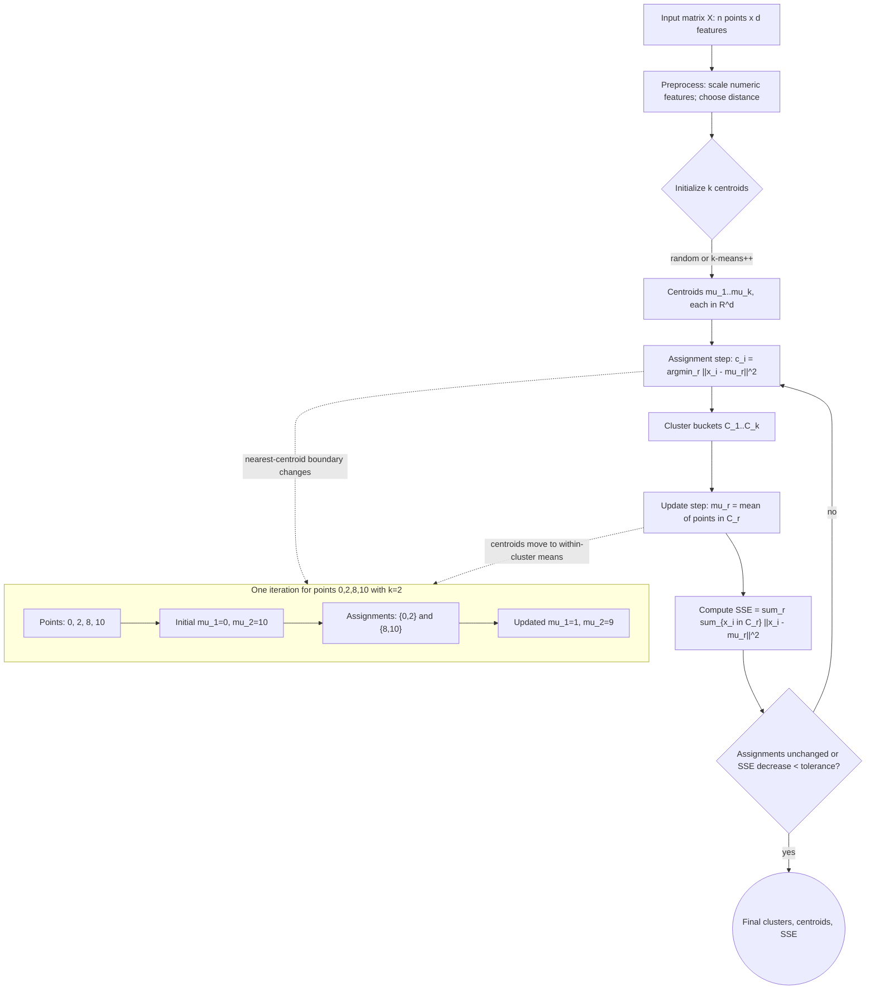

# Cluster Analysis

Cluster analysis groups unlabeled data objects so that objects in the same group are more similar to each other than to objects in other groups. Aggarwal presents clustering as a core unsupervised building block, with representative-based methods such as k-means, hierarchical methods, probabilistic model-based clustering, density and grid methods, graph-based algorithms, non-negative matrix factorization, and validation criteria.

The basic families differ in what they regard as a cluster. A centroid method looks for compact groups around representatives. A mixture model looks for observations generated by the same distribution. A density method looks for connected high-density regions. Hierarchical methods record nested mergers rather than committing immediately to one partition.

## What counts as a cluster

A **clustering** partitions or organizes objects $X_1,\dots,X_n$ into groups $C_1,\dots,C_k$. Some algorithms create a hard partition where each object belongs to one cluster; others create soft memberships or hierarchical structures.

**Representative-based clustering** describes each cluster by a prototype. In **k-means**, the prototype is the arithmetic mean or centroid. In **k-medians**, it is a coordinate-wise median. In **k-medoids**, it is an actual data object.

The **k-means objective** is

$$
\min_{C_1,\dots,C_k,\mu_1,\dots,\mu_k}
\sum_{r=1}^{k}\sum_{X_i\in C_r}\|X_i-\mu_r\|_2^2.
$$

**Agglomerative hierarchical clustering** starts with each point as its own cluster and repeatedly merges the closest pair. Linkage criteria include single linkage, complete linkage, average linkage, and Ward linkage.

**Probabilistic model-based clustering** assumes data are generated by a mixture distribution. A Gaussian mixture model represents the density as

$$
p(X)=\sum_{r=1}^{k}\pi_r \mathcal{N}(X\mid \mu_r,\Sigma_r),
$$

where $\pi_r$ are mixture weights.

**Density-based clustering** finds dense regions separated by sparse regions. DBSCAN uses an $\epsilon$ radius and a minimum number of points to define core points.

**Grid-based clustering** partitions the data space into cells and groups dense cells.

**Cluster validation** evaluates whether the clustering is meaningful. Internal measures use only the data and clustering; external measures compare against known labels.

There is no label-based ground truth in the definition. The same observations can have several defensible organizations: customers may group by purchasing behavior or geography; documents may group by topic or writing style. The feature representation and distance specify which organization an algorithm can recover.

## Why k-means alternation works

**K-means alternates between assignment and update.** Given centroids, assign each point to its nearest centroid. Given assignments, update each centroid to the mean of its assigned points. Each step does not increase the squared-error objective, so the algorithm converges to a local optimum. It is not guaranteed to find the global optimum.

**Centroids are optimal for squared Euclidean loss.** For one cluster $C$, minimize $\sum_{X_i\in C}\|X_i-\mu\|^2$. Differentiating with respect to $\mu$ gives

$$
\frac{\partial}{\partial \mu}\sum_{X_i\in C}\|X_i-\mu\|^2
=2\sum_{X_i\in C}(\mu-X_i).
$$

Setting the derivative to zero yields $\mu=(1/\vert C\vert )\sum_{X_i\in C}X_i$.

With centroids fixed, assigning each point to its nearest centroid minimizes that point's contribution independently. With assignments fixed, replacing each centroid by its cluster mean minimizes the cluster contribution. The objective takes only finitely many values associated with hard partitions, so the alternating procedure eventually stops, apart from tie-handling details. Monotone descent does not imply a global optimum because changing several assignments together may escape a solution that no single alternating step improves.

K-means++ initialization spreads starting centroids using probability proportional to squared distance from the centers already chosen. It reduces catastrophic initializations, but repeated starts are still useful. Empty clusters can occur when no point is assigned to a centroid; implementations usually reinitialize that centroid or move it to a poorly represented point.

Squared loss explains both the speed and the sensitivity of k-means. A point twice as far from a center contributes four times the loss. K-medians with $L_1$ loss is more resistant to a single extreme coordinate. K-medoids permits an arbitrary dissimilarity matrix because it restricts representatives to observed objects and never needs to average them.

## Linkage changes the hierarchy

**Hierarchical clustering produces a dendrogram, not just one partition.** A user can cut the dendrogram at different heights to obtain different numbers of clusters. This is useful when no single $k$ is known in advance.

For clusters $A$ and $B$, single linkage uses $\min_{a\in A,b\in B}d(a,b)$, complete linkage uses the maximum, and average linkage averages pairwise distances. Single linkage can recover elongated connected shapes but suffers from chaining: a thin bridge of points can join dense groups. Complete linkage favors clusters with small diameter and can split elongated groups. Ward linkage merges the pair causing the smallest increase in within-cluster squared error, so it is tied to Euclidean geometry rather than an arbitrary distance.

Agglomerative merging is greedy. Once two objects are joined, ordinary algorithms do not split them later. The dendrogram records the decisions consistently, but an early bad merge remains above every subsequent cut.

## Soft assignment with Gaussian mixtures

**Density methods find nonconvex shapes.** K-means favors roughly spherical clusters because of its centroid and Euclidean squared-error objective. DBSCAN can recover arbitrary connected dense regions and identify noise, but it depends strongly on $\epsilon$ and density parameters.

A Gaussian mixture assigns posterior responsibility

$$
\gamma_{ir}
=P(z_i=r\mid x_i)
=\frac{\pi_r\mathcal{N}(x_i\mid\mu_r,\Sigma_r)}
{\sum_s\pi_s\mathcal{N}(x_i\mid\mu_s,\Sigma_s)}.
$$

The expectation-maximization algorithm alternates between computing these responsibilities and updating parameters with responsibility-weighted statistics. If $N_r=\sum_i\gamma_{ir}$, then

$$
\mu_r=\frac{1}{N_r}\sum_i\gamma_{ir}x_i,
\qquad
\pi_r=\frac{N_r}{n}.
$$

Covariances receive the analogous weighted update. Each iteration does not decrease the observed-data likelihood, yet local optima and nearly singular covariance estimates remain possible. Covariance restrictions or regularization are common when dimension is not small relative to sample size.

K-means appears as a limiting hard-assignment case for spherical Gaussian components with equal variance and weights. A general Gaussian mixture can represent elliptical groups and uncertainty near their overlap, but a component is a density component, not automatically a meaningful semantic cluster.

## Density connectivity

**Validation must match the goal.** A low within-cluster sum of squares does not necessarily mean meaningful clusters. Silhouette score, Dunn index, Davies-Bouldin index, adjusted Rand index, and normalized mutual information answer different questions.

**Initialization and preprocessing are part of the clustering result.** For k-means, different initial centroids can lead to different local optima. For hierarchical clustering, a different linkage can change the dendrogram. For DBSCAN, a small change in $\epsilon$ can merge clusters or turn many points into noise. A credible clustering study reports these choices, checks stability under reasonable perturbations, and inspects whether the clusters are interpretable in original feature space, not only in the transformed space used by the algorithm.

**Cluster labels are arbitrary.** Cluster 0 and cluster 1 have no inherent ordering, and repeated runs may permute them. Evaluation and downstream use should compare memberships, centroids, or matched clusters rather than relying on numeric label IDs.

DBSCAN distinguishes core, border, and noise points. A core point has at least `MinPts` observations in its $\epsilon$-neighborhood, counting itself under the usual convention. A border point lacks enough neighbors to be core but lies near a core point. Clusters are maximal sets connected through core points, with border points attached. A border point reachable from two clusters can be assigned according to traversal order, so even deterministic parameters need not settle every boundary semantically.

The parameters express a density threshold. In $d$ dimensions, roughly speaking, `MinPts` observations must occupy an $\epsilon$-ball whose volume grows as $\epsilon^d$. A single global radius struggles when one cluster is sparse and another dense.

## The k-means loop



This k-means diagram shows the full alternating optimization loop instead of only naming clustering families. The input shape, centroid dimensions, assignment formula, centroid update rule, SSE objective, and convergence test are all labeled, so the reader can see why each iteration cannot increase the squared-error objective. The side example traces the one-dimensional worked example from initial centroids through assignments to updated centroids.

| Algorithm | Cluster shape | Parameters | Strength | Weakness |
|---|---|---|---|---|
| k-means | Spherical, equal-variance tendency | $k$ | Fast, simple | Local minima, outlier-sensitive |
| k-medoids | Prototype as data point | $k$ | Works with arbitrary distances | More expensive |
| Agglomerative | Depends on linkage | linkage, cut height | Dendrogram | Often $O(n^2)$ memory/time |
| Gaussian mixture | Elliptical density | $k$, covariance form | Soft memberships | Model assumptions |
| DBSCAN | Arbitrary dense regions | $\epsilon$, MinPts | Finds noise | Hard with varying density |
| Grid-based | Cell-connected regions | grid size, density | Scalable summaries | Grid resolution matters |

## Worked example 1: One k-means iteration

**Problem.** Cluster four one-dimensional points $0,2,8,10$ with $k=2$. Initial centroids are $\mu_1=0$ and $\mu_2=10$.

**Method.**

1. Assign each point to the nearest centroid:
   - Point 0: distance to 0 is 0, to 10 is 10 -> cluster 1.
   - Point 2: distance to 0 is 2, to 10 is 8 -> cluster 1.
   - Point 8: distance to 0 is 8, to 10 is 2 -> cluster 2.
   - Point 10: distance to 0 is 10, to 10 is 0 -> cluster 2.

2. Update centroids:

$$
\mu_1=\frac{0+2}{2}=1,\quad \mu_2=\frac{8+10}{2}=9.
$$

3. Compute squared-error objective:

$$
(0-1)^2+(2-1)^2+(8-9)^2+(10-9)^2=1+1+1+1=4.
$$

4. Repeat assignment with centroids 1 and 9:
   - 0 and 2 remain closer to 1.
   - 8 and 10 remain closer to 9.

**Checked answer.** The algorithm has converged to clusters \{0,2\} and \{8,10\} with centroids 1 and 9 and objective value 4.

## Worked example 2: DBSCAN core and border points

**Problem.** Use DBSCAN with $\epsilon=1.1$ and MinPts = 3 on one-dimensional points:

$$
0,\ 0.5,\ 1.0,\ 3.0,\ 3.4,\ 10.0.
$$

Count each point itself in its $\epsilon$-neighborhood.

**Method.**

1. Neighborhood of 0 includes 0, 0.5, 1.0 because all are within 1.1. Count 3 -> core.
2. Neighborhood of 0.5 includes 0, 0.5, 1.0. Count 3 -> core.
3. Neighborhood of 1.0 includes 0, 0.5, 1.0. Count 3 -> core.
4. Neighborhood of 3.0 includes 3.0 and 3.4 only. Count 2 -> not core.
5. Neighborhood of 3.4 includes 3.0 and 3.4 only. Count 2 -> not core.
6. Neighborhood of 10.0 includes only 10.0. Count 1 -> not core.

Now connect density-reachable points. Points 0, 0.5, and 1.0 are core points in one connected dense region. Points 3.0 and 3.4 are not within $\epsilon$ of any core point, so they are noise under these parameters. Point 10.0 is also noise.

**Checked answer.** DBSCAN returns one cluster \{0,0.5,1.0\} and noise points \{3.0,3.4,10.0\}. If MinPts were 2, the 3.0 and 3.4 pair would become a second dense cluster, showing parameter sensitivity.

## Measuring separation without labels

For point $i$, let $a(i)$ be its average distance to other points in its own cluster. For every other cluster, compute its average distance from $i$, and let $b(i)$ be the smallest such average. The silhouette is

$$
s(i)=\frac{b(i)-a(i)}{\max\{a(i),b(i)\}}.
$$

Values near $1$ indicate a point much closer to its assigned cluster; values near $0$ lie on a boundary; negative values suggest another cluster is closer on average. A singleton cluster needs a convention, commonly silhouette zero. The measure favors compact separated groups and can undervalue a valid density-based clustering with curved shapes.

External scores answer a different question. Adjusted Rand index compares pairs that are placed together or apart and corrects for chance. It is invariant to label permutation. If known classes are used for evaluation, a low score does not prove the clustering is useless: the clusters may expose subclasses or an independent organizing factor.

Useful validation combines objective values, resampling stability, sensitivity to hyperparameters, and descriptions in the original variables. None substitutes for deciding whether the grouping supports the intended analysis.

## Reproducing the small examples

Pseudocode for k-means:

```text
INPUT: data X, number of clusters k
OUTPUT: assignments and centroids

initialize k centroids
repeat until assignments stop changing or max iterations reached:
    for each point Xi:
        assign Xi to nearest centroid
    for each cluster r:
        set centroid r to the mean of assigned points
return assignments and centroids
```

```python
import numpy as np
from sklearn.cluster import DBSCAN, KMeans
from sklearn.metrics import silhouette_score

X = np.array([[0.0], [2.0], [8.0], [10.0]])
kmeans = KMeans(n_clusters=2, init=np.array([[0.0], [10.0]]), n_init=1, random_state=0)
labels = kmeans.fit_predict(X)
print("k-means labels:", labels)
print("centers:", kmeans.cluster_centers_.ravel())
print("inertia:", kmeans.inertia_)

Y = np.array([[0.0], [0.5], [1.0], [3.0], [3.4], [10.0]])
db = DBSCAN(eps=1.1, min_samples=3)
db_labels = db.fit_predict(Y)
print("DBSCAN labels:", db_labels)

if len(set(labels)) > 1:
    print("silhouette:", round(silhouette_score(X, labels), 3))
```

## Failure modes

- Choosing $k$ because it is convenient rather than validating it.
- Running k-means once and trusting a local optimum from unlucky initialization.
- Applying k-means to categorical or highly non-spherical data without justification.
- Forgetting to normalize features before distance-based clustering.
- Interpreting DBSCAN noise as necessarily erroneous; noise may be the most interesting part.
- Comparing clustering results only by visual inspection in two dimensions when the algorithm used many dimensions.
- Treating external class labels as the only valid clustering, even though clusters and classes can represent different structure.
- Selecting the run with the highest silhouette from hundreds of parameter trials and reporting the score as if no search occurred.
- Describing clusters only by standardized centroids. Convert summaries back to original units and include within-cluster spread and size.
- Using a two-dimensional projection to choose clusters, then claiming that the same separation exists in the full feature space.

## Related pages

- [Advanced Clustering Concepts](/cs/data-mining/chapter-07-advanced-clustering)
- [Similarity and Distances](/cs/data-mining/chapter-03-similarity-distances)
- [Outlier Analysis](/cs/data-mining/chapter-08-outlier-analysis)
- [Mining Data Streams and Big Data](/cs/data-mining/chapter-12-mining-data-streams)
- [Mining Graph Data](/cs/data-mining/chapter-17-mining-graph-data)
