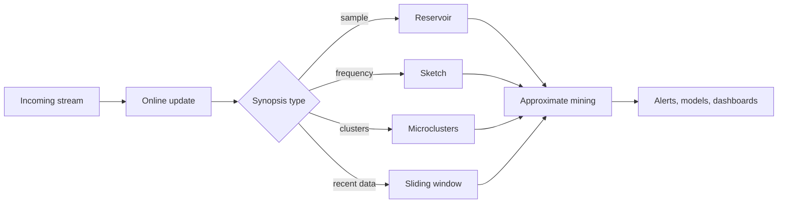

# Mining Data Streams and Big Data

Data stream mining studies data that arrive continuously and may be too large to store, revisit, or process with multiple full passes. Aggarwal's stream chapter covers synopsis structures, reservoir sampling, sketches, streaming frequent patterns, stream clustering, streaming outlier detection, and streaming classification. The broader big-data issue also includes disk-resident and distributed batch settings, where frameworks such as MapReduce can scan huge stored data but do not replace real-time stream algorithms.

Most familiar mining tasks have streaming versions, but the one-pass constraint, concept drift, memory limits, and real-time deadlines change the algorithms. The central question becomes which summary can be updated before the next event arrives and still answer the intended query.

## The stream model

A **data stream** is a sequence $X_1,X_2,\dots$ observed over time, often with no known endpoint.

The **one-pass constraint** means each item can be processed once, or only a small number of times, before it is discarded.

A **synopsis** is a compact summary of a stream. Examples include samples, histograms, sketches, Bloom filters, wavelet summaries, and microclusters.

**Reservoir sampling** maintains a uniform sample of fixed size from a stream of unknown length.

A **sliding window** model keeps only the most recent $w$ observations.

A **decay model** weights recent observations more heavily than old observations, often with exponential decay.

**Concept drift** occurs when the relationship between features and labels, or the data distribution itself, changes over time.

**MapReduce** is a distributed batch pattern with map tasks producing key-value pairs and reduce tasks aggregating values by key. It is useful for large stored data sets, but classic MapReduce is not a low-latency stream model.

**Microclusters** are compact cluster summaries with counts and sufficient statistics, often used by stream clustering methods.

Streams can follow several access models. A cash-register stream receives positive increments to item counts. A turnstile stream permits positive and negative updates, as when records are inserted and deleted. Some summaries that work for nonnegative counts fail when updates can cancel. A sliding window expires old events, requiring either deletion support or a data structure organized by age.

Bounded memory is meaningful only relative to something. An algorithm using memory logarithmic in stream length can run indefinitely; one storing all distinct keys may still exhaust memory even though it never stores duplicate events. State growth, per-event update time, and query time should be stated separately.

## What approximation buys

**Streaming changes exactness expectations.** Many exact batch algorithms need repeated scans or random access. Stream methods often return approximate answers with bounded memory.

**Reservoir sampling is unbiased over all items seen so far.** With reservoir size $k$, item $t$ is retained with probability $k/t$. Older items remain with the same probability after replacement logic.

**Sketches trade memory for controlled error.** Count-min sketch, Bloom filters, and related structures use hash functions to summarize frequencies or membership. They can update quickly but may have false positives or overestimates.

For a count-min sketch with width $w=\lceil e/\epsilon\rceil$ and depth $d=\lceil\ln(1/\delta)\rceil$, the usual guarantee for nonnegative updates is

$$
c_i\leq\widehat{c}_i\leq c_i+\epsilon N
$$

with probability at least $1-\delta$, where $N$ is the total count mass. Each row's collision noise has expectation at most $N/w$; Markov's inequality bounds the chance of a large overestimate in one row, and taking the minimum across independently hashed rows reduces the failure probability exponentially. The estimate never falls below the true count because collisions only add.

Width controls additive error; depth controls confidence. Doubling depth does not halve the collision error. Negative updates break the simple no-underestimate property unless a compatible variant and assumptions are used.

A Bloom filter answers whether a key may have appeared. Bits set by collisions cause false positives, but an ordinary filter has no false negatives as long as bits are never cleared. It cannot recover counts or enumerate stored keys. Count-min sketch and Bloom filter both use hashing, yet their query semantics differ.

Reservoir sampling supplies unbiased inclusion over positions, not guaranteed representation of every rare group. Stratified reservoirs can preserve known groups, while priority sampling supports weighted inclusion. If recent observations matter more, a uniform reservoir is the wrong synopsis.

## Recent data and gradual forgetting

**Stream clustering separates online and offline phases.** The online phase maintains microclusters. The offline phase reclusters summaries when a user asks for a current clustering. This avoids storing all raw points.

**Concept drift requires recency.** A classifier trained on all historical data may be worse than one trained on recent data if behavior changes. Sliding windows, decay, and adaptive ensembles address this.

Under exponential decay, an observation $a$ time units old receives weight

$$
w(a)=2^{-a/h},
$$

where $h$ is the half-life. The weight is $1/2$ after one half-life and $1/4$ after two. If updates arrive at fixed intervals, a decayed total can be maintained recursively as

$$
S_t=\lambda S_{t-1}+x_t,
\qquad 0<\lambda<1.
$$

The effective memory is smooth rather than a hard cutoff. Old events never vanish exactly, and comparing systems requires reporting $\lambda$ or half-life.

Drift may affect the marginal feature distribution $P(X)$, the class prevalence $P(y)$, or the conditional relation $P(y\mid X)$. Only the last necessarily invalidates the decision boundary, though the others can change calibration and workload. Labels often arrive after predictions, so supervised drift detection lags. Unsupervised feature drift is faster to observe but can raise alarms for harmless changes.

## Online summaries and offline models

**Distributed batch is not the same as streaming.** MapReduce can compute item counts or model updates over huge stored files. A stream method must update continuously and may never see the full data again.

**Window choice is a modeling assumption.** A sliding window of one hour, one day, or one month defines what "current" means. Short windows adapt quickly but have high variance; long windows are stable but slow to react to drift. Exponential decay gives a smoother compromise, but the decay rate still encodes a memory horizon. Stream mining results should therefore report the window or decay policy as carefully as a batch method reports its training set.

**Synopses should match query guarantees.** A Bloom filter answers approximate membership queries with false positives. A count-min sketch estimates frequencies with overestimation. A reservoir sample supports approximate full-data analysis. A microcluster supports centroid and variance summaries. These structures are not interchangeable: choosing a sketch for a task that needs quantiles or choosing a reservoir for a task that needs rare-item counts can produce poor results even when memory use is low.

**Latency is a first-class constraint.** A stream model that is accurate but updates too slowly can miss the event it was meant to detect. Online algorithms should report update time, memory footprint, and alert delay, not only final accuracy or approximation error.

**Backpressure and missing data affect stream mining.** Real streams can arrive late, out of order, duplicated, or dropped under load. A robust mining system defines event time versus processing time, handles late arrivals, and records how much data were skipped or approximated. Otherwise, changes in infrastructure can look like changes in behavior.

**Replay is valuable when available.** Even if production is one-pass, archived samples let engineers test new stream logic against historical bursts, outages, and drift events before deployment.

## Event time, processing time, and late records

Event time records when the source says an event occurred; processing time records when the mining system handled it. Network delay and retries can reorder these. A watermark is a system's claim that most events earlier than a time have arrived. Window results emitted before the watermark may be revised when late data are accepted, or late data may be dropped according to policy.

Deduplication needs a stable event identifier and a retention horizon. Keeping every identifier forever violates bounded memory; forgetting identifiers too soon allows delayed retries to count twice. Approximate membership filters save memory but can discard a genuinely new event through a false positive. These are data semantics, not merely infrastructure details, because they change counts and model updates.

Backpressure occurs when processing cannot keep up with arrival. Buffering raises latency, sampling changes statistical coverage, and dropping newest or oldest events creates different biases. Monitoring should expose lag and loss alongside mining outputs.

## Which synopsis answers which query



| Setting | Data access | Typical tool | Suitable task |
|---|---|---|---|
| In-memory batch | Many random accesses | Standard algorithms | Moderate data |
| Disk-resident batch | Few sequential scans | External memory algorithms | Very large stored data |
| Distributed batch | Parallel scans | MapReduce-style aggregation | Huge stored logs |
| Stream | One pass, bounded memory | Samples, sketches, online models | Real-time monitoring |
| Sliding window stream | Recent data only | Window summaries | Drift-aware analytics |

## Worked example 1: Count-min sketch update

**Problem.** Track approximate item counts using a sketch with two hash rows and five columns. The hash functions are:

$$
h_1(A)=1,\ h_1(B)=3,\quad h_2(A)=4,\ h_2(B)=3.
$$

Process stream $A,B,A$. Estimate counts of A and B.

**Method.**

1. Initialize a $2\times5$ table of zeros.

2. Process first A:
   - row 1, column 1 increases to 1.
   - row 2, column 4 increases to 1.

3. Process B:
   - row 1, column 3 increases to 1.
   - row 2, column 3 increases to 1.

4. Process second A:
   - row 1, column 1 increases to 2.
   - row 2, column 4 increases to 2.

5. Estimate count of A by taking the minimum of its hashed counters:

$$
\hat{c}(A)=\min(table[1,1],table[2,4])=\min(2,2)=2.
$$

6. Estimate B:

$$
\hat{c}(B)=\min(table[1,3],table[2,3])=\min(1,1)=1.
$$

**Checked answer.** The estimates are exact in this tiny example: A has count 2 and B has count 1. In larger streams, collisions can only increase counters, so count-min sketch overestimates rather than underestimates.

## Worked example 2: Microcluster sufficient statistics

**Problem.** Maintain a one-dimensional microcluster for points $2,4,8$. Store count $N$, linear sum $LS$, and squared sum $SS$. Compute centroid and variance.

**Method.**

1. Count:

$$
N=3.
$$

2. Linear sum:

$$
LS=2+4+8=14.
$$

3. Squared sum:

$$
SS=2^2+4^2+8^2=4+16+64=84.
$$

4. Centroid:

$$
\mu=\frac{LS}{N}=\frac{14}{3}=4.667.
$$

5. Population variance:

$$
\frac{SS}{N}-\mu^2=\frac{84}{3}-4.667^2=28-21.778=6.222.
$$

**Checked answer.** The microcluster summary $(N,LS,SS)=(3,14,84)$ is enough to compute centroid 4.667 and variance 6.222 without storing the three raw points.

Two microclusters can be merged without raw points by adding their $N$, $LS$, and $SS$ values. They can also support decay by multiplying all three statistics by the same factor before a new update. They cannot reconstruct multimodality inside a summary: points $0,10$ and repeated points near $5$ can share a mean while having different shapes. Microclusters therefore need radius controls and periodic maintenance.

## Worked example 3: exponential half-life

**Problem.** A counter has value $S_0=8$. No new events arrive for two time steps, and the decay factor is $\lambda=0.5$. Then an event of weight 3 arrives. Compute the state after each update.

**Method.** After one empty step,

$$
S_1=0.5(8)+0=4.
$$

After the second,

$$
S_2=0.5(4)+0=2.
$$

At the third step, include the new event:

$$
S_3=0.5(2)+3=4.
$$

**Checked answer.** The original mass of 8 contributes only 1 to $S_3$ after three decays, while the new event contributes 3. The resulting state is 4. The recursion applies decay before adding the current event; reversing that convention would decay a new event immediately and give a different result.

## Implementing two small synopses

Pseudocode for reservoir sampling:

```text
INPUT: stream x1, x2, ..., reservoir size k
OUTPUT: sample reservoir R

put first k items into R
for item xt at position t > k:
    with probability k / t:
        choose a random index r in 1..k
        replace R[r] with xt
return R
```

```python
import random
from collections import defaultdict

def reservoir_sample(stream, k, seed=0):
    rng = random.Random(seed)
    reservoir = []
    for t, item in enumerate(stream, start=1):
        if t <= k:
            reservoir.append(item)
        else:
            j = rng.randint(1, t)
            if j <= k:
                reservoir[j - 1] = item
    return reservoir

class CountMinSketch:
    def __init__(self, width=10, depth=3, seed=0):
        self.width = width
        self.depth = depth
        self.tables = [[0] * width for _ in range(depth)]
        self.salts = [seed + i * 9973 for i in range(depth)]

    def _hash(self, item, row):
        return hash((item, self.salts[row])) % self.width

    def update(self, item, count=1):
        for r in range(self.depth):
            self.tables[r][self._hash(item, r)] += count

    def estimate(self, item):
        return min(self.tables[r][self._hash(item, r)] for r in range(self.depth))

stream = list("ABRACADABRA")
print(reservoir_sample(stream, k=4, seed=1))

cms = CountMinSketch(width=20, depth=4)
for item in stream:
    cms.update(item)
print({item: cms.estimate(item) for item in sorted(set(stream))})
```

Python's built-in `hash` is randomized between interpreter processes, so this educational sketch is not suitable for persisted or distributed state: different workers or restarts can map the same item to different counters. A deployed sketch needs a stable, specified hash function and serialized seeds. It also needs counter-width planning because fixed-width counters can overflow on long streams.

## Failure modes

- Applying a batch algorithm that needs repeated scans to a true stream.
- Ignoring concept drift and letting stale data dominate a current model.
- Treating sketch estimates as exact counts.
- Choosing sliding-window size without considering delay, noise, and drift rate.
- Confusing distributed batch processing with real-time stream processing.
- Keeping a reservoir sample when the task requires recency-biased behavior.
- Forgetting that stream labels may arrive late, which complicates supervised evaluation.
- Measuring average update latency while ignoring tail latency; a small fraction of slow updates can create sustained queue growth.
- Evaluating drift adaptation on randomly shuffled data, which destroys the temporal change the method is supposed to handle.
- Using processing-time windows for events whose business meaning is defined by event time.

## Related pages

- [Data Mining Process and Data Types](/cs/data-mining/chapter-01-process-data-types)
- [Data Preparation](/cs/data-mining/chapter-02-data-preparation)
- [Association Pattern Mining](/cs/data-mining/chapter-04-association-pattern-mining)
- [Cluster Analysis](/cs/data-mining/chapter-06-cluster-analysis)
- [Outlier Analysis](/cs/data-mining/chapter-08-outlier-analysis)
- [Advanced Classification Concepts](/cs/data-mining/chapter-11-advanced-classification)
