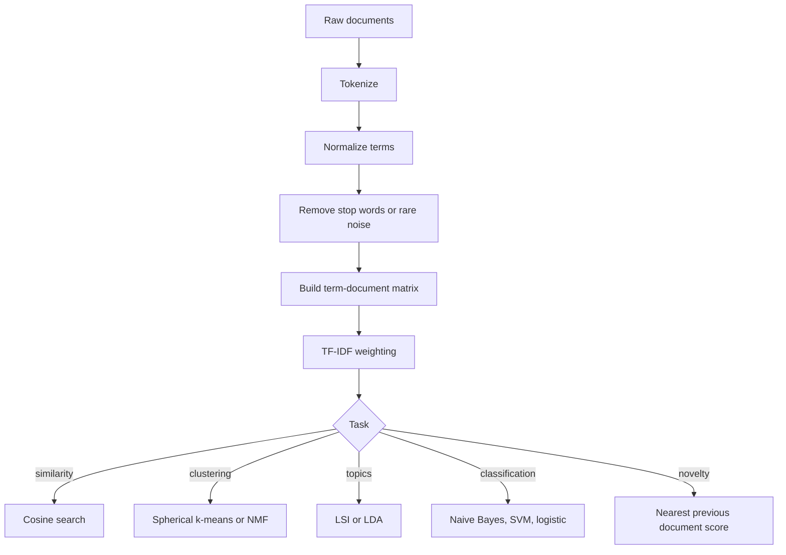

# Mining Text Data

Text mining transforms unstructured language into analyzable representations for similarity search, clustering, topic modeling, classification, novelty detection, and other data mining tasks. Aggarwal's text chapter covers document preparation, text similarity, specialized clustering, topic modeling, classification, and first-story detection. The central representation is usually the sparse term-document matrix, but the best weighting and reduction choices depend on the task.

The classic pipeline moves from tokenization to sparse weighting, then uses that representation for retrieval, clustering, topics, classification, or novelty detection. Each stage embeds linguistic assumptions even when the final algorithm is purely numerical.

## Turning documents into sparse vectors

A **document-term matrix** has rows as documents and columns as terms. Entry $(i,j)$ stores a count or weight of term $j$ in document $i$.

**Term frequency (TF)** measures how often a term appears in a document. It may be raw count, binary presence, or log-scaled count.

**Inverse document frequency (IDF)** downweights terms that appear in many documents:

$$
\mathrm{idf}(t)=\log\frac{N}{df(t)},
$$

where $N$ is the number of documents and $df(t)$ is the number of documents containing term $t$. Implementations often use smoothing.

**TF-IDF** multiplies a term's within-document frequency by its inverse document frequency.

**Cosine similarity** is the standard similarity for TF-IDF vectors because it reduces the effect of document length.

**Latent semantic indexing (LSI)** applies truncated SVD to a term-document matrix, mapping documents into a lower-dimensional latent space.

**Topic modeling** represents documents as mixtures of latent topics and topics as distributions over words. Latent Dirichlet allocation (LDA) is a standard probabilistic topic model.

**Novelty or first-story detection** identifies documents that discuss events not already seen in the stream.

Tokenization defines the features before weighting begins. Whitespace splitting mishandles punctuation, contractions, URLs, emoji, and languages without whitespace-delimited words. Character n-grams avoid some word-boundary decisions and are useful for misspellings, morphology, and language identification. Word n-grams preserve short phrases such as `not good`, at the cost of a much larger vocabulary.

Stemming applies rough rules to merge word forms, while lemmatization uses vocabulary and grammatical analysis to choose a base form. Merging `policy` and `police` by an aggressive stemmer is harmful; keeping `run`, `runs`, and `running` separate may be wasteful for another task. The choice should be checked through downstream errors and representative nearest neighbors.

## Weighting frequent and rare terms

**Bag-of-words loses order but gains tractability.** Many text mining methods ignore word order and grammar, representing each document by token counts. This is crude linguistically but effective for topical similarity and classification.

**TF-IDF balances local and global evidence.** A term repeated in a document is locally important, but a term appearing in almost every document is not very discriminative. TF-IDF encodes this tradeoff.

There is no single TF-IDF formula. Sublinear term frequency often uses $1+\log tf$ for positive counts, preventing one repeated term from growing linearly. Smoothed IDF may use

$$
\log\frac{1+N}{1+df(t)}+1,
$$

which avoids zero weights and division issues. A saved model must preserve the exact convention and training vocabulary.

BM25 is a standard retrieval weighting that saturates term frequency and normalizes document length:

$$
\operatorname{score}(D,Q)=
\sum_{t\in Q}IDF(t)
\frac{tf(t,D)(k_1+1)}
{tf(t,D)+k_1\left(1-b+b\frac{|D|}{avgdl}\right)}.
$$

Parameter $k_1$ controls term-frequency saturation, and $b$ controls length normalization. Unlike cosine TF-IDF, BM25 is naturally expressed as a query-document score rather than a symmetric document distance.

Length normalization can also remove useful signal. A one-word query and a long article may have the same direction if their relative weights match, even though evidence strength differs. Retrieval systems commonly combine text score with fields, freshness, or document priors.

## Low-rank semantics and topics

**Cosine similarity and length normalization are essential.** Without normalization, long documents appear similar to many documents simply because they contain more terms.

**SVD/LSI captures correlated terms.** If "car" and "automobile" occur in similar document contexts, a low-rank representation can place related documents closer even when exact words differ.

LSI chooses directions that reconstruct the weighted matrix well. Those directions can contain positive and negative coordinates and need not correspond to a clean human topic. Non-negative matrix factorization instead approximates $X\approx WH$ with $W,H\geq0$. Its additive parts are often easier to label, though the factorization is nonconvex and depends on initialization.

**Topic models provide soft structure.** A document may be 70 percent sports and 30 percent politics. This is more realistic than forcing each document into one topic cluster.

LDA describes a generative process. For each document $d$, draw topic proportions $\theta_d$ from a Dirichlet distribution. For each token position, draw a topic $z_{dn}$ from $\theta_d$, then draw the observed word from that topic's word distribution $\phi_{z_{dn}}$. Inference reverses this story: given words, estimate topic assignments and proportions. The exchangeability assumption discards token order within a document.

The number of topics is chosen, not discovered without qualification. Perplexity measures held-out predictive fit but may prefer topics people find fragmented. Topic coherence examines whether top words co-occur, and human review asks whether topics are distinct and useful. Stability across seeds and corpus samples is important because several decompositions can explain similar word counts.

## Classification and first-story detection

**Text classification often uses simple linear models well.** Naive Bayes, logistic regression, and linear SVMs are strong baselines for sparse high-dimensional text.

**Text preprocessing is domain-specific.** Lowercasing, stemming, stop-word removal, phrase detection, and rare-term filtering are not universally good or bad. In topic discovery, stop words usually obscure themes. In authorship or sentiment analysis, function words and punctuation may carry signal. In product search, exact model numbers and rare proper nouns can be critical. The preprocessing pipeline should be evaluated against the task, not copied blindly.

**Vocabulary drift is common in streams and web corpora.** New names, hashtags, products, and events appear continuously. A fixed vocabulary makes models stable but may miss emerging topics. Updating the vocabulary improves coverage but changes feature meanings over time. For novelty detection and first-story detection, this drift is part of the signal; for classification, it is a deployment challenge that requires monitoring.

**Sparse linear algebra is part of the method.** Text matrices often contain millions of possible terms but only a small number per document. Efficient mining uses sparse storage, sparse dot products, and algorithms that do not densify the matrix accidentally. A pipeline that converts TF-IDF to a dense array may fail long before the learning algorithm becomes the bottleneck.

**Evaluation should match reading behavior.** Search cares about top-ranked relevance; classification may care about macro-F1 across rare categories; topic modeling may care about interpretability; novelty detection may care about the first alert for an event. A single accuracy-like number rarely captures whether the text-mining system is useful.

Linear text classifiers compute a weighted sum of sparse term features. Their strength comes partly from the representation: with thousands of terms, many class boundaries become approximately linear. Coefficients can reveal associated tokens, but correlated phrases and preprocessing choices make them unstable explanations.

For first-story detection, a simple novelty score is distance from the most similar earlier document:

$$
novelty(d_t)=1-\max_{i<t}\cos(d_t,d_i).
$$

A high score means no close predecessor under the representation. Restricting comparisons to a recent window lets recurring seasonal stories become novel again; using all history suppresses them indefinitely. Approximate nearest-neighbor indexes may be necessary for large archives. Duplicate and syndicated stories should be handled explicitly because they can dominate nearest-neighbor structure.

## Choosing a representation



| Representation | What it captures | Strength | Caution |
|---|---|---|---|
| Raw counts | Term frequency | Simple and sparse | Length bias |
| Binary terms | Presence only | Robust for short text | Loses repetition |
| TF-IDF | Local frequency and rarity | Strong retrieval baseline | IDF must be fitted on training corpus |
| LSI/SVD | Low-rank semantic factors | Handles synonymy partly | Components are not always interpretable |
| Topic model | Mixture of topics | Soft thematic summaries | Needs topic count and validation |
| N-grams | Local word order | Phrases and style | Higher dimensionality |

## Worked example 1: TF-IDF and cosine similarity

**Problem.** Compute simple TF-IDF weights for three documents:

```text
D1: data mining data
D2: data science
D3: cooking recipe
```

Use raw term frequency and $\mathrm{idf}(t)=\log(N/df(t))$ with $N=3$. Compare D1 and D2.

**Method.**

1. Document frequencies:
   - data appears in D1 and D2 -> $df=2$.
   - mining appears in D1 -> $df=1$.
   - science appears in D2 -> $df=1$.
   - cooking and recipe appear in D3 -> $df=1$.

2. IDF values:

$$
idf(data)=\log(3/2)=0.405,\quad idf(mining)=idf(science)=\log(3)=1.099.
$$

3. D1 TF-IDF:
   - data count 2 -> $2\cdot0.405=0.810$.
   - mining count 1 -> $1.099$.

4. D2 TF-IDF:
   - data count 1 -> $0.405$.
   - science count 1 -> $1.099$.

5. Dot product between D1 and D2 uses shared term data only:

$$
0.810\cdot0.405=0.328.
$$

6. Norms:

$$
\|D1\|=\sqrt{0.810^2+1.099^2}=1.365,
$$

$$
\|D2\|=\sqrt{0.405^2+1.099^2}=1.171.
$$

7. Cosine similarity:

$$
\frac{0.328}{1.365\cdot1.171}=0.205.
$$

**Checked answer.** D1 and D2 are somewhat related because both contain "data", but the similarity is modest because their distinctive terms differ.

## Worked example 2: A toy topic-mixture likelihood

**Problem.** A topic model has two topics:

| word | topic 1 | topic 2 |
|---|---:|---:|
| goal | 0.30 | 0.01 |
| team | 0.25 | 0.02 |
| vote | 0.01 | 0.25 |
| policy | 0.02 | 0.30 |

A document has topic mixture $\theta=(0.8,0.2)$ and contains `team goal policy`. Compute the per-token probability after marginalizing the hidden topic, then the bag-of-words likelihood under conditional independence.

**Method.**

1. For `team`, sum over the two possible token topics:

$$
P(team\mid\theta)=0.8(0.25)+0.2(0.02)=0.204.
$$

2. Likewise,

$$
P(goal\mid\theta)=0.8(0.30)+0.2(0.01)=0.242,
$$

and

$$
P(policy\mid\theta)=0.8(0.02)+0.2(0.30)=0.076.
$$

3. Multiply the token probabilities under the bag-of-words conditional-independence model:

$$
P(d\mid\theta,\phi)=0.204\cdot0.242\cdot0.076\approx0.00375.
$$

**Checked answer.** The likelihood under the supplied 80/20 mixture is about $0.00375$. The calculation evaluates a fixed mixture; LDA inference would estimate $\theta$ from all words and priors rather than receiving it as input. Each token can have a different latent topic even though the document shares one mixture.

## Building sparse text models

Pseudocode for TF-IDF text classification:

```text
INPUT: raw documents and labels
OUTPUT: text classifier

split documents into training and test sets
fit tokenizer and vocabulary on training documents
compute TF-IDF weights for training documents
train a linear classifier
transform test documents using the same vocabulary and IDF
evaluate predictions
```

```python
from sklearn.cluster import KMeans
from sklearn.decomposition import TruncatedSVD
from sklearn.feature_extraction.text import TfidfVectorizer
from sklearn.metrics.pairwise import cosine_similarity
from sklearn.pipeline import Pipeline
from sklearn.svm import LinearSVC

docs = [
    "data mining discovers patterns in data",
    "machine learning and data science",
    "fresh cooking recipe with vegetables",
    "football team scored a goal",
]
labels = ["tech", "tech", "food", "sports"]

tfidf = TfidfVectorizer(stop_words="english")
X = tfidf.fit_transform(docs)
print("cosine")
print(cosine_similarity(X).round(3))

lsi = TruncatedSVD(n_components=2, random_state=0)
print("lsi coordinates")
print(lsi.fit_transform(X).round(3))

clf = Pipeline([("tfidf", TfidfVectorizer(stop_words="english")), ("svm", LinearSVC())])
clf.fit(docs, labels)
print(clf.predict(["data patterns and learning"]))
print(KMeans(n_clusters=2, n_init=10, random_state=0).fit_predict(X))
```

The four-document corpus is enough to exercise APIs but not to evaluate a classifier or topic structure. In a real split, the vectorizer belongs inside the classifier pipeline so vocabulary and IDF are learned from training documents only. The standalone `tfidf` and `X` above serve unsupervised inspection of this complete toy corpus.

## Empty vectors and vocabulary boundaries

A document can become an all-zero vector after tokenization and filtering. It may contain only stop words, symbols rejected by the token pattern, or terms unseen in the fitted vocabulary. Cosine similarity is then undefined mathematically, although libraries often return zero. Such documents should be counted and inspected rather than silently treated as unrelated to everything.

Unknown terms pose a different problem from empty content. A fixed vocabulary ignores them, which stabilizes feature meanings but loses new names and events. Feature hashing maps unseen tokens into a fixed-dimensional space and avoids storing a vocabulary, at the cost of collisions and harder interpretation. Updating the vocabulary requires refitting IDF and usually retraining downstream models because column identities or weights change. Monitoring the fraction of tokens discarded as unknown gives an early signal of domain drift.

Language identification and routing should precede a language-specific analyzer when the corpus is multilingual. Applying English stemming or stop words to another language can erase content unevenly and create misleading similarity clusters.

Document splits need duplicate control. Newswire copies, quoted articles, templated product pages, and revised documents can place nearly identical text on both sides of a random split. A classifier then appears to generalize while matching memorized phrases. Exact hashes catch byte-identical copies; normalized text hashes and token shingles catch near duplicates. Deduplication should precede splitting, or duplicate groups should be assigned together. Time-aware tests still need this grouping because a later revision may repeat almost all of an earlier document.

Corpus construction also defines negative examples. Search relevance judgments usually cover only a pooled set of candidates, so unjudged documents are not guaranteed irrelevant. Treating every unjudged item as negative biases evaluation toward systems that resemble the systems used to create the pool.

## Failure modes

- Fitting TF-IDF on the full corpus before train-test splitting.
- Removing rare terms that are important labels, product names, or event markers.
- Forgetting document length normalization when using count vectors.
- Treating topic numbers as ground truth categories without interpretation.
- Evaluating topic models only by mathematical fit and not by human usefulness.
- Using cosine similarity on raw counts when common terms dominate.
- Ignoring time in novelty detection; a document can be old topically but new as an event.
- Removing negation as a stop word and turning “not approved” into “approved.”
- Splitting documents randomly when near-duplicates, authors, or later revisions can cross the train-test boundary.
- Using topic labels assigned by an analyst as if the model itself had named or validated the topics.

## Related pages

- [Similarity and Distances](/cs/data-mining/chapter-03-similarity-distances)
- [Feature Selection and Dimensionality Reduction](/cs/data-mining/chapter-02-feature-selection-dimensionality-reduction)
- [Data Classification](/cs/data-mining/chapter-10-data-classification)
- [Mining Data Streams and Big Data](/cs/data-mining/chapter-12-mining-data-streams)
- [Mining Web Data and Recommenders](/cs/data-mining/chapter-18-mining-web-data)
