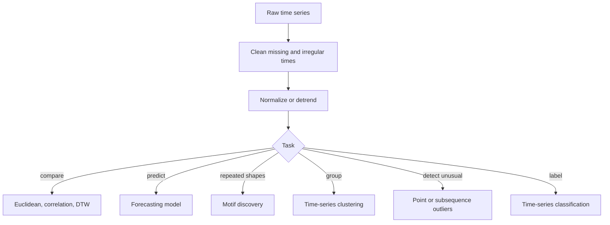

# Mining Time Series Data

Time series mining studies ordered numeric observations such as sensor readings, stock prices, demand curves, medical signals, click rates, and weather measurements. Aggarwal's time-series chapter covers preparation and similarity, forecasting, motifs, clustering, outlier detection, and classification. The key difference from ordinary vector data is that order matters: shifts, trends, seasonality, autocorrelation, and local shape all affect the analysis.

The major tasks share an ordered representation but ask different questions: forecasting extrapolates, motif search finds recurrence, classification assigns labels to whole series or windows, and anomaly detection measures departure from an expected temporal pattern.

## Order changes the data model

A **time series** is an ordered sequence

$$
X=(x_1,x_2,\dots,x_T),
$$

where $x_t$ is observed at time $t$.

A **subsequence** or **window** of length $w$ is

$$
X_{a:a+w-1}=(x_a,\dots,x_{a+w-1}).
$$

**Autocorrelation** measures correlation between a series and a lagged version of itself.

For a weakly stationary series with mean $\mu$, the lag-$k$ autocovariance is

$$
\gamma_k=\operatorname{E}[(x_t-\mu)(x_{t-k}-\mu)],
$$

and autocorrelation is $\rho_k=\gamma_k/\gamma_0$. Stationarity here means that the mean and covariance structure do not change with absolute time. A trend violates that condition and can create large autocorrelations even when deviations around the trend are weakly related.

**Normalization** for time series often means z-normalizing a sequence or window:

$$
z_t=\frac{x_t-\mu_X}{\sigma_X}.
$$

**Dynamic time warping (DTW)** compares two series by finding a minimum-cost monotone alignment path through their time indices.

**Forecasting** predicts future values $x_{T+1},x_{T+2},\dots$ from past observations.

A **motif** is a repeated subsequence pattern in a time series or across many series.

A **time-series outlier** may be a point anomaly, subsequence anomaly, contextual anomaly, or entire anomalous series.

## Level, scale, trend, and seasonality

**Time-series preparation must separate level, scale, and shape.** Two users may show the same daily pattern at different absolute activity levels. Z-normalizing windows can reveal shape similarity, but it removes magnitude information that may be important.

Differencing removes a local level or trend component:

$$
\nabla x_t=x_t-x_{t-1}.
$$

Seasonal differencing at period $s$ uses $x_t-x_{t-s}$. Differencing a random walk turns it into its increments, but unnecessary differencing amplifies measurement noise and removes low-frequency information. Decomposition into trend, seasonal, and residual components is descriptive unless it is fitted causally; centered smoothers use future observations near each time point.

Irregular sampling also changes interpretation. The difference between consecutive observations is not a fixed-lag change if one pair is a minute apart and another a day apart. Resampling introduces interpolation assumptions. Models that accept actual time gaps can avoid pretending that imputed grid values were measured.

## Similarity under timing variation

**DTW handles local speed variation.** If one series performs the same rise-and-fall pattern more slowly, Euclidean distance aligns time index to time index and may overstate dissimilarity. DTW can align one point with multiple points.

The basic dynamic program costs $O(mn)$ time and memory for lengths $m,n$. A Sakoe--Chiba band restricts alignments to $\vert i-j\vert \leq r$, reducing work and preventing implausible long warps. Slope constraints limit how many consecutive horizontal or vertical moves are allowed. The local cost, boundary conditions, path normalization, and window are all part of the distance definition.

DTW is invariant to some timing changes, not automatically to vertical offset or scale. Z-normalizing before DTW compares shape; using raw values retains magnitude. Derivative DTW compares local changes and can reduce sensitivity to baseline shifts, while becoming more sensitive to noise.

## Forecasts are conditional expectations or quantiles

**Forecasting depends on temporal dependence.** Moving averages use recent history; autoregressive models use lagged values; exponential smoothing discounts older observations; more complex models handle trend and seasonality.

Simple exponential smoothing updates a level estimate by

$$
\ell_t=\alpha x_t+(1-\alpha)\ell_{t-1},
\qquad 0<\alpha\leq1,
$$

and forecasts $\hat{x}_{t+h\mid t}=\ell_t$ for all $h\gt 0$. Expanding the recursion shows geometrically decaying weights on past observations. Large $\alpha$ reacts quickly and produces a noisy level; small $\alpha$ is stable and lags changes. Trend and seasonal extensions maintain additional state.

Point forecasts omit uncertainty. Under squared-error loss, the optimal point is a conditional mean; under absolute-error loss, it is a conditional median. Prediction intervals should be evaluated for empirical coverage and width. A narrow interval that misses often is not preferable to a calibrated wider one.

Multi-step evaluation must specify whether forecasts are produced recursively or directly. A recursive model feeds its own prediction back as a lag, so errors can accumulate with horizon. Direct models fit a separate target for each horizon and use more parameters. Reporting only an average across horizons can hide a model that is accurate tomorrow and poor next week.

Rolling-origin backtesting mimics repeated deployment. Choose an initial training interval, forecast the next block, advance the origin, and repeat. An expanding window keeps all past observations; a rolling window drops old history. Hyperparameters must be selected using inner historical folds or an earlier validation period, leaving the final time block untouched. Comparing models on identical origins matters because some periods are intrinsically harder. Aggregate errors should be accompanied by errors by horizon, season, and regime so a few calm periods do not hide failure during peaks.

Revisions create another temporal trap. Economic and operational series may be corrected after their first release. A backtest built from today's revised history can use values that were unavailable to the forecaster at the time. Vintage data, when available, support a true real-time evaluation.

Forecast evaluation must compare with temporal baselines. The last observed value is a strong baseline for persistent series; the value from the same season is strong for periodic series. Mean absolute error stays in original units, RMSE penalizes large misses more, and percentage errors break near zero.

## Motifs, discords, and overlapping windows

**Motif discovery often uses subsequence search.** A repeated shape can indicate a normal cycle, a repeated fault, or a behavioral signature. Efficient motif discovery avoids comparing every pair of windows naively when possible.

**Time-series clustering has several meanings.** One can cluster whole series, subsequences, or time points. The distance measure and normalization define the result.

**Streaming time series need online summaries.** Long or continuous series may require incremental statistics, sketches, or windows rather than storing all observations.

**The unit of analysis must be explicit.** A time-series project may classify whole series, forecast the next value of one series, cluster short windows, detect single-point spikes, or find unusual subsequences. These are different tasks with different train-test splits and leakage risks. For example, randomly splitting overlapping windows from the same long series can put nearly identical windows in both train and test sets, making performance look much better than it will be on future data.

**Seasonality and trend can masquerade as patterns.** A repeated daily cycle may dominate Euclidean similarity; an upward trend may make old normal values look anomalous; a weekly seasonal drop may look like a fault if the model ignores calendar context. Detrending, seasonal adjustment, contextual features, and time-aware validation are often required before applying generic clustering, classification, or outlier methods.

**Forecasting and anomaly detection interact.** One common anomaly score is the forecast residual: observed value minus predicted value. This means the anomaly detector inherits the strengths and weaknesses of the forecasting model. A poor model can create false alarms, while an overly flexible model can explain away real anomalies. Residual-based detection should therefore validate both forecast accuracy and alert quality.

**Motif discovery should handle trivial matches.** Overlapping windows from almost the same location in a series are naturally similar and can dominate the nearest-neighbor list. Many motif algorithms exclude trivial matches within a small temporal neighborhood so the discovered motifs represent repeated behavior rather than the same event shifted by one time step.

**Time-series features should be computed causally for prediction.** A centered moving average, future-normalized window, or decomposition fitted on the whole series may use information from the future. That is acceptable for retrospective description but invalid for forecasting or online classification. For deployed prediction, every feature at time $t$ must use only information available at or before time $t$.

**Multiple related series add hierarchy.** Retail demand may be measured by item, store, and region; sensors may be grouped by machine and factory. Mining each series independently ignores shared structure, while pooling all series can hide local behavior. Hierarchical or grouped evaluation helps decide whether patterns generalize across related series.

**Missing timestamps are not ordinary missing values.** A missing sensor reading may mean no measurement, device failure, communication delay, or zero activity depending on the system. Imputation should preserve that distinction when possible, often with explicit missingness indicators or gap-length features.

A matrix profile stores, for every subsequence start, the distance to its nearest nontrivial match. Low values identify motifs; high values identify discords, or unusual subsequences. It turns repeated nearest-neighbor searches into a reusable summary. Window length remains a scientific choice: a length that captures one heartbeat will not capture a daily cycle.

Overlapping windows cause dependence. A spike appears in many adjacent windows, so reporting each as a separate anomaly floods an alert queue. Grouping overlapping high-score windows into one episode gives a more faithful event count.

## A task map



```text
Euclidean alignment:       DTW alignment:

X: x1  x2  x3  x4          X: x1  x2      x3  x4
   |   |   |   |              |   | \     |   |
Y: y1  y2  y3  y4          Y: y1  y2  y3  y4  y5

Euclidean forces same index. DTW allows local stretching.
```

## Worked example 1: Z-normalized window comparison

**Problem.** Compare two windows:

$$
X=(2,4,6),\quad Y=(10,20,30).
$$

Compute Euclidean distance before and after z-normalization.

**Method.**

1. Raw Euclidean distance:

$$
\sqrt{(2-10)^2+(4-20)^2+(6-30)^2}
=\sqrt{64+256+576}
=\sqrt{896}=29.933.
$$

2. Normalize $X$. Mean is $4$. Population standard deviation is

$$
\sqrt{\frac{(2-4)^2+(4-4)^2+(6-4)^2}{3}}
=\sqrt{8/3}=1.633.
$$

   Therefore $X'=(-1.225,0,1.225)$.

3. Normalize $Y$. Mean is 20. Population standard deviation is

$$
\sqrt{\frac{100+0+100}{3}}=8.165.
$$

   Therefore $Y'=(-1.225,0,1.225)$.

4. Normalized Euclidean distance:

$$
\sqrt{0^2+0^2+0^2}=0.
$$

**Checked answer.** The raw distance is large, but the normalized shape distance is zero. The two windows have the same linear shape at different scales.

## Worked example 2: One-step moving average forecast

**Problem.** Given demand values

$$
20,\ 22,\ 21,\ 25,\ 27,
$$

forecast the next value using a 3-point moving average.

**Method.**

1. A 3-point moving average forecast uses the last three observations.
2. The last three values are 21, 25, and 27.
3. Average:

$$
\hat{x}_{6}=\frac{21+25+27}{3}=\frac{73}{3}=24.333.
$$

4. If the actual next value later turns out to be 26, absolute error is

$$
|26-24.333|=1.667.
$$

**Checked answer.** The forecast is approximately 24.33. This simple method smooths noise but lags behind upward trends.

## Worked example 3: exponential smoothing updates

**Problem.** Smooth observations $10,14,13$ with $\alpha=0.25$ and initial level $\ell_1=x_1=10$. Forecast the fourth observation.

**Method.** Update after observing $x_2=14$:

$$
\ell_2=0.25(14)+0.75(10)=3.5+7.5=11.
$$

After $x_3=13$:

$$
\ell_3=0.25(13)+0.75(11)=3.25+8.25=11.5.
$$

The one-step-ahead forecast is the current level:

$$
\hat{x}_{4\mid3}=11.5.
$$

Expanding the weights verifies the same value:

$$
\ell_3=0.25(13)+0.25(0.75)(14)+(0.75)^2(10)
=3.25+2.625+5.625=11.5.
$$

**Checked answer.** The forecast is 11.5. The initial value still carries weight $(0.75)^2=0.5625$ after two updates, which explains why the estimate trails the recent values.

## Implementing DTW and causal summaries

Pseudocode for DTW distance:

```text
INPUT: series X of length m, series Y of length n
OUTPUT: DTW distance

create matrix D with infinity
D[0,0] = 0
for i from 1 to m:
    for j from 1 to n:
        cost = abs(X[i] - Y[j])
        D[i,j] = cost + min(D[i-1,j], D[i,j-1], D[i-1,j-1])
return D[m,n]
```

```python
import numpy as np
from sklearn.cluster import KMeans

def dtw_distance(x, y):
    x = np.asarray(x, dtype=float)
    y = np.asarray(y, dtype=float)
    d = np.full((len(x) + 1, len(y) + 1), np.inf)
    d[0, 0] = 0.0
    for i in range(1, len(x) + 1):
        for j in range(1, len(y) + 1):
            cost = abs(x[i - 1] - y[j - 1])
            d[i, j] = cost + min(d[i - 1, j], d[i, j - 1], d[i - 1, j - 1])
    return d[-1, -1]

series = np.array([20, 22, 21, 25, 27], dtype=float)
forecast = series[-3:].mean()
print("moving average forecast:", forecast)
print("dtw:", dtw_distance([1, 2, 3], [1, 1, 2, 3]))

windows = np.array([[2, 4, 6], [10, 20, 30], [6, 4, 2]], dtype=float)
windows_z = (windows - windows.mean(axis=1, keepdims=True)) / windows.std(axis=1, keepdims=True)
print(KMeans(n_clusters=2, n_init=10, random_state=0).fit_predict(windows_z))
```

The DTW routine stores the full dynamic-programming matrix, although only the final distance is returned. Two rolling rows reduce memory to $O(n)$. Recovering an alignment path requires backpointers or recomputation. Production comparisons also need a warping band and a rule for missing samples; the unconstrained educational function will align through any finite detour.

## Failure modes

- Comparing raw series with different scales when shape is the real object of interest.
- Normalizing away magnitude when magnitude is the anomaly or target.
- Using Euclidean distance when patterns are phase-shifted or stretched.
- Letting DTW warp too freely without a window constraint.
- Mixing irregularly sampled series without resampling or time-aware models.
- Evaluating forecasts only in-sample rather than on future holdout periods.
- Treating overlapping subsequences as independent examples in validation.
- Choosing a forecast model by test-period error and then presenting that same period as untouched evaluation.
- Using a symmetric smoothing filter to create features for an online alert, thereby including future samples.
- Interpreting a repeated motif as independent repetitions when adjacent matches heavily overlap.

<div className="see-also">

See also: [Similarity and Distances](/cs/data-mining/chapter-03-similarity-distances) · [Mining Data Streams and Big Data](/cs/data-mining/chapter-12-mining-data-streams) · [Outlier Analysis](/cs/data-mining/chapter-08-outlier-analysis) · [Mining Discrete Sequences](/cs/data-mining/chapter-15-mining-discrete-sequences) · [Mining Spatial and Trajectory Data](/cs/data-mining/chapter-16-mining-spatial-data)

</div>
