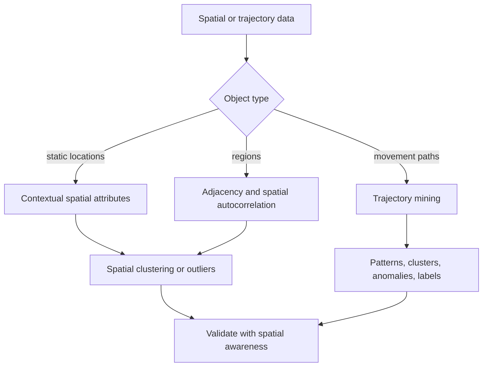

# Mining Spatial and Trajectory Data

Spatial data mining studies objects with location, geometry, distance, neighborhood, and regional context. Aggarwal's spatial chapter covers mining with contextual spatial attributes and trajectory mining. Spatial data sits between multidimensional mining and graph/time-series mining: a point has numeric coordinates, but its meaning often depends on nearby objects, regions, paths, and movement through space.

Static spatial analysis uses location and neighborhood context; trajectory analysis adds order, direction, duration, and movement constraints. Both require a declared coordinate system and a defensible notion of proximity before a mining algorithm is chosen.

## Geometry, attributes, and neighborhoods

A **spatial object** has geometric information such as a point, line, polygon, raster cell, or region.

A **spatial attribute** is a feature tied to location. Examples include population density, elevation, pollution, store revenue, and temperature.

**Spatial autocorrelation** means nearby locations tend to have related values. Positive autocorrelation occurs when nearby values are similar; negative autocorrelation occurs when nearby values differ systematically.

A **neighborhood relation** defines which objects influence each other. It may use distance radius, $k$ nearest neighbors, adjacency of regions, or road-network distance.

A **trajectory** is an ordered sequence of spatial positions:

$$
T=((x_1,y_1,t_1),\dots,(x_m,y_m,t_m)).
$$

**Trajectory mining** analyzes movement paths for patterns, clusters, outliers, or labels.

**Map matching** aligns raw location observations to a road network or other spatial network.

**Trajectory similarity** may use pointwise distance, longest common subsequence, edit-distance variants, dynamic time warping, or route-overlap measures.

The spatial weights matrix $W=(w_{ij})$ makes neighborhood assumptions explicit. Binary contiguity uses $w_{ij}=1$ for adjacent regions. Distance weights may decay with separation, and $k$-nearest-neighbor weights give every object the same nominal neighbor count. Row standardization divides each row by its sum, changing both interpretation and the influence of areas with many neighbors.

Neighborhood construction can be asymmetric: $j$ may be among $i$'s $k$ nearest neighbors while $i$ is not among $j$'s. Some statistics and graph algorithms expect symmetry, so mutual or union-based symmetrization must be chosen deliberately.

## Spatial context and local dependence

**Spatial context changes feature meaning.** A high crime count may be expected in a dense downtown region and unusual in a small residential region. Spatial mining often needs contextual normalization.

**Nearby observations are not independent.** Standard validation assumptions can fail when train and test sets contain neighboring locations. Spatial cross-validation should separate regions when testing generalization to new areas.

Moran's $I$ is a common global autocorrelation statistic. For $n$ observations, deviations $z_i=x_i-\bar{x}$, and $S_0=\sum_i\sum_jw_{ij}$,

$$
I=\frac{n}{S_0}
\frac{\sum_i\sum_j w_{ij}z_i z_j}
{\sum_i z_i^2}.
$$

Positive values indicate that linked locations tend to have deviations with the same sign; negative values indicate neighboring contrasts. The expected value under one common randomization null is $-1/(n-1)$, not exactly zero. Significance depends on the null model and weights, often assessed with permutations.

Global autocorrelation can coexist with local exceptions. Local indicators compare each location with its neighborhood and can identify high-high regions, low-low regions, and spatial outliers such as a high value surrounded by low values. Testing many locations again raises a multiple-comparison problem.

Aggregation boundaries can change a spatial conclusion. Counts summarized by census tract may show a different correlation or cluster pattern from the same events summarized by grid cell or district. This is the modifiable areal unit problem: both the scale and the placement of boundaries affect statistics. Polygon-level averages also hide within-region variation. Repeating an analysis across reasonable partitions, using point-level models when possible, and reporting population or exposure denominators helps separate stable structure from an artifact of zoning.

Area-level relationships need not describe individuals. A district with high income and high transit use does not imply that its high-income residents are the transit users. Drawing individual conclusions from aggregate spatial associations is an ecological fallacy. The available unit of observation limits the claim.

**Spatial outliers are often local.** A location may be globally ordinary but locally anomalous relative to its neighbors. A temperature of 30 degrees may be normal in summer overall but unusual if surrounding sensors report 20.

**Trajectory mining combines order and geometry.** A trajectory cannot be reduced to an unordered coordinate set when direction, speed, stops, turns, or time gaps carry meaning.

## Distances, coordinate systems, and path geometry

**Trajectory simplification can reduce noise.** GPS traces may contain many redundant points. Simplification keeps shape-defining points, reducing cost before clustering or classification.

**Road-network distance may matter more than Euclidean distance.** Two points separated by a river, wall, or road network may be close geometrically but far in travel time.

Latitude and longitude are angular coordinates. For nearby points and modest regions, a suitable projected coordinate reference system turns them into planar units for Euclidean calculation. For points on a sphere, the haversine central angle is

$$
a=\sin^2\left(\frac{\Delta\phi}{2}\right)
+\cos\phi_1\cos\phi_2
\sin^2\left(\frac{\Delta\lambda}{2}\right),
$$

$$
c=2\operatorname{atan2}(\sqrt{a},\sqrt{1-a}),
\qquad d=Rc,
$$

where latitudes $\phi$ and longitudes $\lambda$ are in radians and $R$ is an Earth-radius approximation. Ellipsoidal geodesics are preferable when accuracy over large distances matters.

Polygon area is particularly projection-sensitive. A map projection suitable for visual navigation may distort area badly. Analyses of density need an equal-area projection or geodesic area calculation, while local distance analysis usually uses a projection designed for the study region.

## From raw geography to mining records

**Spatial scale controls what counts as local.** A neighborhood radius of 100 meters might detect building-level anomalies, while 10 kilometers might detect city-level regions. The same point can be normal at one scale and unusual at another. Multi-scale analysis is common in spatial mining because geographic processes such as traffic, disease, weather, and retail demand operate at different resolutions.

**Trajectory data usually need event extraction.** Raw GPS points are often too noisy and dense for direct mining. Analysts may extract stops, moves, road segments, turns, speeds, and dwell times before clustering or classification. This converts a numeric path into a richer sequence of movement events, but it also introduces parameters such as stop-duration thresholds and map-matching confidence.

**Spatial joins are often the expensive step.** Many spatial mining tasks start by connecting points to regions, sensors to nearby sensors, trips to roads, or events to neighborhoods. Indexes such as grids, R-trees, and geohashes are therefore not just database details; they determine whether the mining workflow can run at the required scale.

**Boundary effects require care.** A point near the edge of the study region has fewer observed neighbors, not necessarily fewer real neighbors. Local density and local outlier scores can be biased at borders unless the analysis accounts for the observation window.

**Coordinate reference systems matter.** Distances, areas, and angles depend on projection. A method that is correct for planar coordinates can be wrong on latitude-longitude pairs if the study region is large. Spatial mining should record the coordinate system, projection, and distance function before interpreting numeric distances.

**Privacy is often spatial too.** Trajectories and home-work patterns can identify people even after names are removed. Aggregation, spatial masking, and minimum-count rules may be needed before publishing maps or mined mobility patterns.

**Visualization is useful but can mislead.** Map projections, marker sizes, overplotting, and color scales can create apparent clusters or hide sparse anomalies. Spatial mining should pair maps with quantitative checks.

**Temporal context often matters for spatial data.** A location pattern during rush hour, a storm, or a holiday may be normal only within that temporal context. Spatial and time-series preparation frequently need to be combined.

Map matching is an inference problem because the nearest road segment is not always the driven road. GPS error, parallel roads, tunnels, and sparse samples create ambiguity. A common hidden-state formulation scores candidate road positions by observation likelihood and transitions between candidates by route plausibility. The most likely path can differ from the sequence of nearest segments.

Trajectory distance depends on the question. Discrete Frechet distance preserves traversal order and is often described through a person-and-dog leash analogy. DTW aligns sampled positions or derived features while allowing timing differences. Longest-common-subsequence variants tolerate unmatched points within a spatial threshold. Route overlap on a road network emphasizes shared segments and may ignore timing entirely.

Simplification algorithms such as Douglas--Peucker recursively keep the point with largest perpendicular distance from the segment joining interval endpoints. A spatial tolerance bounds geometric deviation in the chosen coordinate units. It does not preserve speed profiles or stop duration unless time is included separately.

## Static and moving-object tasks



```text
Trajectory example

t1       t2       t3       t4
* ------ * ------ * -----> *
 \                         road B
  \ 
   * ------ *              road A

The same points may be close in Euclidean space but different as routes.
```

| Task | Static spatial version | Trajectory version |
|---|---|---|
| Similarity | Distance or neighbor context | Route, shape, timing similarity |
| Clustering | Group nearby similar locations | Group similar movement paths |
| Outlier detection | Local deviation from neighbors | Unusual route, stop, speed, or segment |
| Classification | Predict region label | Predict trip purpose or object type |
| Pattern mining | Co-located events | Frequent routes or movement motifs |

## Worked example 1: Local spatial outlier score

**Problem.** Four sensors report temperature:

| sensor | location | value |
|---|---|---:|
| A | center | 20 |
| B | near A | 21 |
| C | near A | 19 |
| D | near A | 35 |

Use the difference between a sensor value and the mean of its three neighbors as a local outlier score. Compute the score for D and A.

**Method.**

1. For D, neighbors are A, B, and C with values 20, 21, and 19.
2. Neighbor mean:

$$
\bar{x}_{N(D)}=\frac{20+21+19}{3}=20.
$$

3. D's absolute local deviation:

$$
|35-20|=15.
$$

4. For A, neighbors are B, C, and D with values 21, 19, and 35.
5. Neighbor mean:

$$
\bar{x}_{N(A)}=\frac{21+19+35}{3}=25.
$$

6. A's absolute local deviation:

$$
|20-25|=5.
$$

**Checked answer.** D has a larger local anomaly score, 15 versus 5. The result also shows a pitfall: if an outlier is included as a neighbor, it can distort other local scores.

## Worked example 2: Trajectory simplification by perpendicular distance

**Problem.** A trajectory has points

$$
P_1=(0,0),\quad P_2=(1,0.1),\quad P_3=(2,0),\quad P_4=(3,3).
$$

If we approximate the first three points by line segment $P_1P_3$, should $P_2$ be kept when tolerance is 0.2?

**Method.**

1. Segment $P_1P_3$ lies on the x-axis from $(0,0)$ to $(2,0)$.
2. The perpendicular distance from $P_2=(1,0.1)$ to the x-axis is $0.1$.
3. Compare with tolerance:

$$
0.1 \le 0.2.
$$

4. Therefore $P_2$ can be removed without exceeding the tolerance for this segment.
5. Point $P_4=(3,3)$ cannot be represented by the same segment without a much larger deviation, so it should be kept as a shape-changing point.

**Checked answer.** Remove $P_2$ under tolerance 0.2; keep $P_1$, $P_3$, and $P_4$ for the simplified trajectory.

## Worked example 3: Moran's numerator on a line

**Problem.** Three regions lie in a line, with values $(1,2,3)$. Neighbors are $1\leftrightarrow2\leftrightarrow3$, weights are symmetric and binary, and the diagonal is zero. Compute Moran's $I$.

**Method.** The mean is 2, so deviations are $z=(-1,0,1)$. There are four directed nonzero weights: $w_{12},w_{21},w_{23},w_{32}$, hence $S_0=4$.

Every weighted cross-product includes the center deviation zero:

$$
\sum_i\sum_jw_{ij}z_i z_j
=(-1)(0)+(0)(-1)+(0)(1)+(1)(0)=0.
$$

The denominator is

$$
\sum_i z_i^2=1+0+1=2.
$$

Therefore

$$
I=\frac{3}{4}\frac{0}{2}=0.
$$

**Checked answer.** Moran's $I$ is zero for this particular weights matrix. The monotonically increasing values might look spatially structured, but the middle observation equals the mean, so adjacent deviation products vanish. With only three regions, a significance claim would be especially weak.

## Computing local context

Pseudocode for local spatial outlier detection:

```text
INPUT: spatial points with values, neighbor rule N
OUTPUT: local outlier scores

for each point i:
    neighbors = N(i)
    expected = average value among neighbors
    score[i] = abs(value[i] - expected)
rank points by descending score
return scores
```

```python
import numpy as np
from sklearn.cluster import DBSCAN
from sklearn.neighbors import NearestNeighbors

coords = np.array([[0, 0], [0, 1], [1, 0], [10, 10]], dtype=float)
values = np.array([20, 21, 19, 35], dtype=float)

nn = NearestNeighbors(n_neighbors=3).fit(coords)
dist, ind = nn.kneighbors(coords)
scores = []
for i, neighbors in enumerate(ind):
    # first neighbor is the point itself; skip it
    neigh = [j for j in neighbors if j != i]
    expected = values[neigh].mean()
    scores.append(abs(values[i] - expected))
print("local scores:", np.round(scores, 3))

trajectory_points = np.array([[0, 0], [1, 0.1], [2, 0], [3, 3]], dtype=float)
route_clusters = DBSCAN(eps=1.5, min_samples=2).fit_predict(trajectory_points)
print("point-level spatial clusters:", route_clusters)
```

The neighbor query requests three returned points, including the query itself, so each expectation averages only two other sensors in this code. That differs from the four-sensor prose example, where every sensor uses all three others. Neighborhood definitions must match when scores are compared. The DBSCAN call clusters sampled points, not whole trajectories; route clustering would first require a trajectory-level distance or representation.

## Failure modes

- Treating latitude and longitude as ordinary Euclidean coordinates over large areas.
- Ignoring road-network or barrier effects when travel distance matters.
- Randomly splitting nearby spatial points into train and test sets, causing optimistic evaluation.
- Removing "noisy" GPS points that are actually meaningful stops or turns.
- Comparing trajectories only by start and end points.
- Forgetting that local spatial outliers can be hidden by global statistics.
- Using a single spatial scale when patterns exist at multiple scales.
- Computing distances in degrees and reporting them as if they were meters.
- Choosing spatial folds after viewing outcomes, which can tune the evaluation geography to the desired result.
- Publishing fine-grained trajectories after removing names and assuming location sequences are anonymous.

<div className="see-also">

See also: [Mining Time Series Data](/cs/data-mining/chapter-14-mining-time-series-data) · [Mining Discrete Sequences](/cs/data-mining/chapter-15-mining-discrete-sequences) · [Similarity and Distances](/cs/data-mining/chapter-03-similarity-distances) · [Cluster Analysis](/cs/data-mining/chapter-06-cluster-analysis) · [Outlier Analysis](/cs/data-mining/chapter-08-outlier-analysis)

</div>
