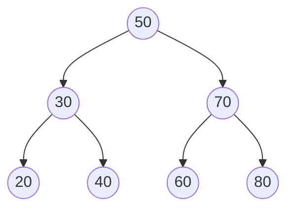

# Binary Search Trees

A binary search tree stores ordered keys in a shape determined by comparisons. At a node with key $k$, every key in the left subtree is less than $k$ and every key in the right subtree is greater than $k$. The rule applies to whole subtrees, not only to the two children.

Search follows one root-to-leaf path. That sounds logarithmic because each comparison chooses one of two directions, but the shape decides how much is actually discarded. A balanced tree has logarithmic height. A chain has linear height and discards only one node per comparison. An ordinary BST maintains order but does nothing to prevent the chain.

## The ordering invariant

For distinct keys, a node $u$ defines bounds for all of its descendants:

$$
x\in u.\mathrm{left}\Rightarrow x.\mathrm{key}<u.\mathrm{key},
\qquad
x\in u.\mathrm{right}\Rightarrow x.\mathrm{key}>u.\mathrm{key}.
$$

Each ancestor adds another bound. If a search for `45` moves left from `50` and then right from `30`, the remaining subtree can contain only keys between `30` and `50`. Checking only that every left child is smaller and every right child is larger is insufficient to validate a BST. The invalid tree below passes that local test at each displayed parent even though `55` lies in the left subtree of `50`:

```text
       50
      /
    30
      \
       55
```

A correct validator carries a lower and upper bound down the recursion. The bounds also expose a subtle implementation issue: using `key - 1` to make an exclusive integer bound can overflow at the minimum value. Passing bounds as keys with explicit inclusivity, or comparing against ancestor nodes, avoids arithmetic at the limits.

Duplicates require a declared policy. Common choices are:

- reject an equal key, giving set semantics;
- keep one node and increment a count;
- store a collection of values under one key, giving multimap semantics;
- choose a consistent side for equality.

The last policy is easy to state but can create a long equal-key chain and complicates validation. Keeping a count or value collection usually preserves the structural meaning of one node per distinct key.

### Validating the whole tree

Validation can run in $O(n)$ time by passing the legal interval to each recursive call. The root begins with no lower or upper bound. Going left replaces the upper bound with the current key; going right replaces the lower bound. Every node must satisfy both bounds inherited from all ancestors.

For the invalid tree shown earlier, `55` is reached by going left from `50`, so its inherited upper bound is `50`. The comparison with its immediate parent `30` succeeds, but `55 < 50` fails. The bound method catches the violation at the node where it becomes observable.

Another valid test performs an inorder traversal and checks that keys are strictly increasing under set semantics. It needs only the previously visited key, but the duplicate policy changes the comparison: a count-per-node tree remains strictly increasing, while a tree that stores equal keys as separate nodes may permit equality in selected positions. The bounds method states that policy more directly.

Validation should also consider representation integrity when pointers are mutable. A cycle or a child shared by two parents is not a tree at all; naive recursion may loop forever or visit and free a node twice. Detecting such corruption requires tracking node addresses in addition to checking key order. A module that keeps node links private prevents ordinary callers from creating those shapes.

## Search cost is tree height

Search compares at most one key per level:

```text
search(node, key):
    while node exists:
        if key equals node.key: return node
        if key is smaller:      node = node.left
        otherwise:              node = node.right
    return not found
```

If the tree height is $h$, search is $O(h)$. With height measured in edges, a one-node tree has $h=0$ and a failed search may inspect $h+1$ nodes. The asymptotic statement ignores that harmless offset.

A binary tree of height $h$ contains at most

$$
1+2+\cdots+2^h=2^{h+1}-1
$$

nodes. Rearranging gives a lower bound of roughly $\log_2 n$ on the height needed to hold $n$ nodes. A well-balanced search tree approaches that bound. The upper bound is $n-1$, attained by a chain.

The insertion order controls an unbalanced BST's shape. Inserting `1, 2, 3, 4, 5` produces only right children. Searching for `5` then takes five comparisons. Inserting the same keys as `3, 1, 5, 2, 4` gives height two. The set of keys is identical; only arrival order differs.

| Operation | Time in height $h$ | Balanced tree | Chain |
|---|---:|---:|---:|
| search | $O(h)$ | $O(\log n)$ | $O(n)$ |
| insert | $O(h)$ | $O(\log n)$ | $O(n)$ |
| delete | $O(h)$ | $O(\log n)$ | $O(n)$ |
| minimum or maximum | $O(h)$ | $O(\log n)$ | $O(n)$ |
| full traversal | $O(n)$ | $O(n)$ | $O(n)$ |

Insertion first performs an unsuccessful search, then attaches a new leaf at the missing link where that search ended. It never moves existing nodes, so the invariant follows directly from the comparison path. The new key has satisfied every ancestor bound on its way down.

### Worked example: building and searching

Insert `50, 30, 70, 20, 40, 60, 80` into an empty tree.

1. `50` becomes the root.
2. `30 < 50`, so `30` becomes the left child of `50`.
3. `70 > 50`, so `70` becomes the right child.
4. For `20`, move left at `50`, then left at `30`; insert below `30`.
5. For `40`, move left at `50`, then right at `30`; insert there.
6. For `60`, move right at `50`, then left at `70`.
7. For `80`, move right at `50`, then right at `70`.



Now search for `40`. Compare with `50`: smaller, so go left. Compare with `30`: larger, so go right. The next node equals `40`, so the search succeeds after three comparisons. Searching for `45` follows `50` left, `30` right, `40` right, then reaches a null link. That null link is also exactly where `45` would be inserted.

An inorder traversal returns `20, 30, 40, 50, 60, 70, 80`. More generally, inorder traversal of a BST is sorted. Induct on the subtree size: the left traversal is sorted and below the root, then the root is visited, then the right traversal is sorted and above the root. Concatenating those parts preserves order.

## Successors, predecessors, and ordered queries

The minimum node is reached by following left links until none remains. The maximum follows right links. For a node with a right subtree, its successor is the minimum of that right subtree. That node is greater than the original key, and no smaller greater key can exist: any such key would have to lie farther left in the same right subtree.

If a node has no right subtree and parent pointers are available, its successor is the first ancestor for which the node lies in the ancestor's left subtree. Without parent pointers, a search from the root can remember the lowest greater ancestor.

Ordered traversal supports queries that a hash table does not naturally answer. To report keys in the interval $[a,b]$, recursively visit the left subtree only when the current key may have larger qualifying predecessors, emit the current key if it is inside the interval, and visit the right subtree only when qualifying successors may exist. The cost is $O(h+k)$ for $k$ reported keys when pruning is effective.

### Worked example: a range query

Use the tree above to report every key from `35` through `65`, inclusive.

1. At `50`, the key is inside the range. A qualifying smaller key may exist, so inspect the left subtree first.
2. At `30`, the key is below `35`. Its left subtree is even smaller and can be skipped. Move right to `40`.
3. `40` is inside the range. Its missing children add nothing. Emit `40`.
4. Return to `50` and emit `50`.
5. Inspect the right subtree at `70`. Since `70` exceeds `65`, its right subtree can be skipped. Move left to `60`.
6. `60` is inside the range, so emit it.

The result is `40, 50, 60`. Only five tree nodes were inspected; `20` and `80` were pruned by the ordering bounds.

Subtree metadata can support richer ordered queries. If every node stores its subtree size, the rank of a key and the $k$th smallest key can be found by comparing $k$ with the left-subtree size. Rotations or updates in a balanced implementation must then repair that size along with child pointers.

## Deletion is a replacement problem

Deletion first searches for the node. The structural work depends on its children.

For a leaf, replace the parent's link with null. For a node with one child, replace the parent's link with that child. Every key in the replacement subtree already satisfied the deleted node's ancestor bounds, so no further rearrangement is needed.

A node with two children cannot be replaced directly by either child without reattaching the other subtree. The usual method chooses the inorder successor—the smallest node in the right subtree—or the predecessor—the largest node in the left subtree. Copy or move the successor's payload into the target, then delete the successor from its old position. Because the successor is leftmost in its subtree, it has no left child. The second deletion therefore reduces to the zero-or-one-child case.

### Worked example: deleting the root

Delete `50` from the seven-node tree.

1. Search finds `50` at the root. It has two children.
2. Enter its right subtree at `70`.
3. Follow the left link to `60`. There is no further left child, so `60` is the successor.
4. Replace the root key `50` with `60`.
5. Delete the original `60` node. It is a leaf, so set the left link of `70` to null.

```text
before:                 after:
       50                     60
      /  \                   /  \
    30    70               30    70
   / \    / \             / \     \
 20  40  60  80          20  40    80
```

The resulting inorder sequence is `20, 30, 40, 60, 70, 80`. The target key is absent, each other key occurs once, and the successor separates the old left subtree from the remaining right subtree.

Copying a key is harmless for a set of integers. For records, the key and associated value must move together. If external code holds pointers to nodes, replacing a payload also changes which logical item that node represents. An implementation requiring stable node identity may splice the successor node into the target's position instead, which needs more pointer updates but preserves object identity.

Recursive insertion and deletion must return the new subtree root. The caller assigns that result to its child link, and the top-level caller assigns it to the tree root. Omitting the assignment loses changes when a null subtree gains a node or when the deleted node is replaced by a child.

## A compact set implementation in C

The implementation below uses distinct integer keys. Equal insertion is a no-op. Its recursive structure mirrors the invariant, while its worst-case call depth is the tree height.

```c
#include <stdio.h>
#include <stdlib.h>

typedef struct Node {
    int key;
    struct Node *left;
    struct Node *right;
} Node;

static Node *new_node(int key) {
    Node *n = malloc(sizeof(*n));
    if (n == NULL) {
        fprintf(stderr, "allocation failed\n");
        exit(EXIT_FAILURE);
    }
    n->key = key;
    n->left = NULL;
    n->right = NULL;
    return n;
}

static Node *insert(Node *root, int key) {
    if (root == NULL) return new_node(key);
    if (key < root->key) root->left = insert(root->left, key);
    if (key > root->key) root->right = insert(root->right, key);
    return root;
}

static const Node *search(const Node *root, int key) {
    while (root != NULL && root->key != key) {
        root = key < root->key ? root->left : root->right;
    }
    return root;
}

static Node *minimum(Node *root) {
    while (root->left != NULL) root = root->left;
    return root;
}

static Node *delete(Node *root, int key) {
    if (root == NULL) return NULL;

    if (key < root->key) {
        root->left = delete(root->left, key);
    } else if (key > root->key) {
        root->right = delete(root->right, key);
    } else if (root->left == NULL) {
        Node *replacement = root->right;
        free(root);
        return replacement;
    } else if (root->right == NULL) {
        Node *replacement = root->left;
        free(root);
        return replacement;
    } else {
        Node *successor = minimum(root->right);
        root->key = successor->key;
        root->right = delete(root->right, successor->key);
    }
    return root;
}

static void print_inorder(const Node *root) {
    if (root == NULL) return;
    print_inorder(root->left);
    printf("%d ", root->key);
    print_inorder(root->right);
}

static void destroy(Node *root) {
    if (root == NULL) return;
    destroy(root->left);
    destroy(root->right);
    free(root);
}

int main(void) {
    int keys[] = {50, 30, 70, 20, 40, 60, 80};
    Node *root = NULL;

    for (size_t i = 0; i < sizeof(keys) / sizeof(keys[0]); ++i) {
        root = insert(root, keys[i]);
    }
    printf("contains 40: %s\n", search(root, 40) ? "yes" : "no");
    root = delete(root, 50);
    print_inorder(root);
    printf("\n");
    destroy(root);
    return EXIT_SUCCESS;
}
```

The recursive cleanup is postorder because both child pointers must be used before their node is freed. On an adversarial chain, recursive search, update, and cleanup can exhaust the call stack. An iterative implementation removes that particular failure but does not repair the linear running time.

## When an ordinary BST is the wrong structure

AVL and red-black trees add rotations and balance metadata to bound height. They preserve the inorder sequence while changing shape. B-trees use wider nodes and are suited to storage systems where fetching a block dominates comparisons. Treaps randomize priorities to make bad height unlikely without depending on input order.

A sorted array also supports logarithmic search and usually has better locality, but middle insertion and deletion are linear. A hash table offers expected constant-time exact lookup, yet it does not keep keys ordered and cannot answer range queries by walking adjacent keys. The workload decides which trade is useful.

| Need | Often suitable |
|---|---|
| mostly reads, compact sorted data | sorted array |
| exact lookup, no order operations | hash table |
| ordered updates and range queries | balanced search tree |
| educational or input known to stay shallow | ordinary BST |

Common errors follow the structural cases. Claims of unconditional $O(\log n)$ ignore height. A duplicate policy left unspecified makes insertion, search, and deletion disagree. Deleting a two-child node without removing the successor leaves a duplicate. Freeing a node before saving its child pointer reads freed memory. Recursive updates that ignore the returned root silently detach modifications.

<div className="see-also">

See also: [Binary trees and traversals](/cs/data-structures/binary-trees) · [Searching algorithms](/cs/data-structures/searching-algorithms) · [Sorting algorithms](/cs/data-structures/sorting-algorithms) · [Heaps and priority queues](/cs/data-structures/heaps-priority-queues) · [Hashing](/cs/data-structures/hashing)

</div>
