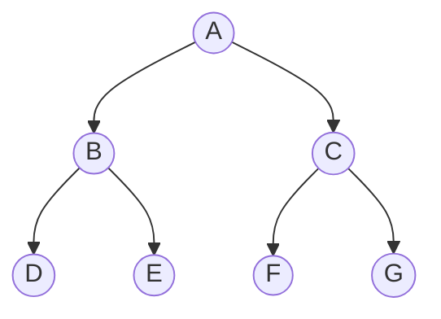

# Binary Trees and Traversals

A binary tree is either empty or consists of a root with a left binary tree and a right binary tree. That recursive definition is more useful than the picture of a branching diagram: it tells us how to represent a tree, how to write algorithms over it, and how to prove those algorithms correct.

Left and right are distinct positions. A root with only a left child and a root with only a right child have different shapes even if the stored values match. A binary tree imposes no ordering rule on those values. Heaps, binary search trees, syntax trees, and decision trees add separate invariants to the same basic shape.

## Shape and vocabulary

The **root** is the only node without a parent. A **leaf** has no children; an **internal node** has at least one. A node's **depth** is the number of edges from the root to it. Its **height** is the maximum number of edges on a downward path from that node to a leaf. Under this edge-count convention, a leaf has height zero and the empty tree is often assigned height $-1$.

Some books count nodes rather than edges, giving a leaf height of one and an empty tree height of zero. Either convention works, but formulas shift by one. Writing the base case beside the definition prevents most confusion.

Several shape terms are easy to mix up:

| Term | Condition |
|---|---|
| full | every node has either zero or two children |
| perfect | every internal node has two children and all leaves have the same depth |
| complete | every level except possibly the last is full, and the last is filled left to right |
| balanced | height is kept near logarithmic by some stated balance condition |
| degenerate | each internal node has only one child, forming a chain |

“Balanced” is not one universal shape rule. AVL trees constrain child-height differences; red-black trees constrain colored paths; a complete tree satisfies a stronger positional condition useful for heaps. A drawing that looks roughly symmetric is not a specification.

Every nonempty tree with $n$ nodes has $n-1$ edges. Each node except the root has exactly one incoming parent edge, so counting those nodes counts all edges. This identity depends on the structure being connected and acyclic. A general graph with $n-1$ edges need not be a tree unless the appropriate connectivity or acyclicity condition is also known.

At depth $d$, a binary tree has at most $2^d$ nodes. The root gives the base case $2^0=1$. If depth $d$ has at most $2^d$ nodes and each has at most two children, depth $d+1$ has at most $2^{d+1}$. Summing through height $h$ gives

$$
1+2+4+\cdots+2^h=2^{h+1}-1.
$$

A perfect tree reaches the bound. A complete tree with $n$ nodes has height $\lfloor\log_2 n\rfloor$ under the edge convention, while a degenerate $n$-node tree has height $n-1$.

There is another useful count for full binary trees. If $i$ is the number of internal nodes and $l$ the number of leaves, then $l=i+1$. Every internal node contributes two child edges, so the tree has $2i$ edges. It also has $i+l-1$ edges by the general tree identity. Equating them gives $2i=i+l-1$, hence $l=i+1$.

## Linked nodes and array positions

An arbitrary binary tree is naturally represented by a node with two links:

```c
typedef struct Node {
    int value;
    struct Node *left;
    struct Node *right;
} Node;
```

A missing child is a null pointer. The representation allocates space for two links in every node, but it does not reserve storage for absent descendants. Nodes can be inserted by changing a few links when the higher-level data structure permits it.

Complete or nearly complete trees fit compactly in an array. With zero-based indices, node $i$ has

$$
\begin{aligned}
\operatorname{left}(i) &= 2i+1, \\
\operatorname{right}(i) &= 2i+2, \\
\operatorname{parent}(i) &= \left\lfloor\frac{i-1}{2}\right\rfloor \quad (i>0).
\end{aligned}
$$

The formulas follow from level order. Before depth $d$, a perfect prefix contains $2^d-1$ nodes, and positions within the level occupy the next consecutive indices. No child pointers are needed; the index supplies the relationships.

For a sparse tree, the same scheme can waste enormous ranges. Following right children from index zero gives indices $2,6,14,30$, doubling the gap at each level. Four stored nodes would require an array reaching index `30`. Linked representation uses four nodes regardless of those conceptual empty positions.

### Worked example: parent and child indices

Store the level-order values `[50, 30, 70, 10, 40, 60, 80]` in a zero-based array. Find the relatives of the node at index `2`.

```text
index:  0   1   2   3   4   5   6
value: 50  30  70  10  40  60  80
```

The node at index `2` stores `70`. Its parent index is

$$
\left\lfloor\frac{2-1}{2}\right\rfloor=0,
$$

so the parent stores `50`. The left child index is

$$
2(2)+1=5,
$$

which stores `60`. The right child index is

$$
2(2)+2=6,
$$

which stores `80`. Both child indices are below the array length, so both children exist. For a candidate index at or beyond the logical length, the child is absent even though the arithmetic still produces a number.

## Traversal is a choice of when to visit the root

Depth-first traversals differ only in where the root operation appears relative to the two recursive calls:

- **preorder** visits root, then left subtree, then right subtree;
- **inorder** visits left subtree, then root, then right subtree;
- **postorder** visits left subtree, then right subtree, then root.

The names describe the root's position. Each subtree is traversed by the same rule. On an arbitrary binary tree, none of the three orders says that values are numerically sorted. Sorted inorder output is a consequence of the additional binary-search-tree invariant.

Level-order traversal is breadth-first rather than depth-first. It visits nodes by increasing depth, placing discovered children in a queue. Depth-first recursion uses the call stack implicitly. An iterative depth-first traversal uses an explicit stack and can expose or control the same pending work.



### Worked example: deriving all four orders

For the displayed tree, compute each traversal from its rule rather than reading across the drawing.

Preorder visits `A` first. Its left subtree contributes `B D E`: visit `B`, then leaf `D`, then leaf `E`. Its right subtree contributes `C F G`. Combining those parts gives

```text
preorder: A B D E C F G
```

Inorder handles the left subtree before `A`. At `B`, visit `D`, then `B`, then `E`, producing `D B E`. After `A`, the right subtree produces `F C G`:

```text
inorder: D B E A F C G
```

Postorder delays each root until both subtrees are complete. The left subtree produces `D E B`, the right produces `F G C`, and `A` comes last:

```text
postorder: D E B F G C A
```

For level order, begin a queue with `A`. Remove `A` and enqueue `B, C`; remove `B` and enqueue `D, E`; remove `C` and enqueue `F, G`. The leaves add nothing:

```text
level order: A B C D E F G
```

Each result contains all seven nodes exactly once. The root appears first in preorder and last in postorder; level order never visits a child before its parent.

## The recursive pattern and its proof

Many tree functions have the same skeleton:

```text
solve(tree):
    if tree is empty: return base value
    left_result  = solve(tree.left)
    right_result = solve(tree.right)
    return combine(tree.value, left_result, right_result)
```

For size, the base value is zero and combination adds one. For height under the edge convention, the empty base is $-1$ and combination adds one to the larger child height:

$$
\begin{aligned}
\operatorname{size}(T) &= 1+\operatorname{size}(T_L)+\operatorname{size}(T_R), \\
\operatorname{height}(T) &= 1+\max(\operatorname{height}(T_L),\operatorname{height}(T_R)).
\end{aligned}
$$

Structural induction follows the same form. Prove the empty-tree base case. Assume the function is correct for the left and right subtrees. Then show that the combination step produces the correct answer for the root tree. The recursive data definition supplies both the algorithm and the proof decomposition.

Time complexity is usually $O(n)$ when each node performs constant local work. Auxiliary stack space is $O(h)$, where $h$ is height. A balanced tree uses $O(\log n)$ stack frames; a chain uses $O(n)$ and may overflow the program stack. Rewriting recursion as an explicit stack avoids dependence on call-stack capacity, but the explicit stack can still hold $O(h)$ node pointers.

## Traversal state without recursion

An iterative preorder traversal starts by pushing the root. Each step pops a node, visits it, then pushes its right child followed by its left child. The stack is last-in, first-out, so pushing right first causes left to be processed first. If the push order is reversed, the traversal remains a valid root-first walk but visits right subtrees before left ones.

Iterative inorder has to remember ancestors whose left subtrees are still being explored. Repeatedly push the current node and move left. When there is no left child, pop an ancestor, visit it, then move to its right child. Each node is pushed and popped once, giving $O(n)$ time. The stack contents represent the path back to the next unfinished ancestor.

Postorder needs enough state to distinguish “returning from the left child” from “returning from the right child.” One method stores a visited flag with each stack entry. Another remembers the previously processed node and inspects whether the right subtree has already completed. Two-stack algorithms are easier to derive but use more storage and effectively reverse a root-right-left order.

Level order uses a queue. After removing a node, enqueue its existing left and right children. The queue invariant is that all discovered but unvisited nodes appear in nondecreasing depth order. If level boundaries matter, record the queue length before processing a level; exactly that many removals belong to the current depth, even though their children are appended during the loop.

Let $w$ be the maximum number of nodes on any level. Breadth-first traversal uses $O(w)$ auxiliary space, while depth-first traversal uses $O(h)$. Neither bound universally dominates the other. A perfect tree has small height but a last level containing about half its nodes, so breadth-first storage is $\Theta(n)$. A chain has width one but height $n-1$, so a queue stays constant-sized while a depth-first stack grows linearly.

Traversal can also be **lazy**: an iterator yields one value and retains only the stack or queue needed to resume. It avoids materializing an $n$-element output list and lets a caller stop early. Mutation during iteration needs a defined policy, because changing child links can invalidate the retained path or cause nodes to be skipped or revisited.

## Expression trees show why order matters

An expression tree stores operators in internal nodes and operands in leaves. Evaluating it is a postorder computation: evaluate both child expressions before applying the parent operator. Preorder and postorder also correspond to prefix and postfix forms when every operator's arity is known.

Consider $(3+5)(10-4)$, with multiplication at the root, addition on the left, and subtraction on the right:

```text
          *
        /   \
       +     -
      / \   / \
     3   5 10  4
```

### Worked example: postorder evaluation

1. Descend into the left `+` node.
2. Its leaves evaluate to `3` and `5`; apply addition to obtain `8`.
3. Descend into the right `-` node.
4. Its leaves evaluate to `10` and `4`; apply subtraction to obtain `6`.
5. Return to the root and multiply the child results: $8\cdot6=48$.

The postorder token sequence is `3 5 + 10 4 - *`. A stack evaluator reaches the same result: push `3`, push `5`, replace them with `8`; push `10`, push `4`, replace them with `6`; replace `8` and `6` with `48`. Inorder tokens need parentheses to preserve the tree's grouping, while prefix and postfix can encode this fixed-arity tree without parentheses.

## Traversal code and lifetime

The following program builds the seven-node character tree, prints the three depth-first orders, computes size and height, then frees every node.

```c
#include <stdio.h>
#include <stdlib.h>

typedef struct Node {
    char value;
    struct Node *left;
    struct Node *right;
} Node;

static Node *node(char value, Node *left, Node *right) {
    Node *n = malloc(sizeof(*n));
    if (n == NULL) {
        fprintf(stderr, "allocation failed\n");
        exit(EXIT_FAILURE);
    }
    n->value = value;
    n->left = left;
    n->right = right;
    return n;
}

static void preorder(const Node *root) {
    if (root == NULL) return;
    printf("%c ", root->value);
    preorder(root->left);
    preorder(root->right);
}

static void inorder(const Node *root) {
    if (root == NULL) return;
    inorder(root->left);
    printf("%c ", root->value);
    inorder(root->right);
}

static void postorder(const Node *root) {
    if (root == NULL) return;
    postorder(root->left);
    postorder(root->right);
    printf("%c ", root->value);
}

static size_t tree_size(const Node *root) {
    if (root == NULL) return 0;
    return 1 + tree_size(root->left) + tree_size(root->right);
}

static int tree_height(const Node *root) {
    if (root == NULL) return -1;
    int left = tree_height(root->left);
    int right = tree_height(root->right);
    return 1 + (left > right ? left : right);
}

static void destroy(Node *root) {
    if (root == NULL) return;
    destroy(root->left);
    destroy(root->right);
    free(root);
}

int main(void) {
    Node *root =
        node('A',
             node('B', node('D', NULL, NULL), node('E', NULL, NULL)),
             node('C', node('F', NULL, NULL), node('G', NULL, NULL)));

    preorder(root);  printf("\n");
    inorder(root);   printf("\n");
    postorder(root); printf("\n");
    printf("size=%zu height=%d\n", tree_size(root), tree_height(root));
    destroy(root);
    return EXIT_SUCCESS;
}
```

Destruction must use child links before freeing the node that stores them. Postorder has exactly that order. Freeing the root first and then reading `root->left` accesses an object whose lifetime has ended.

## Reconstruction and missing children

A traversal order by itself usually does not determine a unique tree. Preorder `A B C` could describe a root `A` with a left chain, a right chain, or several mixed shapes. Inorder plus preorder, or inorder plus postorder, uniquely determines a binary tree when values are distinct. The first preorder value identifies the root; its position in inorder separates the left and right subtrees, and the argument repeats recursively.

Serialization can instead record missing children. A preorder stream for each node followed by explicit null markers preserves shape without needing a second traversal. The markers matter: leaves and one-child nodes otherwise become ambiguous. Duplicate values also stop value-based reconstruction from choosing a unique inorder split unless occurrences carry identity.

Several errors recur around the same boundaries. Inorder is assumed to be sorted without a search-tree invariant. Height conventions are mixed inside one formula. Array child indices are used without comparing them to the logical length. A recursive function omits the null base case. A traversal modifies or frees a node before saving links it still needs. A graph with a cycle is passed to tree code, turning finite recursion into an infinite walk.

<div className="see-also">

See also: [Binary search trees](/cs/data-structures/binary-search-trees) · [Heaps and priority queues](/cs/data-structures/heaps-priority-queues) · [Stacks](/cs/data-structures/stacks) · [Queues](/cs/data-structures/queues) · [Graph traversals](/cs/data-structures/graph-traversals)

</div>
