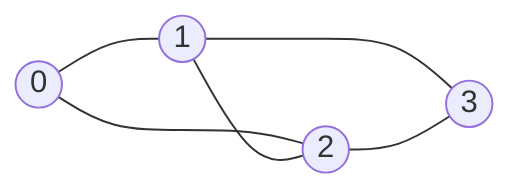

# Graph Representation

Graphs model pairwise relationships. Vertices represent objects and edges represent connections: roads between cities, prerequisite links between courses, calls between functions, or dependencies between build targets. The mathematics stays the same across these examples, but the memory layout does not. Representation determines which questions are cheap enough to ask repeatedly.

BFS, DFS, Prim, Kruskal, Dijkstra, and Floyd-Warshall operate on the same abstract object. Their running times and code shape change sharply depending on whether edges live in a matrix, per-vertex neighbor lists, or one flat edge array. Choosing the representation is part of choosing the algorithm.

## From an abstract graph to stored records

A **graph** is a pair $G = (V, E)$, where $V$ is a set of vertices and $E$ is a set of edges.

For an **undirected graph**, an edge is an unordered pair $\{u, v\}$. For a **directed graph**, or digraph, an edge is an ordered pair $(u, v)$ from source `u` to destination `v`.

A **weighted graph** associates a cost, distance, capacity, or weight with each edge. An **unweighted graph** may be treated as having weight `1` on every edge for traversal-distance purposes.

Important terms:

- **Adjacent vertices**: two vertices connected by an edge.
- **Degree**: number of incident edges in an undirected graph.
- **Indegree**: number of incoming directed edges.
- **Outdegree**: number of outgoing directed edges.
- **Path**: a sequence of vertices connected by edges.
- **Cycle**: a path that starts and ends at the same vertex without repeating internal vertices.
- **Connected graph**: every pair of vertices has a path between them, for undirected graphs.

Three common storage schemes are:

- **Adjacency matrix**: a two-dimensional array `matrix[V][V]`. Entry `matrix[i][j]` records whether edge `i -> j` exists or stores its weight.
- **Adjacency list**: an array of lists. Entry `adj[i]` points to the neighbors of vertex `i`.
- **Edge list**: an array of edge records `(u, v, w)`, useful for algorithms such as Kruskal's MST.

## Choosing storage by access pattern

An adjacency matrix uses $\Theta(\vert V\vert ^2)$ memory regardless of the number of edges. It answers "is there an edge from `u` to `v`?" in $O(1)$ time. It is often appropriate for dense graphs or algorithms such as Floyd-Warshall that naturally inspect all vertex pairs.

An adjacency list uses $\Theta(\vert V\vert  + \vert E\vert )$ memory. It is usually better for sparse graphs, where $\vert E\vert $ is much smaller than $\vert V\vert ^2$. Iterating over all neighbors of a vertex costs time proportional to that vertex's degree.

For undirected graphs, each edge usually appears twice in adjacency lists: once in `u`'s list and once in `v`'s list. For directed graphs, edge `u -> v` appears only in `u`'s outgoing list unless incoming lists are also maintained.

| Representation | Space | Edge lookup `u,v` | Iterate neighbors of `u` | Best fit |
|---|---:|---:|---:|---|
| Adjacency matrix | $\Theta(V^2)$ | $O(1)$ | $O(V)$ | dense graphs, all-pairs algorithms |
| Adjacency list | $\Theta(V + E)$ | $O(\deg u)$ | $O(\deg u)$ | sparse graphs, traversal |
| Edge list | $\Theta(E)$ | $O(E)$ | $O(E)$ unless indexed | sorting edges, Kruskal |

The matrix representation is often the simplest for classroom traces because every possible pair of vertices has a visible cell. It also makes directed and weighted variants easy to inspect: `matrix[u][v]` can store a boolean, a weight, or a sentinel such as `INF`. The downside is that the representation pays for edges that do not exist. For a graph with one million vertices, a full matrix is usually impossible even if the graph has only a few million actual edges.

Adjacency lists reverse that tradeoff. They store only existing edges, so they are the default for sparse graphs and for algorithms that iterate over outgoing edges. The list node may contain just `to` and `next`, or it may also contain `weight`. Some implementations use dynamic arrays instead of linked lists for each adjacency bucket, improving cache locality and making iteration faster. The ADT idea is the same either way: for a vertex `u`, enumerate all outgoing neighbors.

Edge lists are not convenient for ordinary neighbor queries, but they are excellent when the algorithm processes edges globally. Kruskal's algorithm sorts all edges by weight, so an array of edge records is exactly the needed input. Many real graph libraries keep more than one view of the same graph when different algorithms need different access patterns.

Vertex naming is another representation detail. Algorithms are easiest when vertices are numbered `0..V-1`, because arrays can store colors, distances, parents, and adjacency heads. If input uses strings such as city names, the program usually maps each name to an integer index with a dictionary, runs the graph algorithm on indices, and maps results back to names for output. This mapping layer keeps the core graph code simple.

For weighted graphs, adjacency-list nodes normally store both `to` and `weight`. For unweighted graphs, omitting the weight saves memory. For multigraphs, where two vertices may have more than one edge between them, the representation must allow duplicate adjacency records; a simple matrix cannot distinguish parallel edges unless each cell stores a list or count.

The choice should follow the dominant operation rather than a rule that lists are always better. A dense graph with $V=2{,}000$ has nearly four million possible directed edges. A compact bit matrix uses one bit per possible edge and answers membership with a few arithmetic operations; a pointer-heavy linked representation may use more memory even if a modest fraction of edges is absent. Conversely, a road graph with millions of vertices but only a handful of roads incident to each vertex cannot afford a $V\times V$ matrix.

Cache behavior adds another layer. Linked adjacency nodes are easy to insert but scatter allocations through memory. A vector of neighbors per vertex keeps each neighborhood contiguous. A compressed sparse row representation goes further: all destinations are stored in one array, and an offset array marks where each vertex's segment begins.

For example, if the outgoing lists are

```text
0: 1, 3
1: 2
2: 0, 3
3: (none)
```

then a CSR-style encoding is

```text
offset: [0, 2, 3, 5, 5]
to:     [1, 3, 2, 0, 3]
```

Neighbors of vertex `u` occupy `to[offset[u] .. offset[u+1])`. The extra terminal offset makes the length equal to $V+1$. Iteration is cache-friendly and the storage is $\Theta(V+E)$, but inserting a new edge into the middle is expensive. CSR fits graphs that are built once and traversed many times; vectors or linked nodes fit more dynamic workloads.

## Direction, weights, and edge identity

An undirected edge must be distinguishable from two unrelated directed edges at the API boundary. An adjacency list commonly stores an undirected edge twice so that both endpoints can enumerate it. That duplication affects algorithms which process edges globally: summing all adjacency-list weights counts each undirected edge twice, and an edge-list export must either filter one orientation or attach a shared edge identifier.

Self-loops need a stated convention. In an undirected graph, a loop contributes two to the degree under the standard graph-theoretic definition, even though a naive adjacency list might store one record. Parallel edges also affect meaning. A boolean matrix loses multiplicity; a count matrix preserves how many parallel edges exist; a weight matrix might preserve only the lightest edge. None is universally correct.

Zero-weight edges expose a common matrix bug. If zero means “absent,” a legitimate zero-cost edge cannot be represented. Use a separate presence matrix, an infinity sentinel, or an optional value. Infinity arithmetic also needs guarding: adding a weight to a sentinel near the integer limit can overflow before a shortest-path comparison is made.

Incoming-neighbor queries deserve attention for directed graphs. An outgoing adjacency list answers “where can `u` go?” efficiently but may require scanning the whole graph to find predecessors of `u`. Algorithms that repeatedly need both directions often store the transpose graph alongside the original. The doubled edge storage buys linear-time passes in either direction.

## Construction and mutation costs

If neighbor order does not matter, an adjacency list can be built from an edge list in $\Theta(V+E)$ time after vertex validation. Sorting each vertex's neighbors costs more, but it gives deterministic traversal order and permits binary-search membership in $O(\log\deg(u))$. Duplicate destinations can then be removed by one linear pass within each sorted bucket. Do not deduplicate a multigraph, where parallel edges carry meaning.

Deletion depends on the container. Removing `u -> v` from a linked list or unsorted vector takes $O(\deg(u))$ to locate. A sorted vector shortens lookup but still shifts later entries. A hash set per vertex gives expected constant-time membership and deletion at considerable memory cost. Dynamic graph workloads therefore need a different tradeoff from static analytics.

Keeping a matrix and adjacency lists together can speed mixed queries, but every mutation must update both views atomically. If one update succeeds and the other fails, later algorithms read different graphs. A single authoritative representation plus explicit derived snapshots is easier to reason about when mutations are infrequent.

## One graph in two layouts



Adjacency matrix for the undirected graph:

| vertex | 0 | 1 | 2 | 3 |
|---|---:|---:|---:|---:|
| 0 | 0 | 1 | 1 | 0 |
| 1 | 1 | 0 | 1 | 1 |
| 2 | 1 | 1 | 0 | 1 |
| 3 | 0 | 1 | 1 | 0 |

Adjacency lists:

```text
0: 1 -> 2
1: 0 -> 2 -> 3
2: 0 -> 1 -> 3
3: 1 -> 2
```

## Worked example: building an adjacency matrix

Build an adjacency matrix for an undirected graph with vertices `0, 1, 2, 3` and edges `{0,1}`, `{0,2}`, `{1,3}`.

Start with all zeros. For each undirected edge `{u,v}`, set both `matrix[u][v] = 1` and `matrix[v][u] = 1`.

1. Initial matrix:

```text
0 0 0 0
0 0 0 0
0 0 0 0
0 0 0 0
```

2. Add `{0,1}`:

```text
0 1 0 0
1 0 0 0
0 0 0 0
0 0 0 0
```

3. Add `{0,2}`:

```text
0 1 1 0
1 0 0 0
1 0 0 0
0 0 0 0
```

4. Add `{1,3}`:

```text
0 1 1 0
1 0 0 1
1 0 0 0
0 1 0 0
```

The final matrix is symmetric because the graph is undirected. Row `0` has two `1`s, so vertex `0` has degree `2`, matching edges `{0,1}` and `{0,2}`.

## Worked example: recovering edge count from degrees

Take the adjacency lists:

```text
0: 1 -> 2
1: 0 -> 2 -> 3
2: 0 -> 1 -> 3
3: 1 -> 2
```

Compute every vertex degree and the total number of undirected edges.

Count the stored neighbor records:

1. Count neighbors in each list:
   - Vertex `0`: neighbors `1, 2`, degree `2`.
   - Vertex `1`: neighbors `0, 2, 3`, degree `3`.
   - Vertex `2`: neighbors `0, 1, 3`, degree `3`.
   - Vertex `3`: neighbors `1, 2`, degree `2`.
2. Sum degrees:

$$
2 + 3 + 3 + 2 = 10
$$

3. In an undirected adjacency list, each edge is counted twice, once from each endpoint. Therefore:

$$
|E| = 10 / 2 = 5
$$

The represented edges are `{0,1}`, `{0,2}`, `{1,2}`, `{1,3}`, and `{2,3}`, exactly five edges.

## Worked example: converting an edge list to CSR

Take the directed edge list

```text
(2,3), (0,3), (2,0), (1,2), (0,1)
```

with four vertices. CSR first needs the outgoing degree of each source.

1. Vertex `0` appears twice as a source, so its count is `2`.
2. Vertex `1` appears once, so its count is `1`.
3. Vertex `2` appears twice, so its count is `2`.
4. Vertex `3` never appears as a source, so its count is `0`.

The counts are `[2, 1, 2, 0]`. Prefix sums produce the offsets:

```text
offset[0] = 0
offset[1] = 0 + 2 = 2
offset[2] = 2 + 1 = 3
offset[3] = 3 + 2 = 5
offset[4] = 5 + 0 = 5
```

After grouping destinations by source, one valid destination array is

```text
to = [3, 1, 2, 3, 0]
```

The segment for vertex `2` is `to[3..5) = [3, 0]`, matching edges `2 -> 3` and `2 -> 0`. Ordering inside a segment is optional. Sorting each segment costs extra construction time but enables binary-search edge lookup in $O(\log\deg(u))$.

## A small owned adjacency list in C

This program builds an undirected adjacency-list graph and prints each vertex's neighbors. New edges are prepended to each list.

```c
#include <stdio.h>
#include <stdlib.h>

#define V 4

typedef struct EdgeNode {
    int to;
    struct EdgeNode *next;
} EdgeNode;

typedef struct {
    EdgeNode *head[V];
} Graph;

static EdgeNode *make_edge(int to, EdgeNode *next) {
    EdgeNode *e = malloc(sizeof(*e));
    if (e == NULL) {
        fprintf(stderr, "malloc failed\n");
        exit(EXIT_FAILURE);
    }
    e->to = to;
    e->next = next;
    return e;
}

static void init(Graph *g) {
    for (int i = 0; i < V; ++i) {
        g->head[i] = NULL;
    }
}

static void add_undirected_edge(Graph *g, int u, int v) {
    g->head[u] = make_edge(v, g->head[u]);
    g->head[v] = make_edge(u, g->head[v]);
}

static void print_graph(const Graph *g) {
    for (int u = 0; u < V; ++u) {
        printf("%d:", u);
        for (EdgeNode *e = g->head[u]; e != NULL; e = e->next) {
            printf(" %d", e->to);
        }
        printf("\n");
    }
}

static void destroy(Graph *g) {
    for (int u = 0; u < V; ++u) {
        EdgeNode *e = g->head[u];
        while (e != NULL) {
            EdgeNode *next = e->next;
            free(e);
            e = next;
        }
    }
}

int main(void) {
    Graph g;
    init(&g);
    add_undirected_edge(&g, 0, 1);
    add_undirected_edge(&g, 0, 2);
    add_undirected_edge(&g, 1, 2);
    add_undirected_edge(&g, 1, 3);
    add_undirected_edge(&g, 2, 3);
    print_graph(&g);
    destroy(&g);
    return EXIT_SUCCESS;
}
```

## Representation mistakes that survive small tests

- Storing an undirected edge only once in an adjacency list, then expecting traversal from both endpoints to work.
- Forgetting that an adjacency matrix for an undirected graph should be symmetric.
- Using a dense matrix for a huge sparse graph when adjacency lists would use far less memory.
- Assuming neighbor order in an adjacency list is meaningful. It often depends on insertion order.
- Confusing indegree and outdegree in directed graphs.
- Using `0` to mean both "no edge" and a valid zero-weight edge. Weighted matrices need a separate sentinel or boolean presence matrix.

A further trap is to quote $O(V+E)$ space while using a linked node per edge without accounting for allocator and pointer overhead. The asymptotic statement remains correct, but it may badly predict memory use. Measure the record size when the graph is large.

Graph mutation also needs an invariant. If `add_undirected_edge` allocates the first adjacency node successfully and the second allocation fails, the graph is left half-updated. Production code can allocate both nodes before linking either one, or roll back on failure. The demonstration program exits on allocation failure, which avoids returning a partially successful operation.

Finally, vertex indices are a trust boundary. Every public insertion routine should reject negative or out-of-range endpoints before indexing arrays. Hard-coded classroom examples can omit this check; input-driven code cannot.

<div className="see-also">

See also: [graph traversals](/cs/data-structures/graph-traversals) · [minimum spanning trees](/cs/data-structures/minimum-spanning-trees) · [shortest paths](/cs/data-structures/shortest-paths) · [linked lists](/cs/data-structures/linked-lists) · [arrays and array operations](/cs/data-structures/arrays)

</div>
