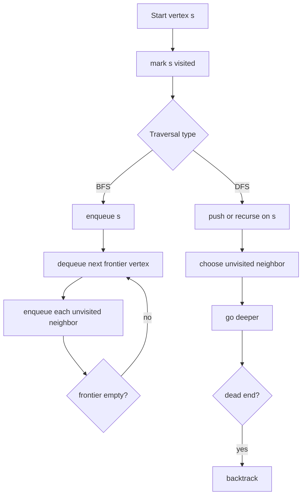

# Graph Traversals

Graph traversal systematically visits vertices reachable from a starting point. Depth-first search (DFS) follows one branch until it must backtrack. Breadth-first search (BFS) expands the frontier in layers. The algorithms differ by one data-structure choice—stack versus queue—but that choice changes what can be inferred from the resulting tree.

Traversal is representation-sensitive. With adjacency lists, scanning all vertices and edges costs $O(V+E)$. With an adjacency matrix, finding the neighbors of each processed vertex requires scanning a row of length $V$, giving $O(V^2)$ time even for a sparse graph.

## The frontier and the visited invariant

Given a graph $G = (V, E)$ and a start vertex `s`, a traversal maintains a set of visited vertices to avoid repeated work and infinite loops around cycles.

**Depth-first search**:

- Visit a start vertex.
- Recursively visit an unvisited neighbor.
- Continue until no unvisited neighbor remains, then backtrack.
- Can be implemented recursively or with an explicit stack.

**Breadth-first search**:

- Visit a start vertex and enqueue it.
- Repeatedly dequeue a vertex and enqueue its unvisited neighbors.
- Visits vertices in nondecreasing number of edges from the start in an unweighted graph.

Traversal outputs may include:

- **Visit order**: the order vertices are first discovered.
- **Parent tree**: for each discovered vertex, the vertex from which it was first reached.
- **Connected components**: groups of vertices mutually reachable in an undirected graph.
- **Discovery and finish times**: DFS metadata useful for directed graph analysis.

The central invariant is simple: a vertex enters the frontier only after it has been marked discovered. Marking and insertion form one logical operation. This prevents a cycle from generating repeated work and gives every discovered vertex a single parent.

## Why the running time is linear

With adjacency lists, DFS and BFS both run in $O(V + E)$ time for a full traversal. Each vertex is marked visited once, and each adjacency-list entry is inspected once. For an undirected graph, each edge appears twice, but $2E$ is still $O(E)$.

BFS computes shortest path distances from the start in an unweighted graph. Proof sketch: BFS processes vertices by layers. All vertices at distance `0` are processed before distance `1`; all vertices at distance `1` before distance `2`; and so on. When a vertex is first discovered, the path through its parent has the fewest possible edges.

DFS does not generally compute shortest paths. Its strength is structural: it identifies connected components, supports topological sorting in directed acyclic graphs, detects cycles, and helps classify edges.

| Traversal | Frontier | Main guarantee | Common applications |
|---|---|---|---|
| DFS | stack or recursion | explores complete paths before alternatives | components, cycle detection, topological sort |
| BFS | queue | shortest unweighted edge distance from start | levels, shortest hops, bipartite checking |

The parent array produced by a traversal is often as important as the visit order. In BFS, `parent[v]` records the predecessor that first discovered `v`, so following parent links backward reconstructs a shortest unweighted path to the start vertex. In DFS, parent links form a depth-first forest. When the graph is disconnected, a full traversal starts a new DFS or BFS from each unvisited vertex, producing one tree per connected component.

Traversal state should be marked at discovery time, not after all neighbors have been processed. This distinction is especially important for BFS. If a vertex is marked only when dequeued, several already-discovered vertices can enqueue it again before it reaches the front of the queue. Marking when enqueued means each vertex enters the queue at most once.

For directed graphs, DFS can classify edges by discovery and finish times: tree edges discover new vertices, back edges point to ancestors, forward edges point to descendants, and cross edges connect separate DFS branches. A back edge in a directed graph indicates a cycle. These classifications are beyond the simplest traversal trace, but they explain why DFS is the foundation for topological sorting and strongly connected component algorithms.

Traversal code should be written against the graph representation's natural neighbor operation. With adjacency lists, a loop follows only existing edges, so total work is proportional to the number of stored adjacency records. With an adjacency matrix, the code scans an entire row to discover neighbors, so it checks every possible destination even when few edges exist. The same BFS idea therefore has different constants and sometimes different asymptotic cost.

In undirected graphs, connected components can be found by repeatedly starting BFS or DFS from an unvisited vertex. Each restart begins a new component. The number of restarts is the number of components, and the parent forest records one spanning tree for each component.

In directed graphs, the same restart pattern covers every vertex, but reachability is directional. A DFS forest from a directed graph should not be interpreted as undirected connected components unless the direction of edges is intentionally ignored.

The $O(V+E)$ claim follows by accounting rather than by inspecting the nesting of loops. Initialization touches $V$ state entries. Each vertex is inserted into and removed from the frontier at most once. With adjacency lists, the neighbor loop inspects every directed edge once; an undirected edge appears in two lists and is inspected twice. The total is $O(V)+O(E)$. A loop inside another loop does not force a quadratic bound when the inner iterations are distributed across disjoint adjacency lists.

For one-source traversal, unreachable vertices need not be scanned after the frontier empties. Its cost can be written $O(V_r+E_r)$ for the reachable subgraph. A full traversal adds the outer restart loop and reaches the conventional $O(V+E)$ bound.

## What the BFS layers prove

Set `distance[s] = 0`. Whenever BFS discovers `v` from `u`, assign

$$
\operatorname{distance}[v]=\operatorname{distance}[u]+1.
$$

The queue contains vertices in nondecreasing distance order. Initially this is true for `s`. Processing a distance-$k$ vertex appends only new distance-$(k+1)$ vertices behind all vertices already queued at distance $k$ or $k+1$. By induction, a vertex at distance $k+1$ cannot be discovered before some length-$(k+1)$ path reaches it, and any hypothetical shorter path would have caused discovery from an earlier layer. First discovery therefore gives a shortest path by number of edges.

This proof depends on every edge having equal cost. If edge weights differ, the fewest-edge path may be more expensive. Dijkstra replaces the FIFO queue with a minimum-priority frontier and requires nonnegative weights. For weights restricted to `0` and `1`, a deque gives the specialized 0–1 BFS: a zero-weight relaxation goes to the front and a one-weight relaxation goes to the back.

## What DFS records

Recursive DFS gives each vertex a discovery time when entered and a finish time after all outgoing neighbors are processed. The intervals are properly nested: for two vertices in the same DFS tree, their time intervals are either disjoint or one contains the other. An edge from a vertex to an active ancestor is a back edge and proves that a directed cycle exists.

For a directed acyclic graph, no back edge appears. Sorting vertices by decreasing finish time yields a topological order. When `u -> v` is examined, either `v` finishes before `u`, or `v` was already finished in another branch; in either case `u` precedes `v` in reverse finish order. The same DFS machinery therefore supports a structural result that BFS layers do not provide.

Recursive DFS uses the language call stack. Its auxiliary space is $O(V)$ in the worst case, and a path-like graph can exceed a runtime's recursion limit. An explicit stack avoids that system limit, but matching recursive visit order takes care: because a stack is LIFO, neighbors usually need to be pushed in reverse of the desired visitation order. An iterative implementation that marks only on pop may also push duplicates; marking on push keeps frontier size and parent assignment controlled.

## Stack frontier versus queue frontier



Example graph:

```text
0: 1, 2
1: 0, 3
2: 0, 3
3: 1, 2, 4
4: 3
```

## Worked example: BFS order and distances

Run BFS from vertex `0` on the example graph, visiting neighbors in increasing numeric order.

Use a queue and mark vertices when they are enqueued, not when dequeued.

1. Start at `0`. Mark `0`, distance `0`, parent none. Queue: `[0]`.
2. Dequeue `0`. Its neighbors are `1` and `2`.
   - Mark `1`, distance `1`, parent `0`.
   - Mark `2`, distance `1`, parent `0`.
   - Queue: `[1, 2]`.
3. Dequeue `1`. Neighbors are `0` and `3`.
   - `0` already visited.
   - Mark `3`, distance `2`, parent `1`.
   - Queue: `[2, 3]`.
4. Dequeue `2`. Neighbors are `0` and `3`.
   - Both already visited.
   - Queue: `[3]`.
5. Dequeue `3`. Neighbors are `1`, `2`, and `4`.
   - `1` and `2` already visited.
   - Mark `4`, distance `3`, parent `3`.
   - Queue: `[4]`.
6. Dequeue `4`. Neighbor `3` already visited. Queue becomes empty.

BFS discovery order is `0, 1, 2, 3, 4`. Distances are `d[0]=0`, `d[1]=1`, `d[2]=1`, `d[3]=2`, `d[4]=3`. The path to `4` from parent links is `0 -> 1 -> 3 -> 4`, which has three edges.

## Worked example: DFS order and backtracking

Now run recursive DFS from vertex `0` on the same graph, again considering neighbors in increasing numeric order.

Visit a vertex, then recursively visit the first unvisited neighbor.

1. Visit `0`. First unvisited neighbor is `1`.
2. Visit `1`. Neighbors: `0` already visited, then `3` unvisited.
3. Visit `3`. Neighbors: `1` visited, `2` unvisited.
4. Visit `2`. Neighbors `0` and `3` are both visited. Backtrack to `3`.
5. Continue `3`'s neighbors: `4` unvisited.
6. Visit `4`. Neighbor `3` visited. Backtrack to `3`, then `1`, then `0`.
7. Continue `0`'s neighbors: `2` already visited. Done.

DFS discovery order is `0, 1, 3, 2, 4`. This is not a shortest-distance order because vertex `2`, which is one edge from `0`, was visited after vertex `3`, which is two edges from `0`. That difference is expected for DFS.

## Worked example: components and a BFS forest

Consider an undirected graph with vertices `0..6` and edges

```text
0--1, 1--2, 3--4, 4--5
```

Vertex `6` is isolated. Run the full BFS loop in increasing vertex order.

1. Vertex `0` is unvisited, so start component `0`. BFS discovers `0`, then `1`, then `2`. Parent entries are `parent[0] = -1`, `parent[1] = 0`, and `parent[2] = 1`.
2. Outer-loop vertices `1` and `2` are already marked, so they do not start new searches.
3. Vertex `3` starts component `1`. BFS discovers `3`, `4`, and `5`, with parents `-1`, `3`, and `4` respectively.
4. Vertices `4` and `5` are already marked.
5. Vertex `6` starts component `2`. It has no neighbors, so its one-vertex BFS ends immediately.

There are three components: `\{0,1,2\}`, `\{3,4,5\}`, and `\{6\}`. The three roots are exactly the vertices whose parent remains `-1`. The parent relation is a forest with $V-c=7-3=4$ tree edges, matching the four non-root discoveries.

## Matrix-based C implementation

This program uses an adjacency matrix for compact demonstration and implements both DFS and BFS. For large sparse graphs, use adjacency lists instead.

```c
#include <stdio.h>
#include <stdlib.h>

#define V 5

static void dfs_rec(int graph[V][V], int v, int visited[V]) {
    visited[v] = 1;
    printf("%d ", v);
    for (int w = 0; w < V; ++w) {
        if (graph[v][w] && !visited[w]) {
            dfs_rec(graph, w, visited);
        }
    }
}

static void bfs(int graph[V][V], int start) {
    int visited[V] = {0};
    int queue[V];
    int front = 0;
    int rear = 0;

    visited[start] = 1;
    queue[rear++] = start;

    while (front < rear) {
        int v = queue[front++];
        printf("%d ", v);
        for (int w = 0; w < V; ++w) {
            if (graph[v][w] && !visited[w]) {
                visited[w] = 1;
                queue[rear++] = w;
            }
        }
    }
}

int main(void) {
    int graph[V][V] = {
        {0, 1, 1, 0, 0},
        {1, 0, 0, 1, 0},
        {1, 0, 0, 1, 0},
        {0, 1, 1, 0, 1},
        {0, 0, 0, 1, 0}
    };
    int visited[V] = {0};

    printf("DFS: ");
    dfs_rec(graph, 0, visited);
    printf("\nBFS: ");
    bfs(graph, 0);
    printf("\n");
    return EXIT_SUCCESS;
}
```

## Errors that change the traversal

- Marking a BFS vertex only when dequeued. That can enqueue the same vertex many times through different parents.
- Forgetting the visited set in cyclic graphs, causing infinite traversal.
- Claiming DFS gives shortest paths. BFS gives shortest unweighted paths; DFS does not.
- Expecting one traversal from a start vertex to visit a disconnected graph. Full graph traversal must restart from each unvisited vertex.
- Letting recursive DFS overflow the call stack on very deep graphs. An explicit stack is safer for huge inputs.
- Assuming traversal order is unique. It depends on neighbor ordering in the representation.

Mutating the graph during traversal needs a defined policy. Adding an edge to an adjacency vector can invalidate an iterator; deleting an edge can cause the next neighbor to be skipped. Most traversal APIs assume a stable graph for the duration. If mutation is required, collect changes and apply them after the pass, or use a representation with explicit iterator guarantees.

Parallel edges do not require special visited handling: the first edge may discover the endpoint and later parallel edges find it already marked. Self-loops behave the same way. They do matter to applications such as cycle classification, where an undirected edge back to the parent must be distinguished from a second parallel edge to the parent.

When reconstructing a path, stop at the source or at a sentinel parent. Following an uninitialized parent for an unreachable target is a memory error in C, not merely a wrong answer. Check reachability before walking the chain.

## Related pages

- [graph representation](/cs/data-structures/graph-representation)
- [queues](/cs/data-structures/queues)
- [stacks](/cs/data-structures/stacks)
- [minimum spanning trees](/cs/data-structures/minimum-spanning-trees)
- [shortest paths](/cs/data-structures/shortest-paths)
