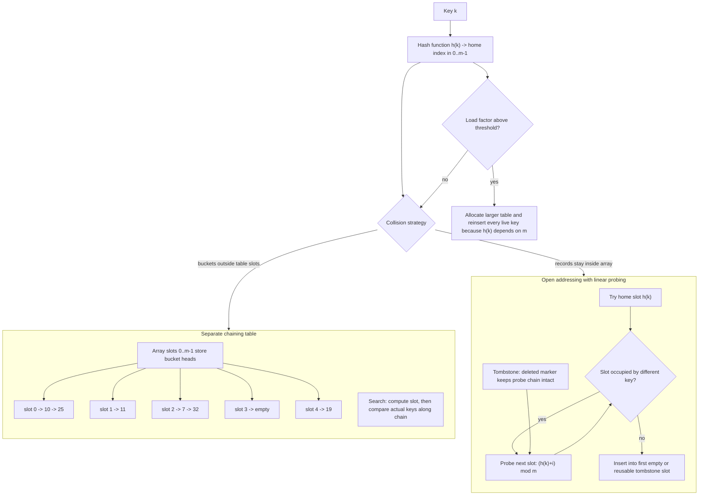

# Hashing

Hashing makes dictionary operations close to constant time by computing where a key should live. Instead of comparing a key with many stored keys, a hash function maps it to a table index. Search, insertion, and deletion are fast when that mapping distributes the keys well and the table is not too full.

Collisions are unavoidable: two distinct keys can map to the same slot. Most of the design work in a hash table concerns collision handling, resizing, and exact key comparison.

## From keys to table slots

A **hash table** stores records in an array of size $m$. A **hash function** maps a key $k$ to an integer slot:

$$
h(k) \in \{0, 1, \dots, m - 1\}
$$

For integer keys, the division method is a simple choice:

$$
h(k) = k \bmod m
$$

A **collision** occurs when two different keys map to the same slot. The **load factor** is

$$
\alpha = \frac{n}{m}
$$

where $n$ is the number of stored keys and $m$ is the number of table slots.

Hash-table equality has two stages: compute a slot or bucket from the hash value, then compare the actual key. A hash narrows the search; equal hashes do not prove equal keys.

Hash functions must distribute the keys that actually occur. For strings, a common construction multiplies an accumulated hash by a constant and adds the next character. For integers, a prime table size can keep the division method from repeating patterns present in the keys. Security-sensitive tables often randomize hashing to resist adversarial inputs, although the usual analysis begins with uniform hashing.

Two rules define a valid hash for a key type:

1. If two keys compare equal, they must produce the same hash value.
2. A key's hash-relevant state must not change while the key is stored in the table.

The converse of the first rule is false. Equal hashes can belong to unequal keys, so lookup must finish with the table's equality operation. The second rule explains a subtle failure with mutable keys: after a field used by the hash changes, lookup starts in a different bucket even though the object is still physically stored in the old one.

A hash function for a composite key should incorporate every field used by equality and mix their bits so regular input patterns do not survive into the table index. The table then converts the wide hash value to a slot, often by a remainder or a bit mask. A power-of-two capacity makes masking cheap, but it places more responsibility on the hash's low bits. Choosing a prime capacity is not a substitute for a decent hash; it only avoids some simple periodic interactions.

## Two ways to absorb collisions

- **Separate chaining** stores a linked list, dynamic array, or other bucket at each slot.
- **Open addressing** keeps every record in the table array. An occupied home slot starts a probe sequence.

Common open-addressing sequences are:

- **Linear probing**: $h_i(k) = (h(k) + i) \bmod m$.
- **Quadratic probing**: $h_i(k) = (h(k) + c_1 i + c_2 i^2) \bmod m$.
- **Double hashing**: $h_i(k) = (h_1(k) + i h_2(k)) \bmod m$.



| Method | Storage location | Deletion difficulty | Load factor limit | Typical issue |
|---|---|---|---|---|
| Chaining | linked buckets outside table slots | straightforward list deletion | can exceed `1` | pointer overhead |
| Linear probing | table array only | tombstones needed | must be below `1` | primary clustering |
| Quadratic probing | table array only | tombstones needed | must be below `1` | may not visit every slot |
| Double hashing | table array only | tombstones needed | must be below `1` | second hash must fit the table size |

## Load factor and the cost of crowding

Under uniform hashing and a moderate load factor, dictionary operations take expected $O(1)$ time. The worst case remains $O(n)$ when many keys collide or the table becomes crowded.

With separate chaining, the expected chain length is $\alpha = n/m$, so a successful search takes expected $O(1 + \alpha)$ time. Chaining permits $\alpha \gt 1$, although long chains still slow access.

Open addressing requires $\alpha \lt  1$ because each key occupies an array slot. Probe sequences lengthen rapidly as $\alpha$ approaches `1`. Linear probing also develops **primary clustering**: occupied runs grow and attract still more collisions.

Under the idealized assumption of uniform independent probes, the expected number of probes for an unsuccessful open-addressing search is at most

$$
\frac{1}{1-\alpha}.
$$

At $\alpha=0.5$ this bound is $2$ probes; at $\alpha=0.9$ it is $10$. A successful search has expected probe count at most

$$
\frac{1}{\alpha}\ln\frac{1}{1-\alpha}.
$$

These formulas describe uniform hashing, not linear probing exactly, but they capture the sharp nonlinear cost of crowding. Cache behavior complicates the comparison. A few adjacent probes in a flat array can be faster than following one pointer into a chained node, even when both methods have the same asymptotic expected time.

A table therefore needs a resizing policy. Once an open-addressed table crosses a threshold such as `0.7`, it can allocate a larger array and reinsert each occupied key. Reinsertion is required because $h(k) = k \bmod m$ changes with $m$. Chained tables also benefit from resizing, though they tolerate higher load factors.

Resizing one table of $n$ elements costs $O(n)$, but geometric growth keeps insertion amortized $O(1)$. If capacities double, the total number of elements moved while growing from 1 to capacity $2^r$ is bounded by

$$
1+2+4+\cdots+2^{r-1}=2^r-1.
$$

That total is linear in the final capacity, so the occasional rebuild spreads to constant extra work per insertion over the whole sequence. Growing by one slot at a time would repeatedly copy almost the entire table and lead to quadratic total work.

## A chained-table example

Take a five-bucket table with $h(k)=k\bmod5$ and insert `12, 7, 22, 9, 14` in that order. The bucket indices are

$$
12\mapsto2,\quad 7\mapsto2,\quad 22\mapsto2,
\quad 9\mapsto4,\quad 14\mapsto4.
$$

If each new key is appended, the table is

```text
bucket 0: —
bucket 1: —
bucket 2: 12 -> 7 -> 22
bucket 3: —
bucket 4: 9 -> 14
```

Here $n=5$, $m=5$, and $\alpha=1$. A successful search for `22` computes bucket 2 and makes three key comparisons. An unsuccessful search for `17` also examines the three keys in bucket 2. Deleting `7` only relinks that bucket; it cannot disrupt searches in another bucket. The same load factor would be impossible for open addressing because no empty slot would remain to terminate an unsuccessful probe.

## Following a linear probe

Insert `18, 41, 22, 44, 59, 32` into a table of size `7` with $h(k) = k \bmod 7$.

1. `18` maps to slot `4`.
2. `41` maps to slot `6`.
3. `22` maps to slot `1`.
4. `44` maps to slot `2`.
5. `59` maps to slot `3`.
6. `32` maps to slot `4`; slot `4` holds `18`, so the probe advances to empty slot `5`.

```text
index: 0    1    2    3    4    5    6
key:   _   22   44   59   18   32   41
```

A search for `32` begins at slot `4`, compares against `18`, then succeeds at slot `5`.

## Deletion without breaking a probe chain

Suppose `18` is deleted from the preceding table. Marking slot `4` empty would leave

```text
index: 0    1    2    3    4    5    6
key:   _   22   44   59   _   32   41
```

A search for `32` starts at $32 \bmod 7 = 4$. An empty slot normally means that no key was inserted farther along this probe sequence, so the search would stop and incorrectly report failure.

Open-addressed deletion uses a tombstone such as `DELETED` instead. Searches continue through tombstones, while insertions may reuse them. Tombstones can accumulate and eventually justify a rehash of the table.

Insertion with tombstones has one extra trap. The algorithm may remember the first tombstone as a possible destination, but it must continue probing until it finds an empty slot or the existing key. Stopping immediately at the tombstone can insert a duplicate of a key located later in the same probe chain. The C implementation below follows the longer search before choosing the saved tombstone.

## Implementing linear probing in C

The implementation below keeps slot state separate from the integer key, handles negative remainders, and preserves probe chains after deletion.

```c
#include <stdio.h>
#include <stdlib.h>

#define TABLE_SIZE 11

typedef enum { EMPTY, OCCUPIED, DELETED } State;

typedef struct {
    int key;
    State state;
} Slot;

static int hash(int key) {
    int r = key % TABLE_SIZE;
    return r < 0 ? r + TABLE_SIZE : r;
}

static int search(Slot table[], int key) {
    int start = hash(key);
    for (int i = 0; i < TABLE_SIZE; ++i) {
        int pos = (start + i) % TABLE_SIZE;
        if (table[pos].state == EMPTY) return -1;
        if (table[pos].state == OCCUPIED && table[pos].key == key) {
            return pos;
        }
    }
    return -1;
}

static int insert(Slot table[], int key) {
    if (search(table, key) != -1) return 1;
    int start = hash(key);
    int first_deleted = -1;

    for (int i = 0; i < TABLE_SIZE; ++i) {
        int pos = (start + i) % TABLE_SIZE;
        if (table[pos].state == DELETED && first_deleted == -1) {
            first_deleted = pos;
        } else if (table[pos].state == EMPTY) {
            int target = first_deleted == -1 ? pos : first_deleted;
            table[target].key = key;
            table[target].state = OCCUPIED;
            return 1;
        }
    }
    if (first_deleted != -1) {
        table[first_deleted].key = key;
        table[first_deleted].state = OCCUPIED;
        return 1;
    }
    return 0;
}

static int erase(Slot table[], int key) {
    int pos = search(table, key);
    if (pos == -1) return 0;
    table[pos].state = DELETED;
    return 1;
}

int main(void) {
    Slot table[TABLE_SIZE] = {0};
    int keys[] = {18, 41, 22, 44, 59, 32};
    for (size_t i = 0; i < sizeof(keys) / sizeof(keys[0]); ++i) {
        insert(table, keys[i]);
    }
    erase(table, 18);
    printf("32 is at index %d\n", search(table, 32));
    return EXIT_SUCCESS;
}
```

For keyed records in C, ownership belongs in the table contract. A table storing string pointers must state whether it copies strings or borrows pointers owned elsewhere; deletion, resizing, and destruction all depend on that choice.

The fixed capacity keeps the example centered on probing. A reusable implementation also tracks the number of occupied slots and tombstones, grows before insertion can exhaust the probe sequence, and rebuilds when deleted markers become a substantial fraction of the array. It should calculate capacity growth with overflow checks and define what happens when allocation fails.

## Hash tables under hostile input

Expected $O(1)$ behavior depends on assumptions about key distribution. If an attacker can choose many keys with the same hash, a chained table can fall to $O(n)$ per operation and an open-addressed table can suffer long probe runs. Repeating such operations may turn a nominally linear request into quadratic work.

Common defenses include a per-process random seed in the string hash, a collision strategy with a stronger worst-case fallback, and limits at untrusted parsing boundaries. A cryptographic hash is usually unnecessary for an ordinary in-memory table and often costs more than needed. The relevant property is unpredictability to the input producer, not collision resistance against unlimited offline search.

Iteration order is another contract issue. Resizing relocates entries, randomized seeding changes bucket order between runs, and deletion may change probe clusters. Code that needs sorted output should sort the keys explicitly or use an ordered map. Tests should compare contents rather than assume an incidental hash-table order.

## Hashing strings step by step

A polynomial-style string hash updates an accumulator for each byte or character. With multiplier 31, initial value 0, and character codes for `c`, `a`, and `t`, the unbounded arithmetic is

$$
\begin{aligned}
h_1&=0\cdot31+99=99,\\
h_2&=99\cdot31+97=3166,\\
h_3&=3166\cdot31+116=98262.
\end{aligned}
$$

For a table of size 11, the home bucket would be $98262\bmod11=10$. Real implementations normally let arithmetic wrap in a specified unsigned integer width and perform better final mixing before selecting table bits. The multiplier is not magic; it combines order-sensitive contributions so that `cat` and `act` do not collapse merely because they contain the same characters.

Text introduces a contract question before hashing begins: what counts as equal? Byte-for-byte UTF-8 equality, Unicode scalar equality, case-insensitive equality, and normalized human-text equality are different. The hash must use the same representation as equality. Normalizing only during hashing would allow unequal keys to share a hash, which is legal but wasteful; normalizing only during equality could violate the rule that equal keys hash alike.

## Probe policies beyond the basic three

Modern open-addressed tables often store small metadata beside keys and compare several candidate slots using vector instructions. Robin Hood hashing tracks probe distance and lets a newly inserted key with a longer probe displace one with a shorter probe. The policy reduces variance in lookup length: keys that were “lucky” give ground to keys far from home. Deletion may use backward shifting instead of tombstones when the probing rules make that safe.

Cuckoo hashing gives each key a small set of possible locations. Insertion may evict a resident key to its alternative location, producing a chain of relocations. Lookup checks only the candidate locations, but insertion can cycle and require a rebuild with new hash functions. These schemes change constants and tail behavior; they do not remove the need for exact equality, controlled load factor, or resizing.

Separate chaining remains attractive when references to entries must remain stable across table growth, when records are large, or when load can temporarily exceed one. Flat open addressing often wins for compact records and read-heavy workloads because it avoids per-node allocation and follows contiguous memory. The choice should follow measured access patterns and API guarantees rather than the abstract expected time alone.

## Testing the table rather than one example

A useful test compares the custom table with a simple reference map over a randomized sequence of insertions, updates, lookups, and deletions. After every operation, both should agree on membership and values. Force collisions with a deliberately constant test hash, exercise wraparound at the last array slot, and insert through several resize thresholds.

Deletion tests should place several colliding keys in one probe chain, remove the first and middle keys, then find those later in the chain. Reinsert into tombstones and confirm that duplicate keys are updated rather than added twice. For chaining, test removal of the bucket head as well as an interior node. These cases target invariants that a friendly set of distinct home slots never exercises.

## Failure modes to watch

- A table size and hash function can reinforce patterns in the keys, such as using only low bits when those bits rarely vary.
- Open addressing degrades sharply near a full table, and accumulated tombstones have a similar effect.
- Comparing hashes instead of keys produces false matches after collisions.
- Hash tables do not provide sorted traversal; expected access speed comes at the cost of order.
- Floating-point keys need an equality-and-hash policy for signed zero and NaN values; copying raw bit patterns rarely matches language-level equality.
- A hash function that reads padding bytes or uninitialized memory can produce nondeterministic results and may expose data.

<div className="see-also">

See also: [arrays and array operations](/cs/data-structures/arrays) · [linked lists](/cs/data-structures/linked-lists) · [searching algorithms](/cs/data-structures/searching-algorithms) · [binary search trees](/cs/data-structures/binary-search-trees) · [graph representation](/cs/data-structures/graph-representation)

</div>
