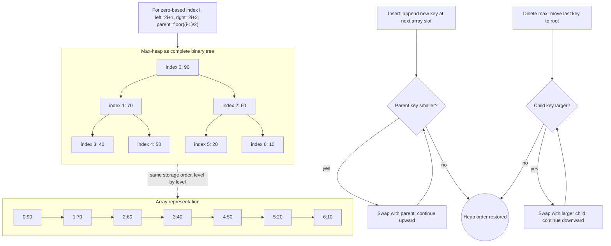

# Heaps and Priority Queues

A priority queue stores items so that the item with the most urgent key can be removed first. A binary heap is the usual array-based implementation. It combines a complete-tree shape, which packs without pointers, with a partial order that keeps the minimum or maximum at the root.

The structure deliberately does less than a search tree. It cannot find an arbitrary key quickly, and iteration is not sorted. That narrower contract buys compact storage and logarithmic updates, which is exactly what schedulers, graph algorithms, and event simulations need.

## Shape and order invariants

A **priority queue ADT** supports:

- **`insert(PQ, item, priority)`**: add an item.
- **`find_min(PQ)`** or **`find_max(PQ)`**: inspect the highest-priority item.
- **`delete_min(PQ)`** or **`delete_max(PQ)`**: remove and return the highest-priority item.
- **`is_empty(PQ)`**: report whether no items remain.

A **max heap** is a complete binary tree in which each parent key is greater than or equal to its children:

$$
\mathrm{key(parent)} \ge \mathrm{key(child)}
$$

A **min heap** reverses the inequality. The root of a max heap stores the maximum key; the root of a min heap stores the minimum key.

Because a binary heap is complete, it is usually stored in an array. With zero-based indexing:

$$
\begin{aligned}
\mathrm{left}(i) &= 2i + 1 \\
\mathrm{right}(i) &= 2i + 2 \\
\mathrm{parent}(i) &= \left\lfloor \frac{i - 1}{2} \right\rfloor
\end{aligned}
$$

Two local repair operations are central:

- **Sift up**: after inserting at the end, repeatedly swap with the parent while heap order is violated.
- **Sift down**: after moving the last element to the root during deletion, repeatedly swap with the larger child in a max heap or smaller child in a min heap.

## Operation costs from tree height

A binary heap with $n$ elements has height $\lfloor \log_2 n \rfloor$ because it is complete. Therefore insertion and delete-max/delete-min take $O(\log n)$ time. Finding the root maximum or minimum is $O(1)$.

Building a heap by inserting $n$ items one at a time costs $O(n \log n)$. Floyd's bottom-up heap construction, which sifts down from the last internal node to the root, costs $O(n)$. The reason is that most nodes are near the leaves and can move only a small distance. The total work is bounded by a convergent height-weighted sum.

A heap is not a sorted array. The root is the extreme element, and every parent is ordered relative to its children, but siblings and nodes in different subtrees have no complete ordering relationship.

| Operation | Binary heap cost | Notes |
|---|---:|---|
| Find max in max heap | $O(1)$ | root element |
| Insert | $O(\log n)$ | append then sift up |
| Delete max | $O(\log n)$ | replace root then sift down |
| Build heap bottom-up | $O(n)$ | Floyd heapify |
| Search arbitrary key | $O(n)$ | heap order is partial |
| Heap sort | $O(n \log n)$ | repeated delete max or in-place heap |

The priority queue ADT does not require a heap, but the binary heap is the usual default because it gives a strong balance between simplicity and performance. An unsorted array gives $O(1)$ insertion but $O(n)$ delete-max. A sorted array gives $O(1)$ find-max and delete-max at one end but $O(n)$ insertion. A heap keeps both insertion and deletion logarithmic without requiring a full sorted order.

Some priority-queue applications need operations beyond the basic set. Dijkstra's algorithm is cleaner with `decrease_key`, which lowers a vertex's tentative distance and moves it upward in a min heap. A simple C implementation may avoid true `decrease_key` by inserting a duplicate pair and ignoring stale entries when they are removed. That is often easier, but it uses more heap entries. More advanced heaps improve amortized bounds for such operations, but with much more complex pointer structure.

Testing heap code should check both the output sequence and the internal invariant. If repeated delete-max returns keys in descending order, the public behavior looks right. If every parent remains at least as large as its children after each operation, the representation is also right.

Heaps are also sensitive to boundary tests. The last internal node in a zero-based heap of size `n` is `(n - 2) / 2` when `n >= 2`; leaves start after that. Bottom-up heap construction relies on this fact by sifting down only internal nodes. Sifting down from leaves is harmless but unnecessary.

Careful index arithmetic is part of the heap invariant, not a cosmetic implementation detail.

## Why bottom-up construction is linear

Calling `insert` $n$ times gives the valid upper bound $O(n\log n)$, but it overstates the work of Floyd's bottom-up method. Heapify begins at the last internal node and sifts each internal node down. About half the nodes are leaves and need no work; about a quarter can move at most one level; about an eighth can move at most two.

One way to bound the total work is

$$
n\sum_{h=1}^{\infty}\frac{h}{2^{h+1}}.
$$

The series converges to a constant, so the total is $O(n)$. Reading the input already costs $\Omega(n)$, making heap construction $\Theta(n)$. The apparently nested “for each node, possibly descend” loops are linear because only a small number of nodes have enough height to descend far.

For zero-based storage, leaves occupy indices from $\lfloor n/2\rfloor$ onward. The loop can therefore start at $\lfloor n/2\rfloor-1$ and move backward to the root. A signed index avoids unsigned underflow when that backward loop passes zero.

## Priorities, ties, and changing keys

If equal-priority items must leave in arrival order, the application needs a stable tie-breaker. Store a monotonically increasing sequence number with each item and compare `(priority, sequence)` pairs. A min queue uses the smaller sequence number when priorities tie. The heap itself promises only the order described by its comparator.

Changing the priority of an element requires knowing its array position. A bare heap cannot locate an arbitrary payload faster than $O(n)$. Implementations that expose `decrease_key`, `increase_key`, or deletion by handle maintain a map from item identifiers to heap indices. Every swap must update that map; forgetting one update creates failures far from the original swap.

If a min-heap key decreases, only the ancestor relation can be violated, so sift up. If it increases, only descendants can be violated, so sift down. For an arbitrary replacement, compare the new key with the old one to choose the repair direction. Dijkstra implementations often avoid handles by pushing a new `(distance, vertex)` pair and discarding an entry when its stored distance no longer equals the best distance. That version is short and reliable, at the cost of extra entries.

## Heap sort and partial order

Heap sort first builds a max heap in place. It then swaps the root with the last active element, shrinks the heap boundary, and sifts the new root down. Each extraction places the next-largest key in its final position. Construction is $\Theta(n)$ and the $n-1$ extractions cost $O(\log n)$ each, giving $\Theta(n\log n)$ worst-case time and $O(1)$ auxiliary array space.

The intermediate heap array is not sorted. From a max-heap root one can identify the largest key, but the second-largest key is merely one of the root's two children. Siblings and separate subtrees have no ordering relation. Consequently, binary search cannot be applied to heap storage.

## Arity and comparator choices

A $d$-ary heap gives each node up to $d$ children. Its height is $\Theta(\log_d n)$, so sift-up crosses fewer levels as $d$ grows. Sift-down must inspect up to $d$ children at each level to choose the best one, producing $O(d\log_d n)$ comparisons. Binary heaps are a balanced default; larger arity can help when upward repairs are frequent or cache layout favors fewer levels.

Priority direction is only a comparator choice. A scheduler may treat an earlier deadline as more urgent and use min-heap order, while another system may assign larger numeric urgency and use max-heap order. Generic APIs commonly expose `push`, `peek`, and `pop` around a comparator instead of assuming that “higher priority” means a larger number.

The comparator must remain consistent while items are stored. If it reads mutable external state, two unchanged array entries can silently reverse order. Store the priority in the heap record and run the appropriate repair whenever that value changes.

## The same heap as a tree and an array



This heap diagram ties the complete-tree invariant to the level-order array representation. Each tree node is labeled with its array index, and the formula node gives the exact parent/child index arithmetic used by heap operations. The insert and delete-max repair paths show why only one root-to-leaf or leaf-to-root path needs to be adjusted, giving logarithmic update cost.

## Worked example: inserting into a max heap

Insert `80` into the max heap with array `[90, 70, 60, 40, 50, 20, 10]`.

Append `80` at the next open position, then sift it upward until the parent is larger or it reaches the root.

1. Append at index `7`:

```text
[90, 70, 60, 40, 50, 20, 10, 80]
```

2. Parent of index `7` is `(7 - 1) / 2 = 3`. Parent key is `40`.
3. Since `80 > 40`, swap:

```text
[90, 70, 60, 80, 50, 20, 10, 40]
```

4. New index of `80` is `3`. Parent is `(3 - 1) / 2 = 1`. Parent key is `70`.
5. Since `80 > 70`, swap:

```text
[90, 80, 60, 70, 50, 20, 10, 40]
```

6. New index is `1`. Parent is `0`, key `90`.
7. Since `80 <= 90`, stop.

The result `[90, 80, 60, 70, 50, 20, 10, 40]` is a max heap. Each parent is at least as large as its children: `90 >= 80,60`, `80 >= 70,50`, `60 >= 20,10`, and `70 >= 40`.

## Worked example: deleting the maximum

Delete the maximum from `[90, 80, 60, 70, 50, 20, 10, 40]`.

Remove root `90`, move the last key `40` to the root, reduce the size, then sift down.

1. Save root `90` as the answer.
2. Move last key `40` to index `0` and remove the last slot:

```text
[40, 80, 60, 70, 50, 20, 10]
```

3. Compare `40` with children `80` and `60`. The larger child is `80`, so swap:

```text
[80, 40, 60, 70, 50, 20, 10]
```

4. At index `1`, compare `40` with children `70` and `50`. The larger child is `70`, so swap:

```text
[80, 70, 60, 40, 50, 20, 10]
```

5. At index `3`, there are no children inside the heap. Stop.

The deleted maximum is `90`, and the remaining array `[80, 70, 60, 40, 50, 20, 10]` is a valid max heap.

## Worked example: Floyd heapify

Build a max heap from `[4, 10, 3, 5, 1]`. With $n=5$, the last internal index is $\lfloor5/2\rfloor-1=1$.

1. Start at index `1`, key `10`. Its children are indices `3` and `4`, keys `5` and `1`. Since `10` is already at least as large as both, no swap occurs.
2. Move to index `0`, key `4`. Its children have keys `10` and `3`; choose the larger child `10` at index `1`.
3. Swap `4` and `10`, giving `[10, 4, 3, 5, 1]`.
4. The displaced `4` is now at index `1`. Its children have keys `5` and `1`; choose `5` and swap.
5. The array becomes `[10, 5, 3, 4, 1]`. Index `3` is a leaf, so sifting stops.

Check every internal node: `10 >= 5,3` and `5 >= 4,1`. The result is a max heap. It is not the only max heap that could contain these keys, but Floyd's scan produces this one for the stated child-selection rule.

## Fixed-capacity max heap in C

This program implements a fixed-capacity max heap with insert and delete-max.

```c
#include <stdio.h>
#include <stdlib.h>

#define CAPACITY 32

typedef struct {
    int data[CAPACITY];
    int size;
} MaxHeap;

static void init(MaxHeap *h) {
    h->size = 0;
}

static void swap(int *a, int *b) {
    int tmp = *a;
    *a = *b;
    *b = tmp;
}

static int insert(MaxHeap *h, int key) {
    if (h->size == CAPACITY) return 0;
    int i = h->size++;
    h->data[i] = key;
    while (i > 0) {
        int parent = (i - 1) / 2;
        if (h->data[parent] >= h->data[i]) break;
        swap(&h->data[parent], &h->data[i]);
        i = parent;
    }
    return 1;
}

static int delete_max(MaxHeap *h, int *out) {
    if (h->size == 0) return 0;
    *out = h->data[0];
    h->data[0] = h->data[--h->size];

    int i = 0;
    while (1) {
        int left = 2 * i + 1;
        int right = 2 * i + 2;
        int largest = i;
        if (left < h->size && h->data[left] > h->data[largest]) {
            largest = left;
        }
        if (right < h->size && h->data[right] > h->data[largest]) {
            largest = right;
        }
        if (largest == i) break;
        swap(&h->data[i], &h->data[largest]);
        i = largest;
    }
    return 1;
}

int main(void) {
    MaxHeap h;
    int values[] = {70, 40, 90, 10, 50, 60, 20, 80};
    init(&h);
    for (size_t i = 0; i < sizeof(values) / sizeof(values[0]); ++i) {
        insert(&h, values[i]);
    }
    int max_value;
    while (delete_max(&h, &max_value)) {
        printf("%d ", max_value);
    }
    printf("\n");
    return EXIT_SUCCESS;
}
```

## Bugs hidden by happy-path tests

- Expecting a heap array to be fully sorted. Heap order is only between parent and child.
- Forgetting that complete-tree indexing depends on zero-based versus one-based formulas.
- Sifting down with the wrong child. In a max heap, swap with the larger child; in a min heap, swap with the smaller child.
- Removing the root without first saving it.
- Treating priority queue search as efficient. Standard heaps do not locate arbitrary keys quickly.
- Confusing the heap data structure with the C runtime heap used by `malloc`. They are unrelated meanings of the same word.

An empty deletion and a full insertion need explicit results. Returning a boolean and writing the removed value through an output pointer, as in the example, keeps every integer key available as data. Sentinel keys such as `-1` are ambiguous when negative priorities are valid.

Capacity arithmetic matters in a growable heap. Doubling a `size_t` capacity can overflow, and `realloc` failure must not overwrite the only pointer to the old allocation. Those concerns disappear in the fixed-capacity example but return in a reusable library.

Comparators must define a consistent order. A comparator that changes while items are inside the heap, perhaps because it reads mutable external state, invalidates heap order without touching the array. Store immutable priority values or repair the affected item whenever its priority changes.

<div className="see-also">

See also: [binary trees](/cs/data-structures/binary-trees) · [sorting algorithms](/cs/data-structures/sorting-algorithms) · [shortest paths](/cs/data-structures/shortest-paths) · [minimum spanning trees](/cs/data-structures/minimum-spanning-trees) · [queues](/cs/data-structures/queues)

</div>
