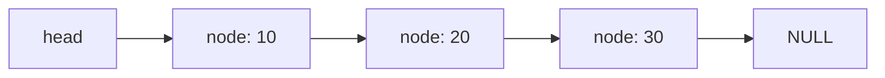

# Linked Lists

Linked lists replace an array's contiguous storage with nodes connected by pointers. Insertion or deletion near a known node can be constant time, but indexed access requires following links from the head. In C, the representation also exposes allocation, pointer-update order, and ownership decisions.

The same link pattern supports several structures: a one-way chain, a ring, a two-way sequence, a linked stack or queue, a sparse row, or an adjacency list.

## A sequence assembled from nodes

A **node** contains a data field and one or more links. A singly linked node in C can be written as

```c
typedef struct Node {
    int value;
    struct Node *next;
} Node;
```

A **singly linked list** has one link per node and is usually reached through a head pointer. Traversal goes only forward.



A **doubly linked list** stores `prev` and `next`, allowing traversal in both directions and $O(1)$ deletion when a pointer to the node is already available.

```text
NULL <- [prev|10|next] <-> [prev|20|next] <-> [prev|30|next] -> NULL
```

A **circular linked list** makes the final node point back to the first, or uses a header node whose links eventually return to that header. It suits repeated cycling and can remove boundary cases from insertion and deletion.

The list ADT commonly offers `insert_front(L, x)`, `insert_after(p, x)`, `delete_after(p)`, `find(L, key)`, `traverse(L, visit)`, and `is_empty(L)`. Their costs depend on which node pointers the caller already has.

The representation invariant is simple enough to state and important enough to check: starting at the head and repeatedly following `next` must visit every live node exactly once and then reach `NULL`, unless the type is explicitly circular. For a doubly linked list, every adjacent pair must also satisfy `p->next->prev == p`. If a stored size is present, it must equal the number of reachable data nodes. A broken invariant may leave nodes unreachable, create a cycle, or retain a pointer to freed storage.

## Count the traversal as well as the splice

With only a head pointer, a singly linked list supports insertion and deletion at the front in $O(1)$ time. Searching costs $O(n)$, and reaching item $i$ costs $O(i)$. A tail pointer reduces append from $O(n)$ to $O(1)$.

Deleting a particular node from a singly linked list requires its predecessor because that predecessor's `next` field must change. A doubly linked list stores the predecessor link explicitly, paying extra memory for simpler deletion.

| Operation | Singly list with head | Singly list with head+tail | Doubly linked list |
|---|---:|---:|---:|
| Insert at front | $O(1)$ | $O(1)$ | $O(1)$ |
| Delete at front | $O(1)$ | $O(1)$ | $O(1)$ |
| Append at rear | $O(n)$ | $O(1)$ | $O(1)$ with tail |
| Search by key | $O(n)$ | $O(n)$ | $O(n)$ |
| Delete known node | needs previous node | needs previous node | $O(1)$ |
| Access by index | $O(n)$ | $O(n)$ | $O(n)$ |

The phrase “known node” carries the important qualification. Inserting after a pointer already in hand is $O(1)$; inserting in sorted position remains $O(n)$ because finding that position dominates.

Arrays and lists also behave differently on real hardware. Nodes consume pointer space, are often scattered across the heap, and have poor cache locality. Lists pay off when pointer splicing avoids repeated array shifts or the structure naturally grows in small pieces.

For many workloads, a dynamic array wins even when its worst-case operation looks less attractive. Sequential traversal of contiguous elements uses cache lines and hardware prefetching well, whereas each list link may trigger a cache miss. A list is compelling when nodes must keep stable addresses, when frequent splices occur at already-known positions, or when another structure naturally embeds links in its records. It is a poor default merely because the number of elements changes.

## Splicing a singly linked list without losing its suffix

To insert a node after `p`, connect the new node to the old successor before redirecting `p`:

$$
\begin{aligned}
\text{new->next} &= \text{p->next} \\
\text{p->next} &= \text{new}
\end{aligned}
$$

Reversing those assignments overwrites the only link to the suffix.

For example, let `p` point to `10` in

```text
p
|
10 -> 30 -> 40 -> NULL
```

After allocating a node containing `20`, set `new->next = p->next`, then `p->next = new`:

```text
10 -> 20 -> 30 -> 40 -> NULL
```

Traversal from the head still reaches `10`, `20`, `30`, and `40`; no separate scan was needed because `p` was supplied.

## Unlinking a node in both directions

Consider `A <-> B <-> C <-> D` with `p` pointing to `C`. Deletion redirects both neighbors before freeing `p`:

1. Set `p->prev->next = p->next`, so `B->next` points to `D`.
2. Set `p->next->prev = p->prev`, so `D->prev` points to `B`.
3. Free `p`.

```text
A <-> B <-> D
```

Forward traversal gives `A, B, D`, and backward traversal gives `D, B, A`. At the head or tail, one missing neighbor is replaced by an update to the external head or tail pointer.

The order around `free` is non-negotiable. Both replacement links must be obtained and installed while `p` is still alive. After `free(p)`, even reading `p->next` to find the successor has undefined behavior. Setting the local variable `p = NULL` afterward may prevent accidental reuse through that variable, but it cannot clear other aliases that still point to the freed node.

## Sentinels, circular lists, and the head pointer

A **sentinel** node marks a boundary but stores no user value. Because there is always a node before the first real element, front insertion and deletion need fewer special cases. A circular sentinel can point to itself when the list is empty; following `next` from the sentinel eventually returns to it.

Circular traversal cannot use `while (p != NULL)`. The stopping condition must detect the sentinel or a return to the starting node.

Functions that may replace the first node often receive `Node **head`. The extra indirection lets them change the caller's head. Passing only `Node *head` would update a local copy when the first node is inserted or removed.

Another useful style is to keep a pointer to the link that names the current node. Initially that link is `&head`; after advancing, it is `&cur->next`. Deletion then has no separate head case:

```c
static int delete_first(Node **head, int value) {
    Node **link = head;
    while (*link != NULL && (*link)->value != value) {
        link = &(*link)->next;
    }
    if (*link == NULL) return 0;

    Node *victim = *link;
    *link = victim->next;
    free(victim);
    return 1;
}
```

`link` always points to the field that must change if the current node is removed. At the first node it names the caller's head pointer; later it names a preceding node's `next` field.

## Worked example: reversing in place

A singly linked list can be reversed in $O(n)$ time and $O(1)$ auxiliary space. Three pointers are needed because changing the current node's link would otherwise lose the unprocessed suffix.

Start with

```text
prev = NULL, cur = 10
10 -> 20 -> 30 -> NULL
```

At each iteration, save `cur->next` as `next`, redirect `cur->next` to `prev`, then advance both working pointers:

```c
static Node *reverse(Node *head) {
    Node *prev = NULL;
    Node *cur = head;
    while (cur != NULL) {
        Node *next = cur->next;
        cur->next = prev;
        prev = cur;
        cur = next;
    }
    return prev;
}
```

The states are

```text
after 10: NULL <- 10    20 -> 30 -> NULL
after 20: NULL <- 10 <- 20    30 -> NULL
after 30: NULL <- 10 <- 20 <- 30
```

When `cur` reaches `NULL`, `prev` points to `30`, the new head. The loop invariant is that `prev` heads the reversed prefix and `cur` heads the untouched suffix. Every original node remains in exactly one of those parts.

## Detecting an accidental cycle

A corrupted or deliberately circular list never reaches `NULL`, so an ordinary traversal can hang. Floyd's tortoise-and-hare algorithm advances one pointer by one link and another by two. If a cycle exists, the faster pointer eventually laps the slower pointer inside it; if there is no cycle, the fast pointer reaches the end.

```c
static int has_cycle(const Node *head) {
    const Node *slow = head;
    const Node *fast = head;
    while (fast != NULL && fast->next != NULL) {
        slow = slow->next;
        fast = fast->next->next;
        if (slow == fast) return 1;
    }
    return 0;
}
```

For `A -> B -> C -> D -> B`, after one iteration `slow` is at `B` and `fast` at `C`; after two they are at `C` and `B`; after three both are at `D`. The method uses constant extra space. Keeping a set of visited node addresses also detects the cycle, but requires $O(n)$ additional memory.

## Splicing and merging without copying values

Links allow whole runs of nodes to move without moving their payloads. Concatenating two singly linked lists is $O(1)$ if the first list stores a tail pointer: set `first.tail->next = second.head`, then update the combined tail. Without a tail pointer, finding the last node of the first list costs $O(n)$.

Merging two already-sorted lists takes $O(n+m)$ time. At each step, detach the smaller front node and append it to the result. A dummy head keeps the first append identical to later ones; after the loop, attach whichever input suffix remains. No node allocation is required, but the operation consumes the original list structure. A non-destructive merge would need new nodes or a different ownership model.

## Maintaining a sorted singly linked list in C

This implementation inserts in ascending order, deletes the first matching value, and releases the remaining nodes at shutdown.

```c
#include <stdio.h>
#include <stdlib.h>

typedef struct Node {
    int value;
    struct Node *next;
} Node;

static Node *make_node(int value) {
    Node *node = malloc(sizeof(*node));
    if (node == NULL) {
        fprintf(stderr, "malloc failed\n");
        exit(EXIT_FAILURE);
    }
    node->value = value;
    node->next = NULL;
    return node;
}

static void sorted_insert(Node **head, int value) {
    Node *node = make_node(value);
    if (*head == NULL || value < (*head)->value) {
        node->next = *head;
        *head = node;
        return;
    }

    Node *cur = *head;
    while (cur->next != NULL && cur->next->value < value) {
        cur = cur->next;
    }
    node->next = cur->next;
    cur->next = node;
}

static int delete_value(Node **head, int value) {
    Node *cur = *head;
    Node *prev = NULL;
    while (cur != NULL && cur->value != value) {
        prev = cur;
        cur = cur->next;
    }
    if (cur == NULL) return 0;
    if (prev == NULL) {
        *head = cur->next;
    } else {
        prev->next = cur->next;
    }
    free(cur);
    return 1;
}

static void print_list(const Node *head) {
    for (const Node *cur = head; cur != NULL; cur = cur->next) {
        printf("%d%s", cur->value, cur->next == NULL ? "\n" : " -> ");
    }
}

static void destroy(Node *head) {
    while (head != NULL) {
        Node *next = head->next;
        free(head);
        head = next;
    }
}

int main(void) {
    Node *list = NULL;
    sorted_insert(&list, 30);
    sorted_insert(&list, 10);
    sorted_insert(&list, 20);
    sorted_insert(&list, 40);
    delete_value(&list, 30);
    print_list(list);
    destroy(list);
    return EXIT_SUCCESS;
}
```

## Ownership and iterator validity

A node contains an integer here, so freeing the node finishes deletion. A node that owns a heap-allocated string must free that string first. A node that merely borrows a pointer must not free the pointed-to object. Mixing those policies across operations leads to leaks or double frees; the list API should choose one and document it.

Returning raw node pointers also creates an invalidation rule. Insertion does not invalidate pointers to existing nodes, one advantage over a growing array. Deleting a node immediately invalidates every pointer to it, however, and destroying the list invalidates all outstanding node pointers. A traversal that deletes its current node must save the successor before deletion.

Concurrent mutation needs synchronization beyond the link algorithm itself. Two threads can each perform locally sensible pointer writes and still lose an insertion or expose a half-updated doubly linked pair. Coarse locking around each operation is the simplest safe design. Lock-free lists require atomic operations, memory-order reasoning, and a reclamation scheme that prevents one thread from freeing a node another thread may still read.

## Finding structure with two moving pointers

The slow-and-fast pattern does more than detect cycles. To find a middle node, advance `slow` by one link and `fast` by two until `fast` reaches the end. On `10 -> 20 -> 30 -> 40 -> 50`, the pointer pairs begin at `(10, 10)`, then become `(20, 30)` and `(30, 50)`. The loop stops because `fast->next` is null, leaving `slow` at 30.

For an even-length list, the stopping convention decides which middle is returned. Starting both pointers at the head and looping while `fast != NULL && fast->next != NULL` returns the second middle of `10 -> 20 -> 30 -> 40`. A merge-sort split often wants the first middle instead, so it starts `fast` one link ahead or changes the condition. The edge cases should be chosen from the caller's needs rather than treated as an incidental detail.

The same idea finds the node $k$ positions from the end in one traversal. Advance a lead pointer $k$ links, then advance lead and follow together until lead reaches null. Their fixed separation leaves follow at the target. If the lead cannot advance $k$ times, the list is shorter than requested. Defining whether the final node is position zero or one avoids an off-by-one disagreement.

## Memory cost and intrusive links

A list node carrying a four-byte integer may occupy far more than four bytes. On a machine with eight-byte pointers, a singly linked node commonly needs a pointer plus the integer and alignment padding; a doubly linked node needs two pointers. The allocator may add metadata and round allocations to size classes. For millions of small values, pointer and allocation overhead can dominate payload size.

Allocating nodes from an arena or pool can improve locality and make bulk destruction cheap. It also changes lifetime rules: an individual node may be returned to the pool rather than the general allocator, and pointers become invalid when the arena is reset. The API must not mix pool-owned and separately allocated nodes without a way to distinguish them.

An **intrusive list** stores the link fields inside an object that exists for another reason. It avoids a wrapper-node allocation and can give one object membership in several lists through separate link fields. The list no longer owns a uniform standalone node, so container recovery, object lifetime, and removal-before-destruction become the caller's responsibility. Operating-system kernels use this pattern where allocation control and stable object identity matter.

## Checking a mutation locally

After a singly linked insertion, verify that the predecessor reaches the new node and the new node reaches the saved successor. After doubly linked deletion, verify both directions across the repaired gap. A debug build can occasionally walk the entire list, count nodes, compare the stored size, and check backward links. Full validation costs linear time, so it belongs in tests or assertions rather than every production splice.

## Pointer failures that corrupt a list

- Overwriting `p->next` before saving it disconnects the rest of a singly linked list.
- Front and rear operations must update any external head and tail pointers they invalidate.
- Removing a node from the chain without `free` leaks memory; reading its fields after `free` is undefined behavior. Save required links first.
- A singly linked deletion needs either the predecessor or a pointer to the link that names the target node.

<div className="see-also">

See also: [stacks](/cs/data-structures/stacks) · [queues](/cs/data-structures/queues) · [hashing](/cs/data-structures/hashing) · [graph representation](/cs/data-structures/graph-representation) · [binary trees](/cs/data-structures/binary-trees)

</div>
