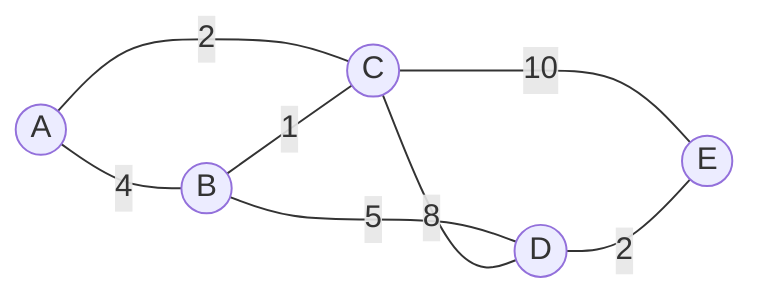
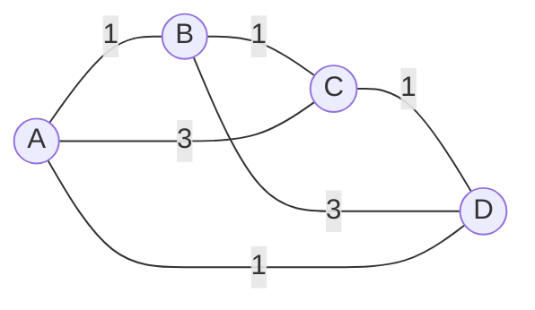

# Minimum Spanning Trees

A minimum spanning tree, or MST, connects every vertex of a weighted undirected graph with the least possible total edge weight and no cycles. The two standard algorithms expose different supporting structures: Kruskal uses disjoint sets, while Prim uses a priority queue or repeated minimum scans.

## What the tree must span

Let $G = (V, E)$ be a connected, undirected, weighted graph. A **spanning tree** is a subgraph $T = (V, E_T)$ that includes every vertex, is connected, and has no cycles. With $\lvert V \rvert$ vertices, every spanning tree has exactly $\lvert V \rvert - 1$ edges.

An MST minimizes the sum

$$
w(T) = \sum_{e \in E_T} w(e)
$$

If all edge weights are distinct, the MST is unique. Tied weights may permit several MSTs with the same total weight.

Distinct weights are sufficient for uniqueness, but they are not necessary. A graph can contain equal-weight edges and still have one MST. Given an MST, a precise test examines every non-tree edge: its weight must be strictly greater than the maximum edge weight on the tree path between its endpoints. Equality permits an exchange and therefore another MST. It is usually safer for an implementation to accept any minimum tree than to assume one exact edge set.

The input assumptions matter. Standard MSTs apply to undirected graphs. A disconnected graph has a **minimum spanning forest**, not one spanning tree.

Negative edge weights cause no difficulty. A spanning tree has a fixed number of edges, and both greedy proofs compare relative weights, not their signs. Parallel edges are also allowed; a self-loop can never help because it connects no new vertex. Directed graphs require a different object, a minimum arborescence rooted at a chosen vertex.

## Why the greedy choices are safe

Two exchange properties justify the algorithms:

- **Cut property:** for any partition of the vertices, a lightest edge crossing the cut belongs to some MST.
- **Cycle property:** for any cycle, there is an MST that omits a heaviest edge on that cycle.

The cut property has a short exchange proof. Let $e$ be a lightest edge crossing a cut, and choose an MST $T$. If $T$ already contains $e$, nothing remains to prove. Otherwise, adding $e$ to $T$ creates exactly one cycle. That cycle must contain another edge $f$ crossing the cut, because it enters and later leaves the opposite side. Since $e$ is lightest across the cut, $w(e)\le w(f)$. Replacing $f$ by $e$ restores a spanning tree and cannot increase total weight. The replacement is therefore another MST containing $e$.

The cycle property follows from the same exchange in reverse. If $e$ is a heaviest edge on a cycle and a candidate tree contains it, removing $e$ splits the tree. Some other edge $f$ on that cycle crosses the new cut, and $w(f)\le w(e)$. Replacing $e$ by $f$ does not increase cost. With strict inequality, no MST can contain $e$.

Kruskal repeatedly takes the lightest edge joining two current components. That edge is lightest across a cut between those components, so the cut property makes it safe. Edges whose endpoints are already in the same component are rejected because they would create a cycle.

Prim maintains one growing tree. The vertices inside and outside the tree define a cut, and the lightest crossing edge safely adds one outside vertex.

The rule is more constrained than “take a cheap nearby edge.” Each accepted edge must be lightest across a cut compatible with the partial solution. A globally light edge can be rejected once its endpoints already belong to the same component.

## Kruskal grows a forest into one tree

Consider this graph:



Kruskal sorts the edges and scans them in nondecreasing weight order. A **disjoint-set union** structure tracks components through `find(x)` and `union(a, b)`.

| Step | Edge considered | Action | Reason |
|---:|---|---|---|
| 1 | `B-C` weight 1 | add | joins two components |
| 2 | `A-C` weight 2 | add | joins `A` to the first component |
| 3 | `D-E` weight 2 | add | joins `D` and `E` |
| 4 | `A-B` weight 4 | reject | closes cycle `A-C-B-A` |
| 5 | `B-D` weight 5 | add | joins the two remaining components |

The component trace is

1. Begin with `\{A\}`, `\{B\}`, `\{C\}`, `\{D\}`, `\{E\}`.
2. Add `B-C`: `\{B,C\}`, `\{A\}`, `\{D\}`, `\{E\}`; total `1`.
3. Add `A-C`: `\{A,B,C\}`, `\{D\}`, `\{E\}`; total `3`.
4. Add `D-E`: `\{A,B,C\}`, `\{D,E\}`; total `5`.
5. Reject `A-B` because both endpoints are in `\{A,B,C\}`.
6. Add `B-D`: `\{A,B,C,D,E\}`; total `10`.

The selected edges are `B-C`, `A-C`, `D-E`, and `B-D`. They cover five vertices with four acyclic edges and total weight `10`.

The rejected edge `A-B` illustrates the cycle property: in cycle `A-B-C-A`, its weight 4 is greater than weights 1 and 2. The edges of weights 8 and 10 are never needed because the lighter edge `B-D` connects the two large components first. Stopping after $V-1$ accepted edges is safe; any additional accepted edge would create a cycle.

## Prim expands the cut around a start vertex

Starting Prim's algorithm at `A` on the same graph gives a different selection order:

1. From `S = \{A\}`, compare `A-B` at `4` with `A-C` at `2`; add `A-C`.
2. From `S = \{A,C\}`, the lightest crossing edge is `C-B` at `1`; add it.
3. From `S = \{A,B,C\}`, compare `B-D` at `5`, `C-D` at `8`, and `C-E` at `10`; add `B-D`.
4. From `S = \{A,B,C,D\}`, add `D-E` at `2` rather than `C-E` at `10`.

All vertices are now included. The total is again $2 + 1 + 5 + 2 = 10$, with the same edge set as Kruskal found.

Prim's start vertex can change the selection order and, when ties exist, the chosen MST. It cannot change the minimum total. A heap implementation normally stores for each outside vertex its best known connecting weight, called its key, and its prospective parent. When an accepted vertex reveals a lighter incident edge, the neighbor's key decreases. Some priority queues support an explicit decrease-key operation; another common implementation pushes a new pair and ignores stale entries when popped.

## Worked example with tied weights

Consider a four-cycle whose four boundary edges all have weight 1, plus diagonals `A-C` and `B-D` of weight 3.



Kruskal examines the four weight-1 edges first. Suppose the tie order is `A-B`, `B-C`, `C-D`, `D-A`:

1. Accept `A-B`; components are `\{A,B\}`, `\{C\}`, `\{D\}`.
2. Accept `B-C`; components are `\{A,B,C\}`, `\{D\}`.
3. Accept `C-D`; all vertices are connected and the total is 3.
4. Stop, or reject `D-A` because it closes the cycle.

If `D-A` appeared before `C-D`, the algorithm could select `A-B`, `B-C`, and `D-A` instead. Both trees have three edges and total weight 3. In fact, deleting any one boundary edge produces an MST, so there are four. Neither diagonal can appear in an MST: replacing it by the omitted weight-1 boundary edge reduces the total.

## Representation sets the running time

Kruskal takes $O(E \log E)$ time for edge sorting. With path compression and union by rank, its union-find work is nearly constant amortized time per operation, so sorting dominates.

Prim with an adjacency matrix and a linear minimum scan takes $O(V^2)$. With adjacency lists and a binary heap, it takes $O(E \log V)$.

Since $E\le V^2$ for a simple graph, $\log E=O(\log V)$, so Kruskal is often summarized as $O(E\log V)$. Prim's matrix version can beat heap overhead on dense graphs even though $O(V^2)$ looks less sophisticated. The representation should follow the graph density and the form in which edges arrive.

| Algorithm | Main data structures | Time complexity | Natural input shape |
|---|---|---:|---|
| Kruskal | edge list, sorting, union-find | $O(E \log E)$ | sparse graphs, edge-list input |
| Prim with matrix | adjacency matrix, arrays | $O(V^2)$ | dense graphs |
| Prim with heap | adjacency lists, priority queue | $O(E \log V)$ | sparse graphs |

A third classical method, Borůvka's algorithm, lets every current component select its cheapest outgoing edge in a round. All safe selections are added simultaneously, reducing the number of components by at least a constant factor each round. It is useful in parallel and distributed settings and also appears as a phase inside some faster MST implementations. The same cut property proves every selected component edge safe.

## Kruskal with path compression and rank

The C implementation sorts an edge array, merges disjoint components, and rejects disconnected input rather than reporting a partial forest as an MST.

```c
#include <stdio.h>
#include <stdlib.h>

typedef struct {
    int u;
    int v;
    int w;
} Edge;

typedef struct {
    int parent;
    int rank;
} Set;

static int compare_edges(const void *a, const void *b) {
    const Edge *ea = a;
    const Edge *eb = b;
    return (ea->w > eb->w) - (ea->w < eb->w);
}

static int find(Set sets[], int x) {
    if (sets[x].parent != x) {
        sets[x].parent = find(sets, sets[x].parent);
    }
    return sets[x].parent;
}

static int unite(Set sets[], int a, int b) {
    int ra = find(sets, a);
    int rb = find(sets, b);
    if (ra == rb) return 0;
    if (sets[ra].rank < sets[rb].rank) {
        sets[ra].parent = rb;
    } else if (sets[ra].rank > sets[rb].rank) {
        sets[rb].parent = ra;
    } else {
        sets[rb].parent = ra;
        sets[ra].rank++;
    }
    return 1;
}

int main(void) {
    Edge edges[] = {
        {0, 1, 4}, {0, 2, 2}, {1, 2, 1}, {1, 3, 5},
        {2, 3, 8}, {2, 4, 10}, {3, 4, 2}
    };
    int vertex_count = 5;
    int edge_count = (int)(sizeof(edges) / sizeof(edges[0]));
    Set sets[5];
    int total = 0;
    int chosen = 0;

    for (int i = 0; i < vertex_count; ++i) {
        sets[i].parent = i;
        sets[i].rank = 0;
    }
    qsort(edges, edge_count, sizeof(edges[0]), compare_edges);

    for (int i = 0; i < edge_count && chosen < vertex_count - 1; ++i) {
        if (unite(sets, edges[i].u, edges[i].v)) {
            printf("%d-%d weight %d\n", edges[i].u, edges[i].v, edges[i].w);
            total += edges[i].w;
            chosen++;
        }
    }
    if (chosen != vertex_count - 1) {
        fprintf(stderr, "graph is disconnected\n");
        return EXIT_FAILURE;
    }
    printf("total = %d\n", total);
    return EXIT_SUCCESS;
}
```

## Checks that distinguish an MST

A low-weight edge set is still wrong if it leaves a vertex disconnected or contains a cycle. For connected input, verify that the result has $V - 1$ selected edges and one connected component.

An MST minimizes the total weight of the tree. It does not minimize the distance from one source to every other vertex; that is a shortest-path problem. Equal edge weights can also produce several correct MSTs, so comparing only the chosen edge identities may reject valid answers.

To verify a proposed tree $T$, first check the inexpensive structural conditions: it contains every vertex, has $V-1$ edges, and is connected. Those imply acyclicity. Minimality needs more. For each non-tree edge $(u,v)$, find the maximum-weight edge on the unique $u$-$v$ path in $T$. If the non-tree edge is lighter, swapping it in produces a cheaper spanning tree and disproves minimality. If no such edge exists, the cycle property certifies $T$ as minimum.

For a small example, suppose a proposed tree contains path `A-B-C` with weights 7 and 4, while the graph also contains non-tree edge `A-C` of weight 5. Adding `A-C` creates a cycle. The maximum tree edge on that cycle is `A-B` at 7, so replacing it by the edge of weight 5 lowers the total by 2; the proposal was not minimum. If `A-C` instead had weight 8, it would give no improvement.

## What an MST models—and what it omits

MSTs fit connection problems in which paying for an edge once is enough and only total construction cost matters: laying a basic cable backbone, clustering points by deleting the largest tree edges, or forming a low-cost network skeleton. The mathematical model omits redundancy. Every edge in a tree is a bridge, so one failure disconnects it. A real network that needs fault tolerance may use an MST as a baseline and then add edges under a reliability constraint.

The model also ignores path quality. An MST can force a long route between nearby vertices because it minimizes the sum of selected edge weights, not pairwise travel distances or diameter. A shortest-path tree solves distances from one source but may cost more overall. Minimum-cost connected subgraphs with extra restrictions—bounded degree, required redundancy, or optional intermediate vertices—are different and often much harder problems.

## How weight changes affect a finished tree

The cut and cycle properties also explain local sensitivity. If the weight of a non-tree edge decreases, add it temporarily to the MST. It creates one cycle. If the changed edge is now lighter than the heaviest tree edge on that cycle, exchange those two edges; otherwise the old tree remains minimum with respect to that change.

If a tree edge becomes heavier, removing it splits the tree into two components. The cheapest graph edge crossing that cut is its best replacement. A replacement lighter than the changed edge improves the tree. These observations support dynamic MST data structures, though finding path maxima and cut minima quickly requires more machinery than rerunning the static algorithm.

For example, in the earlier MST the non-tree edge `C-D` has weight 8. Adding it creates the path cycle `C-B-D-C`, whose tree edges have weights 1 and 5. If `C-D` falls to 4, replace `B-D` at 5 and reduce the total from 10 to 9. If it falls only to 6, no exchange helps. The test examines the relevant cycle rather than comparing the changed edge with every tree edge.

## Deterministic output with ties

Applications sometimes need repeatable output even when several MSTs exist. Kruskal can sort by a secondary canonical key such as normalized endpoint identifiers after comparing weights. Prim can break equal keys the same way. The tie-breaker selects one of the valid minimum trees; it must never outrank edge weight.

Determinism helps snapshots and debugging, but it should not enter the correctness definition. A test can verify structure and total weight, or compare against a known optimum, without insisting on one arbitrary tie resolution. If downstream behavior depends on which equal-weight tree was chosen, that dependency belongs in the stated optimization objective or tie-breaking policy.

<div className="see-also">

See also: [graph representation](/cs/data-structures/graph-representation) · [graph traversals](/cs/data-structures/graph-traversals) · [heaps and priority queues](/cs/data-structures/heaps-priority-queues) · [shortest paths](/cs/data-structures/shortest-paths) · [sorting algorithms](/cs/data-structures/sorting-algorithms)

</div>
