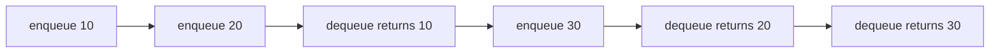

# Queues, Circular Queues, and Deques

A queue records waiting order. New elements enter at the rear, old elements leave from the front, and the element that has waited longest is served first. This FIFO rule appears in scheduling, buffering, breadth-first search, discrete-event simulation, and producer-consumer systems.

The basic queue is easy to describe but surprisingly easy to implement poorly in C. If an array queue always removes by shifting every remaining element left, each dequeue costs $O(n)$. If it uses a `front` index and never reuses earlier cells, the array appears full even when many cells have been dequeued. The circular queue solves both problems by treating the array as a ring. The deque, or double-ended queue, generalizes the idea by allowing insertion and deletion at both ends.

## The FIFO contract

A **queue ADT** has:

- **Objects**: finite ordered sequences $\langle x_0, x_1, \dots, x_{n-1}\rangle$, where $x_0$ is the front and $x_{n-1}$ is the rear.
- **`enqueue(Q, x)`**: insert `x` at the rear.
- **`dequeue(Q)`**: remove and return the front element.
- **`front(Q)`**: inspect the front element without removing it.
- **`is_empty(Q)`**: report whether the queue has no elements.
- **`is_full(Q)`**: meaningful for bounded array queues.

The defining rule is **FIFO**, first in, first out. If elements arrive as `A`, `B`, `C`, then the dequeue order is `A`, then `B`, then `C`.

A **linear array queue** uses two indices, `front` and `rear`, but does not wrap them. It is simple but wastes cells after dequeue operations.

A **circular queue** stores elements in `data[0..capacity-1]` and advances indices modulo the capacity:

$$
\mathrm{next}(i) = (i + 1) \bmod \mathrm{capacity}
$$

Common representations are:

- Keep a separate `size` field. Full when `size == capacity`, empty when `size == 0`.
- Leave one array slot unused. Full when `(rear + 1) % capacity == front`, empty when `front == rear`.

A **deque** supports `push_front`, `push_back`, `pop_front`, and `pop_back`. It can act as a stack, a queue, or a sliding-window structure.

## Ring-buffer invariants

The circular queue achieves $O(1)$ enqueue and dequeue without shifting elements. The proof is direct: each operation writes or reads one cell and updates one or two integers with modular arithmetic. The array never moves existing elements.

The separate-size convention makes full and empty tests unambiguous. Without `size`, `front == rear` could mean either empty or full, so an implementation must either reserve one cell or store additional state.

For applications, the semantic difference between stacks and queues is often more important than implementation details. DFS uses a stack-like frontier and follows one path deeply; BFS uses a queue and explores all vertices at distance $k$ before any vertex at distance $k+1$. A scheduler that should be fair among jobs usually starts with queue behavior, while an undo feature usually starts with stack behavior.

| Structure | Insert ends | Remove ends | Order rule | Typical use |
|---|---|---|---|---|
| Stack | top only | top only | LIFO | recursion, undo, DFS |
| Queue | rear only | front only | FIFO | scheduling, BFS, buffering |
| Circular queue | rear only | front only | FIFO with reused array cells | fixed-size buffers |
| Deque | front and rear | front and rear | programmer chooses | sliding windows, work stealing |

The most common C design decision is whether the queue owns its storage or receives storage from the caller. A small embedded-style circular queue may contain a fixed array inside the `struct`, making allocation unnecessary. A general-purpose queue may store a pointer, capacity, front index, rear index, and size so it can be initialized with any capacity. Linked queues add another option: keep both `front` and `rear` node pointers. Enqueue links a new node after the rear, and dequeue removes the front node. Without the rear pointer, enqueue would require traversal and would no longer be $O(1)$.

Deque implementations follow the same circular-buffer logic but update both ends. To push at the front, decrement `front` modulo capacity before writing. To pop at the back, decrement `rear` modulo capacity before reading. These off-by-one details are why it is worth writing down the exact invariant before coding.

For the separate-size representation used later, the invariant is:

- `front` is the index of the current first element when `size > 0`.
- `rear` is the next free slot for an enqueue.
- The logical element at offset $k$ is stored at index $(front+k)\bmod capacity$ for $0\le k\lt size$.
- `0 <= size <= capacity`.

After enqueue, advance `rear` and increment `size`. After dequeue, advance `front` and decrement `size`. When the last element is removed, `front` and `rear` meet automatically. Their numeric values do not need to reset to zero.

The one-unused-slot convention removes `size` but changes usable capacity. An array of physical length $C$ holds at most $C-1$ items. Empty means `front == rear`; full means `(rear + 1) % C == front`. Confusing physical and usable capacity is a common integration bug, so an API should name both clearly.

## Fixed, linked, and growing queues

A fixed ring buffer has predictable memory use and no allocation during operations. When full, the application must choose a policy: reject the new item, block the producer, overwrite the oldest item, or grow. Those behaviors are semantically different. Telemetry buffers often overwrite old samples, while a work queue normally must not silently discard a job.

A linked queue has no fixed element capacity except available memory. It needs both head and tail pointers for $O(1)$ operations. Enqueue allocates a node and links it after the tail; dequeue detaches and frees the head. When the final node is removed, both pointers must become `NULL`. Allocation overhead and poor locality can make a linked queue slower than a ring even though both operations are $O(1)$.

A dynamically growing circular array combines locality with flexible capacity. On growth, allocate a larger array and copy the logical sequence in order:

$$
new[k]=old[(front+k)\bmod oldCapacity],\qquad 0\le k<size.
$$

Then set `front = 0` and `rear = size`. Doubling capacity gives amortized $O(1)$ enqueue because the total number of copied elements across geometrically increasing capacities is linear in the number of enqueues. A single growth operation remains $O(n)$.

## Full queues and overload policy

A full bounded queue forces an application decision. Rejecting the new item preserves queued work. Overwriting the oldest item favors recent data. Blocking the producer applies backpressure, but it can deadlock if the consumer depends on that producer. Growing the buffer postpones the choice while consuming more memory. These outcomes should not be hidden behind the same boolean without documentation.

Latency-sensitive systems often choose a bound precisely so overload cannot turn into unbounded memory growth. Sustained occupancy near capacity means the arrival rate exceeds the service rate. The response may be admission control, more consumers, or a deliberate loss policy. The circular array supplies the storage mechanics; it does not determine which work may be dropped.

Batch dequeue can reduce synchronization and call overhead when ordering permits it. Removing up to a requested count still preserves FIFO order, including when the batch crosses the physical end of the ring. Its running time is linear in the number of returned elements.

## Deques as an algorithmic tool

A deque includes ordinary queue and stack behavior, but its most interesting uses mix the two ends. In 0–1 BFS, a relaxed zero-weight edge pushes its endpoint to the front while a one-weight edge pushes to the back. In a sliding-window maximum algorithm, the deque stores candidate indices in decreasing value order. Obsolete indices leave from the front; dominated values leave from the back.

The deque should store indices rather than values when expiration depends on position. Duplicate values then remain distinguishable. The front always identifies the maximum for the current window, while each array index enters and leaves the deque at most once, giving linear total time.

## How physical and logical order differ



Circular storage after wraparound:

```text
capacity = 6, size = 4

index:   0    1    2    3    4    5
value:  50   60   _    _    30   40
                rear->2  front->4

logical queue order: 30, 40, 50, 60
```

## Worked example: circular queue wraparound

A circular queue has capacity `5`, `front = 0`, `rear = 0`, and `size = 0`. Perform `enqueue(10)`, `enqueue(20)`, `enqueue(30)`, `dequeue()`, `dequeue()`, `enqueue(40)`, `enqueue(50)`, `enqueue(60)`, then find the final array and logical order.

With the separate-size convention, `rear` points to the next free cell and `front` points to the current front element.

1. Enqueue `10`: write at `rear = 0`, set `rear = 1`, `size = 1`.
2. Enqueue `20`: write at `1`, set `rear = 2`, `size = 2`.
3. Enqueue `30`: write at `2`, set `rear = 3`, `size = 3`.
4. Dequeue: read `data[0] = 10`, set `front = 1`, `size = 2`.
5. Dequeue: read `data[1] = 20`, set `front = 2`, `size = 1`.
6. Enqueue `40`: write at `3`, set `rear = 4`, `size = 2`.
7. Enqueue `50`: write at `4`, set `rear = 0` because `(4 + 1) % 5 = 0`, `size = 3`.
8. Enqueue `60`: write at `0`, set `rear = 1`, `size = 4`.

Final physical array:

```text
index:   0    1    2    3    4
value:  60   20   30   40   50
front = 2, rear = 1, size = 4
```

Ignore stale values outside the logical queue. Starting at `front = 2` and reading `size = 4` elements modulo `5` gives indices `2, 3, 4, 0`, so the logical order is `30, 40, 50, 60`.

## Worked example: a FIFO service simulation

Customers arrive at times `0`, `2`, `3`, and `9`. A single server takes `4` time units per customer. Simulate the service order and waiting times using a FIFO queue.

Process events in time order. When the server is free and the queue is nonempty, dequeue the next customer.

1. Time `0`: customer `A` arrives. Server is free, so `A` starts immediately. Finish time is `4`. Waiting time: `0 - 0 = 0`.
2. Time `2`: customer `B` arrives while `A` is being served. Queue: `[B]`.
3. Time `3`: customer `C` arrives. Queue: `[B, C]`.
4. Time `4`: `A` finishes. Dequeue `B`. `B` arrived at `2`, starts at `4`, waits `2`.
5. Time `8`: `B` finishes. Dequeue `C`. `C` arrived at `3`, starts at `8`, waits `5`.
6. Time `9`: customer `D` arrives while `C` is being served. Queue: `[D]`.
7. Time `12`: `C` finishes. Dequeue `D`. `D` arrived at `9`, starts at `12`, waits `3`.
8. Time `16`: `D` finishes.

The service order is `A, B, C, D`, exactly the arrival order. Waiting times are `0`, `2`, `5`, and `3`, for an average of $(0 + 2 + 5 + 3)/4 = 2.5$ time units.

## Worked example: sliding-window maximum with a deque

Find the maximum in every length-$3$ window of `[4, 2, 12, 3, 8, 7]`. Store indices in a deque, keeping their values in decreasing order.

1. Index `0`, value `4`: deque `[0]`.
2. Index `1`, value `2`: `2` does not dominate `4`, so deque `[0,1]`.
3. Index `2`, value `12`: remove indices `1` and `0` from the back because both values are at most `12`. Deque becomes `[2]`. The first window `[4,2,12]` has maximum `12`.
4. Index `3`, value `3`: index `2` is still in the window and has larger value. Deque `[2,3]`. Window `[2,12,3]` has maximum `12`.
5. Index `4`, value `8`: index `2` has not expired because the window starts at `2`. Remove index `3` from the back because `3 <= 8`; deque `[2,4]`. Window `[12,3,8]` has maximum `12`.
6. Index `5`, value `7`: the window now starts at `3`, so remove expired index `2` from the front. Append `5`, giving `[4,5]`. Window `[3,8,7]` has maximum `8`.

The output is `[12, 12, 12, 8]`. Each index is appended once and removed at most once, so all deque maintenance across the scan is $O(n)$ rather than $O(nk)$ for rescanning every window of length $k$.

## A bounded circular queue in C

The following program implements a bounded circular queue with a separate `size` field. The printed output demonstrates wraparound.

```c
#include <stdio.h>
#include <stdlib.h>

#define CAPACITY 5

typedef struct {
    int data[CAPACITY];
    int front;
    int rear;
    int size;
} Queue;

static void init(Queue *q) {
    q->front = 0;
    q->rear = 0;
    q->size = 0;
}

static int is_empty(const Queue *q) {
    return q->size == 0;
}

static int is_full(const Queue *q) {
    return q->size == CAPACITY;
}

static int enqueue(Queue *q, int value) {
    if (is_full(q)) return 0;
    q->data[q->rear] = value;
    q->rear = (q->rear + 1) % CAPACITY;
    q->size++;
    return 1;
}

static int dequeue(Queue *q, int *out) {
    if (is_empty(q)) return 0;
    *out = q->data[q->front];
    q->front = (q->front + 1) % CAPACITY;
    q->size--;
    return 1;
}

static void print_queue(const Queue *q) {
    printf("queue:");
    for (int k = 0; k < q->size; ++k) {
        int index = (q->front + k) % CAPACITY;
        printf(" %d", q->data[index]);
    }
    printf("\n");
}

int main(void) {
    Queue q;
    int removed;
    init(&q);
    enqueue(&q, 10);
    enqueue(&q, 20);
    enqueue(&q, 30);
    dequeue(&q, &removed);
    dequeue(&q, &removed);
    enqueue(&q, 40);
    enqueue(&q, 50);
    enqueue(&q, 60);
    print_queue(&q);
    return EXIT_SUCCESS;
}
```

## Boundary cases to settle in the API

- Confusing `front` and `rear` meanings. Document whether `rear` points to the last element or the next free slot.
- Forgetting modulo arithmetic when an index reaches the physical end of the array.
- Using `front == rear` for both full and empty without an extra convention.
- Shifting elements on every dequeue in an array queue. That implementation is simple but destroys the expected $O(1)$ queue operation.
- Reading stale cells in a circular buffer. Physical array contents are not the same thing as logical queue contents.
- Using a queue for expression evaluation where LIFO nesting is required; that is a stack problem.

The example returns `0` for failure and writes a dequeued value through `out`. This keeps every integer available as queue data. A sentinel return such as `-1` is unsafe if `-1` is a legitimate element.

Modulo by zero is undefined, so capacity must be positive before any index update. A dynamically allocated queue must also guard multiplication when converting element capacity to byte count. For fixed arrays these conditions are established at compile time.

Ordinary queue code is not automatically thread-safe. In a producer-consumer program, updating an index and the size is a multi-step state change. Locks, condition variables, atomics, and memory-order rules belong to the concurrent queue design; adding `volatile` does not make the operations atomic or establish inter-thread ordering.

## Related pages

- [stacks](/cs/data-structures/stacks)
- [arrays and array operations](/cs/data-structures/arrays)
- [linked lists](/cs/data-structures/linked-lists)
- [graph traversals](/cs/data-structures/graph-traversals)
- [shortest paths](/cs/data-structures/shortest-paths)
