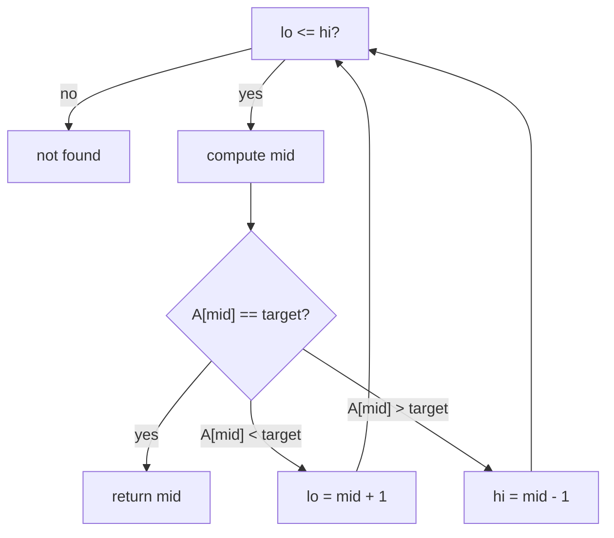

# Searching Algorithms

Searching asks whether a target key is present and, if so, where. The simplest method is linear search: inspect elements one by one. The most famous improvement is binary search: if the array is sorted, compare with the middle element and discard half of the remaining candidates. These two algorithms capture a recurring data-structures lesson: extra organization can buy faster operations, but only if the program maintains the required invariant.

Arrays support linear and binary search, binary search trees organize keys dynamically, and hashing aims for expected constant-time dictionary access. Linear and binary search are the useful baseline because their invariants are exposed directly in the array indices.

## What a search operation promises

The **search problem** takes a collection `A` and a target key `x`. It returns either a position `i` such that `A[i] == x`, or a failure value such as `-1`.

**Linear search** scans the collection in sequence:

$$
A[0], A[1], A[2], \dots
$$

until it finds the key or exhausts the collection. It works on unsorted arrays, linked lists, and streams.

**Binary search** works on a sorted random-access array. It maintains a search interval `[lo, hi]`. At each step it checks:

$$
mid = lo + \left\lfloor \frac{hi - lo}{2} \right\rfloor
$$

Then:

- If `A[mid] == x`, the search succeeds.
- If `A[mid] < x`, the target can only be in the right half, so set `lo = mid + 1`.
- If `A[mid] > x`, the target can only be in the left half, so set `hi = mid - 1`.

A **successful search** finds the key. An **unsuccessful search** proves the key is absent. For binary search, absence is proved when the interval becomes empty, meaning `lo > hi`.

## Cost of scanning and halving

Linear search has best-case $O(1)$ time when the target is first, worst-case $O(n)$ time when the target is absent or last, and average-case $O(n)$ time under ordinary assumptions. It needs no preprocessing and only sequential access.

Binary search has worst-case $O(\log n)$ time because each comparison halves the remaining interval. After `k` comparisons, the candidate interval has size at most:

$$
\frac{n}{2^k}
$$

The search stops when this drops below `1`, which occurs when $2^k \gt  n$, so $k = O(\log n)$.

Binary search requires sorted data and efficient index access. It is a poor fit for singly linked lists because finding the middle by index is not constant time. On linked lists, binary search loses its advantage unless additional indexing is present.

| Algorithm | Requires sorted data? | Requires random access? | Best | Worst | Works on linked list? |
|---|---|---|---:|---:|---|
| Linear search | no | no | $O(1)$ | $O(n)$ | yes |
| Binary search | yes | yes | $O(1)$ | $O(\log n)$ comparisons | not efficiently |
| Hash table lookup | no sorted order | array table | expected $O(1)$ | $O(n)$ | via buckets |
| BST search | maintained tree order | no | $O(1)$ at root | $O(h)$ | tree nodes |

Searching is often paired with update operations. If the data is built once and queried many times, sorting the array once and then using binary search can be excellent. If the data changes frequently, maintaining sorted order in an array may cost $O(n)$ per insertion or deletion. A hash table or balanced search tree may then be a better dictionary representation. The search algorithm cannot be chosen independently from the update pattern.

Variants of binary search answer more than "is the key present?" A lower-bound search returns the first index whose value is not less than the target. An upper-bound search returns the first index greater than the target. These variants are useful for duplicate keys and insertion positions. They use the same interval-halving idea, but the loop invariant changes, so copying ordinary binary search and changing one comparison often introduces boundary bugs.

For linked structures, linear search remains important. A linked list cannot jump to its middle in $O(1)$ time, so binary search's comparison count is not the whole cost. Hash tables with chained buckets also use short linear searches inside each bucket. Many fast dictionary operations are built from a hash computation followed by a small local linear scan.

Search can also return more than an index. Symbol tables and dictionaries return an associated record, not just the key. In C this often means returning a pointer to the found element or filling an output parameter. The API should make failure unambiguous: `NULL` works for pointer results, while integer-index searches commonly use `-1`.

When data contains duplicates, the required answer must be specified. "Find any matching key" is easier than "find the first matching key" or "count all matching keys." Binary-search variants can find the first and last positions in $O(\log n)$ each, after which the count is `last - first + 1`.

This is a small API detail, but it changes both tests and loop conditions.

## The invariant behind binary search

The inclusive-interval version maintains the claim: if the target occurs in the array, at least one occurrence lies in `A[lo..hi]`. Initially the interval is the whole array. If `A[mid] < target`, sorted order proves that every index through `mid` is too small, so assigning `lo = mid + 1` preserves the claim. The greater-than case is symmetric. When `lo > hi`, the candidate interval is empty and absence has been proved.

That argument also explains why the sorted precondition is structural rather than an optimization hint. Without monotonic order, a comparison at the middle says nothing about either discarded half.

There are two common interval conventions:

| Convention | Initial interval | Loop condition | Right-half update | Left-half update |
|---|---|---|---|---|
| inclusive | `[0, n-1]` | `lo <= hi` | `lo = mid + 1` | `hi = mid - 1` |
| half-open | `[0, n)` | `lo < hi` | often `lo = mid + 1` | often `hi = mid` |

Both are sound. Mixing their initialization, condition, and updates is not. Half-open intervals are especially convenient for lower bound because the final value `lo == hi` is an insertion position in the range `0..n`, including just after the last element.

## Lower bound, upper bound, and duplicates

Ordinary binary search can stop at any matching duplicate. Lower bound instead seeks the first index $i$ such that $A[i]\ge x$. Maintain a half-open interval `[lo, hi)` containing the answer. If `A[mid] < x`, indices through `mid` cannot be the answer, so move `lo`. Otherwise keep `mid` as a candidate by setting `hi = mid`.

```c
static int lower_bound(const int a[], int n, int x) {
    int lo = 0;
    int hi = n;
    while (lo < hi) {
        int mid = lo + (hi - lo) / 2;
        if (a[mid] < x) lo = mid + 1;
        else hi = mid;
    }
    return lo;
}
```

Upper bound changes the test to `a[mid] <= x` and returns the first index whose value is greater than $x$. Therefore the equal range is `[lower_bound, upper_bound)`, and its length is the number of occurrences. The formula also handles absence: both bounds are the same insertion position, producing length zero.

## When sorting pays for itself

Sorting before one search is usually wasteful: a linear scan costs $\Theta(n)$, while comparison sorting plus binary search costs $\Theta(n\log n)$. With many queries on unchanged data, the one-time sort can be amortized.

Suppose a linear query examines about $n/2$ elements on average and a binary query uses about $\log_2 n$ comparisons. If sorting costs approximately $c n\log_2 n$ comparisons and there are $q$ queries, compare

$$
q\frac{n}{2}
\quad\text{with}\quad
c n\log_2 n+q\log_2 n.
$$

The exact crossover depends on $c$, cache behavior, and the success distribution. The expression clarifies the trade: sorting is an index-building cost paid once to reduce each later lookup. Frequent insertions complicate it because maintaining sorted array order costs $O(n)$ per insertion.

Comparison-based search over a sorted array also has a logarithmic worst-case lower bound. A comparison with the target has at most three outcomes, and a decision tree must distinguish $n$ successful positions plus failure regions. Its height therefore grows as $\Omega(\log n)$. Binary search meets that asymptotic bound.

## Comparison count is only part of the cost

Linear search reads contiguous memory in order, which hardware prefetchers handle well. Binary search jumps between distant positions and can incur cache misses. For small arrays, or for one lookup over data that is already in cache, a branch-light linear scan can beat binary search despite making more comparisons. The asymptotic advantage becomes decisive only as the searched range grows.

Data layout also explains why binary search over a linked list is a bad bargain. Although the number of key comparisons can remain logarithmic in a carefully written method, reaching each midpoint requires pointer traversal. The accumulated access work is linear, with worse locality than a direct scan. Big-O for comparisons alone would conceal the actual operation being paid for.

A classic linear-search variant places a sentinel equal to the target just beyond the logical range. The inner loop then needs only an equality test; after it stops, the algorithm checks whether the found position is inside the original range. This saves a bounds test per iteration but requires a writable spare slot and careful restoration. Modern optimizing compilers and memory-safety concerns often favor the plain bounded loop. The sentinel remains useful as an example of trading a stronger representation precondition for a smaller loop body.

## Watching the candidate interval shrink

Binary search interval shrinking for target `23`:

```text
array: [2, 5, 8, 12, 16, 23, 38, 41, 56]
step 1: lo=0 hi=8 mid=4 A[mid]=16  -> go right
step 2: lo=5 hi=8 mid=6 A[mid]=38  -> go left
step 3: lo=5 hi=5 mid=5 A[mid]=23  -> found
```



## Worked example: linear search with comparison count

Search for `17` in `[4, 9, 2, 17, 6, 11]` using linear search and count comparisons.

Inspect from left to right.

1. Compare `A[0] = 4` with `17`. Not equal. Comparisons: `1`.
2. Compare `A[1] = 9` with `17`. Not equal. Comparisons: `2`.
3. Compare `A[2] = 2` with `17`. Not equal. Comparisons: `3`.
4. Compare `A[3] = 17` with `17`. Equal. Comparisons: `4`.
5. Return index `3`.

Linear search returns `3` after four comparisons. The array did not need to be sorted. If the target had been absent, the algorithm would have made six comparisons and returned failure.

## Worked example: binary search for an absent key

Search for `15` in sorted array `[2, 5, 8, 12, 16, 23, 38, 41, 56]` using binary search.

Maintain inclusive bounds `lo` and `hi`.

1. Start `lo = 0`, `hi = 8`.
2. Compute `mid = 0 + (8 - 0) / 2 = 4`. `A[4] = 16`.
3. Since `16 > 15`, discard indices `4..8`. Set `hi = 3`.
4. Now `lo = 0`, `hi = 3`. Compute `mid = 0 + (3 - 0) / 2 = 1`. `A[1] = 5`.
5. Since `5 < 15`, discard indices `0..1`. Set `lo = 2`.
6. Now `lo = 2`, `hi = 3`. Compute `mid = 2 + (3 - 2) / 2 = 2`. `A[2] = 8`.
7. Since `8 < 15`, set `lo = 3`.
8. Now `lo = 3`, `hi = 3`. Compute `mid = 3`. `A[3] = 12`.
9. Since `12 < 15`, set `lo = 4`.
10. Now `lo = 4`, `hi = 3`, so the interval is empty.

Return `-1` because `15` is absent. The final bounds also show where `15` would be inserted to preserve sorted order: index `4`, immediately before `16`.

## Worked example: first and last duplicate

Let `A = [1, 2, 2, 2, 5, 7]` and search for the range equal to `2`.

For lower bound:

1. Start `[lo,hi) = [0,6)`. `mid = 3`, `A[3] = 2`. Since it is not less than `2`, set `hi = 3`.
2. Interval `[0,3)`. `mid = 1`, `A[1] = 2`; set `hi = 1`.
3. Interval `[0,1)`. `mid = 0`, `A[0] = 1`; set `lo = 1`.
4. Bounds meet at index `1`, the first value not less than `2`.

For upper bound:

1. Start `[0,6)`. At `mid = 3`, `A[3] <= 2`, so set `lo = 4`.
2. Interval `[4,6)`. `mid = 5`, value `7 > 2`, so set `hi = 5`.
3. Interval `[4,5)`. `mid = 4`, value `5 > 2`, so set `hi = 4`.
4. Bounds meet at `4`, the first value greater than `2`.

The equal range is `[1,4)`, containing indices `1`, `2`, and `3`. Its size is $4-1=3$.

## Linear and binary search in C

This C program provides linear and iterative binary search. The binary search midpoint formula avoids overflow that can occur with `(lo + hi) / 2` on very large arrays.

```c
#include <stdio.h>
#include <stdlib.h>

static int linear_search(const int a[], int n, int target) {
    for (int i = 0; i < n; ++i) {
        if (a[i] == target) return i;
    }
    return -1;
}

static int binary_search(const int a[], int n, int target) {
    int lo = 0;
    int hi = n - 1;
    while (lo <= hi) {
        int mid = lo + (hi - lo) / 2;
        if (a[mid] == target) {
            return mid;
        } else if (a[mid] < target) {
            lo = mid + 1;
        } else {
            hi = mid - 1;
        }
    }
    return -1;
}

int main(void) {
    int unsorted[] = {4, 9, 2, 17, 6, 11};
    int sorted[] = {2, 5, 8, 12, 16, 23, 38, 41, 56};
    int n1 = (int)(sizeof(unsorted) / sizeof(unsorted[0]));
    int n2 = (int)(sizeof(sorted) / sizeof(sorted[0]));

    printf("linear 17 -> %d\n", linear_search(unsorted, n1, 17));
    printf("binary 23 -> %d\n", binary_search(sorted, n2, 23));
    printf("binary 15 -> %d\n", binary_search(sorted, n2, 15));
    return EXIT_SUCCESS;
}
```

## Boundary bugs and misleading cost claims

- Running binary search on unsorted data. The discard-half logic is invalid without sorted order.
- Updating bounds incorrectly and creating an infinite loop. Inclusive bounds need `lo = mid + 1` or `hi = mid - 1`.
- Computing `mid` as `(lo + hi) / 2` in systems where integer overflow is possible.
- Forgetting that binary search on a linked list is not efficient because middle access is costly.
- Returning arbitrary failure values without documenting them. In C, `-1` is common for "not found" when valid indices are nonnegative.
- Ignoring duplicates. Basic binary search may return any matching index; first or last occurrence requires modified logic.

Integer types need attention. The overflow-safe midpoint expression assumes `hi - lo` is representable and the array length fits the chosen index type. A reusable C interface normally uses `size_t`; then a half-open interval is easier because it never needs the problematic value `n - 1` when `n == 0`.

Search cost also includes the key comparison. Comparing fixed-size integers is reasonably modeled as $O(1)$. Comparing long strings may examine many characters, so a binary search can cost $O(L\log n)$ character inspections for maximum key length $L$. Quoting only the number of array probes can hide the dominant work.

<div className="see-also">

See also: [arrays and array operations](/cs/data-structures/arrays) · [sorting algorithms](/cs/data-structures/sorting-algorithms) · [binary search trees](/cs/data-structures/binary-search-trees) · [hashing](/cs/data-structures/hashing) · [linked lists](/cs/data-structures/linked-lists)

</div>
