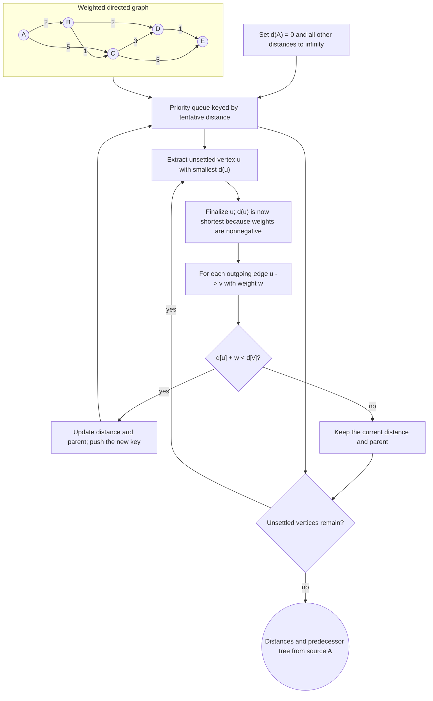

# Shortest Paths

Shortest-path algorithms find minimum-cost routes through weighted graphs. BFS handles equal-cost edges; Dijkstra handles general nonnegative weights; Bellman–Ford permits negative edges; Floyd–Warshall computes all pairs by dynamic programming. The weight restrictions are part of each algorithm's correctness, not a minor implementation condition.

A minimum spanning tree solves a different optimization problem. It minimizes the total weight of a tree connecting all vertices, while a shortest-path tree minimizes source-to-vertex route costs. The minimum spanning tree of a road network need not contain the shortest route between two chosen cities.

## Distances and relaxation

Let $G = (V, E)$ be a weighted graph with edge weight function $w(u,v)$. The **length** of a path is the sum of its edge weights. A **shortest path** from source `s` to vertex `v` is a path with minimum total weight among all paths from `s` to `v`.

The **single-source shortest-path** problem computes distances:

$$
d[v] = \delta(s, v)
$$

for every vertex `v`, where $\delta(s,v)$ is the true shortest-path distance from `s` to `v`.

The **all-pairs shortest-path** problem computes $\delta(i,j)$ for every ordered pair of vertices.

Core operation:

- **Relaxation**: given an edge `u -> v`, if the known distance to `v` can be improved by going through `u`, update it:

$$
\text{if } d[u] + w(u,v) < d[v], \text{ then } d[v] = d[u] + w(u,v)
$$

Dijkstra's algorithm assumes all edge weights are nonnegative. Bellman–Ford and Floyd–Warshall can handle negative edges, but a reachable negative cycle makes a finite shortest path undefined: walking around the cycle again reduces the path cost without bound.

## Why Dijkstra may finalize a vertex

Dijkstra's algorithm maintains a set of finalized vertices whose distances are known to be optimal. At each step it selects the unsettled vertex with the smallest tentative distance. With nonnegative weights, no later path through another unsettled vertex can improve it, because every extra edge adds a nonnegative amount.

Using an adjacency matrix and scanning for the next minimum tentative distance gives $O(V^2)$ time. Using adjacency lists and a binary heap priority queue gives $O((V + E)\log V)$ in a typical implementation.

Shortest-path implementations usually store a predecessor or parent array in addition to distances. Distances answer "how much does the best path cost?" Parents answer "what is the path?" After Dijkstra finishes, following `parent[target]`, then `parent[parent[target]]`, and so on reconstructs the path backward from the target to the source. If the parent remains `-1` for a non-source vertex, the vertex was unreachable.

The choice between Dijkstra and Floyd-Warshall is mostly about query pattern and graph size. If there is one source or a few sources in a sparse graph, repeated Dijkstra with adjacency lists is usually appropriate. If all vertex pairs are needed and the graph is small enough for a matrix, Floyd-Warshall is compact and handles dense graphs well. Its triple loop is also a classic example of dynamic programming over allowed intermediate vertices.

Negative weights require special care. A single negative edge can invalidate Dijkstra's finalized-distance argument. Floyd-Warshall can incorporate negative edges, but a negative diagonal entry after the algorithm indicates a negative cycle reachable from that vertex.

The Dijkstra proof uses a cut argument. Suppose `u` is the unsettled vertex with minimum tentative distance, and imagine a shorter path from the source to `u`. On that path, take the first unsettled vertex `x` and its settled predecessor `p`. When `p` was processed, relaxation established

$$
d[x]\le d[p]+w(p,x)=\delta(s,x).
$$

Because the remaining edges on the imagined path are nonnegative, $\delta(s,x)\le\delta(s,u)$. Minimum selection also gives $d[u]\le d[x]$. These inequalities contradict the claim that a path shorter than $d[u]$ exists. A negative edge breaks the nonnegative-remainder step, so an apparently final distance can later improve.

With a binary heap, many implementations insert a new pair whenever a distance improves rather than implementing decrease-key. When a pair `(du, u)` is popped, discard it if `du != dist[u]`. Each successful relaxation may create one heap entry, so the bound is commonly written $O((V+E)\log V)$ or $O(E\log V)$ for a connected graph. The stale-entry test avoids scanning outgoing edges again for an obsolete key.

## Negative edges and Bellman–Ford

Bellman–Ford repeatedly relaxes every edge. Any simple shortest path in a graph with $V$ vertices uses at most $V-1$ edges; if it repeated a vertex, removing the resulting nonnegative cycle would not increase cost. After pass $k$, all shortest paths that use at most $k$ edges have been propagated. Therefore $V-1$ passes suffice when no reachable negative cycle exists.

One additional pass detects a reachable negative cycle: if any distance can still decrease, there is a cheaper walk with at least $V$ edges, which must repeat a vertex. The repeated portion has negative total weight. Edges whose source remains unreachable must be skipped, or sentinel arithmetic can create a false relaxation.

Bellman–Ford costs $O(VE)$, much slower than heap Dijkstra on sparse nonnegative graphs. Its value is the broader weight model and the explicit negative-cycle test.

| Algorithm | Scope | Weight condition | Typical time |
|---|---|---|---:|
| BFS | one source | equal edge costs | $O(V+E)$ |
| Dijkstra | one source | nonnegative | $O((V+E)\log V)$ with binary heap |
| Bellman–Ford | one source | negative allowed; reports reachable negative cycle | $O(VE)$ |
| Floyd–Warshall | all pairs | negative allowed; no relevant negative cycle | $O(V^3)$ |

There are useful special cases outside the table. In a directed acyclic graph, process vertices in topological order and relax outgoing edges once. Every predecessor of a vertex has already been processed, so distances settle without a priority queue. The cost is $O(V+E)$ and negative edges are allowed because a DAG cannot contain a negative cycle.

For all-pairs queries on a sparse graph with nonnegative weights, running heap Dijkstra from every source costs roughly $O(VE\log V)$ and avoids a dense distance matrix during each run. Floyd–Warshall is often simpler for dense or modest-sized graphs and naturally returns a full matrix. The graph density, number of sources, permitted weights, and need to reconstruct paths all belong in the choice.

## Floyd–Warshall as a dynamic program

Let $D^{(k)}[i][j]$ be the best route from `i` to `j` whose intermediate vertices come only from `0..k`. Such a route either avoids vertex `k`, or it splits into a route from `i` to `k` and one from `k` to `j`. Hence

$$
D^{(k)}[i][j]=\min\left(D^{(k-1)}[i][j],D^{(k-1)}[i][k]+D^{(k-1)}[k][j]\right).
$$

The matrix can be updated in place when `k` is the outermost loop, because entries involving the newly allowed intermediate remain valid for the same stage. Swapping the loop order changes the dependency schedule and generally breaks the algorithm.

Initialize diagonal entries to zero, direct edges to their weights, and absent edges to infinity. After completion, `D[v][v] < 0` signals a negative cycle reachable from `v`. For a pair `(i,j)`, no finite shortest distance exists if `i` can reach such a cycle and the cycle can reach `j`.

## Distances are not paths

A predecessor array stores the last edge of each chosen best route. On relaxation through `u`, set `parent[v] = u`. To reconstruct a route to `t`, follow parents backward until the source, then reverse the sequence. If `dist[t]` is infinity, no parent chain should be followed.

Equal-cost alternatives need a policy if output must be deterministic. One implementation may keep the first predecessor found; another may prefer the smaller vertex identifier. Both distances are correct, but tests comparing an exact path must reflect the tie rule.

## Dijkstra's settle-and-relax loop



This Dijkstra diagram combines the weighted graph, priority queue, finalization invariant, and relaxation operation. The extract-min step is what makes a vertex settled, while each outgoing edge may update a tentative distance and predecessor. The update label includes the two common heap strategies: true decrease-key or inserting a duplicate entry and ignoring stale removals later.

## Worked example: Dijkstra from A

Run Dijkstra's algorithm from `A` on the graph above.

Keep tentative distances, use infinity for unknown values, and choose the unsettled vertex with smallest tentative distance each round.

Initial:

```text
d[A]=0, d[B]=inf, d[C]=inf, d[D]=inf, d[E]=inf
settled = {}
```

1. Choose `A` with distance `0`. Relax outgoing edges:
   - `A -> B` weight `2`: `0 + 2 < inf`, so `d[B]=2`, parent `A`.
   - `A -> C` weight `5`: `0 + 5 < inf`, so `d[C]=5`, parent `A`.
   Settled: `{A}`.
2. Choose unsettled minimum `B` with distance `2`. Relax:
   - `B -> C` weight `1`: `2 + 1 = 3 < 5`, so `d[C]=3`, parent `B`.
   - `B -> D` weight `2`: `2 + 2 = 4 < inf`, so `d[D]=4`, parent `B`.
   Settled: `{A,B}`.
3. Choose `C` with distance `3`. Relax:
   - `C -> D` weight `3`: `3 + 3 = 6`, not better than `4`.
   - `C -> E` weight `5`: `3 + 5 = 8 < inf`, so `d[E]=8`, parent `C`.
   Settled: `{A,B,C}`.
4. Choose `D` with distance `4`. Relax:
   - `D -> E` weight `1`: `4 + 1 = 5 < 8`, so `d[E]=5`, parent `D`.
   Settled: `{A,B,C,D}`.
5. Choose `E` with distance `5`. No outgoing improvements. Done.

The final distances are `A:0`, `B:2`, `C:3`, `D:4`, `E:5`. The shortest path to `E` is `A -> B -> D -> E`, with cost `2 + 2 + 1 = 5`.

## Worked example: one Floyd–Warshall stage

Suppose vertices are `0, 1, 2`, and the current distance matrix before allowing vertex `1` as an intermediate is:

```text
      0   1   2
0     0   4   10
1   inf   0    3
2   inf inf    0
```

Update distances using vertex `1` as a possible intermediate.

For every pair `(i,j)`, test whether `D[i][1] + D[1][j]` improves `D[i][j]`.

1. Pair `(0,2)`:

$$
\begin{aligned}
D[0][1] + D[1][2] &= 4 + 3 \\
&= 7
\end{aligned}
$$

Current `D[0][2]` is `10`, so update it to `7`.

2. Pair `(0,0)`: `D[0][1] + D[1][0] = 4 + inf = inf`, no improvement over `0`.
3. Pair `(0,1)`: `D[0][1] + D[1][1] = 4 + 0 = 4`, equal to current `4`.
4. Pairs starting from `1`: going through `1` adds `D[1][1] = 0`, so no improvement.
5. Pairs starting from `2`: `D[2][1] = inf`, so no path through `1`.

Updated matrix:

```text
      0   1   2
0     0   4    7
1   inf   0    3
2   inf inf    0
```

The new shortest known path from `0` to `2` is `0 -> 1 -> 2` with cost `7`, replacing the direct edge cost `10`.

## Worked example: why Dijkstra fails on a negative edge

Take directed edges `S -> A` of weight `2`, `S -> B` of weight `5`, and `B -> A` of weight `-10`.

1. Initialization gives `d[S]=0`, `d[A]=inf`, and `d[B]=inf`.
2. Relaxing edges from `S` gives `d[A]=2` and `d[B]=5`.
3. Dijkstra chooses `A` next because `2 < 5` and finalizes it.
4. Later it chooses `B`. Relaxing `B -> A` proposes $5+(-10)=-5$.
5. The true shortest path is `S -> B -> A` with cost `-5`, contradicting the earlier finalized value `2`.

The failure does not require a negative cycle. One negative edge is enough to invalidate the settle-once proof. Bellman–Ford handles the graph: after a pass establishes `d[B]=5`, a later relaxation of `B -> A` lowers `d[A]` to `-5`.

## Matrix-based Dijkstra in C

This C program implements Dijkstra's algorithm with an adjacency matrix and simple $O(V^2)$ minimum selection.

```c
#include <stdio.h>
#include <stdlib.h>
#include <limits.h>

#define V 5
#define INF 1000000000

static int min_unvisited(int dist[V], int used[V]) {
    int best = -1;
    for (int i = 0; i < V; ++i) {
        if (!used[i] && (best == -1 || dist[i] < dist[best])) {
            best = i;
        }
    }
    return best;
}

static void dijkstra(int graph[V][V], int source) {
    int dist[V];
    int parent[V];
    int used[V] = {0};

    for (int i = 0; i < V; ++i) {
        dist[i] = INF;
        parent[i] = -1;
    }
    dist[source] = 0;

    for (int step = 0; step < V; ++step) {
        int u = min_unvisited(dist, used);
        if (u == -1 || dist[u] == INF) break;
        used[u] = 1;

        for (int v = 0; v < V; ++v) {
            if (graph[u][v] != INF && !used[v]) {
                int candidate = dist[u] + graph[u][v];
                if (candidate < dist[v]) {
                    dist[v] = candidate;
                    parent[v] = u;
                }
            }
        }
    }

    for (int i = 0; i < V; ++i) {
        printf("vertex %d: dist=%d parent=%d\n", i, dist[i], parent[i]);
    }
}

int main(void) {
    int g[V][V] = {
        {INF, 2,   5,   INF, INF},
        {INF, INF, 1,   2,   INF},
        {INF, INF, INF, 3,   5},
        {INF, INF, INF, INF, 1},
        {INF, INF, INF, INF, INF}
    };
    dijkstra(g, 0);
    return EXIT_SUCCESS;
}
```

## Failure modes in implementations

- Running Dijkstra on graphs with negative edge weights. The finalized-distance argument no longer works.
- Confusing unreachable distance with a large real distance. Choose `INF` carefully to avoid overflow in `dist[u] + weight`.
- Forgetting to initialize `dist[source] = 0`.
- Treating an MST as a shortest-path tree. The optimization goals differ.
- Using Floyd-Warshall on a graph with a negative cycle and interpreting the output as finite shortest paths.
- In an adjacency matrix, using `0` for "no edge" when zero-weight edges are possible.

Integer overflow deserves more than a large `INF` constant. Before computing `dist[u] + weight`, establish that `dist[u]` is finite and that the addition fits the distance type. Using a wider signed type helps but does not remove the need for a bound when input weights are untrusted.

Early termination is sound in Dijkstra when the requested target is extracted with its current minimum key, not merely when it is first discovered. Discovery provides a tentative route; extraction under the nonnegative-weight invariant finalizes it.

For floating-point weights, comparisons near equality can make tie behavior platform-dependent. Negative zero and NaN also need a policy. Many graph applications avoid those questions by storing scaled integer costs when the domain permits it.

## Related pages

- [graph representation](/cs/data-structures/graph-representation)
- [graph traversals](/cs/data-structures/graph-traversals)
- [heaps and priority queues](/cs/data-structures/heaps-priority-queues)
- [minimum spanning trees](/cs/data-structures/minimum-spanning-trees)
- [queues](/cs/data-structures/queues)
