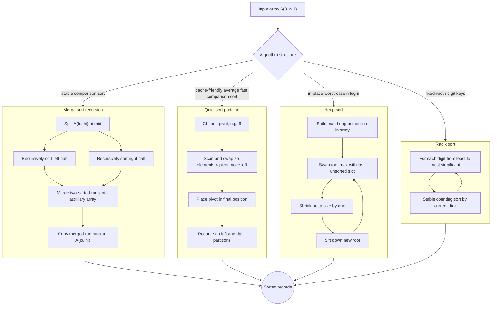

# Sorting Algorithms

Sorting rearranges records into key order. The algorithms are useful to compare because they solve the same problem with sharply different invariants: insertion sort grows a prefix, quicksort partitions, merge sort combines ordered runs, heap sort maintains a priority structure, and radix sort processes digits rather than comparisons.

## The ordering contract

Given records

$$
\langle r_0, r_1, \dots, r_{n-1}\rangle
$$

with keys $k_i$, sorting rearranges them so that

$$
k_0 \le k_1 \le \cdots \le k_{n-1}
$$

Several properties refine that contract:

- A **stable** sort preserves the original relative order of records with equal keys.
- An **in-place** sort uses only $O(1)$ or small auxiliary storage beyond the input, with recursion stacks treated separately in some definitions.
- An **adaptive** sort runs faster when the input is already close to sorted.
- A **comparison sort** learns order only by comparing keys.
- A **distribution sort** uses structure in the keys, such as digits or a bounded range.

Comparison functions are part of the contract in C. A `qsort` comparator must return a negative, zero, or positive result consistently. Returning `a - b` for integers can overflow; comparing with relational operators avoids that failure.

The comparison must define a strict weak ordering: it cannot say that $a\lt b$ and $b\lt a$, and its results must be transitive. A comparator that depends on mutable global state or changes its answer between calls invalidates the assumptions of the sorting algorithm. Floating-point NaN values need an explicit placement policy because ordinary less-than comparisons do not give them a total order.

## How the major families rearrange data

- **Selection sort** repeatedly selects the minimum remaining item and places it next.
- **Insertion sort** grows a sorted prefix by inserting the next item into position.
- **Bubble sort** repeatedly swaps adjacent out-of-order pairs.
- **Quicksort** partitions around a pivot, then recursively sorts both sides.
- **Merge sort** recursively sorts halves, then merges two sorted sequences.
- **Heap sort** builds a heap, then repeatedly removes the maximum.
- **Radix sort** processes digits, commonly with a stable counting sort at each pass.



## Time, space, and stability

Selection sort always makes $\Theta(n^2)$ comparisons. It performs relatively few swaps, which can matter when moving records is unusually expensive, but it is rarely the best general-purpose choice.

Insertion sort takes $\Theta(n^2)$ in the worst case and $\Theta(n)$ on an already sorted array. It is stable, has low overhead, and works well on small or nearly sorted ranges.

Quicksort averages $\Theta(n \log n)$ and has good cache behavior. Consistently poor pivots produce a $\Theta(n^2)$ worst case; randomized or median-of-three pivot selection reduces that risk.

Merge sort guarantees $\Theta(n \log n)$ time and can be stable, but merging arrays requires $\Theta(n)$ auxiliary storage. Heap sort also guarantees $\Theta(n \log n)$ and can run in place, though it is normally unstable and often has poorer cache behavior than quicksort.

Radix sort takes $O(d(n + b))$ for $d$ digit passes and base $b$. It is not a comparison sort, so the $\Omega(n \log n)$ comparison lower bound does not apply.

## Why comparison sorting needs $n\log n$

A deterministic comparison sort can be modeled as a decision tree. Each internal node asks a comparison question, and each leaf represents one possible final ordering. For $n$ distinct inputs there are $n!$ permutations, so a correct algorithm needs at least $n!$ leaves. A binary tree of height $h$ has at most $2^h$ leaves, hence

$$
2^h\ge n!,
\qquad
h\ge \log_2(n!).
$$

Using the lower bound $n!\ge(n/2)^{n/2}$ for $n\ge2$,

$$
\log_2(n!)\ge\frac{n}{2}\log_2\frac{n}{2}=\Omega(n\log n).
$$

Thus some input forces any comparison-only method to make on the order of $n\log n$ comparisons. Merge sort and heap sort meet that bound in the worst case. Radix and counting sorts escape it by asking stronger questions about digit values or a bounded key universe rather than learning order solely through pairwise comparison.

| Algorithm | Best | Average | Worst | Extra space | Stable? |
|---|---:|---:|---:|---:|---|
| Selection | $O(n^2)$ | $O(n^2)$ | $O(n^2)$ | $O(1)$ | no |
| Insertion | $O(n)$ | $O(n^2)$ | $O(n^2)$ | $O(1)$ | yes |
| Bubble | $O(n)$ with early stop | $O(n^2)$ | $O(n^2)$ | $O(1)$ | yes |
| Quicksort | $O(n \log n)$ | $O(n \log n)$ | $O(n^2)$ | $O(\log n)$ average stack | usually no |
| Merge sort | $O(n \log n)$ | $O(n \log n)$ | $O(n \log n)$ | $O(n)$ | yes |
| Heap sort | $O(n \log n)$ | $O(n \log n)$ | $O(n \log n)$ | $O(1)$ | no |
| Radix sort | $O(d(n+b))$ | $O(d(n+b))$ | $O(d(n+b))$ | $O(n+b)$ | yes if the digit sort is stable |

## Insertion sort as a moving boundary

Sort `[8, 3, 5, 2, 9]` by maintaining a sorted prefix and inserting `a[i]` into `a[0..i-1]`:

1. Begin with `[8]`.
2. Insert `3`: shift `8`, producing `[3, 8, 5, 2, 9]`.
3. Insert `5`: shift `8`, then place `5` after `3`, producing `[3, 5, 8, 2, 9]`.
4. Insert `2`: shift `8`, `5`, and `3`, producing `[2, 3, 5, 8, 9]`.
5. Insert `9`: the final item already follows `8`, so no shift is needed.

The last insertion shows the algorithm's adaptiveness: an item already in position costs one comparison and no data movement. More complex sorts often use insertion sort for small subarrays for the same low-overhead behavior.

An **inversion** is a pair of indices $i\lt j$ with $a_i\gt a_j$. Insertion sort removes one inversion each time it shifts a larger element right past the current key. Its total number of shifts equals the initial inversion count. A sorted array has zero inversions and costs linear time; a reverse-sorted array has

$$
\frac{n(n-1)}{2}
$$

inversions and triggers quadratic work. This gives a precise meaning to “nearly sorted”: few inversions imply little movement.

## The merge operation in isolation

Merge `L = [2, 5, 8]` and `R = [1, 3, 9]` with one cursor in each array:

1. Compare `2` and `1`; copy `1`.
2. Compare `2` and `3`; copy `2`.
3. Compare `5` and `3`; copy `3`.
4. Compare `5` and `9`; copy `5`.
5. Compare `8` and `9`; copy `8`.
6. `L` is exhausted, so copy the remaining `9`.

The merged run is `[1, 2, 3, 5, 8, 9]`. Choosing from the left run first when keys tie preserves stability.

Merge sort's recurrence is

$$
T(n)=2T(n/2)+\Theta(n),
$$

because it sorts two halves and performs one linear merge. At recursion level $j$, all merges together process $n$ elements. There are $\log_2n$ levels for power-of-two input, giving $\Theta(n\log n)$ total work. A linked list can be merge-sorted with $O(1)$ node-storage overhead because runs can be joined by relinking nodes, though recursion or an iterative run schedule still needs control state.

## Worked example: a complete partition

Apply the Lomuto partition used below to `[9, 3, 7, 1, 6, 2, 8]`. The pivot is the last value, `8`, and `i` marks the first slot not yet known to contain a value at most the pivot.

1. `9 > 8`, so leave `i = 0`.
2. `3 <= 8`; swap positions 0 and 1: `[3, 9, 7, 1, 6, 2, 8]`, then set `i = 1`.
3. `7 <= 8`; swap positions 1 and 2: `[3, 7, 9, 1, 6, 2, 8]`, then set `i = 2`.
4. `1 <= 8`; swap it with `9`: `[3, 7, 1, 9, 6, 2, 8]`, then set `i = 3`.
5. `6 <= 8`; swap it with `9`: `[3, 7, 1, 6, 9, 2, 8]`, then set `i = 4`.
6. `2 <= 8`; swap it with `9`: `[3, 7, 1, 6, 2, 9, 8]`, then set `i = 5`.
7. Swap the pivot with position 5: `[3, 7, 1, 6, 2, 8, 9]`.

The pivot is now at final index 5. Everything to its left is at most 8 and everything to its right is greater than 8; neither side is internally sorted yet. Recursion handles the two smaller ranges.

Lomuto partition is clear but behaves poorly with many equal keys because values equal to the pivot accumulate on one side. A three-way partition divides the range into values less than, equal to, and greater than the pivot. It can turn an all-equal input from deep quadratic recursion into one linear partition followed by no recursive work on the equal block.

## A compact Lomuto quicksort in C

This implementation uses the last item as pivot. Robust library sorts usually improve pivot selection and switch to insertion sort on small partitions.

```c
#include <stdio.h>
#include <stdlib.h>

static void swap(int *a, int *b) {
    int tmp = *a;
    *a = *b;
    *b = tmp;
}

static int partition(int a[], int lo, int hi) {
    int pivot = a[hi];
    int i = lo;
    for (int j = lo; j < hi; ++j) {
        if (a[j] <= pivot) {
            swap(&a[i], &a[j]);
            i++;
        }
    }
    swap(&a[i], &a[hi]);
    return i;
}

static void quicksort(int a[], int lo, int hi) {
    if (lo >= hi) return;
    int p = partition(a, lo, hi);
    quicksort(a, lo, p - 1);
    quicksort(a, p + 1, hi);
}

static void print_array(const int a[], int n) {
    for (int i = 0; i < n; ++i) {
        printf("%d%s", a[i], i + 1 == n ? "\n" : " ");
    }
}

int main(void) {
    int a[] = {9, 3, 7, 1, 6, 2, 8};
    int n = (int)(sizeof(a) / sizeof(a[0]));
    quicksort(a, 0, n - 1);
    print_array(a, n);
    return EXIT_SUCCESS;
}
```

The partition routine must place the pivot in its final position and return that index; the recursive calls then exclude the pivot.

Choosing the last element as pivot makes already sorted input produce partitions of sizes $n-1$ and 0, so both time and recursion depth become quadratic and linear respectively. Random pivot selection makes that repeated worst case unlikely for non-adversarial use. Production implementations often use **introsort**: begin with quicksort, switch to heap sort if recursion becomes too deep, and use insertion sort for short ranges. The combination retains quicksort's usual locality while bounding the worst case.

Tail-recursing on the smaller partition and looping over the larger one limits stack depth to $O(\log n)$ even when partitions are unbalanced. That transformation controls stack space; it does not repair quadratic comparison count from consistently bad pivots.

## Why bottom-up heap construction is linear

Calling insertion $n$ times would build a heap in $O(n\log n)$ time. Floyd's bottom-up construction instead sifts down each internal node and runs in $O(n)$. Most nodes are near the leaves and can move only a short distance. At most about $n/2^{h+1}$ nodes have height $h$, so the work is bounded by

$$
n\sum_{h\ge0}\frac{h}{2^{h+1}}=O(n).
$$

Heap sort then performs $n-1$ root removals, each $O(\log n)$, for total $O(n\log n)$. Its access pattern jumps around the array more than quicksort's scans, which helps explain the frequent constant-factor difference despite the stronger worst-case guarantee.

## Stability as observable behavior

Suppose records arrive in this order:

```text
(Kim, 82), (Lee, 91), (Park, 82), (Choi, 91)
```

Sorting stably by score gives

```text
(Kim, 82), (Park, 82), (Lee, 91), (Choi, 91)
```

Kim remains before Park, and Lee remains before Choi. If the records had already been sorted by name, a later stable sort by score would preserve name order within each score. The equivalent one-pass comparator sorts by the pair `(score, name)`. Stability matters when the prior order carries meaning that is not repeated in the current key.

An unstable algorithm can be decorated with the original index as a tie-breaker, but that increases key size and movement. It also changes the comparison contract rather than making the underlying algorithm stable.

## When the data does not fit in memory

External sorting is dominated by storage I/O rather than comparisons. A common external merge sort reads memory-sized chunks, sorts each chunk, writes the sorted runs, then performs a multiway merge using buffered input and a small heap of run heads. Long sequential reads and writes are far cheaper than random access on secondary storage.

The merge fan-in is limited by available buffers and file handles. More runs per pass reduce the number of passes, while larger buffers improve sequential throughput. The in-memory algorithm used for each run matters less than minimizing full-data I/O. Database systems also exploit existing ordered runs and may stop early for queries that require only the smallest $k$ records.

## Choosing for the records and the later workload

Large records may be cheaper to sort through an array of pointers or indices than to move in full. Stability matters for multi-key ordering: after sorting student records by first name, a stable sort by last name retains first-name order among equal last names.

A sorted array supports binary search in $O(\log n)$ and groups duplicates, but keeping it sorted across frequent insertions requires shifting elements. Update-heavy dictionaries often favor search trees or hash tables instead.

Algorithms with the same asymptotic time are not interchangeable. Memory use, stability, worst-case behavior, cache locality, and movement cost remain relevant. Bubble sort is mainly pedagogical; insertion sort is usually the stronger simple choice for small arrays. Radix sort requires structured keys and a stable digit-level operation, so it does not replace comparison sorting for arbitrary records.

After implementing a sort, test more than random arrays: empty and one-element inputs, already sorted and reverse-sorted data, all-equal keys, duplicate-heavy data, and values at comparator limits. Verify both order and permutation preservation. A result can be nondecreasing yet wrong if an element was lost or duplicated during movement.

<div className="see-also">

See also: [arrays and array operations](/cs/data-structures/arrays) · [heaps and priority queues](/cs/data-structures/heaps-priority-queues) · [searching algorithms](/cs/data-structures/searching-algorithms) · [binary search trees](/cs/data-structures/binary-search-trees) · [minimum spanning trees](/cs/data-structures/minimum-spanning-trees)

</div>
