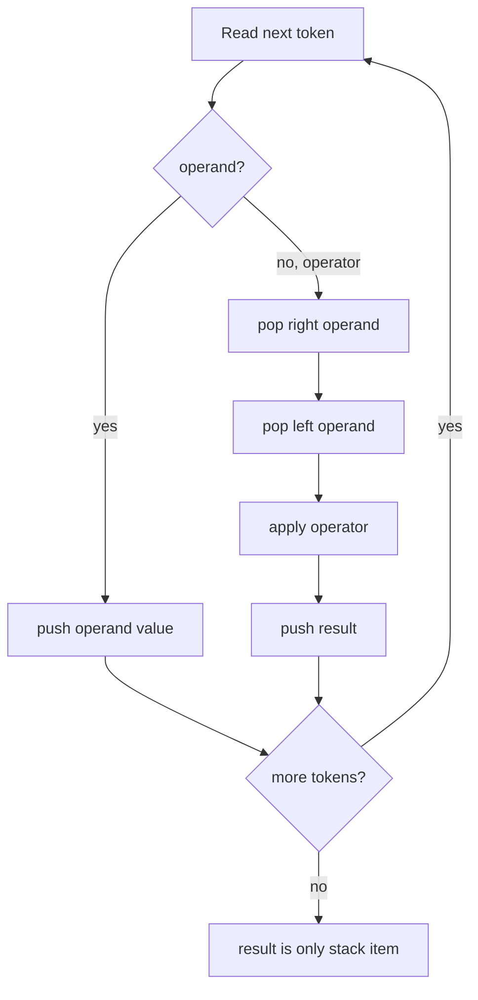

# Stacks and Expression Evaluation

A stack permits insertion and deletion only at one end, the top. The restriction gives a precise order: the last item pushed is the first item popped. Nested work therefore maps naturally to stacks, including function calls, parentheses, undo histories, backtracking, depth-first traversal, and expression evaluation.

## The LIFO interface

A stack stores a finite ordered sequence $\langle x_0, x_1, \dots, x_{n-1}\rangle$, with $x_{n-1}$ at the top. Its core operations are:

- `push(S, x)` inserts `x` at the top.
- `pop(S)` removes and returns the top item; it is invalid on an empty stack.
- `peek(S)` or `top(S)` returns the top item without removing it.
- `is_empty(S)` reports whether the stack has no items.
- `is_full(S)` applies to bounded array implementations.

For

$$
\mathrm{push}(A),\ \mathrm{push}(B),\ \mathrm{push}(C),\ \mathrm{pop}()
$$

the popped value is `C`.

The stack changes only at its top:

```text
push 10        push 20        pop
--------       --------       --------
|  10 | <-top  |  20 | <-top  |  10 | <-top
--------       |  10 |        --------
               --------
```

## Array storage or linked storage

An array stack stores items in `data[0..capacity-1]` and records the top position. One convention uses `top == -1` for empty and `data[top]` for the current item. Another uses `top == 0` for empty and stores the current item at `data[top - 1]`. Every operation must follow the same convention.

A linked stack uses the list head as the top. Pushing allocates a new head; popping removes it. Both representations provide $O(1)$ `push`, `pop`, and `peek`, but they fail differently.

| Implementation | Push | Pop | Extra memory per item | Failure mode | Natural use |
|---|---:|---:|---:|---|---|
| Fixed array | $O(1)$ | $O(1)$ | none beyond array slot | capacity exhausted | known maximum depth |
| Dynamic array | $O(1)$ amortized | $O(1)$ | unused capacity | allocation failure | general-purpose stack |
| Linked list | $O(1)$ | $O(1)$ | pointer per node | allocation failure | irregular linked structures |

Linked storage does not eliminate resource limits. It performs a `malloc` on every push and a `free` on every pop unless nodes are pooled. Small, frequently used stacks such as parser operator stacks are usually simpler and faster as dynamic arrays.

A dynamic array doubles its capacity when full. One push may then cost $O(n)$ because it copies the existing items, but a sequence of pushes is amortized $O(1)$ per item. Growing through capacities $1,2,4,\ldots,2^k$ copies at most

$$
1+2+4+\cdots+2^{k-1}=2^k-1
$$

old items before reaching capacity $2^k$. That total is linear in the final stack size. The implementation still needs to detect capacity arithmetic overflow and preserve the old allocation if reallocation fails.

The call stack used by C functions is managed by the runtime rather than by this ADT. Recursive DFS, tree traversal, and quicksort consume call-stack frames. An explicit stack gives the program direct control over capacity, allocation, and overflow handling.

Each operation should preserve a representation invariant. For the `top == -1` convention used below, an array stack must satisfy $-1\le top\lt capacity$, and the live items occupy exactly `data[0]` through `data[top]`. For a linked stack, following `next` from the top must reach each live node once and finish at `NULL`. These conditions are more useful for debugging than checking only the returned value from one pop.

## Worked example: matching nested delimiters

A delimiter checker pushes opening symbols and removes them when the matching closer arrives. The top is important: `([])` is valid, but `([)]` is not, even though each symbol occurs once.

Scan `f(a[2] + g({x}))` from left to right:

1. On `(`, push it: stack `[(]`.
2. On `[`, push it: stack `[(, []`.
3. On `]`, the top is `[`, so pop: stack `[(]`.
4. On `(`, push it: stack `[(, (]`.
5. On `{`, push it: stack `[(, (, {]`.
6. On `}`, pop the matching `{`.
7. The next `)` pops `(`, and the final `)` pops the original `(`.
8. End of input with an empty stack means the delimiters are balanced.

There are two distinct errors. A closing delimiter with an empty stack, or one that does not match the top, fails immediately. A nonempty stack at end of input reports unclosed delimiters. The algorithm takes $O(n)$ time and at most $O(n)$ space for an input of length $n$.

## Postfix evaluation reduces ready operands

In **infix** notation the operator appears between operands, as in `A + B`. **Prefix** writes `+ A B`, and **postfix** or reverse Polish notation writes `A B +`.

Postfix needs one operand stack because an operator appears only after its operands are available. After any prefix of the token stream, the stack contains the values of complete subexpressions whose surrounding operators have not yet appeared. Reducing the top two operands to one result preserves that invariant.



For `6 2 3 + * 4 -`, scan from left to right:

1. Push `6`, `2`, and `3`: `[6, 2, 3]`.
2. On `+`, pop right operand `3` and left operand `2`; push `5`: `[6, 5]`.
3. On `*`, pop `5` then `6`; push `30`: `[30]`.
4. Push `4`: `[30, 4]`.
5. On `-`, pop right operand `4` and left operand `30`; push `26`: `[26]`.

The order of the pops matters for subtraction and division. The postfix expression corresponds to `6 * (2 + 3) - 4` and evaluates to `26`.

## Delaying operators during infix conversion

Infix-to-postfix conversion uses a second stack for operators whose left operand is known but whose output position is delayed by precedence or parentheses. Higher-precedence operators leave the stack before lower-precedence ones; parentheses mark boundaries.

Convert `(A + B) * (C - D) / E` as follows:

1. Push `(`, output `A`, then push `+`.
2. Output `B`; on `)`, output `+` and discard `(`. Output: `A B +`.
3. Push `*`, then push the next `(`.
4. Output `C`, push `-`, and output `D`.
5. On `)`, output `-` and discard `(`. Output: `A B + C D -`.
6. On `/`, pop `*` first because the operators have equal precedence and are left associative; then push `/`.
7. Output `E`, then pop the remaining `/`.

The result is `A B + C D - * E /`, which represents `((A + B) * (C - D)) / E`.

The full operator rule needs both precedence and associativity. Before pushing an incoming left-associative operator, pop operators of greater **or equal** precedence. Before pushing a right-associative operator, pop only greater-precedence operators. Exponentiation is commonly right associative, so `A ^ B ^ C` becomes `A B C ^ ^`, representing $A^{(B^C)}$, rather than `A B ^ C ^`.

| Incoming token | Action |
|---|---|
| operand | append directly to output |
| left parenthesis | push onto operator stack |
| right parenthesis | pop to output until left parenthesis, then discard the pair |
| operator | pop operators required by precedence and associativity, then push it |
| end of input | pop remaining operators; any parenthesis is an error |

This is Dijkstra's shunting-yard method. Function calls and commas can be added by treating a function name as an operator and using commas to finish the current argument. Unary minus needs tokenization context: in `-3` or `a * -b` it is not the same operator as binary subtraction.

## A second expression trace: validating the final depth

Evaluate `5 1 2 + 4 * + 3 -`:

1. Push `5`, `1`, `2`: `[5, 1, 2]`.
2. `+` reduces `1` and `2` to `3`: `[5, 3]`.
3. Push `4`: `[5, 3, 4]`.
4. `*` reduces `3` and `4` to `12`: `[5, 12]`.
5. `+` reduces `5` and `12` to `17`: `[17]`.
6. Push `3`: `[17, 3]`.
7. `-` reduces to `[14]`.

The one remaining value is the result. By contrast, `2 +` underflows while trying to obtain two operands, and `2 3` ends with two values. Both are malformed even though every individual token is recognizable. For binary operators, a valid complete expression with $v$ operand tokens has exactly $v-1$ operator tokens, but stack-depth validation is still needed to ensure every prefix is reducible.

## Evaluating postfix expressions in C

This program accepts a whitespace-separated expression containing integers and the four basic binary operators. The fixed array stack checks overflow and underflow, and the final size check rejects extra operands.

```c
#include <stdio.h>
#include <stdlib.h>
#include <string.h>

#define MAX_STACK 128

typedef struct {
    int data[MAX_STACK];
    int top;
} Stack;

static void init(Stack *s) {
    s->top = -1;
}

static int is_empty(const Stack *s) {
    return s->top == -1;
}

static void push(Stack *s, int value) {
    if (s->top + 1 >= MAX_STACK) {
        fprintf(stderr, "stack overflow\n");
        exit(EXIT_FAILURE);
    }
    s->data[++s->top] = value;
}

static int pop(Stack *s) {
    if (is_empty(s)) {
        fprintf(stderr, "stack underflow\n");
        exit(EXIT_FAILURE);
    }
    return s->data[s->top--];
}

static int apply(int left, int right, char op) {
    switch (op) {
        case '+': return left + right;
        case '-': return left - right;
        case '*': return left * right;
        case '/':
            if (right == 0) {
                fprintf(stderr, "division by zero\n");
                exit(EXIT_FAILURE);
            }
            return left / right;
        default:
            fprintf(stderr, "unknown operator: %c\n", op);
            exit(EXIT_FAILURE);
    }
}

int main(void) {
    char input[] = "6 2 3 + * 4 -";
    char *token = strtok(input, " ");
    Stack s;
    init(&s);

    while (token != NULL) {
        char *end = NULL;
        long value = strtol(token, &end, 10);
        if (*end == '\0') {
            push(&s, (int)value);
        } else if (strlen(token) == 1) {
            int right = pop(&s);
            int left = pop(&s);
            push(&s, apply(left, right, token[0]));
        } else {
            fprintf(stderr, "bad token: %s\n", token);
            return EXIT_FAILURE;
        }
        token = strtok(NULL, " ");
    }

    int result = pop(&s);
    if (!is_empty(&s)) {
        fprintf(stderr, "malformed expression\n");
        return EXIT_FAILURE;
    }
    printf("%d\n", result);
    return EXIT_SUCCESS;
}
```

The token parser accepts a `long` and then casts it to `int`; a hardened version must reject values outside `INT_MIN` through `INT_MAX` before that cast and check `errno` for `strtol` range errors. Arithmetic can also overflow `int`, so an evaluator used with untrusted expressions needs checked addition, subtraction, and multiplication. Syntax validation does not imply arithmetic safety.

## Replacing recursion with an explicit stack

Depth-first search can store pending vertices explicitly. Push a start vertex, repeatedly pop one, and push its unvisited neighbors. Marking a vertex when it is pushed prevents the same vertex from being scheduled many times. The exact traversal order depends on the order in which neighbors are pushed; to imitate a recursive traversal that visits adjacency entries left to right, push them right to left.

An explicit frame may need more than a vertex. A recursive tree traversal implicitly remembers which node is active and which child should be processed next. To reproduce postorder iteratively, a frame can hold `(node, expanded)`: first push the node back as expanded, then push its children; when the expanded frame returns to the top, emit the node. The call stack stores the same state behind the language runtime.

Backtracking uses a stack of choices or frames for the same reason. When a branch fails, popping restores the most recent unresolved choice. Undo systems often use two stacks: executing an action pushes its inverse onto the undo stack and clears the redo stack; undo moves an entry to redo, and redo moves it back. A new action after undo creates a new history branch, so the old redo entries no longer apply.

## Monotonic stacks

A monotonic stack keeps its keys in increasing or decreasing order by popping entries that can no longer answer a later query. For the next-greater-element problem on `[2, 1, 2, 4, 3]`, keep indices whose next greater value is unknown:

1. Push index 0, value 2.
2. Value 1 is not greater than 2; push index 1.
3. Value 2 pops index 1, so the next greater value for 1 is 2. Equal value 2 does not pop index 0 under a strict-greater rule; push index 2.
4. Value 4 pops indices 2 and 0, assigning 4 as their next greater value; push index 3.
5. Value 3 is smaller than 4; push index 4. End of input leaves indices 3 and 4 without a greater value.

Each index is pushed once and popped at most once, so the total is $O(n)$ even though one iteration may pop several entries. The same accounting supports linear-time algorithms for stock span, largest rectangle in a histogram, and temperature-wait problems.

## Capacity is part of the interface

A fixed stack can report overflow, reject the operation, or terminate the program; silently overwriting an older item destroys LIFO semantics. Library code usually returns an error and leaves the stack unchanged. An embedded system may prefer a fixed capacity because memory use must be known, while a parser for arbitrary input may need dynamic growth plus an explicit maximum nesting depth to resist resource exhaustion.

Underflow deserves the same precision. Returning a sentinel value such as `-1` is ambiguous when that value is a valid item. An API can return a success flag and write through an output pointer, use an option type, or raise an exception in a language designed around exceptions. `peek` must follow the same empty-stack policy as `pop` even though it does not mutate the structure.

Generic stacks also need an ownership rule. A stack of borrowed pointers removes pointers without freeing their targets. An owning stack must destroy each remaining item when the stack itself is destroyed and define whether popping transfers ownership to the caller. If `push` copies records by value, the copying behavior and any nested allocations need attention.

## Measuring maximum stack depth

Some algorithms can predict their required capacity. Balanced-delimiter depth equals the maximum number of unmatched opening symbols in any input prefix. Postfix evaluation depth increases by one for an operand and decreases by one for a binary operator, after first requiring depth at least two. The maximum prefix depth is the smallest safe fixed capacity for that expression.

For `6 2 3 + * 4 -`, the depths after successive tokens are `1, 2, 3, 2, 1, 2, 1`, so capacity 3 is sufficient. This trace also validates the expression: depth never becomes negative or attempts an operator below its arity, and the final depth is exactly one. A compiler can compute such bounds while parsing generated expressions even if a general interactive evaluator chooses a dynamic stack.

## Where stack code goes wrong

- Postfix evaluators must pop the right operand before the left for noncommutative operators.
- An empty pop usually indicates malformed input or an algorithm error; it cannot be ignored safely.
- Linked stacks still require allocation checks and a `free` for every removed node.
- Left associativity changes infix conversion: `A - B - C` groups as `(A - B) - C`.
- FIFO workloads such as waiting lines and breadth-first traversal require queues, not stacks.
- Recursive and explicit stacks can both exhaust memory on extreme depth; switching representation changes control, not the finite-resource limit.

<div className="see-also">

See also: [arrays and array operations](/cs/data-structures/arrays) · [queues](/cs/data-structures/queues) · [linked lists](/cs/data-structures/linked-lists) · [binary trees](/cs/data-structures/binary-trees) · [graph traversals](/cs/data-structures/graph-traversals)

</div>
