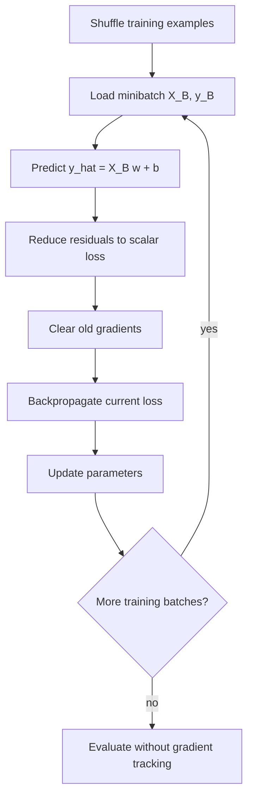

# Linear Regression and Training Loops

Linear regression is small enough to solve on paper yet contains the full supervised-learning workflow: examples and targets, a parameterized model, a loss, an optimizer, and evaluation on held-out data. Training the model with minibatches may seem excessive when a closed-form solution exists, but the loop is nearly the same one used for a multilayer network. The linear case offers something deeper models rarely do: every gradient and optimum can be checked independently.

## The affine model and its assumptions

For a feature vector $x_i\in\mathbb{R}^d$ and scalar target $y_i$, the prediction is

$$
\hat y_i=x_i^Tw+b,
$$

with weights $w\in\mathbb{R}^d$ and intercept $b\in\mathbb{R}$. For $n$ row-wise examples in $X\in\mathbb{R}^{n\times d}$,

$$
\hat y=Xw+b\mathbf{1}.
$$

The model is *linear in its parameters*. Features themselves may be transformed. With features $[x,x^2]$, the prediction $w_1x+w_2x^2+b$ is quadratic in $x$ but remains a linear regression problem in $w_1,w_2,b$. Interactions, splines, and one-hot encoded categories fit the same framework.

The intercept allows the fitted hyperplane to shift away from the origin. Without it, the model is forced to predict zero at $x=0$, whether or not the data support that constraint. Appending a constant-one column to $X$ absorbs $b$ into an enlarged weight vector. Frameworks usually keep bias separate because it is easy to inspect and is often excluded from weight decay.

Least squares assumes that a linear conditional mean is a useful approximation. It does not require every observation to lie near a line, but interpretation of standard statistical intervals typically adds assumptions about independent errors, constant variance, and sampling. Prediction with gradient descent can still work when some of those assumptions fail; residual diagnostics reveal what the model is missing.

## Squared loss from geometry and probability

For one example, use

$$
\ell_i=\frac12(\hat y_i-y_i)^2.
$$

The factor $1/2$ cancels the 2 from differentiation. The empirical objective is

$$
L(w,b)=\frac1n\sum_{i=1}^n\ell_i.
$$

Squared loss heavily penalizes large residuals. That gives smooth gradients but also makes the estimate sensitive to outliers. Absolute error grows linearly and is more robust, though its derivative is not unique at zero. Huber loss joins a quadratic region near zero to linear tails and is often a useful compromise.

There is a probabilistic derivation. Suppose

$$
y_i=x_i^Tw+b+\epsilon_i,
\qquad
\epsilon_i\overset{iid}{\sim}\mathcal N(0,\sigma^2).
$$

The joint likelihood is a product of Gaussian densities. After taking the negative logarithm and dropping terms independent of $w$ and $b$,

$$
-\log p(y\mid X,w,b)
=\frac{1}{2\sigma^2}\sum_i(y_i-x_i^Tw-b)^2+\mathrm{constant}.
$$

Thus maximizing likelihood gives the least-squares estimate. Gaussian noise is a modeling reason for squared error, not proof that every regression target has Gaussian errors.

Geometrically, ignore the intercept or include it as a constant feature. Predictions $Xw$ live in the column space of $X$. Least squares chooses the point in that subspace closest to $y$. At the optimum the residual $r=Xw-y$ is perpendicular to every feature column:

$$
X^Tr=0.
$$

That orthogonality condition produces the normal equations.

## The closed-form solution and where it breaks

For

$$
L(w)=\frac{1}{2n}\lVert Xw-y\rVert_2^2,
$$

the gradient is

$$
\nabla_wL=\frac1nX^T(Xw-y).
$$

Setting it to zero gives

$$
X^TXw=X^Ty.
$$

If $X$ has full column rank, $X^TX$ is invertible and

$$
w^*=(X^TX)^{-1}X^Ty.
$$

Writing the inverse is useful algebra, but numerical software should not explicitly form it. Solving the linear system is more stable. QR factorization avoids squaring the condition number, and singular value decomposition handles rank deficiency while exposing poorly determined directions. If columns are linearly dependent, infinitely many weight vectors may make the same predictions; the Moore–Penrose pseudoinverse returns the minimum-norm solution.

The closed form costs memory to form matrices and roughly cubic work in the feature dimension for a dense solve. It becomes unattractive with millions of features, streaming data, sparse high-dimensional inputs, or models that are nonlinear in their parameters. Gradient methods process subsets of examples and carry directly to neural networks.

### Worked example: projection onto one feature

Fit $\hat y=wx$ with no intercept to

$$
X=\begin{bmatrix}1\\2\end{bmatrix},
\qquad
y=\begin{bmatrix}3\\5\end{bmatrix}.
$$

First compute the scalar normal-equation terms:

$$
\begin{aligned}
X^TX&=1^2+2^2=5,\\
X^Ty&=1(3)+2(5)=13.
\end{aligned}
$$

Then

$$
w^*=5^{-1}(13)=2.6.
$$

Predictions and residuals are

$$
\hat y=\begin{bmatrix}2.6\\5.2\end{bmatrix},
\qquad
r=\hat y-y=\begin{bmatrix}-0.4\\0.2\end{bmatrix}.
$$

The fit cannot pass through both points because it is constrained to pass through the origin. The optimum check is

$$
X^Tr=1(-0.4)+2(0.2)=0.
$$

The residual is nonzero but orthogonal to the only feature column, so no small change in $w$ can reduce squared error.

### What centering says about the intercept

The intercept has a simple least-squares interpretation. Differentiate the objective with respect to $b$ and set the result to zero. The residuals must sum to zero, so their mean is zero. Rearranging gives $b=\bar y-\bar x^Tw$: the fitted hyperplane passes through the point of feature means and the target mean. When every feature and the target are centered using training-set means, the optimal intercept is zero. One can fit the centered problem without an intercept and then recover it from the means.

This result also explains a common regularization convention. Penalizing the intercept pulls the entire prediction surface toward zero, a value that depends on the arbitrary origin chosen for the target. Penalizing slopes instead discourages sensitivity to features. Most ridge and neural-network implementations therefore apply weight decay to weights but not biases. If targets have been centered, the distinction becomes less consequential, yet keeping the groups separate states the intent clearly.

Categorical variables require care with the constant column. If a category with $k$ levels is represented by all $k$ one-hot columns and an intercept is also present, those columns are linearly dependent because each row's indicators sum to one. Dropping one reference level, dropping the intercept, or using a constrained encoding removes the redundancy. Predictions can still be unique under a pseudoinverse, but individual coefficients are otherwise not identifiable.

The magnitude of a coefficient also depends on feature units. A weight measured per meter will be one hundredth of the corresponding weight measured per centimeter, with identical predictions. Standardized coefficients can be compared on a common scale, but correlation among features still complicates interpretation: several feature combinations may explain nearly the same direction in the data. Prediction quality does not automatically justify a causal reading of weights.

## From full gradients to minibatches

For minibatch $B$ with feature matrix $X_B$ and residual vector

$$
r_B=X_Bw+b\mathbf1-y_B,
$$

the mean-loss gradients are

$$
\nabla_wL_B=\frac{1}{|B|}X_B^Tr_B,
\qquad
\nabla_bL_B=\frac{1}{|B|}\mathbf1^Tr_B.
$$

Gradient descent uses all $n$ examples before each update. Stochastic gradient descent uses one. Minibatch SGD lies between them: matrix operations are efficient on accelerators, and sampling introduces noise that is tolerable over many updates. If batches are sampled uniformly, their average gradient is an unbiased estimate of the full gradient.

Batch size changes optimization and systems behavior together. Larger batches reduce gradient variance and use vector hardware efficiently, but perform fewer parameter updates per pass over the data and consume more memory. A learning rate that works for one batch size need not work for another. Loss reduction matters as well: switching from a mean to a sum multiplies gradients by batch size.

Feature scale controls the shape of the quadratic loss. If one feature ranges near $10^3$ and another near $10^{-2}$, curvature differs sharply by direction. A single learning rate then oscillates along the steep direction while moving slowly along the flat one. Standardizing each training feature to roughly zero mean and unit variance usually improves conditioning. Validation and test data must use the training-set mean and standard deviation, not statistics computed from themselves.

For least squares, the Hessian with respect to the weights is $X^TX/n$. Its eigenvectors give the principal curvature directions and its eigenvalues tell how sharply loss rises along each direction. With full-batch gradient descent, a constant learning rate that is too large relative to the largest eigenvalue causes oscillation or divergence. A very small eigenvalue produces slow progress along a nearly flat direction. The ratio of largest to smallest positive eigenvalue is the condition number; large ratios explain the long, narrow loss contours associated with poorly scaled or collinear features.

The quadratic objective is convex, so every local minimum is global. If the design has full column rank, the minimum is unique. That makes linear regression an unusually clean environment for checking an optimizer: failure to reach the known solution cannot be blamed on local minima. Minibatch noise can make the path wander, and a fixed nonzero learning rate may leave parameters fluctuating around the optimum. Reducing the learning rate over time narrows those fluctuations.

Sampling details affect the gradient estimate. Shuffling each epoch is suitable when rows are exchangeable. Ordered data can create batches containing only one class, time period, or magnitude range, leading to strongly biased consecutive steps. Time-dependent training may intentionally preserve order, but then state, leakage, and evaluation splits need a sequence-aware design. Sampling with replacement gives a clean independence model; typical data loaders shuffle once and partition without replacement, which also works well and guarantees one visit per example per epoch.



### Worked example: one minibatch update

Take $\hat y=wx+b$, examples $(1,2)$ and $(3,6)$, initial $w=1$, $b=0$, and learning rate $\eta=0.1$. Use

$$
L_B=\frac{1}{2|B|}\sum_{i\in B}(\hat y_i-y_i)^2.
$$

Predictions are $[1,3]$, so residuals are

$$
r_1=1-2=-1,
\qquad
r_2=3-6=-3.
$$

The gradients are

$$
\begin{aligned}
\nabla_wL_B
&=\frac12(r_1x_1+r_2x_2)\\
&=\frac12((-1)(1)+(-3)(3))\\
&=-5,\\
\nabla_bL_B
&=\frac12(r_1+r_2)=-2.
\end{aligned}
$$

Applying the update gives

$$
\begin{aligned}
w_{new}&=1-0.1(-5)=1.5,\\
b_{new}&=0-0.1(-2)=0.2.
\end{aligned}
$$

Before the update, mean half-squared loss is

$$
L_{old}=\frac14(1^2+3^2)=2.5.
$$

New predictions are $1.7$ and $4.7$, with residuals $-0.3$ and $-1.3$, so

$$
L_{new}=\frac14(0.3^2+1.3^2)=0.445.
$$

The step reduces loss substantially. That does not guarantee every SGD step will reduce full-dataset loss; a sampled batch can point in a noisy direction.

## A training loop that is easy to audit

```python
import torch
from torch import nn
from torch.utils.data import DataLoader, TensorDataset, random_split

torch.manual_seed(7)

n, d = 1200, 2
true_w = torch.tensor([[2.0], [-3.4]])
true_b = 4.2
X = torch.randn(n, d)
y = X @ true_w + true_b + 0.05 * torch.randn(n, 1)

train_set, valid_set = random_split(
    TensorDataset(X, y), [1000, 200],
    generator=torch.Generator().manual_seed(7),
)
train_loader = DataLoader(train_set, batch_size=32, shuffle=True)
valid_loader = DataLoader(valid_set, batch_size=128)

model = nn.Linear(d, 1)
loss_fn = nn.MSELoss()
optimizer = torch.optim.SGD(model.parameters(), lr=0.03)

for epoch in range(10):
    model.train()
    for xb, yb in train_loader:
        optimizer.zero_grad()
        loss = loss_fn(model(xb), yb)
        loss.backward()
        optimizer.step()

    model.eval()
    total_squared_error = 0.0
    with torch.no_grad():
        for xb, yb in valid_loader:
            total_squared_error += ((model(xb) - yb) ** 2).sum().item()
    valid_mse = total_squared_error / len(valid_set)
    print(f"{epoch=:2d} {valid_mse=:.6f}")

print(model.weight.detach(), model.bias.detach())
```

`zero_grad()` prevents accumulation from earlier batches. Backward computes gradients but does not update parameters; `step()` performs the update. Evaluation mode and `no_grad()` have different jobs: `eval()` changes behavior of layers such as dropout and batch normalization, while `no_grad()` disables autograd bookkeeping. A lone linear layer behaves the same in train and evaluation modes, but keeping the pattern avoids errors when the model grows.

Multiplying each batch's mean loss by batch size before accumulating is necessary when the final batch is smaller. The code instead accumulates squared errors directly and divides by the number of validation examples, producing the exact dataset MSE.

Framework broadcasting can hide shape errors. Predictions shaped $(B,1)$ and targets shaped $(B,)$ may combine into a $(B,B)$ residual matrix instead of $B$ paired residuals, depending on the operation. The program runs and gradients flow, but it optimizes comparisons between every prediction and every target. Inspecting shapes at the model boundary and asserting equality before computing loss is cheap protection. Scalar regression targets should consistently use either $(B,1)$ on both sides or $(B,)$ on both sides.

Reproducibility needs more than setting one seed. Data-loader workers, accelerator kernels, randomized splits, and nondeterministic parallel reductions can each introduce variation. Exact bitwise agreement may be unnecessary, but recording seeds, versions, split indices, and preprocessing parameters lets another run reproduce the same experimental setup. A small numerical difference is expected; a large change in validation behavior is evidence to investigate.

Training loss should be reported in the units readers expect. The common framework `MSELoss` omits the factor $1/2$ used in derivations, so its numerical value and gradient are twice those of the half-squared objective. Both have the same minimizer. Problems arise only when a hand-derived learning rate or gradient check assumes one convention while code uses the other. Root mean squared error restores target units and is easier to interpret, though optimization is usually performed on MSE.

## Diagnosing a fit rather than trusting one number

Training and validation loss answer whether optimization proceeds and whether performance transfers to held-out examples. They do not show *how* predictions fail. Plot residuals against fitted value and against important features. Curvature suggests missing nonlinear terms. A fan shape suggests target variance changes with magnitude. Clusters by category suggest a missing group effect. A few huge residuals can dominate MSE and may be data errors or genuinely rare cases.

Check a new loop first on synthetic data with known parameters. If it cannot recover $w$ and $b$ when noise is small, likely causes include mismatched tensor shapes, unintended broadcasting, a missing optimizer step, accumulated gradients, an unsuitable learning rate, or inconsistent loss scaling. Overfitting a tiny batch is another strong test: a sufficiently expressive model should drive its training loss close to zero.

Data splitting must respect how predictions will be used. Random splitting leaks future information in time series and can place near-duplicate records in both sets. Preprocessing parameters belong to the training split. The validation set guides model and hyperparameter choices; a final test set should remain untouched until those choices are fixed.

Extrapolation is a distinct risk. A line continues indefinitely beyond the observed feature range, while the real process may saturate or change regime. Low validation error from a random split says little about predictions far outside the training support because train and validation occupy the same range. If future deployment includes larger values, later times, or new populations, the evaluation set should represent that shift or the uncertainty should be stated explicitly.

Missing values also need a policy before fitting. Dropping incomplete rows can bias the sample when missingness is related to the target. Filling with a training-set statistic may be adequate, and an additional missingness indicator can let the model learn a systematic difference. Whatever method is chosen must be fit on training data and applied unchanged later. Passing a missing value directly into matrix multiplication usually turns the loss and gradients into `NaN`, after which every parameter update is contaminated.

Linear regression is also a useful baseline. If a deeper model cannot beat a well-preprocessed linear fit, architecture may not be the limiting factor. Target noise, leakage, evaluation mistakes, or poor optimization deserve investigation before adding layers.

## Related pages

- [Tensors and Data Preprocessing](/cs/deep-learning/tensors-data-preprocessing)
- [Math for Deep Learning](/cs/deep-learning/math-for-deep-learning)
- [Optimization Algorithms](/cs/deep-learning/optimization-algorithms)
- [Multilayer Perceptrons and Regularization](/cs/deep-learning/multilayer-perceptrons-regularization)
