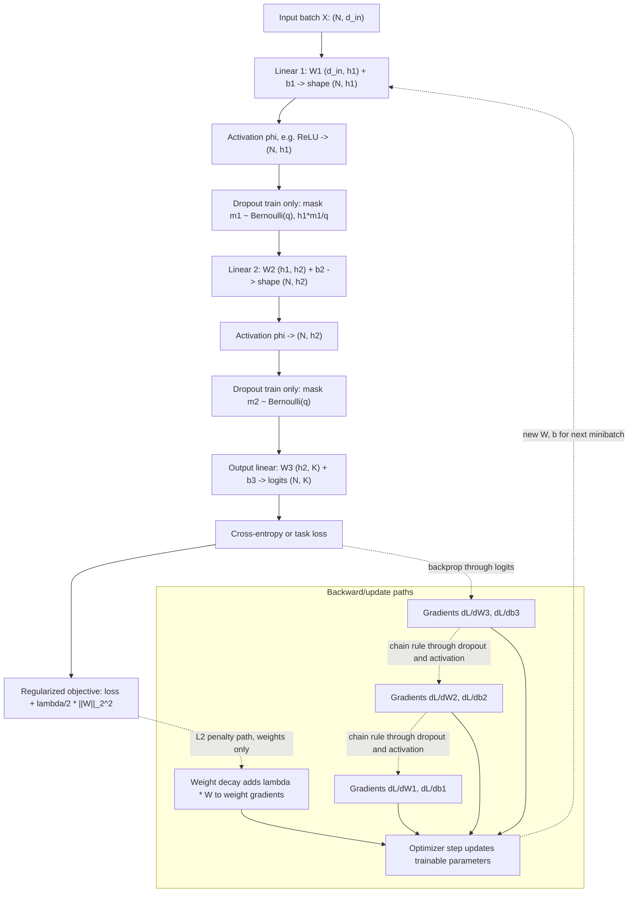

# Multilayer Perceptrons and Regularization

Multilayer perceptrons extend linear models by composing affine transformations with nonlinear activation functions. This is the first point in D2L where the model can represent genuinely nonlinear relationships without manually designing nonlinear features. A linear model can only carve input space with hyperplanes; an MLP can bend those boundaries by learning hidden representations.

The same flexibility creates new training issues. Deep networks can overfit, gradients can vanish or explode, initialization can make learning slow, and regularizers can change both optimization and generalization. D2L treats these as practical engineering concerns rather than isolated theory: activation choice, initialization, dropout, weight decay, and early stopping all shape the behavior of the same training loop.

## From affine maps to hidden representations

An **MLP** with one hidden layer maps an input $x \in \mathbb{R}^d$ to

$$
h = \phi(W_1 x + b_1),
\qquad
o = W_2 h + b_2,
$$

where $\phi$ is an elementwise activation function. For regression, $o$ may be a scalar prediction. For classification, $o$ is usually a vector of logits.

Common **activation functions** include

$$
\mathrm{ReLU}(x)=\max(x,0),
$$

$$
\sigma(x)=\frac{1}{1+\exp(-x)},
$$

and

$$
\tanh(x)=\frac{1-\exp(-2x)}{1+\exp(-2x)}.
$$

**Forward propagation** computes outputs layer by layer. **Backpropagation** applies the chain rule in reverse to compute gradients. A **computational graph** records which operations produced which tensors.

**Weight initialization** chooses initial parameter values before training. Xavier initialization aims to preserve activation variance through layers with roughly symmetric activations. Kaiming initialization is commonly paired with ReLU.

**Weight decay** adds an $L_2$ penalty to discourage large weights. **Dropout** randomly sets hidden activations to zero during training and rescales the survivors so their expectation is preserved. **Early stopping** halts training when validation performance stops improving.

## Why depth needs nonlinearity

Without nonlinear activations, stacking affine layers does not increase expressive power. If

$$
h = W_1x + b_1,
\qquad
o = W_2h + b_2,
$$

then

$$
o = W_2W_1x + W_2b_1 + b_2,
$$

which is just another affine function of $x$. The activation function is what lets hidden layers learn nonlinear features.

The ReLU activation is popular because it is simple, cheap, and has derivative $1$ for positive inputs:

$$
\frac{d}{dx}\mathrm{ReLU}(x) =
\begin{cases}
1, & x > 0, \\
0, & x < 0.
\end{cases}
$$

At $x=0$ the derivative is undefined, but frameworks choose a subgradient convention. ReLU reduces the saturation problem that affects sigmoid and tanh when inputs have large magnitude.

Dropout with drop probability $p$ keeps an activation with probability $q=1-p$. In inverted dropout, the training activation is

$$
\tilde{h}_j =
\frac{m_j h_j}{q},
\qquad
m_j \sim \mathrm{Bernoulli}(q).
$$

Then

$$
\mathbb{E}[\tilde{h}_j] = h_j.
$$

This means no extra scaling is needed at evaluation time.

Weight decay for loss $L(w)$ optimizes

$$
L(w) + \frac{\lambda}{2}\|w\|_2^2.
$$

The gradient contribution from the penalty is $\lambda w$, which shrinks weights toward zero during updates.

Capacity is not determined by parameter count alone, but parameter count is still a useful warning sign. A wide MLP can memorize small datasets, especially when labels contain noise. Regularization methods do not make overfitting impossible; they bias training toward simpler or more robust solutions. D2L's generalization discussion emphasizes that modern deep networks can generalize in regimes where classical parameter-count intuition is incomplete, but validation data remains essential.

Initialization interacts with activation functions. If weights are too small, signals and gradients may shrink as they pass through layers. If weights are too large, activations may explode or saturate. Xavier-style initialization balances fan-in and fan-out for roughly symmetric activations, while Kaiming initialization accounts for ReLU zeroing roughly half of its inputs.

Dropout and weight decay regularize in different ways. Weight decay directly penalizes large weights in the objective. Dropout injects multiplicative noise into activations during training, making the network less dependent on exact co-adaptations among hidden units. They can be used together, but their strengths and tuning knobs are not interchangeable.

Activation distributions are worth monitoring. If most ReLU units are always negative, they output zero and receive no gradient on those examples. If sigmoid or tanh units operate in saturated regions, their derivatives are tiny. Initialization, normalization, learning rate, and input scaling all influence where activations live. Preprocessing and initialization are therefore part of the model design rather than separate housekeeping.

Generalization controls should be evaluated on held-out data. A lower training loss after adding width may simply mean higher capacity. A lower validation loss after adding weight decay, dropout, or early stopping is stronger evidence of improved generalization. D2L's regularization sections are best read as a toolkit for changing the bias of training, not as guarantees that a model will generalize.

The MLP is also a reference model for non-image tabular features. Even when specialized architectures dominate vision and language, a well-regularized MLP remains a useful baseline for dense numeric and categorical features after appropriate preprocessing.

### A two-layer view of the chain rule

For one hidden layer, write $z_1=W_1x+b_1$, $h=\phi(z_1)$, and $o=W_2h+b_2$. Let scalar loss $L$ depend on $o$. Backpropagation computes vector–Jacobian products from right to left. If $\delta_2=\nabla_oL$, then

$$
\begin{aligned}
\nabla_{W_2}L&=\delta_2h^T,\\
\nabla_{b_2}L&=\delta_2,\\
\delta_1&=(W_2^T\delta_2)\odot\phi'(z_1),\\
\nabla_{W_1}L&=\delta_1x^T,\\
\nabla_{b_1}L&=\delta_1.
\end{aligned}
$$

The upstream gradient $W_2^T\delta_2$ says how the output responds to each hidden activation. Elementwise multiplication by $\phi'(z_1)$ accounts for the activation. The outer products accumulate parameter gradients. A framework records the forward operations and performs these local chain-rule steps automatically, but tensor shapes remain the programmer's responsibility.

Repeated multiplication explains vanishing and exploding gradients. If layer Jacobians mostly have singular values below one, a gradient propagated through many layers shrinks. Values consistently above one amplify it. Activations, initialization, normalization, residual connections, and clipping all influence this product. Clipping limits the result after it has grown; it does not repair poor signal propagation by itself.

## Choosing and initializing activations

ReLU is piecewise linear and does not saturate on its positive side. Its zero negative derivative can create a dead unit if every relevant preactivation becomes negative. Leaky ReLU retains a small negative slope, while GELU and SiLU gate values smoothly and are common in modern networks. Sigmoid remains appropriate for probabilities at certain outputs, but its derivative $\sigma(x)(1-\sigma(x))$ is at most $1/4$ and approaches zero in both tails. Tanh is zero-centered but also saturates.

Initialization should break symmetry and keep the scale of signals roughly stable. If every hidden weight starts at the same value, all units receive the same gradient and remain copies of one another. Randomness breaks that symmetry. Consider independent, zero-mean inputs and weights in a layer with fan-in $n$. Ignoring correlations,

$$
\mathrm{Var}(z)\approx n\,\mathrm{Var}(w)\,\mathrm{Var}(x).
$$

Keeping preactivation variance near input variance suggests $\mathrm{Var}(w)\approx1/n$. Xavier initialization balances fan-in and fan-out, often using variance $2/(n_{in}+n_{out})$ for symmetric activations. ReLU discards roughly half of a centered signal, motivating Kaiming variance near $2/n_{in}$. These are approximations at initialization, not promises that every trained layer maintains perfect variance.

Input scaling works with initialization. A carefully initialized first layer can still saturate if one feature arrives six orders of magnitude larger than another. Standardization also makes a weight-decay coefficient treat feature directions more comparably. For sparse or bounded features, domain-specific transforms may be more suitable than mechanical standardization.

## The forward and backward paths



The diagram keeps the batch dimension explicit from input `[N, d_in]` through hidden layers and logits `[N, K]`. Dropout belongs to the training-only activation path. An explicit $L_2$ penalty instead contributes to the objective and its gradients. Optimizer implementations may supply *decoupled* weight decay, discussed below, whose update is not identical to adding an $L_2$ term for every optimizer.

| Technique | Main purpose | Training-time behavior | Evaluation-time behavior |
|---|---|---|---|
| ReLU | Nonlinear representation | Clips negative preactivations | Same as training |
| Xavier init | Stable variance | Sets scale from fan-in and fan-out | Only affects starting point |
| Kaiming init | ReLU-friendly variance | Sets scale from fan-in | Only affects starting point |
| Weight decay | Penalize large weights | Adds $\lambda w$ to gradients | No direct runtime change |
| Dropout | Reduce co-adaptation | Randomly masks activations | Uses full network |
| Early stopping | Avoid late overfitting | Stops by validation signal | Selects saved checkpoint |

## Worked example 1: forward pass through a tiny MLP

Problem: compute the output of a one-hidden-layer MLP. Let

$$
x =
\begin{bmatrix}
1 \\
-2
\end{bmatrix},
\quad
W_1 =
\begin{bmatrix}
1 & 1 \\
2 & -1
\end{bmatrix},
\quad
b_1 =
\begin{bmatrix}
0 \\
1
\end{bmatrix},
$$

use ReLU activation, and let

$$
W_2 =
\begin{bmatrix}
1 & -2
\end{bmatrix},
\quad
b_2 = 0.5.
$$

Method:

1. Compute the hidden preactivation:

$$
z_1 = W_1x+b_1 =
\begin{bmatrix}
1(1)+1(-2) \\
2(1)+(-1)(-2)
\end{bmatrix}
+
\begin{bmatrix}
0 \\
1
\end{bmatrix}
=
\begin{bmatrix}
-1 \\
4
\end{bmatrix}
+
\begin{bmatrix}
0 \\
1
\end{bmatrix}
=
\begin{bmatrix}
-1 \\
5
\end{bmatrix}.
$$

2. Apply ReLU:

$$
h = \mathrm{ReLU}(z_1) =
\begin{bmatrix}
0 \\
5
\end{bmatrix}.
$$

3. Compute output:

$$
o = W_2h+b_2 =
\begin{bmatrix}
1 & -2
\end{bmatrix}
\begin{bmatrix}
0 \\
5
\end{bmatrix}
+0.5
= -10 + 0.5
= -9.5.
$$

Checked answer: the MLP output is $-9.5$. The first hidden unit is inactive because its preactivation is negative.

## Worked example 2: dropout preserves expectation

Problem: a hidden activation is $h=[2,4]^T$. Apply inverted dropout with drop probability $p=0.5$. List all possible masked outputs and show that the expected output equals $h$.

Method:

1. The keep probability is $q=1-p=0.5$.
2. Each unit is kept independently. If kept, it is scaled by $1/q=2$.
3. The four possible masks are $[0,0]$, $[1,0]$, $[0,1]$, and $[1,1]$, each with probability $0.25$.
4. The corresponding outputs are

$$
[0,0],
\quad
[4,0],
\quad
[0,8],
\quad
[4,8].
$$

5. Compute the expectation:

$$
\mathbb{E}[\tilde{h}]
=0.25[0,0]+0.25[4,0]+0.25[0,8]+0.25[4,8]
=[2,4].
$$

Checked answer: inverted dropout changes individual training passes but preserves the activation expectation. PyTorch dropout layers therefore disable masking in `eval()` mode rather than rescaling outputs again.

Preserving the mean does not preserve each output or its variance. For a scalar activation, inverted dropout adds variance $h^2p/q$. Training therefore sees a noisy family of subnetworks, while evaluation uses the deterministic full network. Batch normalization statistics can interact with this train–evaluation difference, so dropout is not automatically helpful in every architecture.

## Three ways to limit overfitting

Weight decay, dropout, and early stopping constrain training through different mechanisms. For ordinary SGD, adding $\lambda\lVert w\rVert_2^2/2$ gives the update

$$
w\leftarrow w-\eta(\nabla L(w)+\lambda w)
=(1-\eta\lambda)w-\eta\nabla L(w).
$$

The multiplicative factor shrinks weights on every step. With adaptive optimizers, an $L_2$ gradient is rescaled by the optimizer's coordinate-wise statistics. Decoupled weight decay, as in AdamW, applies shrinkage separately and is therefore not generally equivalent to an $L_2$ loss penalty. Framework argument names can obscure the distinction, so the optimizer documentation matters.

Dropout injects activation noise and discourages reliance on a precise set of hidden responses. It usually belongs between hidden layers rather than after final logits. The best rate depends on data size, width, normalization, and architecture. A high drop probability can cause underfitting or make optimization needlessly noisy. Validation evidence, not habit, should justify its inclusion.

Early stopping treats training duration as a capacity control. Save the parameters whenever the monitored validation metric improves; stop after a chosen patience interval without improvement; restore the best checkpoint rather than the last one. Validation loss is noisy, so stopping on the first bad epoch is unstable. Repeated tuning against the same validation set gradually overfits model-selection decisions to it, leaving the test set necessary for a final estimate.

| Method | Direct effect | Common tuning signal | Main failure mode |
|---|---|---|---|
| Weight decay | Shrinks parameter magnitudes | Validation loss across $\lambda$ | Too much produces an overly smooth, biased fit |
| Dropout | Adds multiplicative activation noise | Validation metric across drop rate | Too much prevents useful co-adaptation and slows fitting |
| Early stopping | Limits optimization time | Best validation checkpoint | Noisy metric or short patience stops too soon |
| Smaller network | Reduces representational capacity | Width/depth sweep | May underfit structure the data support |

Regularization does not compensate for leakage. If validation examples influence preprocessing, feature construction, or checkpoint choices, an apparently strong validation score can coexist with poor deployment performance. Splits should follow the future prediction boundary: by user, time, location, or group when random rows would share information.

## A small nonlinear classification experiment

```python
import torch
from torch import nn
from torch.utils.data import DataLoader, TensorDataset

torch.manual_seed(2)

n = 1000
X = 4 * torch.rand(n, 2) - 2
y = ((X[:, 0] ** 2 + X[:, 1] ** 2) > 1.5).long()
loader = DataLoader(TensorDataset(X, y), batch_size=64, shuffle=True)

model = nn.Sequential(
    nn.Linear(2, 32),
    nn.ReLU(),
    nn.Dropout(p=0.2),
    nn.Linear(32, 16),
    nn.ReLU(),
    nn.Linear(16, 2),
)

for i, module in enumerate(model):
    if isinstance(module, nn.Linear):
        if i < len(model) - 1:
            nn.init.kaiming_uniform_(module.weight, nonlinearity="relu")
        else:
            nn.init.xavier_uniform_(module.weight)
        nn.init.zeros_(module.bias)

loss_fn = nn.CrossEntropyLoss()
optimizer = torch.optim.Adam(model.parameters(), lr=0.01, weight_decay=1e-4)

model.train()
for epoch in range(30):
    for xb, yb in loader:
        loss = loss_fn(model(xb), yb)
        optimizer.zero_grad()
        loss.backward()
        optimizer.step()

model.eval()
with torch.no_grad():
    accuracy = (model(X).argmax(dim=1) == y).float().mean().item()
print(f"training accuracy: {accuracy:.3f}")
```

The target is whether a point lies outside a circle, so no single straight decision boundary can solve it. Hidden ReLU units piece together multiple linear regions. The example reports training accuracy only to keep focus on representation; a real comparison needs a held-out split and validation-guided regularization. The final linear layer uses Xavier initialization because no ReLU follows its logits.

## Failure modes worth checking first

- Stacking linear layers without nonlinear activations and expecting a deeper model.
- Leaving dropout active during evaluation by forgetting `model.eval()`.
- Applying dropout to logits in a simple classifier unless there is a specific reason.
- Using sigmoid in deep hidden layers without considering saturation and vanishing gradients.
- Initializing all weights to zero, which makes hidden units learn identical features.
- Assuming lower training loss always means a better model. Validation behavior is the relevant generalization signal.
- Applying strong weight decay to biases and normalization scale parameters without checking whether that policy is intended.
- Comparing regularizers after giving them unequal training budgets or selecting them on test performance.

## Related pages

- [Softmax classification and generalization](/cs/deep-learning/softmax-classification-generalization)
- [Optimization algorithms](/cs/deep-learning/optimization-algorithms)
- [PyTorch builders guide](/cs/deep-learning/pytorch-builders-guide)
- [Linear regression and training loops](/cs/deep-learning/linear-regression-training)
