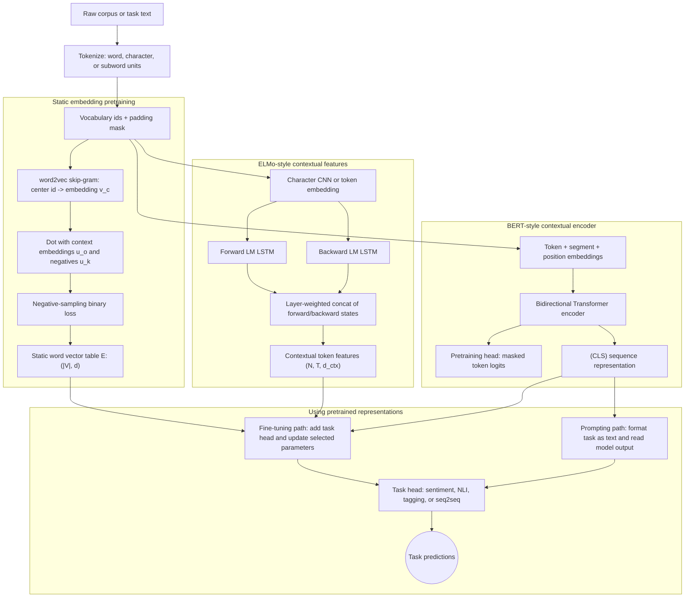

# NLP Pretraining and Applications

D2L's NLP application chapters connect representation learning to downstream language tasks. Before transformers became dominant, word embeddings such as word2vec and GloVe showed that useful semantic structure could be learned from unlabeled text. Modern systems extend that idea with contextual encoders and task-specific fine-tuning for sentiment analysis, natural language inference, and sequence-to-sequence prediction.

The common thread is that text must be represented numerically while preserving enough linguistic structure to support the task. A bag of words can work for simple sentiment problems, but it loses order and context. Static embeddings represent each word type with one vector. Contextual models represent each token occurrence based on surrounding tokens. Applications differ in output structure, but they all depend on tokenization, vocabulary handling, batching, masking, and loss design.

## From tokens to model inputs

A **token** is a unit of text such as a character, word, or subword. A **vocabulary** maps tokens to integer ids. An **embedding matrix** $E \in \mathbb{R}^{\vert \mathcal{V}\vert \times d}$ maps each token id to a vector.

Data preprocessing carries unusual weight in NLP. Tokenization choices change sequence lengths, vocabulary size, unknown-token rate, and evaluation comparability. Subword tokenization improves coverage for rare and morphologically related words, while padding masks prevent models from learning from artificial padding.

| Representation | Contextual? | Handles rare words | Typical use |
|---|---|---|---|
| One-hot token | No | Poorly | Input to embedding lookup |
| word2vec | No | Depends on vocabulary | Static semantic features |
| GloVe | No | Depends on co-occurrence data | Static semantic features |
| Static subword embedding | No | Better | Open-vocabulary modeling |
| RNN hidden states | Yes | With embeddings | Sequence classification/generation |
| Transformer states | Yes | With subword tokenization | Modern NLP fine-tuning |

## Training static word vectors

Word embeddings work because distributional patterns carry meaning: words appearing in similar contexts often have related meanings. Skip-gram and GloVe optimize different objectives, but both place words in vector spaces where dot products or cosine similarity reflect contextual association.

**Skip-gram word2vec** predicts context words from a center word. Given center word $w_c$ and context word $w_o$, the model scores them by an embedding dot product. Negative sampling trains the model to distinguish observed context pairs from sampled noise pairs. For one positive pair and negative words $w_1,\ldots,w_K$, its objective is

$$
-\log \sigma(u_o^T v_c)
-\sum_{k=1}^{K}\log \sigma(-u_k^T v_c),
$$

where $v_c$ is the center embedding and the $u$ vectors are output embeddings. Negative sampling replaces a full softmax over the vocabulary with binary classification over observed and sampled pairs, which lets word2vec scale to large corpora.

Subsampling frequent words is another word2vec device. Articles, punctuation, and other very common tokens occur in many contexts but carry limited semantic specificity. Downsampling them reduces training cost and gives informative context pairs more influence. Negative samples are often drawn from a smoothed unigram distribution so common words appear often enough to be useful without dominating training.

**GloVe** instead learns from global co-occurrence counts. Its objective encourages word-vector dot products to match transformed co-occurrence statistics. Both approaches produce static embeddings: each word type receives one vector, regardless of context.

### Checking a negative-sampling loss by hand

Suppose a skip-gram model has center vector $v_c=[1,2]$, positive output vector $u_o=[2,0]$, and one negative output vector $u_n=[0,1]$.

The positive score is

$$
u_o^T v_c = [2,0]\cdot[1,2] = 2,
$$

so the positive contribution is

$$
-\log\sigma(2) \approx -\log(0.881) \approx 0.127.
$$

The negative also has score $u_n^T v_c=2$, but its contribution uses the negated score:

$$
-\log\sigma(-u_n^Tv_c)=-\log\sigma(-2)\approx -\log(0.119)\approx 2.127.
$$

The total loss is therefore

$$
0.127 + 2.127 = 2.254.
$$

The negative pair is costly because the model currently assigns it a high dot-product score.

### Negative sampling in PyTorch

```python
import torch
from torch import nn
from torch.nn import functional as F

torch.manual_seed(8)

vocab_size = 50
embed_size = 16
batch = 4
negatives = 3

center = torch.randint(0, vocab_size, (batch,))
positive = torch.randint(0, vocab_size, (batch,))
negative = torch.randint(0, vocab_size, (batch, negatives))

center_embed = nn.Embedding(vocab_size, embed_size)
context_embed = nn.Embedding(vocab_size, embed_size)

v = center_embed(center)
u_pos = context_embed(positive)
u_neg = context_embed(negative)

pos_score = (v * u_pos).sum(dim=1)
neg_score = torch.bmm(u_neg, v.unsqueeze(2)).squeeze(2)

loss = -F.logsigmoid(pos_score).mean() - F.logsigmoid(-neg_score).mean()
loss.backward()

print("negative sampling loss:", loss.item())
print("center embedding gradient shape:", center_embed.weight.grad.shape)
```

## Static vectors, ELMo features, and BERT states

Static embeddings force every sense of a word into one vector. The word "bank" has different meanings in financial and river contexts, but its static embedding averages across uses. Contextual encoders instead produce a representation for each token occurrence conditioned on the sentence.



The three pretraining paths produce different objects: a vocabulary-sized table of static vectors, a sequence of contextual recurrent features, or transformer states that can be read at token or sequence level. Downstream systems either attach a task head and fine-tune selected parameters or express the task as text and read the model's generated output.

Pretrained vectors also inherit patterns from their corpus. Social stereotypes and domain-specific associations in the training text can reappear in vector similarities and downstream classifiers. They are learned artifacts of data, not neutral dictionary entries.

## Choosing a head for the prediction target

**Sentiment analysis** predicts polarity or rating from text. A sequence encoder may use pooling, recurrent final states, convolutional features, or a special classification token. The classifier head maps the resulting document representation to logits, usually trained with cross-entropy for categorical labels.

**Natural language inference** predicts whether a hypothesis is entailed by, contradicted by, or neutral with respect to a premise. Simple concatenation is a useful baseline, while attention and transformer encoders give premise and hypothesis tokens direct comparison paths. NLI is a demanding test because lexical overlap alone cannot resolve negation, quantifiers, or paraphrases.

The head must have the same granularity as the target. Sequence-level tasks use one representation per input; token tagging needs one prediction per token; sequence-to-sequence tasks use a decoder distribution at every target step. Using the wrong representation granularity is a common source of shape-correct but conceptually wrong models.

### Tracking sentiment-classifier dimensions

Consider a batch of $32$ padded reviews, each of length $50$, embedded into $100$ dimensions. Token ids have shape `(32, 50)`, and embedding lookup returns `(32, 50, 100)`. A padding-aware mean produces one vector per review:

$$
(32,50,100) \rightarrow (32,100).
$$

A linear classifier from $100$ features to $2$ classes has a weight of shape `(2, 100)`, a bias of shape `(2)`, and

$$
2 \cdot 100 + 2 = 202
$$

parameters. The batch logits have shape `(32, 2)`.

## Batching and diagnosing downstream models

Sorting or bucketing examples by length reduces padding waste. Masks should travel with every batch so encoders, attention layers, pooling operations, and losses agree on which positions are real. Sentence-pair tasks need extra care when sequences are concatenated with separator tokens and segment ids.

Results are only comparable when tokenization and preprocessing match. Other frequent errors include averaging padding into a document vector, treating static vectors as contextual, using a full vocabulary softmax when a word2vec implementation calls for negative sampling, and fine-tuning a large encoder too aggressively on a small labeled dataset.

Aggregate accuracy can hide failures on negation, rare words, long inputs, domain-specific terms, or mislabeled examples. Reading misclassified examples helps separate tokenization faults, representation limits, insufficient capacity, and poor data quality.

<div className="see-also">

See also: [Pretrained transformers and BERT](/cs/deep-learning/pretrained-transformers-nlp) · [Attention and transformers](/cs/deep-learning/attention-transformers) · [Sequence modeling and RNNs](/cs/deep-learning/sequence-modeling-rnns) · [Natural language processing](/cs/nlp/intro) · [Probability and random variables](/math/probability-and-random-variables/intro)

</div>
