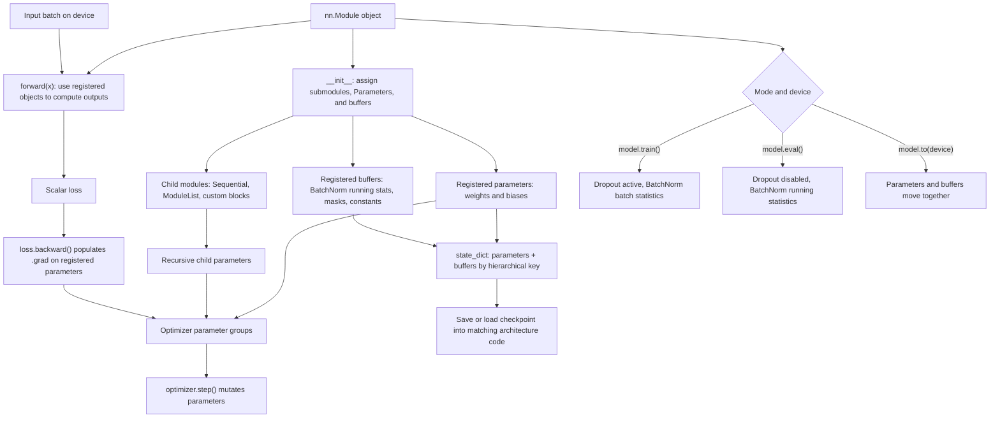

# PyTorch Builders Guide

D2L's builders' guide turns neural networks from formulas into maintainable software. Small demonstrations can fit in a few lines, but larger projects need named modules, reusable layers, controlled initialization, explicit parameter access, serialization, and device management. PyTorch organizes all of these through `nn.Module`.

The division of responsibility is clean: `forward` describes computation, while the module object owns parameters, buffers, and submodules. Correctly registered state can move to a GPU, appear in a `state_dict`, enter an optimizer, and collect gradients. Many difficult PyTorch bugs trace back to a broken registration or device assumption.

## What an `nn.Module` owns

An **`nn.Module`** represents a differentiable component. It may contain parameters, buffers, and other modules. Calling the object invokes `forward` through PyTorch's module wrapper, which preserves hooks and other framework behavior.

A **parameter** is a tensor wrapped in `nn.Parameter`. Assigning one to a module attribute registers it automatically. Registered parameters appear in `model.parameters()` and receive gradients when the forward computation uses them.

A **buffer** is persistent tensor state that is not optimized, such as batch-normalization running statistics. `register_buffer` gives it the same device and serialization behavior as the module without putting it in optimizer parameter groups.

Buffers may be persistent or non-persistent. A persistent buffer appears in `state_dict`; a non-persistent one still follows device transfers but is omitted from checkpoints. A fixed positional encoding that can be regenerated is a possible non-persistent buffer. A plain tensor attribute is neither a parameter nor a buffer, so `.to(device)` does not move it recursively.

A **state dict** is an ordered mapping from hierarchical parameter and buffer names to tensor values. It is the standard weight interchange format. A **custom layer** is simply a module with its own `forward`; it may be parameter-free, like a centering operation, or trainable, like a custom linear transformation.



| PyTorch feature | Correct use | Failure mode |
|---|---|---|
| `nn.Parameter` | Trainable tensor owned by a module | Plain tensor never reaches optimizer |
| `nn.ModuleList` | Dynamic list of child modules | Python list hides submodule parameters |
| `state_dict()` | Save weights and buffers | Whole-object pickle couples data to Python paths |
| `model.train()` | Enable training behavior | BatchNorm or dropout remains in evaluation mode |
| `model.eval()` | Enable evaluation behavior | Dropout remains active during validation |
| `.to(device)` | Move a module or tensor | Model and batch occupy different devices |

## Registration determines what PyTorch can see

Submodule assignment is recursive. If a module stores `self.net = nn.Sequential(...)`, every parameter inside that sequence belongs to the parent. If the same layers live only in an ordinary Python list, PyTorch cannot discover them; use `nn.ModuleList` when the collection must be dynamic.

Parameter creation normally belongs in `__init__`, while `forward` uses those persistent objects. Creating a trainable layer inside `forward` replaces its weights on every call and leaves the optimizer attached to the wrong objects. When an input-dependent shape is genuinely unknown at construction time, `nn.LazyLinear` and the other lazy modules delay initialization until the first input arrives while still registering the result.

The same object can be used more than once. Reusing one `nn.Linear` shares its weights, and gradient contributions from every path accumulate in the same tensors. Creating two layers with equal initial values produces independent parameters instead.

Registration can be inspected rather than guessed. `named_parameters()` and `named_buffers()` yield hierarchical names with their tensors; `named_modules()` includes the module itself and all registered descendants. Before constructing an optimizer, a useful check is to print the trainable names and verify that frozen parameters have `requires_grad=False`.

`ModuleList` registers a collection but defines no computation by itself. The module's `forward` must iterate or index it. `Sequential` both registers and wires a simple one-input-to-one-output chain. `ModuleDict` registers dynamically selected named branches. Ordinary Python containers remain appropriate for metadata or tensors that are intentionally outside module state.

## Modes, gradients, and devices are separate controls

Calling `model.train()` does not run an optimization step. It selects training behavior for modules such as dropout and batch normalization. `model.eval()` selects evaluation behavior but does not turn off autograd. Validation usually combines `model.eval()` with `torch.no_grad()`: the first changes layer semantics, and the second disables gradient recording.

For inference, `torch.inference_mode()` can reduce overhead further than `no_grad()` when its stricter semantics fit the code. Neither context changes dropout or batch normalization mode. Conversely, `.eval()` leaves gradient recording available, which is useful for analyses that need input gradients from an otherwise evaluation-mode model.

Device transfer covers registered parameters and buffers. It does not automatically cover a fresh tensor created in `forward`. A layer that needs zeros or another temporary tensor should use the input's device, often through `x.new_zeros(...)`, rather than calling `torch.zeros(...)` with its default CPU placement.

After validation, training code must call `model.train()` again before resuming updates. Otherwise dropout stays disabled and batch normalization continues to use stored running statistics.

Tensor conversion methods return tensors; they do not generally mutate the Python variable. Write `batch = batch.to(device)`, not merely `batch.to(device)`. The same rule applies to dtype conversion. Parameters should normally use floating or complex dtypes if gradients are required, while class labels for cross-entropy are integer indices.

## The training-step state machine

A standard update has four distinct actions:

```python
optimizer.zero_grad(set_to_none=True)
prediction = model(features)
loss = loss_fn(prediction, targets)
loss.backward()
optimizer.step()
```

`backward()` accumulates into each leaf parameter's `.grad`; it does not replace an existing gradient automatically. Omitting `zero_grad` therefore sums gradients across batches. That behavior is useful for deliberate gradient accumulation, but otherwise silently changes the effective batch and update scale.

Suppose two scalar losses give gradients 3 and 5 for the same parameter. Calling `backward()` on both without clearing leaves `.grad = 8`. If the intention was two optimizer steps, the second should have begun with a cleared gradient. If the intention was one accumulated step over two microbatches, summing is correct, often followed by division through the loss scale so the result matches a mean over the combined batch.

`optimizer.step()` mutates parameters using the stored gradients and any optimizer state. It does not recompute the forward pass. Calling it before `backward()` has no current gradient to use; calling `backward()` again through a graph already freed normally raises an error unless the graph was retained or rebuilt.

## Counting and sharing parameters

### Parameter count for a two-layer MLP

Consider `Linear(10, 8)`, ReLU, and `Linear(8, 3)`. A linear map from $a$ inputs to $b$ outputs owns a $(b,a)$ weight matrix and a $(b)$ bias vector. The first layer has

$$
W_1 \in \mathbb{R}^{8 \times 10},
\qquad
b_1 \in \mathbb{R}^{8},
$$

and therefore

$$
8 \cdot 10 + 8 = 88
$$

parameters. The second has

$$
W_2 \in \mathbb{R}^{3 \times 8},
\qquad
b_2 \in \mathbb{R}^{3},
$$

for another

$$
3 \cdot 8 + 3 = 27.
$$

ReLU has no trainable state, so the total is $88+27=115$. The programmatic check is `sum(p.numel() for p in model.parameters())`.

### Gradient through a tied parameter

Let a scalar parameter appear twice in

$$
y = wx + wx = 2wx.
$$

For $x=3$, target $t=10$, squared loss

$$
\ell = \frac{1}{2}(y-t)^2,
$$

and $w=1$, the prediction is $y=6$ and the residual is $-4$. Therefore

$$
\frac{\partial \ell}{\partial y}=-4,
\qquad
\frac{\partial y}{\partial w}=2x=6,
$$

so

$$
\frac{\partial \ell}{\partial w}
= \frac{\partial \ell}{\partial y}\frac{\partial y}{\partial w}
= (-4)(6)
= -24.
$$

Both uses contribute to the one registered parameter's gradient.

## Initialization and checkpoint boundaries

Initialization is part of the model specification because starting scales affect signal and gradient flow. Apply custom initialization under `torch.no_grad()` or use `torch.nn.init`, whose functions already avoid recording the assignments in the computation graph.

Weights are usually saved and restored as

$$
\text{architecture code} + \text{state dict} \rightarrow \text{restored model}.
$$

This avoids coupling a checkpoint to fragile Python object paths. The class definition still has to match: `state_dict` restores tensor values, not architecture. Its keys and shapes are also useful diagnostics for renamed layers, changed output dimensions, and unregistered submodules.

Reproducible checkpoints need more than weights. Record the architecture settings, preprocessing, class mapping, and any other metadata required to rebuild the model. Set random seeds when a controlled comparison depends on initialization or sampled data order.

An inference checkpoint can contain only model weights and reconstruction metadata. Resuming training also needs optimizer state, the completed epoch or step, scheduler state when present, and usually random-number-generator states. Adaptive optimizers keep moving averages that materially affect the next update; recreating the optimizer from model weights does not reproduce the interrupted trajectory.

Loading should be explicit about trust and placement. A weights-only load restricts what the unpickler can construct, and `map_location` allows a GPU checkpoint to be restored on CPU or another device. Check the result of `load_state_dict`: with the default `strict=True`, missing or unexpected keys are errors. `strict=False` is useful for deliberate transfer learning, but the returned missing and unexpected key lists should still be examined rather than ignored.

Saving `best_state = model.state_dict()` in memory does not freeze a snapshot; the returned tensors reference the module state. Serialize it immediately or deep-copy it if later optimization should not change the saved best weights.

## Building and smoke-testing a custom layer

The example below registers a parameter-free centering layer inside a small MLP, initializes its linear layers explicitly, runs on the available device, and restores a temporary checkpoint.

```python
import os
import tempfile
import torch
from torch import nn

class CenteredLayer(nn.Module):
    def forward(self, x):
        return x - x.mean(dim=0, keepdim=True)

class SmallNet(nn.Module):
    def __init__(self, in_features, hidden, out_features):
        super().__init__()
        self.net = nn.Sequential(
            nn.Linear(in_features, hidden),
            nn.ReLU(),
            CenteredLayer(),
            nn.Linear(hidden, out_features),
        )

    def forward(self, x):
        return self.net(x)

device = torch.device("cuda" if torch.cuda.is_available() else "cpu")
model = SmallNet(10, 8, 3).to(device)

for module in model.modules():
    if isinstance(module, nn.Linear):
        nn.init.xavier_uniform_(module.weight)
        nn.init.zeros_(module.bias)

x = torch.randn(4, 10, device=device)
logits = model(x)
print("logit shape:", logits.shape)
print("parameter count:", sum(p.numel() for p in model.parameters()))

with tempfile.TemporaryDirectory() as tmpdir:
    path = os.path.join(tmpdir, "smallnet.pt")
    torch.save(model.state_dict(), path)
    restored = SmallNet(10, 8, 3).to(device)
    state = torch.load(path, map_location=device, weights_only=True)
    restored.load_state_dict(state)
    restored.eval()
```

Before placing a custom block in a full training job, pass a synthetic tensor through it, check the output shape, reduce to a scalar loss, call `backward`, and confirm that each expected parameter has a gradient. Shape and registration mistakes are much easier to isolate at the block boundary.

For the network above, a compact gradient smoke test is

```python
model.train()
model.zero_grad(set_to_none=True)
loss = model(x).square().mean()
loss.backward()

for name, parameter in model.named_parameters():
    assert parameter.grad is not None, f"missing gradient: {name}"
    assert torch.isfinite(parameter.grad).all(), f"bad gradient: {name}"
```

A missing gradient is not automatically a framework defect. The parameter may be intentionally unused on that branch, detached from the graph, frozen, or involved only in a nondifferentiable operation. The name tells where to start tracing.

## Shape contracts belong at module boundaries

PyTorch layers often accept a range of leading batch dimensions, but the feature dimensions still have precise meanings. Write those expectations down next to `forward`. For a classifier receiving `[batch, features]`, assert `x.shape[-1] == in_features` during early development. For convolutional code, name the convention—usually `[N, C, H, W]`—because a channel-last tensor can have plausible sizes and still be semantically wrong.

Forward hooks can record shapes without editing every layer, but hooks add hidden behavior and should be removed after diagnosis. Direct assertions and small unit tests are easier to maintain. A good block test covers the smallest valid input, a normal batch, the target device and dtype, backward propagation, and train/eval behavior when the block contains stateful layers.

Initialization tests should examine distributions rather than one exact random tensor. A fixed seed helps reproduce failures, but complete reproducibility can still depend on hardware, parallel execution, and algorithm choices. Determinism has a performance cost and should be selected deliberately for experiments that require it.

## Optimizers hold references to specific parameters

Construct the model completely before creating its optimizer. An optimizer stores references to the parameter objects passed at construction. Replacing a layer later creates new parameters that the existing optimizer does not know about, while it may still retain state for parameters no longer used by `forward`.

Changing only parameter values is different from replacing parameter objects. Initialization functions mutate the registered tensors and preserve optimizer references. Assigning `self.weight = nn.Parameter(...)` installs a new object. If architectural mutation is intentional, rebuild or update the optimizer parameter groups and decide what should happen to old momentum or adaptive state.

Freezing a parameter by setting `requires_grad_(False)` prevents new gradients, but the safest fine-tuning setup also excludes frozen parameters from newly constructed optimizer groups. When unfreezing later, add them deliberately with the intended learning rate. Existing stale gradients should be cleared before the transition.

## Buffers for derived tensor state

Suppose a layer needs a fixed vector of per-feature scales during every forward pass. Making it a plain attribute works on the original device but fails after the module moves. Making it a parameter incorrectly exposes it to optimization. A persistent buffer fits when the values belong in a checkpoint; a non-persistent buffer fits when they can be rebuilt from constructor settings.

Buffers are still mutable state. Updating a running statistic should occur under the intended train/eval policy and without building an unwanted autograd history. State that changes according to batches affects reproducibility and checkpoint equivalence, even though no optimizer updates it. Inspecting only `model.parameters()` misses that part of the model.

## A checkpoint is also an interface version

Hierarchical state-dict keys encode attribute names and container positions. Renaming `encoder.blocks.2` or changing a sequential order changes that interface. A migration can rename keys before loading, initialize newly added tensors, and reject shape changes that cannot be interpreted safely.

`strict=False` suppresses the final mismatch exception; it does not decide whether skipped weights are acceptable. Log every missing and unexpected key and assert the expected migration pattern. Accidentally loading nothing into a renamed backbone can otherwise look like a successful warm start.

Store a small format version and the constructor configuration beside long-lived weights. The version tells loading code which migrations apply, while the configuration rebuilds dimensions and options. Arbitrary executable model objects are harder to inspect, more tightly coupled to source layout, and unsafe to deserialize from untrusted origins.

<div className="see-also">

See also: [Multilayer perceptrons and regularization](/cs/deep-learning/multilayer-perceptrons-regularization) · [Convolutional neural networks](/cs/deep-learning/convolutional-neural-networks) · [Computational performance](/cs/deep-learning/computational-performance) · [Machine learning](/cs/machine-learning/intro) · [Linear algebra](/math/linear-algebra/intro)

</div>
