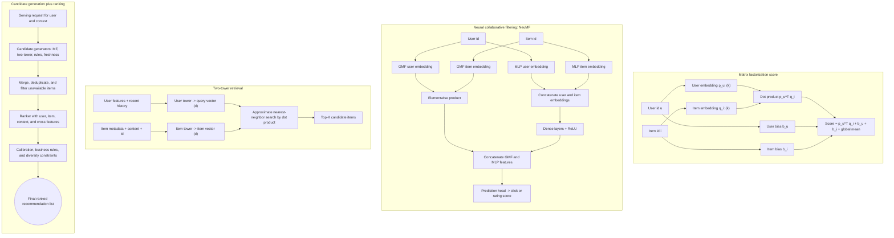

# Recommender Systems

D2L's recommender-system material covers a setting where deep learning meets sparse user-item interaction data. The system predicts what a user may like, click, buy, watch, or rate. Most possible interactions are missing, feedback may be explicit or implicit, and no interaction does not necessarily mean negative preference.

Collaborative filtering, matrix factorization, autoencoders, factorization machines, neural collaborative filtering, and sequence-aware models all learn from observed behavior. Their common core is a scoring function over users, items, and sometimes context; their differences lie in what they represent and how they construct training comparisons.

## The interaction matrix is mostly unknown

Let $R \in \mathbb{R}^{m \times n}$ be a user-item matrix, where $R_{ui}$ records a rating or interaction for user $u$ and item $i$. Most entries are unobserved.

**Collaborative filtering** uses patterns across users and items without requiring explicit item content, though hybrid systems may add metadata. **Explicit feedback** includes ratings and likes. **Implicit feedback** includes clicks, views, dwell time, purchases, and other behavioral signals.

Missing data has different meanings in the two settings. For an explicit-rating objective, only observed entries should normally contribute:

$$
\sum_{(u,i)\in \Omega}(R_{ui}-\hat{r}_{ui})^2
+ \lambda\left(\sum_u\|p_u\|^2+\sum_i\|q_i\|^2\right),
$$

where $\Omega$ is the observed set. Treating every other entry as a zero rating introduces a biased target. For implicit feedback, an unobserved item may have been disliked, ignored, or never exposed to the user, so negative sampling and confidence weighting become part of the model definition.

## Low-rank scores and bias terms

Matrix factorization assigns user vectors $p_u \in \mathbb{R}^k$ and item vectors $q_i \in \mathbb{R}^k$, then predicts

$$
\hat{r}_{ui} = p_u^T q_i + b_u + b_i + \mu.
$$

With $P \in \mathbb{R}^{m \times k}$ and $Q \in \mathbb{R}^{n \times k}$, the interaction component has low-rank form

$$
\hat{R}=PQ^T.
$$

The bias terms absorb broad effects that latent interactions should not have to explain. Some users rate generously, some items are popular, and each dataset has a global rating level. Exposure can make popularity bias even stronger in implicit logs.

### Computing one rating

Take $p_u=[1,2]$, $q_i=[3,1]$, $b_u=0.2$, $b_i=-0.1$, and $\mu=3.5$. The dot product is

$$
p_u^Tq_i = 1(3)+2(1)=5,
$$

so

$$
\hat{r}_{ui}=5+0.2-0.1+3.5=8.6.
$$

The unbounded prediction exceeds a $1$--$5$ rating scale. A rating model may clip, constrain, or transform its output; a ranking model can treat the value as an unrestricted preference score.

## What richer recommenders add

An **autoencoder recommender** reconstructs a user's interaction vector from a compressed hidden representation. A **factorization machine** models pairwise interactions among arbitrary sparse features:

$$
\hat{y}(x)=w_0+\sum_i w_ix_i+\sum_{i<j}\langle v_i,v_j\rangle x_ix_j.
$$

This covers user, item, context, and device features without explicitly materializing every cross feature. **Neural collaborative filtering** replaces or augments the dot product with a neural network over user and item embeddings. **Sequence-aware recommendation** uses RNNs, CNNs, attention, or transformers to predict from ordered history and capture current intent.

| Method | Main representation | Strength | Caution |
|---|---|---|---|
| User-based CF | Similar users | Simple intuition | Sparse data problems |
| Item-based CF | Similar items | Stable item relations | Cold-start items |
| Matrix factorization | User/item latent factors | Scalable baseline | Dot product may be too simple |
| Autoencoder | Compressed interaction vector | Nonlinear reconstruction | Missing-data handling |
| Factorization machine | Feature interaction factors | Works with side features | Pairwise interaction design |
| Neural CF | Embeddings plus MLP | Flexible scoring | More data and tuning needed |
| Sequence-aware | Ordered history | Captures current intent | More complex evaluation |

### One factorization-machine interaction

Suppose $x_1=1$, $x_2=1$, and $x_3=0$, with latent vectors $v_1=[1,0]$, $v_2=[2,3]$, and $v_3=[4,1]$. The pairwise term is

$$
\sum_{i<j}\langle v_i,v_j\rangle x_ix_j.
$$

Only the first two features are jointly active:

$$
\langle v_1,v_2\rangle = 1(2)+0(3)=2.
$$

Every pair involving $x_3$ contributes zero, leaving a total interaction of $2$. Sparse one-hot data only activates a small fraction of the available feature pairs.

## Retrieval and ranking solve different scale problems

Scoring every catalog item with a rich model can be too expensive. Large systems commonly retrieve a manageable candidate set with matrix factorization, a two-tower model, rules, or freshness signals, then apply a slower ranker with cross features and business constraints.



The scoring subgraphs separate a simple dot product, NeuMF's combined generalized-matrix-factorization and MLP paths, and a two-tower model that supports approximate retrieval. The serving path adds filtering, freshness, calibration, and diversity around those learned scores.

## The objective must match the candidate set

A pointwise objective predicts a rating or click label for one pair. A pairwise objective trains an observed item to outrank an unobserved or less preferred item. A listwise objective operates on a ranked set more directly. Squared-error matrix factorization is pointwise; implicit-feedback models often use pairwise ranking losses.

The choice of negatives depends on the intended question: rank among exposed items, rank across the full catalog, or predict the next item in a session. Training and evaluation candidate sets must agree. Otherwise a model can score well on an artificial sampled task while failing at catalog retrieval.

Neural models can fit exposure artifacts more readily than simple baselines. An unseen user or item also has no reliable interaction embedding, so cold-start evaluation should be reported separately and usually requires metadata, onboarding signals, or fallback policies.

Recommendations change later observations. Showing an item can create a click or purchase that would never appear under another policy, making offline logs an incomplete and partly causal view of preference.

## Splits and metrics should resemble deployment

Random interaction splits can leak future behavior into training while testing on earlier events. Time-based splits better represent next-item deployment, while user-level holdouts test a distinct cold-start problem.

Rating RMSE answers a point-prediction question. A product that displays a short list usually cares more about precision@k, recall@k, hit rate, or NDCG. Baselines matter here: item popularity, item-based collaborative filtering, and matrix factorization establish whether a more flexible neural scorer earns its added cost.

## A matrix-factorization baseline in PyTorch

```python
import torch
from torch import nn

torch.manual_seed(10)

users = torch.tensor([0, 0, 1, 1, 2, 2])
items = torch.tensor([0, 1, 1, 2, 0, 2])
ratings = torch.tensor([5.0, 4.0, 4.0, 1.0, 1.0, 5.0])

class MatrixFactorization(nn.Module):
    def __init__(self, num_users, num_items, factors):
        super().__init__()
        self.user = nn.Embedding(num_users, factors)
        self.item = nn.Embedding(num_items, factors)
        self.user_bias = nn.Embedding(num_users, 1)
        self.item_bias = nn.Embedding(num_items, 1)
        self.global_bias = nn.Parameter(torch.zeros(1))

    def forward(self, u, i):
        dot = (self.user(u) * self.item(i)).sum(dim=1)
        bias = self.user_bias(u).squeeze(1) + self.item_bias(i).squeeze(1)
        return dot + bias + self.global_bias

model = MatrixFactorization(num_users=3, num_items=3, factors=4)
optimizer = torch.optim.Adam(model.parameters(), lr=0.05, weight_decay=1e-4)
loss_fn = nn.MSELoss()

for _ in range(200):
    pred = model(users, items)
    loss = loss_fn(pred, ratings)
    optimizer.zero_grad()
    loss.backward()
    optimizer.step()

print("training RMSE:", torch.sqrt(loss_fn(model(users, items), ratings)).item())
print("score user 0 item 2:", model(torch.tensor([0]), torch.tensor([2])).item())
```

This tiny dataset only demonstrates parameterization and optimization. It does not test ranking, cold start, exposure bias, or generalization; those require a time-aware held-out protocol and a candidate set that reflects the intended service.

<div className="see-also">

See also: [Machine learning](/cs/machine-learning/intro) · [NLP pretraining and applications](/cs/deep-learning/nlp-pretraining-and-applications) · [Attention and transformers](/cs/deep-learning/attention-transformers) · [Probability and random variables](/math/probability-and-random-variables/intro) · [Linear algebra](/math/linear-algebra/intro)

</div>
